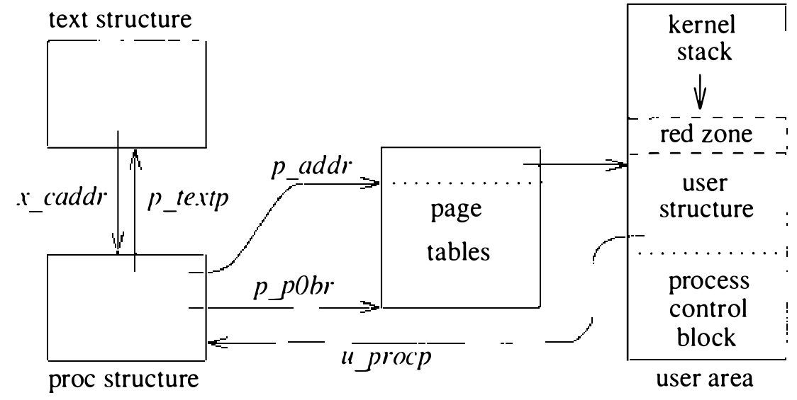
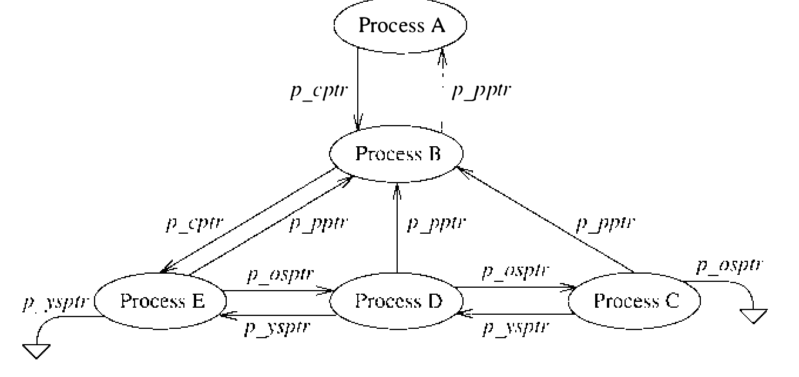
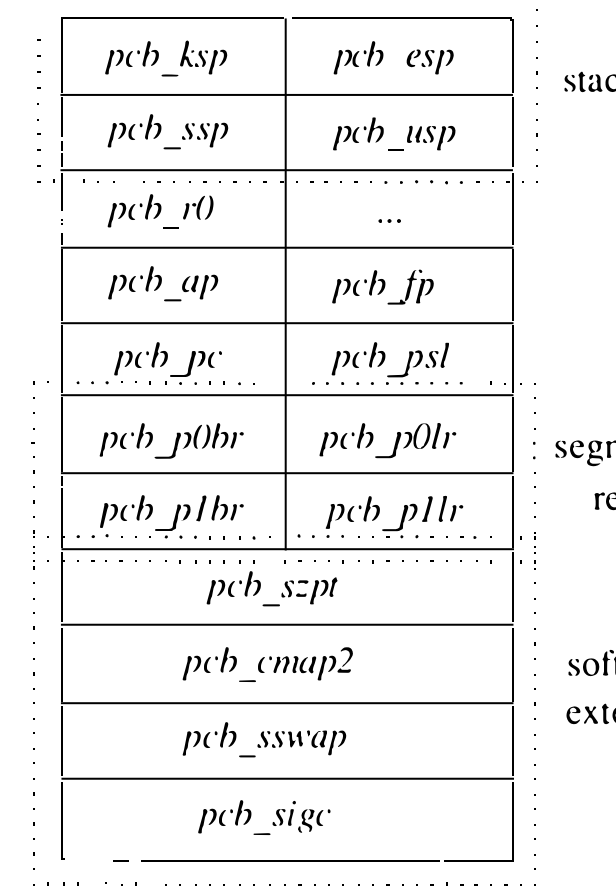

# 4.2 进程状态

描述进程状态的数据结构有若干个，如图 4.1 所示。其中一些必须始终驻留主存，另一些在内存资源紧张时可移到辅存。proc 结构和正文结构是必须始终驻留主存的两个数据结构。user 结构和进程页表只在进程驻留并运行时才需要。以下各节描述这些结构与进程管理相关的部分。正文结构和页表在第 5 章有更完整的描述。

**proc 结构**

proc 结构包含必须始终驻留内存的进程状态，如表 4.1 所示。这些状态在逻辑上分为若干类信息：

表 4.1 进程数据结构

| 类别 | 名字 | 描述 |
| ---- | ---- | ---- |
| 调度 | `p_pri` | 当前优先级；负值为高 |
| | `p_usrpri` | 基于 `p_cpu` 和 `p_nice` 的用户优先级 |
| | `p_nice` | 用户请求的调度优先级 |
| | `p_cpu` | 近期 CPU 使用 |
| | `p_slptime` | 睡眠时长 |
| 标识 | `p_pid` | 唯一的进程标识符 |
| | `p_ppid` | 父进程标识符 |
| | `p_uid` | 用户标识符 |
| 存储管理 | `p_textp` | 指向可执行文件描述的指针 |
| | `p_p0br` | 指向进程页表的指针 |
| | `p_szpt` | 进程页表的大小 |
| | `p_addr` | 用户区的位置 |
| | `p_swaddr` | 换出时用户区的位置 |
| 同步 | `p_wchan` | 进程等待的事件 |
| 信号 | `p_sig` | 待投递信号掩码 |
| | `p_sigignore` | 被忽略信号掩码 |
| | `p_sigcatch` | 被捕获信号掩码 |
| | `p_pgrp` | 进程组标识符 |
| 资源记账 | `p_rusage` | 指向 `rusage` 结构的指针 |
| | `p_quota` | 指向磁盘配额结构的指针 |
| 计时器管理 | `p_time` | 计时器到期的剩余实时时间 |

* **调度**：进程优先级、用户态调度优先级、近期 CPU 利用和睡眠时长。

* **标识**：进程标识符、父进程标识符和实际用户标识符。

* **存储管理**：指向管理共享正文段所用正文表项的指针、指向进程页表的指针、当前驻留主存的页集大小，以及用户结构和页表换出到辅存时的地址。

* **同步**：等待通道（wait channel），描述进程正在等待的事件（见下一节）。

* **信号**：待投递的信号及信号投递给进程时要采取的动作，外加进程组。

* **资源记账**：描述系统提供的多种资源利用情况的 `rusage` 结构（见 3.8 节），以及指向磁盘配额的指针。

* **计时器管理**：实时计时器到期的剩余时间。

进程的状态取表 4.2 所示的值。进程最初由 `fork` 系统调用创建时，先标记为 SIDL；分配到足够的资源可以开始执行后，状态改为 SRUN。此后，进程的状态将在 SRUN（可运行）、SSLEEP（等待事件）和 SSTOP（被信号或父进程停止）之间起伏，直到进程终止。已故进程标记为 SZOMB，直到其终止状态传达给父进程。

表 4.2 进程状态

| 状态 | 描述 |
| ---- | ---- |
| SSLEEP | 等待一个事件 |
| SRUN | 可运行 |
| SIDL | 进程创建中的过渡状态 |
| SZOMB | 进程终止中的过渡状态 |
| SSTOP | 进程被停止或正被跟踪 |

系统把 proc 结构组织成三条链表，以加快按进程状态查找。这些链表由 proc 结构的 `p_nxt` 字段串起。使用中的进程表项，或在 `zombproc` 链上（进程处于 SZOMB 态时），或在 `allproc` 链上。未使用的进程表项在 `freeproc` 链上。

除当前执行的进程外，多数进程还身在两种队列之一：运行队列（run queue）或睡眠队列（sleep queue）。处于可运行状态的进程放在运行队列上，阻塞等待事件的进程位于睡眠队列上。被停止且不等待事件的进程不在任何一种队列上。两种队列都组织成双向链表的数组，使用 proc 结构中的 `p_link` 和 `p_rlink` 字段。运行队列按进程调度优先级组织，见 4.4 节。睡眠队列组织成散列数据结构，优化按进程所等待的事件号（等待通道）查找睡眠进程。睡眠队列见 4.3 节。

proc 结构 `p_flag` 字段中的标志展示进程操作状态的额外信息，如表 4.3 所示。这些标志多数供内核在可能涉及一次或多次上下文切换的操作中标记瞬态。另一些标志用来记录用户传达的信息（SSEQL、SUANOM、SOUSIG）或系统推断的信息（SSYS）。各标志的用途在后文遇到时描述（SLOGIN 见 13.4 节）。

表 4.3 进程标志

| 标志 | 描述 |
| ---- | ---- |
| SLOAD | 进程已装入主存 |
| SSYS | 系统创建的进程（如 swapper 或调页守护进程） |
| SLOCK | 进程正被换出 |
| SSWAP | 交换后的替代返回 |
| STRC | 进程正被调试 |
| SWTED | 另一个调试标志 |
| SOUSIG | 进程使用旧信号机制 |
| SULOCK | 用户请求不换出该进程 |
| SPAGE | 进程正等待取回页面 |
| SKEEP | 内核需要该进程留在内存 |
| SOWEUPC | 进程在采集系统调用计时信息 |
| SOMASK | 收到信号后恢复旧掩码 |
| SWEXIT | 进程正在退出 |
| SPHYSIO | 进程在做物理 I/O |
| SVFORK | 进程由 `vfork()` 产生 |
| SNOVM | `vfork()` 期间子进程持有父进程的虚拟内存 |
| SVFDONE | `vfork()` 期间子进程已把虚拟内存还给父进程 |
| SPAGI | 按需从文件系统调入数据空间 |
| SSEQL | 用户告知顺序的虚拟内存行为 |
| SUANOM | 用户告知随机的虚拟内存行为 |
| STIMO | 睡眠中超时 |
| SSEL | 进程在 select；发生 wakeup 时清除 |
| SLOGIN | 登录进程 |
| SPTECHG | 进程的页表已改变 |

系统中的每个进程都被赋予一个唯一的标识符，称为进程标识符（PID）。PID 是应用程序和内核引用进程的通用机制。应用程序向进程发信号、从已故进程接收退出状态时都要用 PID。对每个进程来说有两个 PID 特别重要：进程自己的 PID 和父进程的 PID。

`p_pgrp` 字段及相关链接（`p_pptr`、`p_cptr`、`p_osptr` 和 `p_ysptr`）用于定位后代进程，如图 4.2 所示。进程派生子进程时，从父到子在 `p_cptr` 字段建立前向链接，从子到父的回链保存在 `p_pptr` 字段。如果一个进程同时有多个活跃子进程，子进程们链接在一起：最年长的子进程经 `p_ysptr` 前向链接到年幼的兄弟，经 `p_osptr` 反向链接。图 4.2 中，进程 B 是进程 A 的直接后代，进程 C、D、E 是 B 的后代且互为兄弟。进程 B 通常是启动了一条管道线（见 2.4 节和 2.6 节）的 shell，管道线包括进程 C、D、E。进程 A 大概是系统初始化进程 `init`（见 3.1 节和 13.4 节）。

进程组（process group）是一组被赋予同一进程组标识符的相关进程，例如 shell 建起的一条管道线。进程组是信号设施的组成部分。`killpg` 系统调用可用来向一个进程组中的所有进程广播（broadcast）信号。图 4.2 中，进程 C、D、E 通常会放在与进程 A、B 不同的进程组里。这种分隔使 C、D、E 所代表的作业可以作为一组来启动、停止、调入前台或放入后台。终端 I/O 系统（第 9 章描述）通过任一时刻只允许一个进程组关联到终端来同步对终端的访问。这一同步设施加上进程组和信号机制，构成 4.7 节描述的作业控制设施的基础。

CPU 时间按调度优先级（scheduling priority）分给进程。一个进程有两个调度优先级：一个用于调度用户态执行，一个用于调度内核态执行。proc 结构的 `p_usrpri` 字段含用户态调度优先级，`p_pri` 字段保存当前内核态调度优先级。进程在内核态执行时，当前优先级可以不同于用户态优先级。优先级取值 0 到 127，值越小优先级越高（见表 4.4）。用户态优先级从 PUSER（50）到 127；小于 PUSER 的优先级只在进程睡着（sleeping，即在内核中等待事件）时以及这种进程刚被唤醒后使用。睡着且优先级介于 PZERO 与 PUSER 之间的内核进程可被信号唤醒；而优先级低于 PZERO 的睡眠进程永不会被信号唤醒。这条规则是必要的，可防信号干扰必须原子完成的磁盘传输之类的操作。

表 4.4 进程调度优先级

| 优先级 | 值 | 描述 |
| ---- | ---- | ---- |
| PSWP | 0 | 交换进程时的优先级 |
| PINOD | 10 | 等待文件控制信息时的优先级 |
| PRIBIO | 20 | 等待磁盘 I/O 完成时的优先级 |
| PZERO | 25 | 基线优先级 |
| PWAIT | 30 | 等待资源的基础优先级 |
| PLOCK | 35 | 等待资源锁的基础优先级 |
| PSLEP | 40 | 等待事件的基础优先级 |
| PUSER | 50 | 用户态执行的基础优先级 |

优先级的排序自第六版以来未曾变动。所有内核优先级必须优于分配给用户进程的优先级。由于优先级编码了系统调用能否被信号中止，取值在 PZERO 之上还是之下很重要。用优先级指明系统调用能否被信号打断，是早期 UNIX 内核为节省正文空间而实现的：与其给在很多地方被调用的 `sleep()` 例程加一个参数，不如把值编码进优先级里。

**user 结构**

user 结构（因为 C 中所有引用都形如 `u.`，也称 u. 结构（u-dot））包含可以换出到辅存的进程状态。这些状态包括：

* 用户态和内核态执行状态
* 与系统调用相关的状态
* 描述符表
* 记账信息
* 资源控制
* 内核使用的每进程执行栈

对 VAX 而言，进程当前的执行状态封装在一个 VAX 进程控制块（PCB）中。这一结构（图 4.3）由 VAX 体系结构定义，包括通用寄存器、栈指针、程序计数器、处理器状态长字和段基址与长度寄存器。除硬件要求的信息外，还添加了四个由内核操纵的字段：进程页表的大小、上下文切换和段复制所用的两个指针，以及实现信号投递用的一小段代码。

user 结构映射到 VAX 虚拟地址空间的固定位置，并标记为用户态可读。user 结构在用户态可读，使信号投递得以更高效地实现（见 4.7 节）。

内核栈位于 user 结构中，把进程的全部内核态状态收拢到单一结构里，简化了上下文切换。但这一设计也把栈限制为固定大小，要求实现者在编写内核代码时小心从事：内核代码必须避免大的局部变量和深度嵌套的子例程调用，以免运行时栈溢出。VAX 的 4.3BSD 系统为每个 user 结构分配 10 页、每页 512 字节。内核栈自 user 结构顶端向下生长。user 结构的定长部分（含 PCB）约 2300 字节，其结束处上面的一页标记为无效。这样，内核栈溢出将引发内核访问故障，而不是覆写 user 结构的定长部分酿成灾难性后果。扣除这些开销后，留给内核运行时栈的约有 2050 字节。由于中断处理在独立的中断栈上进行，user 结构中内核栈的大小只限制因陷阱和系统调用而执行的代码。

**内存**

进程使用的内存由 proc 和 user 结构中的字段描述。进程的用户态执行状态由 PCB 及页表中的信息描述，页表说明进程内存的哪些页当前驻留主存。进程执行之前，它的页表必须装入内存，并把适当的 VAX 存储管理寄存器设为指向它们。为讨论进程管理，我们将忽略存储管理的多数细节，假定内存资源是可用的。第 5 章讨论系统如何管理内存，并详述执行上下文切换所需的与内存相关的动作。

**正文结构**

4.3BSD 支持共享存放纯代码（pure code，即不可修改的代码）的内存。这些内存区域每一个都称为共享正文段，由一个正文结构描述。程序映像经 `execve` 系统调用装入时，若代码段标记为 pure，系统会把映像的正文段与已初始化、未初始化数据段分开装入，并创建一个描述该装入映像的正文结构。（映像未必完全进入内存，可以按需调页。）此后对同一映像的执行可以引用正文结构所描述的资源来共享正文段。共享正文的进程创建和上下文切换在本章讨论；共享正文的存储管理见第 5 章。
