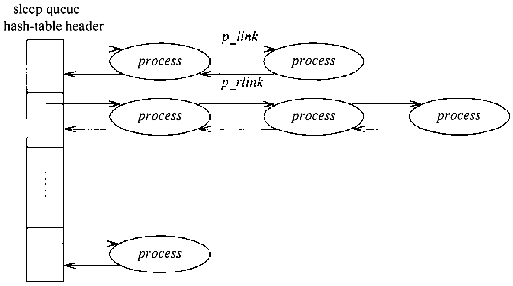
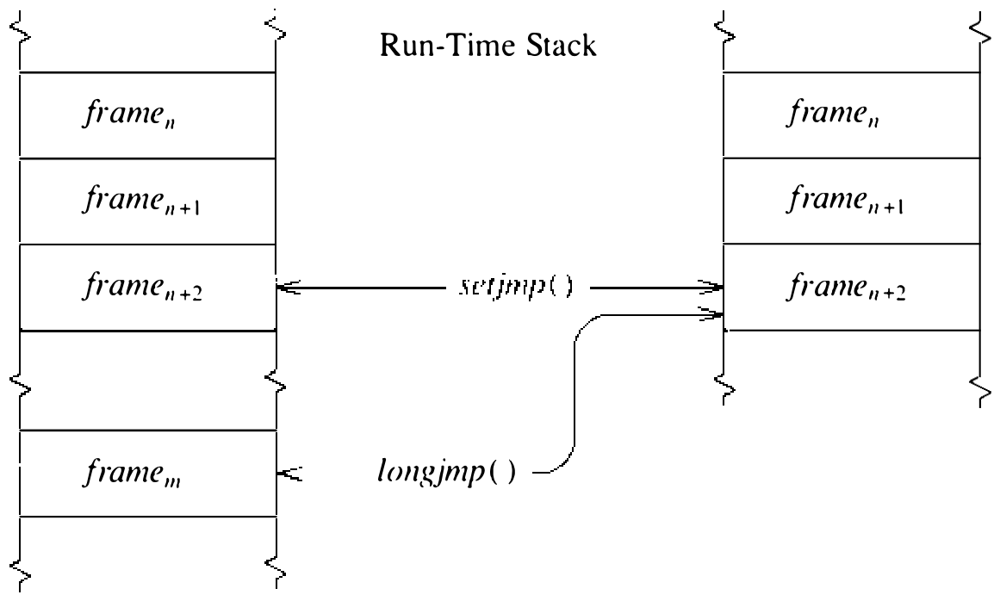

# 4.3 上下文切换

内核在进程之间切换，以便有效共享 CPU；这称为上下文切换（context switching）。进程用满时间片，或因需要当前不可用的资源而阻塞时，内核另找一个进程运行并切换过去。系统也会中断当前执行的进程去服务异步事件（如设备中断）。两种情形虽然都涉及切换 CPU 的执行上下文，但进程之间的切换相对于当前执行的进程是同步的，而中断服务相对于当前进程是异步的。此外，进程间的上下文切换分为自愿（voluntary）与非自愿（involuntary）两类：进程因需要不可用的资源而阻塞时发生自愿切换；进程用满时间片或系统发现更高优先级进程要运行时发生非自愿切换。

每类上下文切换经不同的接口完成。自愿上下文切换由对 `sleep()` 例程的调用发起；非自愿上下文切换由对底层切换机制（体现于 `swtch()` 和 `resume()` 例程）的直接调用强制执行。异步事件的处理由底层硬件管理，对系统实际上透明。我们对异步事件处理的讨论将集中于它如何关系到内核数据结构的访问同步。

**进程状态**

进程之间的上下文切换要求内核态和用户态上下文都更换；为便于做到，系统保证进程的全部用户态状态位于一个数据结构——user 结构中（有些内核状态放在别处）。这一收拢遵循以下约定：

* **内核态硬件执行状态**。上下文切换只能在内核态发生。因此，内核的硬件执行状态由位于 user 结构开头的 PCB 内容定义。

* **用户态硬件执行状态**。在内核态执行期间，进程的用户态状态（程序计数器、栈指针、通用寄存器的副本）总是驻留在位于 user 结构中的内核执行栈上。内核要求系统调用和陷阱处理程序在每次进入内核时保存用户态执行上下文的内容，从而保证用户态状态总是位于这一位置（见 3.1 节）。

* **proc 结构**。proc 结构始终驻留内存，因此指向该结构的指针可以安全地保存在 user 结构中。

* **正文结构**。同样，进程使用的任何共享正文都由正文表中的一个表项定义，而正文表也是永久驻留的数据结构。于是指向正文结构的指针可以保存在 proc 结构中。

* **内存资源**。最后，进程的内存资源实际由 PCB 中基址和长度寄存器的内容以及 proc 结构中的值描述。只要进程留在内存中，这些值就保持有效，上下文切换不必保存和恢复相关页表。进程换到辅存之后，这些值则需在进程回到主存时重新计算。

**低层上下文切换**

把进程的上下文收拢到它的 user 结构中，使内核只需切换“当前 user 结构是谁”的认定即可完成上下文切换。为让 user 结构的切换在 VAX 上尽可能高效，系统把每个进程 user 结构所在的物理内存映射到用户态虚拟地址空间顶端的一个固定位置。（该位置在内核地址空间中也在固定虚拟地址上。）既然用户态虚拟内存映射由进程 PCB 中维护的值定义，进程之间——也就是 user 结构之间——的切换就只是交换 PCB。VAX 体系结构为此专门设计了两条指令和一个特权寄存器。进程控制块基址（PCBB）寄存器保存当前进程 PCB 的物理地址。`svpctx` 指令把当前机器状态保存到当前 PCB，`ldpctx` 指令从当前 PCB 装载当前机器状态。两个进程之间的交换这样完成：

```asm
svpctx    # 把当前状态保存到当前 PCB
...       # 装载新 PCB 的地址，然后……
ldpctx    # ……从该 PCB 建立状态
```

这些低层细节隐藏在 `swtch()` 和 `resume()` 例程内部。需要上下文切换时，调用 `swtch()` 例程使最高优先级的进程运行。`swtch()` 先从调度队列选出合适的进程，再带着装载 PCBB 寄存器所需的信息调用 `resume()`。`resume()` 执行 `ldpctx` 指令恢复新进程的执行状态之后，还必须检查新进程是否有非局部返回请求（例如进程在 `fork` 之后首次开始执行时；见 4.5 节）。

**自愿上下文切换**

进程必须等待资源可用或事件到来时，发生自愿上下文切换。正常系统运行中自愿切换频繁发生：例如，进程每次从终端这样的慢速输入设备请求数据时通常都会阻塞。UNIX 中，自愿上下文切换经 `sleep()` 例程发起。进程不再需要 CPU 时，以一个等待通道和一个调度优先级调用 `sleep()`。等待通道通常是某个数据结构的地址，标识进程等待的资源或事件。常用的等待通道地址有：

| 等待通道 | 含义 |
| ---- | ---- |
| `lbolt` | 等待至多 1 秒 |
| `proc` | 等待子进程终止 |
| `u` | 等待信号 |
| `buf` | 等待块 I/O 操作完成 |

`sleep()` 调用中指定的优先级，是进程被唤醒时应赋予的优先级，不影响用户级调度优先级。睡眠进程组织在队列数组中（见图 4.4）。`sleep()` 和 `wakeup()` 例程把等待通道散列，算出睡眠队列的下标。



**图 4.4 睡眠进程的排队结构**

`sleep()` 例程的操作步骤如下：

1. 把硬件处理机优先级提升到 `splhigh`，阻止可能引起进程状态转换的中断。

2. 把等待通道记入 proc 结构，并对等待通道的值做散列，找到进程的睡眠队列。

3. 把进程的优先级设为进程被唤醒时将具有的优先级。

4. 把进程放在第 2 步所选睡眠队列的末尾。

5. 调用 `swtch()` 请求调度一个新进程；切换到另一进程时，硬件优先级被隐式复位。

睡眠进程在被摘下睡眠队列并标记为可运行之前，不会被选中执行。这一操作由 `wakeup()` 例程完成。以 PZERO 到 PUSER 之间的优先级入睡的进程是可中断的：若有信号投递给它，它可以被唤醒并标记为可运行。例如，等待终端输入的进程将以可中断优先级等待。否则，睡眠进程不可中断：在所等待的事件发生之前不会被调度运行。例如，等待磁盘 I/O 的进程以不可中断优先级入睡。

进程通常以不可中断优先级入睡，以便等待期间持有内核资源。以可中断优先级入睡的进程，可能因等待的事件尚未发生而信号先到，被迫中止系统调用。为了避免永久占用内核资源，这些进程必须在入睡之前释放占有的资源。由于可中断睡眠要多做准备工作，只有进程必须等待可能很久都不发生的事件时才用它。偶尔，本该很快发生的事件（如磁带 I/O）会因硬件故障而卡住。进程在内核中以不可中断优先级睡着，任何信号都撼不动它——连应使它无条件退出的信号也一样。

`wakeup()` 例程被调用来通报事件已发生或资源已可用。`wakeup()` 带一个等待通道被调用，唤醒所有睡在该等待通道上的进程。`wakeup()` 操作从队首到队尾处理睡眠队列上的表项。对每个需要唤醒的进程，`wakeup()`：

1. 把进程从睡眠队列摘除。

2. 若进程已睡眠超过 1 秒，重算其用户态调度优先级。

3. 若进程处于 SSLEEP 态，将其置为可运行；若未被换出主存，放入运行队列；若已被换出，唤醒 `swapin` 进程把它装回内存（见 5.13 节）；若进程处于 SSTOP 态，则留在队列上，直到被用户级进程显式重启——用 `ptrace` 系统调用或继续信号（见 4.7 节）。

如果 `wakeup()` 把进程移入了运行队列，而其中某一个的调度优先级高于当前执行的进程，`wakeup()` 还会请求尽快重新调度 CPU。

`sleep()` 和 `wakeup()` 最常见的用途是调度对共享数据结构的访问；这一用法在本章后面的同步一节描述。

**进程内上下文切换**

除进程间的上下文切换机制外，系统还提供执行非局部跳转（nonlocal goto）的机制。它允许一个例程把控制转移到执行栈上方的某个调用例程处，如图 4.5 所示。非局部跳转通常用于处理应中止进行中操作的异常情况。例如，内核处理系统调用期间收到信号，可以中止该调用，把控制交回系统调用处理程序，由它向应用返回错误码。



**图 4.5 非局部跳转的栈帧管理**

非局部跳转用 `setjmp()` 和 `longjmp()` 例程实现，与 C 库例程 `setjmp()` 和 `longjmp()` 类似。`setjmp()` 例程保存关于当前栈帧的最少信息，使随后的 `longjmp()` 调用能把执行栈回退到当初 `setjmp()` 调用处。`setjmp()` 首次被调用时返回值为零；`longjmp()` 的调用使 `setjmp()` 第二次返回，带回非零值。`setjmp()` 保存的状态通常包括内核态帧指针和程序计数器。进程换出自己时，它做的最后一件事是请求把自己的 u. 区（包括内核栈）写到后备存储。磁盘中断所宣告的这一 I/O 操作可能在进程还来不及调用 `sleep()` 之前就开始了。因此，发起 I/O 请求之前必须保存所有通用寄存器的内容，进程从辅存换回时才能成功启动。`savectx()` 和 `ldctx()` 例程用于这些场合。

非局部跳转在系统中用得很节制，从不嵌套。user 结构中的两个表项 `u_qsave` 和 `u_ssave`，分别用来保存在信号打断系统调用时、以及在从辅存换回后恢复执行上下文时做非局部跳转所需的状态。一个更通用、可嵌套的异常处理设施，会有助于降低系统某些部分的复杂度。

**同步**

对资源的进程间同步通常靠给资源关联两个标志实现：locked 标志和 wanted 标志。进程想访问资源时，先检查 locked 标志。若资源当前未被别的进程使用，该标志不应置位，进程径直置起 locked 标志并使用资源。若资源正被使用，进程就置起 wanted 标志，以与该资源关联的等待通道（通常是描述该资源的数据结构的地址）调用 `sleep()`。进程不再需要资源时，清除 locked 标志；若 wanted 标志已置位，再调用 `wakeup()` 唤醒所有为等该资源而调用过 `sleep()` 的进程。

在内核下半部运行的例程没有上下文，因此不能靠 `sleep()` 等待资源可用。内核上半部访问与下半部共享的资源时，不能用 locked 标志保证独占使用，而必须在使用资源期间阻止下半部运行。与下半部例程同步访问，需要知道这些例程何时可能运行。这一点虽依赖机器，但多数 UNIX 实现的中断优先级排序如表 4.5 所示。要屏蔽某优先级及以下的中断例程，须做适当的设置优先级调用。例如，进程需要操纵终端的数据队列时，访问队列的代码按如下风格编写：

```c
s = spltty();     /* 提升优先级以屏蔽 tty 处理 */
 ...              /* 操纵 tty */
splx(s);          /* 把优先级恢复为先前的值 */
```

**表 4.5 VAX 中断优先级指派**

| 名称 | 优先级 | 屏蔽 |
| ---- | ---- | ---- |
| `spl0()` | 0 | 无（正常操作模式） |
| `splsoftclock()` | 8 | 低优先级时钟处理 |
| `splnet()` | 12 | 网络协议处理 |
| `spl4()` | 20 | 低优先级设备 |
| `spltty()` | 21 | 终端多路复用器 |
| `splbio()` | 21 | 磁盘和磁带控制器 |
| `splimp()` | 22 | 网络设备控制器 |
| `splclock()` | 24 | 高优先级时钟处理 |
| `splhigh()` | 31 | 全部中断活动 |

锁定多个资源时，进程必须小心避免死锁。设进程 A、B 都需要资源 R₁ 和 R₂ 来做某操作：若 A 取得 R₁、B 取得 R₂，那么当 A 想取 R₂、B 想取 R₁ 时就发生死锁。由于在内核态执行的 UNIX 进程绝不会被其他进程抢占，锁定多个资源相对简单，但必须谨慎。如果进程知道做某操作需要多个资源，它可以按任意次序安全地锁定其中一个或多个，只要它绝不自愿交出 CPU。若进程无法取得所需的全部资源，则必须在调用 `sleep()` 等待当前不可得的资源之前，释放它持有的任何资源。

另一种办法：若资源可以偏序，则只需按递增次序分配。例如，`namei()` 例程遍历文件系统名字空间时，必须先锁住路径名的下一成分，再释放当前成分。名字空间从根到叶存在路径名成分的偏序。因此沿名字树向下的翻译可以放心请求下一成分的锁，不必担心死锁。但沿名字树向上遍历（即跟随 dot-dot（..）路径名成分）时，内核必须小心，持有任何锁时不可入睡。

提升处理机优先级以防中断活动的办法适用于单处理机体系结构，对共享内存的多处理机则不行。同样，UNIX 内核的许多地方隐含假设内核处理绝不会被并发执行。Sequent、AT&T、Encore、Alliant 等众多厂商重新设计了同步方案，消除了标准 UNIX 内核中隐含的单处理机假设，使 UNIX 能在紧耦合多处理机体系结构上运行。
