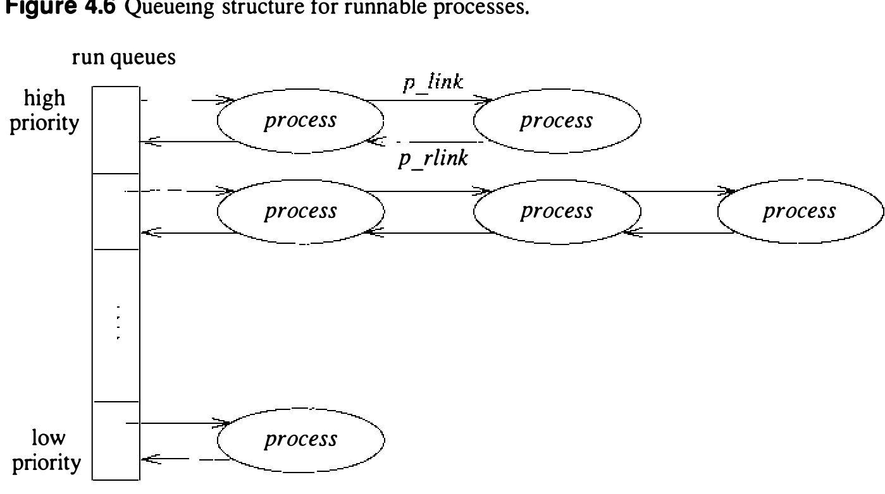

# 4.4 进程调度

4.3BSD 使用基于多级反馈队列的进程调度算法。所有可运行的进程都被赋予一个调度优先级，决定它们放进哪条运行队列。选择新进程运行时，系统从最高优先级到最低优先级扫描运行队列，选第一条非空队列的第一个进程。若一条队列上有多个进程，系统以轮转（round robin）方式运行它们：按在队列上的次序运行，分给相同的时间量。进程阻塞时不再放回任何运行队列。进程用完允许的时间量（或时间片）时，被放到它原来队列的末尾，队首进程被选中运行。

时间片越短，交互响应越好。但较长时间片带来更高的系统总吞吐量，因为上下文切换的开销更少，处理器高速缓存被清洗的次数也更少。4.3BSD 用的时间片是十分之一秒。这个值是经验所得：再长就会损害编辑器等交互作业所期望的响应。

系统动态调整进程的优先级，以反映资源需求（如阻塞等待事件）和进程消耗的资源量（如 CPU 时间）。进程随调度优先级的变化在各运行队列之间移动（多级反馈队列一名中“反馈”一词即由此来）。当正在运行的进程之外有进程取得更高优先级时，系统在第一个进程的时间片到期后切换过去；若一个睡眠进程被唤醒，当前进程在当前系统调用结束后被抢占。系统把这种短期调度算法偏向交互作业：提高为 I/O 长时间阻塞的进程的调度优先级，降低累计了大量 CPU 时间的进程的优先级。

短期进程调度分为两部分：下一小节讲进程调度优先级何时及如何改变；再下一小节讲运行队列的管理，以及进程调度与上下文切换的互动。

**进程优先级的计算**

进程的调度优先级直接由 proc 结构中的两个值决定：`p_cpu` 和 `p_nice`。`p_cpu` 的值给出进程近期 CPU 利用的估计。`p_nice` 的值是用户可设置的加权因子，取值范围 −20 到 20，正常值为 0。负值提高进程优先级，正值降低。

进程的用户态调度优先级每 4 个时钟节拍（VAX 上 40 毫秒）按此式计算一次：

p_usrpri = PUSER + ⌈ p_cpu / 4 ⌉ + 2 · `p_nice`（式 4.1）

结果不得小于 PUSER（见表 4.4）；大于 127 的按 127 截断。这一计算使优先级按近期 CPU 利用线性下降。用户可控的 `p_nice` 参数充当有限的加权因子：负值抵消含 `p_cpu` 的加法项，减缓重度 CPU 利用的影响；否则（忽略第二项的话）`p_nice` 只是把优先级平移一个常数。

CPU 利用 `p_cpu` 在系统时钟每次节拍发现进程正在执行时递增。此外，`p_cpu` 每秒用一个数字衰减滤波器调整一次。衰减使 1 秒内累计的 CPU 使用约 90% 在一段时间内被遗忘，这段时间的长短取决于系统平均负载。准确地说，`p_cpu` 按

p_cpu = (2 · load) / (2 · load + 1) `p_cpu` + `p_nice`（式 4.2）

调整，其中 load 是此前 1 分钟系统运行中运行队列长度的采样平均值。

为理解衰减滤波器的效果，可以看单个计算密集型进程独占 CPU 的情形。进程的 CPU 利用以取决于时钟频率的速率累计节拍。平均负载实际为 1，衰减成为

p_cpu = 0.66 · `p_cpu` + `p_nice`

设进程在时间间隔 i 内累计 Tᵢ 个节拍，且 `p_nice` 为零，则各时间间隔的 CPU 利用按

```sh
p_cpu = 0.66 · T₀
p_cpu = 0.66 · (T₁ + 0.66 · T₀) = 0.66 · T₁ + 0.44 · T₀
p_cpu = 0.66 · T₂ + 0.44 · T₁ + 0.30 · T₀
p_cpu = 0.66 · T₃ + · · · + 0.20 · T₀
p_cpu = 0.66 · T₄ + · · · + 0.13 · T₀
```

计入当前 `p_cpu` 值。于是，五次衰减计算之后，T₀ 只剩 13% 还留在该进程当前的 CPU 利用值中。由于衰减滤波器每秒施用一次，换个说法就是：约 90% 的 CPU 利用在 5 秒后被遗忘。

可运行进程的优先级如上周期性调整。但系统无视阻塞等待事件的进程：它们不可能累计 CPU 使用，其滤波后的 CPU 利用可以一步算出。当阻塞进程众多时，这一优化能显著降低系统的调度开销。进程被唤醒且已睡眠超过 1 秒时，系统重算它的优先级。系统维护一个值 `p_slptime`，即进程阻塞等待事件所花时间的估计。进程调用 `sleep()` 时 `p_slptime` 置 0，进程保持在 SSLEEP 或 SSTOP 态期间每秒加 1。进程被唤醒时，系统按

p_cpu = [ (2 · load) / (2 · load + 1) ] ^ p_slptime · `p_cpu`（式 4.3）

计算 `p_cpu`，再用式 4.1 重算调度优先级。这一分析忽略了 `p_nice` 的影响；所用的 load 也是当前平均负载，而非进程阻塞时的平均负载。

**进程优先级例程**

短期调度算法所用的优先级计算分布在系统若干处。两个例程周期运行：`schedcpu()` 每秒用式 4.2 重算进程优先级，并为因 `sleep()` 调用而阻塞的进程更新 `p_slptime`。`roundrobin()` 例程每秒运行 10 次，使系统以轮转方式重排最高优先级（非空）队列中的进程，给每个进程 100 毫秒的时间量。

CPU 使用估计在系统时钟处理模块 `hardclock()` 中更新，每秒执行 100 次。每当进程的 CPU 使用估计 `p_cpu` 累计满四个节拍，系统就重算它的优先级。重算用式 4.1，由 `setpri()` 例程完成。四节拍后重算的决定与下一小节讲的运行队列管理有关。除来自 `hardclock()` 的调用外，`setrun()` 每次把进程放上运行队列时，也调用 `setpri()` 重算进程的调度优先级。这一从 `wakeup()` 经 `setrun()` 的调用作用于当前运行进程之外的进程；相应地，`wakeup()` 在调用 `setpri()` 之前先调用 `updatepri()` 按式 4.3 重算 CPU 使用估计。

**进程运行队列与上下文切换**

调度优先级计算用来给可运行进程排序。调度优先级取值 0 到 127：0 到 49 保留给内核态执行的进程，50 到 127 保留给用户态执行的进程。用来装可运行进程的队列数影响管理队列的成本。只维护一条（有序）队列的话，选下一个可运行进程变得简单，但别的操作就贵了。用 128 条不同队列又会显著增加确定下一个运行进程的成本。系统用 32 条运行队列，按进程优先级除以四来选队列。选 32 条是折中，主要基于 VAX 某些机器指令的可用性——它们让最低层的调度算法实现得很高效。

运行队列装有主存中除当前运行进程外的全部可运行进程。图 4.6 显示每条队列如何组织成 proc 结构的双向链表。每条运行队列的队首保存在数组 `qs[]` 中，与之关联的还有一个位向量 `whichqs`，用于识别非空的运行队列。`setrq()` 和 `remrq()` 两个例程分别用来把进程放到运行队列尾、把进程从队首取下。调度算法的心脏是 `swtch()` 例程。`swtch()` 负责选择新进程运行，操作如下：



1. 找一条非空运行队列。在 VAX 上，对 `whichqs` 位向量用 `ffs`（找第一个置位位）指令即可轻松做到。若 `whichqs` 为零，说明没有进程可运行，`swtch()` 解除中断屏蔽并循环等待；这就是空闲循环（idle loop）。

2. 对一条非空运行队列，摘下队列上的第一个进程。VAX 上用单条指令 `remque` 即可。

3. 若摘除进程后该队列变空，复位 `whichqs` 中的相应位。

4. 复位 `noproc` 和 `runrun` 标志。`noproc` 是全局标志，表示当前没有进程在运行；`runrun` 标志表示应进行上下文切换，见下文。

5. 调用 `resume()` 让新进程投入运行。

VAX 上，`swtch()` 例程为效率用汇编语言编写。

有了 `swtch()` 例程和进程优先级计算，调度设施还缺的一块是系统如何强制非自愿上下文切换。回想自愿上下文切换发生在进程调用 `sleep()` 时。`sleep()` 只会被可运行的进程调用，所以它只需把进程放上睡眠队列再调用 `swtch()` 调度下一个进程。但 `swtch()` 不能从中断级执行的代码调用，因为 VAX 体系结构不允许从中断栈做上下文切换。

必须另有一种机制：设置名为 `runrun` 的全局重调度请求标志，然后为当前进程投递一个异步系统陷阱（AST）。AST 是一种陷阱，在进程下次返回用户态时送达。VAX 体系结构在硬件上直接支持 AST；别的系统用强制内存故障等办法仿真 AST。系统在下列情况下检查 `runrun` 标志并调用 `swtch()` 强制上下文切换：

* 从中断返回后，若系统原处于空闲
* 系统调用或陷阱结束时
* AST 陷阱发生时

`wakeup()`、`setpri()`、`roundrobin()`、`schedcpu()` 和 `setrun()` 例程都会置起 `runrun` 并投递 AST，强制重调度乃至非自愿上下文切换。

应当指出，由于 UNIX 不抢占内核态执行的进程，对事件的实时响应取决于每次系统活动所花的时间。此外，进程无法知道自己的哪些页驻留内存，因此无法保证执行一段指令序列不招致一次或多次缺页。系统不保证系统活动时长的上界，UNIX 断然不是实时系统。给 UNIX 补加实时进程调度的尝试以不同方式处理了这个问题 [Ferrin & Langridge, 1980; Sanderson et al., 1986]。
