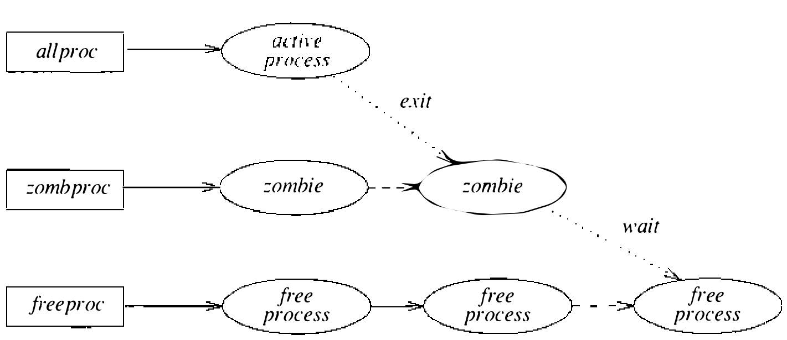

# 4.6 进程终止

进程或者经 `exit` 系统调用自愿终止，或者作为信号的结果被迫终止。两种情况下，进程终止都会向正在终止的进程的父进程（若还在）返回一个状态码。终止状态经 `wait` 或 `wait3` 系统调用返回。`wait3` 调用是标准 `wait` 调用的变体，允许应用查询已停止和已终止两种进程的状态。`wait3` 还能查询已终止子进程资源利用的统计信息。而且与 `wait` 不同，`wait3` 允许进程不阻塞地查询状态码。

内核中，进程通过调用 `exit()` 例程终止。`exit()` 先清理进程的内核态执行状态：

* 取消所有待决计时器
* 释放虚拟内存资源
* 关闭打开的描述符
* 处理已停止或被跟踪的子进程

内核态状态复位后，进程被从活跃进程链——`allproc` 链——摘除，放到由 `zombproc` 指向的僵尸进程链上，如图 4.7 所示。进程状态被改变，全局标志 `noproc` 置位以示当前没有进程在运行。接着 `exit()` 例程：

* 把终止状态记入 proc 结构的 `p_xstat` 字段
* 把进程累计资源使用的一份副本打成一个包（供记账之用），挂在 proc 结构的 `p_ru` 字段上
* 通知已故进程的父进程

最后，通知过父进程之后，直接调用 `swtch()` 重调度 CPU。

**图 4.7 进程终止期间 proc 结构的管理**

`wait` 和 `wait3` 调用都是通过在进程的后代进程中查找已终止者来工作。找到一个处于 SZOMB 态的进程后，系统从已故进程复制终止状态，然后收回相关的进程结构，把它重新初始化为可供将来使用的状态。具体说，进程表项从僵尸链摘下，归还到 `freeproc` 指向的空闲链。注意，子进程使用的资源只有作为 `wait` 系统调用的结果才会被累计。分析一个长时间运行的程序的行为时，用户会希望能在此进程终止之前就得到这些信息。
