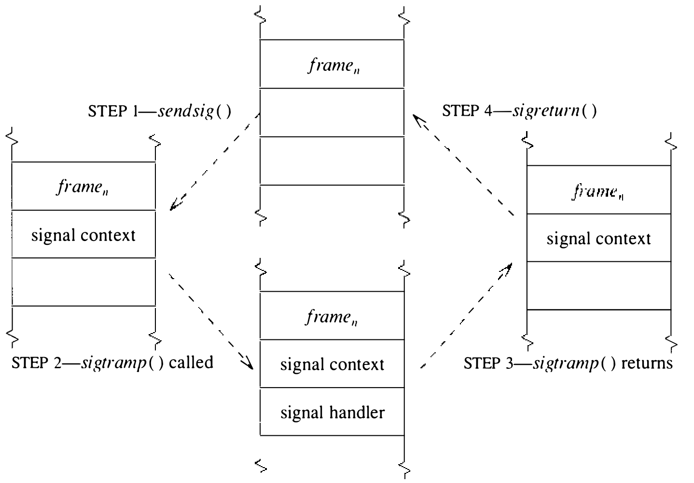

# 4.7 信号

UNIX 为程序正常执行期间可能出现的软硬件状况定义了一组信号（signal），见表 4.6。信号可以经应用指定的信号处理程序（signal handler）异步投递给进程，也可以产生默认（default）动作（如进程终止）由系统执行。4.3BSD 的信号设计成硬件中断或陷阱的软件对等物。

表 4.6 4.3BSD 中定义的信号

| 名称 | 默认动作 | 描述 |
| ---- | ---- | ---- |
| SIGHUP | 终止进程 | 终端线路挂断 |
| SIGINT | 终止进程 | 中断程序 |
| SIGQUIT | 创建 core 映像 | 退出程序 |
| SIGILL | 创建 core 映像 | 非法指令 |
| SIGTRAP | 创建 core 映像 | 跟踪陷阱 |
| SIGIOT | 创建 core 映像 | 执行了 I/O 陷阱指令 |
| SIGEMT | 创建 core 映像 | 执行了仿真指令 |
| SIGFPE | 创建 core 映像 | 浮点异常 |
| SIGKILL | 终止进程 | 杀死程序 |
| SIGBUS | 创建 core 映像 | 总线错误 |
| SIGSEGV | 创建 core 映像 | 段违例 |
| SIGSYS | 创建 core 映像 | 系统调用的参数错误 |
| SIGPIPE | 终止进程 | 向无人读取的管道写入 |
| SIGALRM | 终止进程 | 实时计时器到期 |
| SIGTERM | 终止进程 | 软件终止信号 |
| SIGURG | 丢弃信号 | I/O 通道上的紧急条件 |
| SIGSTOP | 停止进程 | 非来自终端的停止信号 |
| SIGTSTP | 停止进程 | 来自终端的停止信号 |
| SIGCONT | 丢弃信号 | 被停止的进程将继续 |
| SIGCHLD | 丢弃信号 | 子进程停止或退出时通知父进程 |
| SIGTTIN | 停止进程 | 后台进程读终端 |
| SIGTTOU | 停止进程 | 后台进程写终端 |
| SIGIO | 丢弃信号 | 描述符上有 I/O 可能 |
| SIGXCPU | 终止进程 | 超过 CPU 时间限制 |
| SIGXFSZ | 终止进程 | 超过文件大小限制 |
| SIGVTALRM | 终止进程 | 虚拟计时器到期 |
| SIGPROF | 终止进程 | 剖析计时器到期 |
| SIGWINCH | 丢弃信号 | 窗口大小改变 |
| SIGUSR1 | 终止进程 | 用户自定义信号 1 |
| SIGUSR2 | 终止进程 | 用户自定义信号 2 |

每个信号都有一个关联的动作（action），规定信号投递给进程时如何处理。每个信号都有默认动作，可以是下列之一：

* 忽略信号
* 终止进程
* 先生成一个含有信号投递时刻进程执行状态的 core 文件，再终止进程
* 停止进程

应用程序可以用 `sigvec` 系统调用为信号指定动作，包括：

* 采取默认动作
* 忽略信号
* 用处理程序捕获信号

信号处理程序是信号到达时系统将调用的一段用户态例程。称处理程序捕获（catch）了该信号。SIGSTOP 和 SIGKILL 两个信号不得忽略或捕获；这一限制确保存在一种停止和杀死失控进程的软件机制。用户进程无法决定哪些信号默认会创建 core 文件，但可以通过忽略、屏蔽或捕获信号来阻止创建这种文件。

信号由系统检测到硬件事件（如非法指令）或软件事件（如来自终端的停止请求）时投递（post）给进程。信号也可以由别的进程经 `kill` 或 `killpg` 系统调用投递。发送进程只能向与自己有效用户标识符相同的接收进程投递信号（超级用户除外）。这条规则有一个例外：继续信号 SIGCONT 总可以发给发送进程的任何后代。之所以例外，是为了让用户能重新启动一个他们从键盘停止的 setuid 程序。

与硬件中断类似，信号的投递可以被进程屏蔽（mask）。每个进程的执行状态中含有一组当前被屏蔽不得投递的信号。投递给进程的信号若正被屏蔽，就记录在进程的待决信号集中，但在解除屏蔽之前不采取任何动作。`sigblock` 和 `sigsetmask` 系统调用修改进程的屏蔽信号集：`sigblock` 向屏蔽集添加，`sigsetmask` 替换屏蔽集。

系统不允许屏蔽 SIGKILL、SIGSTOP 或 SIGCONT。在 4.3BSD 中不允许屏蔽 SIGCONT，只是因为恢复被停止的进程需要投递这个信号。例如，POSIX 为 SIGCONT 规定了别的语义，允许用户屏蔽该信号而不出问题。

另外两个信号相关的系统调用是 `sigpause` 和 `sigstack`。`sigpause` 调用允许进程交出处理器直到收到信号，类似系统的 `sleep()` 例程。`sigstack` 调用允许进程指定一个运行时栈用于信号投递。默认情况下，系统把信号投递给进程时用它的正常运行时栈。但有些应用不能接受：例如，应用运行在一个系统不会自动扩展的栈上，栈一旦溢出，信号处理程序就必须在备用栈上执行。这一设施类似 VAX 硬件提供的中断栈机制。

最后一个信号相关设施是 `sigreturn` 系统调用。`sigreturn` 相当于用户级的装载处理器上下文操作：向内核传递一个指向（依赖机器的）上下文块的指针，该块描述进程的用户级执行状态。这一状态用来在用户的信号处理程序正常返回之后恢复状态、继续执行。

**进程组**

进程组标识符（process-group identifier）是一个 16 位数，用来标识一组进程——进程组，例如 shell 建立的管道线。killpg 和 setpriority 系统调用用进程组标识符来标识一组进程，终端处理程序则在多路复用终端访问时用它作识别机制。进程从父进程继承进程组。系统从不改动已有进程组的进程的进程组；只有用户程序（通常是 shell）用 `setpgrp` 系统调用这样做。进程组初始化见 13.4 节。

系统内部，进程组的两大用户是终端处理程序（第 9 章）和进程间通信设施（第 10 章）。两者都在各自的私有数据结构中记录进程组标识符，并用它投递信号。终端处理程序还用进程组多路复用对终端的访问。进程试图读或写终端，或以 `ioctl` 调用改变终端状态，而进程的进程组标识符与终端的进程组标识符不同时，终端处理程序就投递使进程进入 SSTOP 态的信号，把它停下来。这一设施是实现作业控制的基本机制，本章稍后详述。

**与其他系统的比较**

UNIX 信号最初为模拟异常事件而设计，例如用户试图杀死失控程序。它无意充当通用的进程间通信机制，因此没有人为它做过可靠性设计。早期系统中，信号一旦被捕获，其动作就被重置为默认。作业控制的引入使信号的使用频繁得多，也让更快处理器加剧的问题显形：两个信号接踵而至时，第二个可能置进程于死地——哪怕已为第一个信号装好了处理程序。于是可靠性变得必要，用户社区也施压要求。开发者没有把必需的大改动硬塞进既有信号机制，而是设计了全新的框架，把旧能力收作子集，同时容纳新机制。

4.3BSD 的信号设施与其他 UNIX 版本的设施差别悬殊。具体说，4.3BSD 信号解决了以下问题：

* 旧系统中，进程一收到信号，与该信号关联的动作就重置为默认。想处理同一信号多次出现的进程必须在每次收到后重装处理程序。这就产生了竞态：处理程序重装之前可能又来一个信号，招致默认动作而非程序员的本意。4.3BSD 中，信号处理程序一次 `sigvec` 系统调用永久安装。

* 旧系统中，正在处理的信号在应用处理期间不被屏蔽。如前所述，这使随后的信号可能终止进程。此外，信号不被屏蔽还意味着可能发生递归中断——除非信号处理程序把信号标记为忽略。4.3BSD 中，调用应用的信号处理程序期间，正在处理的信号自动屏蔽。

* 从前的 UNIX 系统不允许用户进程屏蔽信号投递。需要保护临界区不被信号打扰的应用，唯一的机制是停用那些信号的投递。而且一次只能停用一个信号，无法保证在信号投递给进程之前停用一组信号。4.3BSD 中，信号集可用 `sigblock` 和 `sigsetmask` 系统调用屏蔽。信号投递给已屏蔽它的进程时，投递推迟到解除屏蔽。

* 从前的 UNIX 系统中，信号总在进程的正常运行时栈上投递。4.3BSD 中，可用 `sigstack` 系统调用指定投递信号的备用栈。信号栈让管理定长运行时栈的程序得以可靠处理信号。

* 旧 UNIX 系统中，被信号中断的系统调用提前终止并返回 EINTR 错误码。4.3BSD 中，被信号中断的系统调用只要可能且合理就自动重启。有了系统调用自动重启，程序在处理信号时就无须检查每个系统调用的返回码来判断要不要重启。4.3BSD（4.2BSD 则不然）为 `sigvec` 提供了一个标志，可以恢复旧语义。

4.3BSD 的信号设施围绕 UNIX 虚拟机模型设计：UNIX 系统调用被看作机器硬件指令集的对等物。信号是陷阱或中断的软件对等物，信号处理例程履行中断或陷阱服务例程的同等职能。正如机器提供屏蔽硬件中断的机制以保证对数据结构的一致访问，信号设施允许屏蔽软件信号。最后，由于可能需要复杂的运行时栈环境，信号像中断一样可以在备用运行时栈上处理。这些机器模型总结于表 4.7。

表 4.7 硬件机器与软件虚拟机对比

| 硬件机器 | 软件虚拟机 |
| ---- | ---- |
| 指令集 | 系统调用集 |
| 可重启指令 | 可重启系统调用 |
| 中断/陷阱 | 信号 |
| 中断/陷阱处理程序 | 信号处理程序 |
| 屏蔽中断 | 屏蔽信号 |
| 中断栈 | 信号栈 |

**POSIX 对 4.3BSD 信号的改动**

4.3BSD 的信号（信号栈除外）已被 POSIX 采纳。不过信号函数的语法有些变化，所有名字都随之改了，见表 4.8。POSIX 中唯一没有 4.3BSD 对应物的是 `sigpending`；这个例程查明哪些信号已投递但尚未送达。

表 4.8 4.3BSD 与 POSIX 的信号处理设施

| 4.3BSD | POSIX |
| ---- | ---- |
| `sigmask()` | sigsetopts 函数 |
| `sigblock()` | `sigprocmask()` |
| `sigsetmask()` | `sigprocmask()` |
| `sigpause()` | `sigsuspend()` |
| `sigvec()` | `sigaction()` |
| `sigstack()` | （无） |
| `sigreturn()` | （无） |
| （无） | `sigpending()` |
| `signal()` | `signal()` |

**投递一个信号**

信号的实现分成两部分：向进程投递信号，以及识别信号并把信号送达目标进程。任何进程或中断级执行的代码都可以投递信号。信号的送达通常发生在接收进程的上下文内。但当信号强制进程停止时，动作有时改在信号投递时执行。

信号用 `psignal()` 例程投递给单个进程，或用 `gsignal()` 例程投递给一组进程。`gsignal()` 例程对指定进程组中的每个进程调用 `psignal()`。投递信号关联的动作直截了当，细节却琐碎。理论上，向进程投递信号只是把相应信号加入进程的待决信号集，然后置进程为可运行（若它正以可中断优先级睡眠则唤醒它）。proc 结构的 `p_cursig` 字段在非零时含有当前正投递给进程的信号。`p_sig` 字段含进程的待决信号集。进程每次从 `sleep()` 调用返回（进程优先级小于 PZERO 时）、或在处理完系统调用或陷阱准备退出系统时，都检查是否有信号待决。若有待决信号且必须在进程上下文中送达，就把它从待决集移入 `p_cursig`，进程调用 `psig()` 例程执行适当动作。

`psignal()` 的工作是进程调试设施、作业控制设施与信号固有属性所需的种种特例拼成的混合体。投递信号的步骤如下：

1. 确定接收进程在信号送达时将采取的动作。这一信息保存在进程 proc 结构的 `p_sigignore`、`p_sigmask` 和 `p_sigcatch` 字段中。若进程既不忽略、不屏蔽也不捕获该信号，则视为适用默认动作。若进程正被父进程——即调试器——跟踪，总允许父进程在信号送达前介入。若进程忽略该信号，`psignal()` 的工作就完成了，可以返回。

2. 有了动作，`psignal()` 把信号加入待决信号集 `p_sig`，然后做该信号特有的隐含动作。例如，若信号是继续信号 SIGCONT，则清除任何通常会停止进程的待决信号（如 SIGTTOU）。

3. 接着，`psignal()` 检查信号是否被屏蔽。若进程当前屏蔽该信号的投递，`psignal()` 的工作就完成，可以返回。

4. 若信号未被屏蔽，`psignal()` 就必须或者直接执行动作，或者安排进程执行、由它执行信号关联的动作。为了让进程跑起来，`psignal()` 必须询问进程的状态。

   SSLEEP：进程阻塞等待事件。若进程以负优先级睡眠，则无事可做。否则动作可以直接施加，也可以唤醒进程间接施加。有两种可以直接施加的动作：对会使进程停止的信号，进程被置入 SSTOP 态，并向父进程投递 SIGCHLD 信号通报状态变化；对默认忽略的信号，信号从 `p_sig` 中移除，工作完成。其余情况下，信号关联的动作必须在接收进程的上下文中执行，进程经 `setrun()` 调用被放上运行队列。

   SSTOP：进程被信号或调试停止。若进程正被调试，在控制进程允许它继续之前无事可做。若进程被信号停止，而所投递的信号本会再次停止它，则无事可做，该信号被丢弃。否则，信号要么是继续信号，要么是通常会使进程终止（除非被捕获）的信号。若信号是 SIGCONT，进程重新置为运行——除非它正阻塞等待事件，此时它回到 SSLEEP 态。若信号是 SIGKILL，进程无论如何都重新置为运行，以便下次被调度时终止。其余信号使进程变为可运行，但不放入运行队列，因为它必须等继续信号。

   SRUN、SIDL、SZOMB：若进程不是当前执行的进程，投递一个 AST，使接收进程尽快察觉信号。

`psignal()` 的实现之所以复杂，主要是因为它控制着作业控制设施中的进程状态转换，而且与进程调试设施耦合甚紧。

**送达一个信号**

与信号送达相关的多数动作，都在接收进程自己的上下文内执行。进程每次进入系统时至少调用一次 `issig()` 例程，检查 proc 结构中有无待决信号。

`issig()` 取待决信号集 `p_sig` 中遇到的第一个信号，放入 `p_cursig` 字段。若信号送达将调用信号处理程序或执行 core 转储，就通知调用者有信号待决，实际送达由 `psig()` 调用完成。即：

```c
    if (issig())
        psig();
```

否则，信号关联的动作在 `issig()` 内执行（这些动作模仿 `psignal()` 所为）。

`psig()` 例程要处理两种情形：

1. 产生 core 转储
2. 调用信号处理程序

前者由 `core()` 例程完成，且总是跟着一个 `exit()` 调用强制进程终止。为调用信号处理程序，`psig()` 先算出一组屏蔽信号装入 `p_sigmask`。这组信号通常包含正送达的信号，使同一信号不会递归调用处理程序。安装处理程序的 `sigvec` 系统调用中指定的信号也会包含在内。然后 `psig()` 调用 `sendsig()` 例程，安排进程一返回用户态就立即执行信号处理程序。最后清除 `p_cursig` 中的信号，`psig()` 返回，接下来大概就是返回用户态了。

`sendsig()` 例程的实现依赖机器。图 4.8 展示 VAX 上信号送达相关的控制流。对 VAX 来说，一个参数表和进程当前的用户态执行上下文存放在信号栈上（可能与正常运行时栈不同），并如此操纵进程的状态：一返回用户态，就会立即调用一段存放在进程 user 结构中的代码。（u. 区必须让用户进程可读，这一切才能工作。）这段代码称为信号蹦床代码（signal-trampoline code），它以适当的参数表调用信号处理程序；若处理程序返回，就发起 `sigreturn` 系统调用，把进程的信号状态恢复到信号之前的样子。



**作业控制**

作业控制（job control）是 C shell [Joy, 1986] 和 Korn shell [Korn, 1983; Korn, 1984] 提供的设施，允许用户控制一组称为作业（job）的进程的运作。作业控制提供的最重要设施是对用户终端的多路复用：任一时刻只有一个作业可以读写终端。这一设施提供了窗口系统的部分好处，不过作业控制毕竟不同，在有窗口的系统上常与窗口配合使用。作业控制构建在进程组和信号设施之上。

每个作业是一组被赋予同一进程组标识符的进程。组织成管道线的进程（见 2.4 节和 2.6 节）放进同一个进程组，组通常以管道线头一个进程的 PID 定义。作业靠 `killpg` 系统调用向作业的进程组投递信号来操纵。例如，要强制一个作业停止，可以用：

```c
killpg(pgrp, SIGSTOP)
```

多个作业组成一个会话（session），直观说就是单次登录期间启动的全部进程。会话通常有一个关联的控制终端，默认用它与用户通信。在该终端键盘上敲下的某些字符产生信号，发给会话中某一个作业的全部进程；该作业在前台（foreground），会话中其余作业都在后台（background）。shell 可以用控制终端上的 TIOCSPGRP `ioctl` 改变前台作业。后台作业若试图以 `read`、`write` 或 `ioctl` 系统调用访问终端（`ioctl` 仅在会改变终端状态时才受此限制），就会被信号自动停止。

作业控制设施于 1980 年加入 Berkeley UNIX 系统，其设计基于 TENEX 操作系统中的类似设施 [Bobrow et al., 1972]。最初的 UNIX 实现由 Jim Kulp 在奥地利拉克森堡的国际应用系统分析研究所（IIASA）于 PDP-11/70 上完成。作业控制不止这里讲的这些；与终端处理相关的材料见第 9 章。

AT&T System V Release 3 的作业控制设施试图提供同等功能，但用的是基于伪终端和进程组的方案 [AT&T, 1987]。POSIX 采纳了与 4.3BSD 颇为相似的作业控制，相应的 FIPS 更是强制要求。因此，未来的多数 UNIX 系统很可能都会有源自 4BSD 的作业控制。
