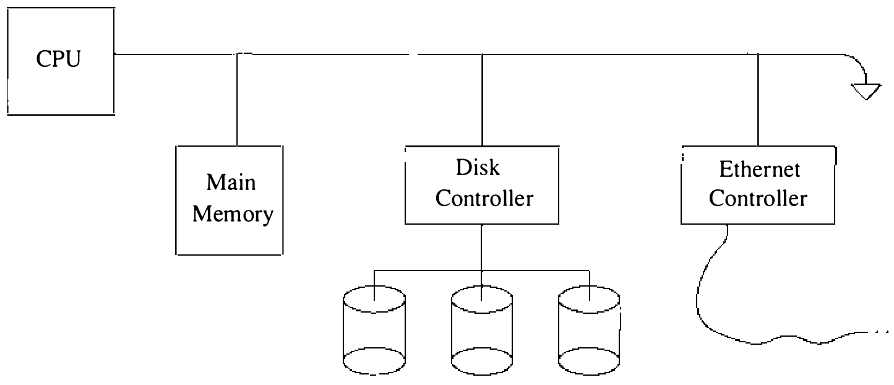
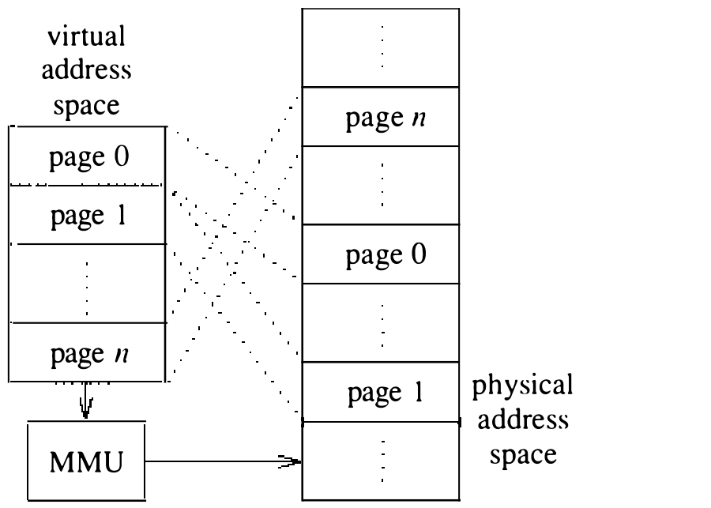

# 5.1 术语

任何操作系统的中心部件都是存储管理系统（memory-management system）。顾名思义，存储管理设施负责管理机器上可用的内存资源。这些资源通常按层次方式分层，内存访问时间与到 CPU 的距离成反比，如图 5.1 所示。第一层的内存系统称为主存（main memory）；再下一层的存储称为辅存（secondary storage）或后备存储（backing storage）。主存系统通常由随机访问存储器构成，辅存则放在动臂磁盘驱动器上。在一些工作站环境里，随着经局域网连接到工作站的文件服务机器的加入，常见的两级层次正在变成三级 [Gingell et al., 1987]。

在多道程序环境中，操作系统能否在进程之间有效共享可用内存至关重要。任何存储管理策略的运作都与进程执行所需的内存直接相关：若进程必须全部驻留主存才能执行，存储管理系统就必须面向分配大块内存；反之，若进程只部分驻留主存也能执行，存储管理策略可能大不相同。存储管理设施通常试图优化驻留主存的可运行进程数。这一目标必须与进程调度程序的目标（第 4 章）一并考虑，避免相互冲突损害系统的整体性能。

辅存的存在虽然允许存在多于主存所能容纳的进程，却也需要额外的算法，而这些算法可能相当复杂。空间管理通常需要与主存不同的算法和策略，还必须设计一套策略来决定何时在主存与辅存之间移动进程。

**进程与内存**

每个进程运行在一台由其执行所依托的底层硬件体系结构定义的虚拟机上。我们只关心那些包含虚拟地址空间（virtual address space）概念的机器。虚拟地址空间是进程可以引用的一段内存位置范围，与硬件上实际存在的物理内存无关。对虚拟地址空间——虚拟地址（virtual address）——的引用由硬件翻译成对物理内存的引用。这一操作称为地址转换（address translation），它使程序可以装入内存的任何位置而无须改动程序中依赖位置的地址。地址转换和虚拟寻址对高效共享 CPU 也很重要，因为位置无关通常使上下文切换得以很快完成。

多数机器为进程提供连续的虚拟地址空间。有些机器则选择把进程的虚拟地址空间显式划分为若干称为段（segment）的区域 [Intel, 1984]；这样的段通常必须在主存中物理连续，并从固定地址开始。我们只讨论不显式分段虚拟地址空间的系统。这里“段”一词的用法与先前描述 UNIX 进程段（如正文段、数据段）时的用法不同；后者的大小是可变的。

多个进程共驻主存时，必须保护与每个进程的虚拟地址空间对应的物理内存，确保一个进程不能改动另一个进程虚拟地址空间的内容。这种保护由硬件实现，通常与地址转换的实现紧密耦合。因此两个操作通常合在一起定义并实现为称为存储管理单元（memory-management unit）的硬件。

当提供给进程的可寻址内存位置的有效范围与主存大小无关时，我们说机器支持虚拟内存（virtual memory）。换个说法：进程的虚拟地址空间独立于 CPU 的物理地址空间。要说一台机器支持虚拟内存，我们还要求进程的整个虚拟地址空间无须驻留主存即可执行。

虚拟内存可以多种方式实现，其中一些基于软件，例如覆盖（overlay）。但最有效的虚拟内存方案基于硬件。这类方案把虚拟地址空间划分为定长的单元，称为页（page），如图 5.2 所示。虚拟内存引用由地址转换单元解析为主存中的一页和页内的偏移。硬件保护由存储管理单元逐页施加。

一些系统提供两级结构的虚拟内存系统，页按段成组 [Organick, 1975]。这类系统中保护通常在段一级。本章余下部分只讨论基于页的虚拟内存系统。

**调页**

地址转换把进程的虚拟地址空间与 CPU 的物理地址空间解耦，满足了虚拟内存的第一项要求。为满足第二项要求，虚拟内存的每一页被标记为在主存中驻留（resident）或不驻留（nonresident）。进程引用到不驻留的虚拟内存位置时，产生一个称为缺页（page fault）的硬件陷阱。缺页的服务，即调页（paging），使进程即使只部分驻留主存也能执行。

Coffman 和 Denning [1973] 用三个重要策略刻画调页系统：

1. 系统何时把页装入内存（取页策略，fetch policy）
2. 系统把页放到内存何处（放置策略，placement policy）
3. 页不可用时应放置请求时，系统如何选出从主存移除的页（置换策略，replacement policy）

正常情况下，主存的所有页同样好用，放置策略对调页系统的性能没有影响。于是调页系统的行为只取决于取页策略和置换策略。纯请求调页（pure demand-paging）系统采用请求式取页策略：只取缺失的那一页，且只在主存已满时才做置换。因此纯请求调页系统的性能只取决于系统的置换策略。实践中，调页系统并不实现纯请求调页算法：取页策略常改为做预调页（prepaging）——除引发缺页的页外再多取几页——置换策略也在主存未满之前就启用。

**置换算法**

置换策略是任何调页系统最关键的方面。为调页系统设计置换策略时，可从范围广泛的算法中挑选。关于不同页面置换算法性能的评估已有大量研究 [Belady, 1966; King, 1971; Marshall, 1979]。为讨论 4.3BSD 所用的置换算法，我们先介绍一些基本术语。

进程在给定输入下的调页行为，用进程执行期间引用的页来描述。这一页序列称为引用串（reference string），代表进程生命周期中离散时刻的行为。与构成引用串的采样引用相对应的，是表明各引用是否导致缺页的实时值。度量进程行为的一个有用指标是缺页率（fault rate）：处理一个引用串所遇缺页次数除以引用串长度的归一化值。

页面置换算法通常按其对从真实程序执行中采集的引用串的有效性来评估。也可以用形式分析，但除非对执行环境施加诸多限制，否则很难进行。度量页面置换算法有效性最常用的指标就是缺页率。

页面置换算法按其选择回收页所用的准则来定义。例如，最优置换算法（Optimal Replacement Policy）[Denning, 1970] 认为，替换一页的“最佳”选择是距下次引用的期望时间最长的页。显然这一策略不适用于动态系统，因为它要求先验地知道进程的调页特性。不过该策略对评估很有用，为其他页面置换算法的性能比较提供了标尺。

实用的页面置换算法需要一定量的状态信息来选择替换页。这种状态通常包括进程的引用模式，按离散时间间隔采样。在有些系统上，采集这些信息的代价可能很高 [Babaoglu & Joy, 1981]。结果，“最佳”页面置换算法未必是最有效的。

**工作集模型**

工作集模型假设进程表现出缓慢变化的引用局部性。在一段时间内，进程在一组子例程或循环中运作，其全部内存引用都落在地址空间的一个固定子集上，该子集称为工作集（working set）。进程周期性地更换工作集，放弃内存的某些区域，开始访问新的区域。经过一段过渡，进程把一组新页确定为自己的工作集。一般说来，系统能给进程提供足以容纳其工作集的页数，进程的缺页率就低；供不齐工作集所需的页，进程就跑得慢、缺页率高。

没有对进程内存引用模式的先验知识，精确计算工作集是不可能的。但工作集可以用多种办法近似。一种近似方法是跟踪进程持有的页数和进程的缺页率。缺页率升过高水位线，就认为工作集变大了，允许进程持有的页数增长；反之，缺页率降到低水位线以下，就认为工作集变小，收缩进程持有的页数。

**交换**

交换（swapping）一词描述这样一种存储管理策略：主存不足时，整个进程在辅存之间移入移出。基于交换的存储管理系统通常比请求调页系统简单，因为簿记工作少。但纯交换系统的效率一般不如调页系统，因为进程必须完全驻留才能执行，多道程序的程度随之降低。交换有时与调页结合成两级方案：调页先满足内存需求，直到出现严重的内存短缺需要断然行动时才动用交换。

**辅存**

本章中，用于调页和/或交换的那部分辅存称为交换区（swap area）或交换空间（swap space）。这些区域所在的硬件设备称为交换设备（swap device）。

**虚拟内存的优点**

在能妥善支持这一设施的计算机上使用虚拟内存有若干好处。虚拟内存让大程序能运行在主存配置小于程序规模的机器上。在内存量中等的机器上，它让更多程序驻留主存竞争 CPU 时间，因为程序不必完全驻留。程序一时只用其程序空间或数据空间的某些节、其余节闲置时，闲置的节不必在场。虚拟内存还让程序启动更快，因为程序开始处理参数、决定采取什么行动之前，一般只需要装入一小节。程序的其他部分在某几次运行中可能根本用不着。程序运行时，程序空间和数据空间的其他节按需调页进入（请求调页）。最后，有许多算法，稀疏地使用大地址空间编写比把数据结构精心塞进小块区域更容易。这类技术没有虚拟内存时代价高得无法使用，有了虚拟内存则可能快得多，又不至于占用过量的实际内存。

另一方面，使用虚拟内存也可能损害性能。一次整体装入程序比按小节请求装入更高效。每次操作都有固定的代价，包括保存和恢复状态、判断必须装入哪一页。所以有些系统只对大于某个最小规模的程序使用请求调页。

**虚拟内存的硬件要求**

几乎所有 UNIX 版本都要求某种形式的存储管理硬件来支持透明的多道程序设计。为保护进程不被其他进程修改，存储管理硬件必须防止程序改变自己的地址映射。UNIX 内核运行在可控制内存映射的特权模式（内核态或系统态）下，进程则运行在非特权模式（用户态）下。支持虚拟内存还有几项额外的体系结构要求。第一条也最明显：CPU 必须区分地址空间的驻留部分与不驻留部分，必须在程序引用不驻留地址时将其挂起，并能在操作系统把所需节放入内存后恢复其运行。由于 CPU 可能在指令执行中途的不同时刻发现数据缺失，它必须提供保存机器状态的机制，使指令稍后能继续或重启。CPU 可以在指令开始时保存足够的状态，以便发现故障时恢复；也可以让指令把一切修改和副作用推迟到所有故障都可能被发现之后，这样重启前无须回退指令执行。有些计算机上，指令回退需要操作系统协助。

多数为支持请求调页虚拟内存而设计的机器，都包含采集程序内存引用信息的硬件支持。系统选择一页替换时，若该页装入内存后修改过，就必须保存其内容。硬件通常逐页维护一个标志，表明页是否被修改过。许多机器还提供一个记录页是否被访问过的标志，供置换算法使用。
