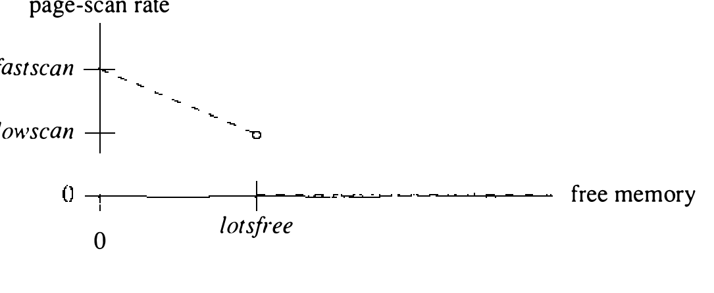
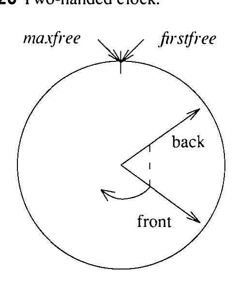

# 5.12 页面置换

缺页服务和其他内存需求可以靠空闲表应付一阵，但内存终须回收再用。进程退出时回收一部分页。内存多、需求低的系统，退出的进程可能就提供了足够的空闲内存。这种情况出现在内存足以容纳内核和所有当前进程曾经用过的所有页时。显然，许多计算机没有那么多主存来留住全部页。于是，终究需要把一些页移到辅存——交换空间去。与调入一页由需求驱动不同，页不再被进程需要时没有即时的征兆。内核必须实现某种策略，决定把哪些页移出内存，好让当前需要的页取而代之。理想情况下，策略选中的替换页将不会很快再用。这一策略的近似做法是找近期未用过的页。在 VAX 上找近期未用过的页有个麻烦：PTE 里没有引用位（reference bit）来标记用过的页。包括 Tahoe 在内的多数其他虚拟内存体系结构都提供这一设施。

调页系统的设计基于大量轨迹驱动模拟的结果 [Babaoglu, 1981]。据此，系统实现请求调页，采用近似全局 LRU 的页面置换算法。每进程的整个地址空间都可调页，尽管仍保持 UNIX 惯有的正文、数据、栈段结构。

## 全局 CLOCK 算法

4BSD UNIX 的页面置换策略是 CLOCK 算法的一个变体 [Corbato, 1968; Easton & Franaszek, 1979]，其中引用位用软件仿真（至少在 VAX 上）。它是全局置换算法（global replacement algorithm）的一例：按全系统范围的准则挑选替换页；局部置换算法（local replacement algorithm）则先选定一个进程，再按每进程准则为它选页换出。CLOCK 算法的一般思路是周期性扫描物理内存，逐页考虑替换。可调页进程使用的那部分主存被当作一个由页组成的环（loop），一个指针即时钟指针（clock hand）绕环一次一页簇地旋转。时钟指针首次到达某簇时，把该簇标记为未引用；下一圈，时钟指针检查该簇在此期间是否被引用过。簇没被用过，就是替换的有力候选：必要时写入交换空间，然后放上空闲表。

在有引用位的机器上，第一遍清除该位，第二遍检查引用位是否又被置位。VAX 上仿真引用位，4BSD 在第一遍清除 valid 位。进程试图使用正被检查引用的页（即 valid 位不置位的页）时，缺页处理程序只是把 valid 位重新置位并返回。第二遍检查 valid 位，如同它是引用位。4.3BSD Tahoe 发行版修改了页面置换例程，在硬件支持时使用真正的引用位。

VAX 上仿真引用位增加了 CLOCK 算法的运行成本，因为额外发生的缺页纯粹为了采集引用信息。缺页处理程序识别出这种无效页的状态一切正常，只是该页在仿真引用位。VAX 上仿真引用位的初始开销约占调页总时间的 10%。在内存严重短缺的系统上，CPU 时间最多有 30% 花在调页上，于是仿真引用位的初始开销最多吃掉 3% 的 CPU 时间。为降低仿真成本，处理首次缺页特征判定与重新有效化的代码用汇编语言重写，结果仿真引用位的时间下降了 70%，最大成本降到 CPU 时间的约 1%。

使用单一的页环迫使所有进程在同等基础上竞争内存。这一算法是按模拟结果选定的。有意思的是，它与 UNIX 对待系统其他资源的方式也一致。让所有进程平等竞争内存的常见替代办法是把内存划分为多个独立区域，每个区域局限于一组彼此竞争内存的进程。VMS 操作系统就采用这种方案 [Kenah & Bate, 1984]。有了它，系统管理员可以保证一个或一组进程始终占有一个最小百分比的内存。不幸的是，这种方案可能难以管理：环设得太小会导致内存利用不足和对辅存设备的过多 I/O，设得太大又会导致交换 [Lazowska & Kelsey, 1978]。

4.3BSD 虚拟内存系统不使用工作集模型，因为它缺少关于进程引用模式的准确信息。它确实跟踪进程持有的页数（驻留集大小，resident-set size），但不知道哪些驻留页构成工作集；驻留页计数只用来判断进程想运行时内存是否够把它换入。

系统以换出占用内存最大的进程之一来应付过度调页；见 5.13 节。只有在调页跟不上内存需求、或短期资源需求值得换出进程时才动用交换。一般而言，重负载下交换调度机制表现不佳；靠页面置换算法做内存调度，系统性能远好于动用交换算法。

## 调页守护进程

页面置换在 `pageout()` 例程中完成。`pageout()` 回收修改过的页时，负责把它们写入交换区。因此 `pageout()` 必须能用 `sleep()` 等常规的内核同步机制。于是它作为一个单独的进程运行，即调页守护进程（pagedaemon），有自己的 proc 结构、user 结构和内核栈。与 `init` 一样，调页守护进程由系统启动期间的一次内部 `fork` 操作创建（见 13.3 节）；但与 `init` 不同，fork 之后它一直留在内核态。调页守护进程径直进入永不返回的 `pageout()`。为了方便，调页守护进程有一个很大的地址空间，要写往交换的页就映射进来。与其他磁盘 I/O 例程的使用者不同，页面换出进程的磁盘操作必须异步进行，这样磁盘写的同时它可以继续扫描。

## 调页参数

进程经缺页处理程序提出的内存分配需求，与系统维持空闲表最小页数阈值的总目标不断竞争。系统运行中监视主存利用，力求把调页守护进程唤醒得足够频繁，使空闲内存保持在最小阈值之上。调页守护进程休眠不动，直到内存需求把它唤醒。它的工作由若干参数控制，参数在 `schedpaging()` 例程中计算。总的说来，这一策略的目标是让空闲内存维持在不低于最小阈值的水平。策略由 CLOCK 算法实施，为空闲表回收页。调页守护进程要回收的页数是系统内存需求的函数：系统越缺内存，扫描的页越多，采样页引用的间隔越短，被释放的页随之增多。

系统每秒检查四次是否需要内存。若有需要，就确定一个调页速率并唤醒调页守护进程。调页速率以每个四分之一秒间隔要扫描的页簇数给出。`schedpaging()` 把空闲内存簇数与若干参数比较来判断内存需求。第一个参数 `lotsfree` 指定让调页守护进程停手的阈值（以 KB 计）：可用内存高于该阈值时，守护进程不扫描也不换出页。`lotsfree` 通常为 512 KB，至多为用户内存的四分之一。另两个有意思的限度是希望维持的空闲内存量 `desfree`，以及开始非自愿交换前可容忍的最小空闲内存 `minfree`。`desfree` 通常 200 KB，至多为内存的八分之一；`minfree` 通常 64 KB，至多为内存的十六分之一。换页扫描速率线性变化：内存完全耗尽时每秒 200 页（或至多内存的 20%），空闲内存等于 `lotsfree` 时每秒 100 页（见图 5.19）。

**图 5.19 页面扫描速率**

调页参数的期望值经全局变量传给调页守护进程。同样，守护进程也把它每个运行间隔扫描的页数记入一个全局变量，报告进度。

## 双指针时钟

调页参数可以用来确定时钟指针绕内存转一圈所需的时间。2 MB 内存按 1 KB 簇划分，指针不到 10 秒就走完全部内存；16 MB 内存的机器上，一整圈要 80 秒。因此，用普通 CLOCK 算法时，留给进程证明自己需要一页的时间高度依赖内存大小。若一次突发的内存短缺使调页在一段无扫描之后开始，时钟要转满一圈才释放第一页。为此，4.3BSD 修改了 CLOCK 算法以更好地支持大内存机器。新算法用两个时钟指针在内存中移动：前针清除引用位，后针采样引用位，如图 5.20 所示。

**图 5.20 双指针时钟**

双指针 CLOCK 算法是原 CLOCK 算法的推广：两针间的距离隐含地就是用户进程可用主存的规模。引用采样的时间与两针间距离成正比、与扫描速率成反比。为简单起见，两针间距始终固定为 2 MB 或全部内存的大小（取小者）。用上双指针 CLOCK 算法后，采样一页是否被用的时间就与内存大小无关了。

## pageout 的运作

现在信息够了，可以考察实现页面置换策略的 `pageout()` 例程的运作。`pageout()` 先把两个时钟指针设到相距适当的距离。指针实际上是核心映射表的下标——核心映射表被当作环形数组对待。内存扫描避开内核静态使用的页。然后 `pageout()` 入睡，直到空闲内存变低。空闲内存少于 `lotsfree` 期间，它每秒至少被唤醒四次。`pageout()` 每次运行，都把时钟指针扫过核心映射表，直到检查完期望数目的页簇或空闲内存达到期望量。扫描的每次迭代检查两个页簇——前针一个、后针一个——然后把两针各推进一簇。

前针处的簇接受检查，确定状态并判断是否为替换候选。簇若不空闲，`pageout()` 使该簇的 PTE 无效；若簇在共享正文段中，则把改动过的 PTE 传播给共享该页的其他进程。

`pageout()` 检查后针处的表项时，查看该簇自前针经过后是否被用过。用过的话 valid 位会被重新置位，簇留在内存。否则该簇被选中释放：任何页若被修改过（或尚未写入交换），必须先“推”到交换才能释放；未被修改的页立即释放。

把进程页写入交换设备的操作，即页面推出（page push），有些复杂。进程的预分配交换空间由进程的 user 结构描述，而推出在调页进程的上下文中进行，调页进程有自己的 user 结构。因此用一个专用页表（`Pushmap`）把拥有该页的进程的 user 结构映射进内核地址空间。

只要需要推出当前页，进程中驻留且脏的相邻页就成组搭车一起写入辅存。它们若在下一次修改之前被释放，就不再需要单独的页面换出操作。每次成组至多 `dmmin` 页（通常 32 页），并从 `dmmin` 页边界开始（用 `dmmin` 是为了确保这种块中的所有页在交换空间上连续）。

`pageout()` 把页写入交换区的机制与正常 I/O 有两处重要不同：

1. 脏页映射进调页守护进程的虚拟地址空间，而不是属于进程的虚拟地址空间。
2. 写操作异步执行。

两项都由 `swap()` 例程完成，它凭传给它的特殊标志识别出脏页推出。描述 I/O 操作的缓冲区头随后按页面推出正确初始化。脏页的 PTE 复制进调页守护进程的页表；要释放的页的地址记入交换缓冲区的 `b_pfcnt` 字段。而且，由于 `pageout()` 在推出期间不入睡，I/O 完成后它通常拿不回控制权。因此 `swap()` 给缓冲区标记回叫标志，把回叫例程设为 `swdone()`。推出完成时 `swdone()` 被调用：它把缓冲区放上已完成页面换出链表并唤醒 `pageout()`。

写操作异步进行，使 `pageout()` 能继续检查页，可能再启动新的推出。交换缓冲区数量恒定，因此必须保证有缓冲区可用才承诺新的页面推出。`pageout()` 用尽交换缓冲区时，至少等一个写操作完成再继续。与往常一样，此时阻塞要求 `pageout()` 恢复运行后重算状态：手头的页可能已被释放或重用。页面换出操作完成时，缓冲区加入已完成页面换出链表；若 `pageout()` 正等缓冲区，就唤醒它。

已完成页面换出链表由 `cleanup()` 处理，时机是 `pageout()` 每次被唤醒以及另一个交换头即将使用之前。对链上的每次页面换出，要释放的页簇放上内存空闲表——除非已有进程把它回收并重新有效化。因成组而搭车的其他页解锁，等待这些锁定页的进程被唤醒。若使用某页的进程已弃它而去，核心映射表中的 `c_gone` 标志已置位而页尚未释放；此时释放。此外，每个进程（proc 表项的 `p_poip`）和每个共享正文段（正文表项的 `x_poip`）都保存一个进行中页面换出（pageouts in progress）计数；页面换出完成时递减，减到零就发 `wakeup()`。这样做是为了让退出的进程能等待所有页面换出操作完成，再释放对相关交换空间的引用。
