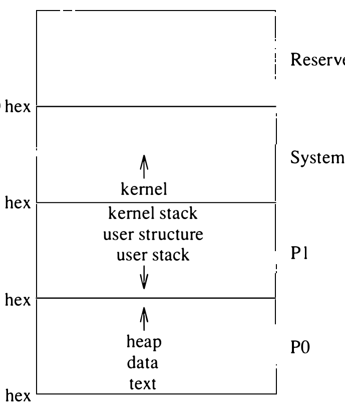
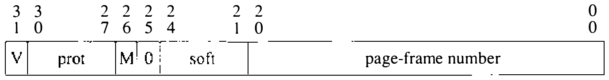
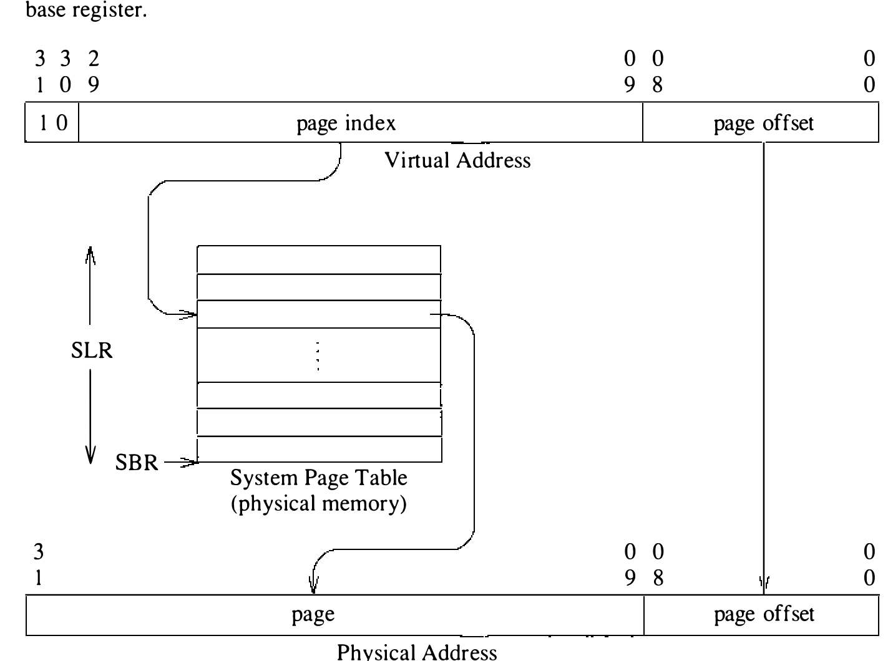
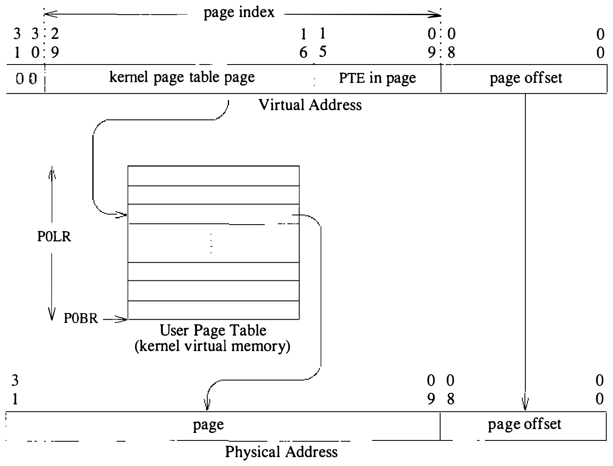

# 5.3 VAX 存储管理硬件

本节概述 VAX 的存储管理体系结构——4.3BSD 虚拟内存系统的设计高度依赖它。VAX 硬件的更多资料见 VAX *Hardware Handbook* [DEC, 1980]。Tahoe 处理器的存储管理与 VAX 相仿。

**VAX 虚拟地址空间**

VAX 存储管理硬件支持两级映射机制做地址转换。第一级页表位于系统的虚拟地址空间，映射用户页表；这些页表再映射用户虚拟地址空间。VAX 的 32 位虚拟地址空间划分为四个等大的块，如图 5.3 所示。

其中两个块，即 P0 区和 P1 区，用于用户进程的地址空间。第三块即系统区（system region），包含共享的内核虚拟地址空间；第四区（标记为保留）不受当前 VAX 硬件支持。P0 区从虚拟地址 0 开始向高地址生长；P1 区则从用户虚拟地址空间顶端开始向低地址生长。各区由两个每进程的基址-长度寄存器对描述。Tahoe 的地址空间用满全部四区，系统位于最上面的区。

VAX 上，当前用户进程的虚拟地址空间可以被内核直接寻址。一般地，系统只在内核的低层部分利用这种可直达性——例如在用户空间与内核空间之间搬运数据的 `copyin()` 和 `copyout()` 例程中。只在这样界限分明的例程中使用，既收获了效率，又避免更大范围的使用妨碍可移植性。效率的好处足够大，以致一些非 VAX 实现（如 Sun Microsystems 的 MC68000 机器）也把用户空间映射进内核。

**VAX 页表**

VAX 页大小固定为 512 字节。每个 VAX 页表项（PTE）由 4 字节的映射与保护信息组成，如图 5.4 所示。硬件试图通过 valid 位为 0 的 PTE 转换地址时，产生转换无效故障（translation-not-valid fault），即缺页。多数支持虚拟内存的体系结构（包括 Tahoe）都提供逐页的引用位（reference bit），对应页被引用时由硬件自动置位；VAX 没有这种机制。4.3BSD 仿真引用位的办法在 5.12 节讨论。

**图 5.3 VAX 虚拟地址空间的布局**

**图 5.4 VAX 页表项（PTE）的格式（V 为页有效位；prot 为保护模式字段；M 为页修改位；soft 为软件自定义字段）**

PTE 的字段保存持有该地址数据的物理页地址，以及规定页能否读写的访问模式。每个 PTE 有 4 位保留给软件使用，VAX 存储管理硬件不解释它们。最后，PTE 中的 1 位，即修改位（modify bit），每次页被修改时由硬件置位。

VAX 页表在使用期间驻留主存。硬件支持页表本身的调页，但 4.3BSD 未利用这一设施。

**系统地址转换**

地址空间的每个区由一张单独的页表映射。系统空间由系统页表映射，它在主存中物理连续。系统页表在引导时建立后，即把两个硬件寄存器设为它的地址和长度：系统基址寄存器（SBR）保存系统页表的物理地址，系统长度寄存器（SLR）保存页表中的项数。4.3BSD 中系统页表是静态分配的，系统映射的大小因此在编译内核时确定。

既然 32 位 VAX 地址空间分为四个等大的区，地址的最高两位就决定了地址落入哪个区（见表 5.1）。

**表 5.1 高位地址与区的映射**

| 高位地址 | 区 |
| ---- | ---- |
| 11 | 保留 |
| 10 | 系统 |
| 01 | P1 |
| 00 | P0 |

选定区之后，其余地址位被解释为区内的页号和页内字节偏移。页各为 512 字节，低 9 位给出页内字节偏移，其余 21 位指明区内的页索引。

内核地址的虚拟地址转换如图 5.5 所示。地址的第 30、31 位判定它属于系统空间后，从第 9 到 29 位提取页索引。索引对照系统长度寄存器检查，有效则与系统基址寄存器相加找到 PTE。存储管理硬件转换地址时，找到 PTE，检查页是否驻留、所需访问是否被允许，然后取出物理页号。最后，物理页号与页内字节偏移合并，生成物理内存地址。

**图 5.5 系统虚拟地址转换（SLR 为系统长度寄存器；SBR 为系统基址寄存器）**

**用户地址转换**

与系统页表不同，用户页表（映射 P0 和 P1 区）位于虚拟内存而非物理内存。映射 512 字节一页需要 4 字节的表项，若把映射 1 GB 区的表项全部建齐，需要 8 MB 页表。好在硬件把这些页表定位在内核虚拟内存中，因此页表不必所有页同时驻留（尽管系统并未利用这一能力）。结果，用户地址的虚拟地址转换过程是使用两级页表的两步转换。

与系统页表一样，P0 页表也由两个硬件寄存器描述。P0 基址寄存器（P0BR）是当前进程 P0 区页表起始处的系统虚拟地址；P0 长度寄存器（P0LR）保存 P0 表中的项数。每次上下文切换时这些寄存器从 PCB 恢复，因为它们通常因进程而异。P1 区类似地由 P1 基址寄存器（P1BR）和 P1 长度寄存器（P1LR）描述。两个基址寄存器都指向 1 GB 区映射的开头。不过，P0LR 给出 P0 映射中 PTE 的个数，P1 长度寄存器给出的却是 **在区之外** 的项数。这一方案为段的增长做了优化：扩展只需改动长度寄存器。

引用 P0 或 P1 地址时的虚拟地址转换过程与系统地址转换类似，只是页表的位置不同。地址高位选定一个区；随后与系统地址一样，从地址第 9 到 29 位提取页索引。索引与相应的长度寄存器比较：小于 P0 空间长度寄存器的值（对 P1 空间则是大于等于）即页号有效。索引再与基址寄存器合并，得出 PTE 的系统虚拟地址。图 5.6 显示查表找到所需页表项的转换。这个系统地址按前述方式转换，算出获取用户 PTE 的物理地址。最后检查 PTE 的有效性和页的保护，取得物理页号。页偏移与页地址相加得到最终物理地址。

注意，用户（P0 和 P1）页表位于内核虚拟内存，意味着找到一个用户物理地址需要两次转换：一次用系统页表，一次用 P0 或 P1 页表。这一转换机制可以看作用户地址的两级页表。由于用户页表按页分配、由系统页表映射，页索引（用户虚拟地址的第 9 到 29 位）可视为两部分：第 16 到 29 位选定一页 PTE，第 9 到 15 位选定页内的一个 PTE。于是，一个内核 PTE 映射一页 512 字节的内核内存，其中装 128 个用户 PTE，后者又映射 64 KB 用户内存。系统地址转换只用一张页表，因此系统页表只有单级转换。

**图 5.6 用户虚拟地址转换（P0LR 为进程长度寄存器；P0BR 为进程基址寄存器）**

（译注：原书初版图 5.6 中虚拟地址的最高两位印作 10，作者在再版勘误中更正为 00。本图是 P0 区的用户地址转换，最高两位应为 00，与表 5.1 相符；图中数值保留原书图像原样，未作改动。）

**缺页**

转换虚拟地址期间，存储管理硬件可能发现某个 PTE 的 valid 位没有置位。找到这种 PTE 时，当前指令在所需页调入内存、PTE 标记有效之前无法完成。存储管理硬件以陷入系统态的陷阱序列发起一次缺页。未决指令回退到开头，以便重启。重启要求撤销一切副作用（如寄存器或内存的修改），使它们只被执行一次。（字符串搬移等少数复杂指令可以设置状态，使指令得以续行而非重启。）故障发生时，操作系统取得控制并分析故障。正常情况下，从磁盘取来一页或为进程分配一个新页。更新 PTE 之后，系统从陷阱返回。返回用户态使 CPU 重新尝试执行原指令。

存储管理硬件还可能发现其他妨碍地址转换完成的状况：页索引可能超出相应长度寄存器的范围，或者访问可能不被 PTE 的保护字段允许。硬件检测到这两种状况之一时，向内核陷入而不是完成地址转换。多数这类陷阱使内核向进程投递信号（SIGSEGV 或 SIGBUS）而不是继续执行。有一个例外：栈指针低于当前栈段但仍在 P1 区内时，内核自动扩展栈并返回用户程序。

**转换检测缓冲区**

使用两级页表且页表位于主存，意味着取一个虚拟地址的内容可能需要多达三次内存引用。若每次内存引用都要如此，代价将无法承受，因此硬件维护一个 PTE 的高速缓存，称为转换检测缓冲区（translation lookaside buffer）。执行地址转换时先查转换检测缓冲区中的匹配项，从而避免内存访问。所需转换不在缓存中时，便将其取来放入缓存，可能挤掉较旧的项。

转换缓存的存在要求操作系统在内存中修改 PTE 时清洗所有失效转换（stale translation）。VAX 上清洗可以整体进行——向转换检测缓冲区全清洗（TBIA）寄存器写零使整个缓存失效；也可以逐项进行——把虚拟地址写入转换检测缓冲区单清洗（TBIS）寄存器使单个表项失效。
