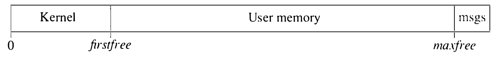

# 5.4 主存管理：核心映射表

4.3BSD 把主存逻辑地分为两部分。内核永久驻留内存，用内存装它的正文段和大部分数据段。此外，进程表等同样必须驻留的内核数据结构在内核初始化时分配。主存的其余部分按需分配给进程（见图 5.7）。（内存顶端的一小块用来保存最近打印到控制台的几条消息；这种安排使系统崩溃后仍可做事后调试。）



**图 5.7 进程可用的物理内存（msgs 为消息）**

核心映射表（core map）是管理主存的中心数据结构。它是一个结构数组，主存中每一页簇对应一个表项，分配给内核正文和数据的除外。核心映射表在引导时分配，是自举过程的最后几步之一。它管理从内核数据段末尾的 `firstfree` 到 `maxfree` 的一段连续主存，如图 5.7 所示。这段连续区域就是主存中可供用户进程使用的部分。

核心映射表维护成一个连续的结构数组，每页簇一项。元素虽小（4.3BSD 中 16 字节），数量一大，总尺寸也可能很大。因此，页簇取大为宜，以减少元素个数和数组大小。核心映射表结构的定义见图 5.8。

```c
struct cmap {
unsigned short c_next,      /* 空闲表下一项的
                                   下标 */
               c_prev,      /* 空闲表上一项的
                                   下标 */
               c_hlink;     /* <块号,设备> 的散列链接 */
unsigned short c_ndx;       /* 属主进程或正文的下标 */
unsigned int   c_page:21,   /* 段内虚拟页号 */
               c_lock:1,    /* 为裸 I/O 或 pagein 锁定 */
               c_want:1,    /* 有人等待 */
               c_intrans:1, /* 转移中位 */
               c_free:1,    /* 在空闲表上 */
               c_gone:1,    /* 关联页
                                   已被释放 */
               c_type:2,    /* 类型 CSYS、CTEXT、CSTACK
                                   或 CDATA */
               :4,          /* 补齐到长字边界 */
               c_blkno:24,  /* 本页是其副本的磁盘块 */
               c_mdev:8;    /* 来自哪个已挂载
                                   设备 */
};
```

**图 5.8 核心映射表结构的定义**

核心映射表数组与可供分配的主存页簇一一对应，给定一个核心映射表结构找页簇、给定页簇找结构都很简单。因此，4.3BSD 的存储管理例程常用核心映射表结构作为引用主存各部分的手段。

核心映射表结构有几种不同的用途：

* 结构记录页簇当前使用情况的信息。这些信息可以用来把物理内存地址映射回虚拟内存地址。

* 空闲页的核心映射表元素链成内存空闲表。

* 逐簇的加锁与同步经由核心映射表结构进行。

* 内容尚有用的空闲页靠核心映射表定位。

随后几小节逐一展开这些功能。

**物理到虚拟的转换**

核心映射表的第一项功能是存放对应页当前使用情况的信息。信息以紧凑形式存放，以节省空间。页在其核心映射表项中的类型为系统、正文、数据、栈之一。系统页的核心映射表项无须包含其他信息，因为针对核心映射表的操作对它们没有影响。除此之外，表项含一个到正文表（正文页）或到进程表（数据和栈页，以及正文段可写的可执行程序）的下标，标识页簇的当前使用者。核心映射表项还含一个页索引，描述页在包含它的虚拟段中的位置。这两项足以定位使用该核心映射表结构所对应内存的进程（可能不止一个）的 PTE。于是，核心映射表结构中的信息支持从物理地址到虚拟地址的转换，正如页表支持反方向的转换。

**内存空闲表**

核心映射表的第二种用途是构建内存空闲表（memory free list）。所有未分配的主存簇用核心映射表结构的两个字段链成的双向链表串在一起。为节省空间，内核用 16 位下标而非 32 位指针构造这些链（至少在 VAX 上如此）。

空闲表按最近最久未使用（LRU）的次序维护，充当可能有用的数据的缓存：也就是说，内容有用的簇在空闲表上可以被回收，直到被覆写。正因为把它当缓存用，空闲表才维护成双向链表。每个核心映射表结构中的 `c_free` 标志指示簇是否在空闲表上。

**同步**

核心映射表是逐页簇操作的虚拟内存功能的同步点，因此两个同步标志（`c_lock` 和 `c_want`）存放在这里。缺页服务期间做 I/O 时内存页被锁定；直读直写用户进程页面的裸 I/O 操作期间也锁定。页面置换算法（稍后描述）释放脏页之前必须先把它们写入交换区；页面置换守护进程在操作期间锁定这些页，避免与缺页处理程序 `pagein()` 相互干扰。

页填充操作期间还用一个额外的标志，为共享一页的多个进程做同步。这个标志即转移中标志（in-transit flag，`c_intrans`），在页簇的读已发起到簇可供使用之间置位。若不驻留簇的多个使用者几乎同时想用它，这个标志保证只有第一个进程启动读操作。

**正文页缓存**

如上一小节所述，空闲页上可能存着有用的数据。一种特别的情形——纯正文段的页——需要维护专门的信息，用来标识页最初来自哪个文件。文件信息以 <设备,块号> 对的形式记在核心映射表结构中。设备信息要么用文件系统挂载表中的下标指明一个已挂载文件系统，要么用为交换设备保留的伪挂载设备下标。块号是数据来源的文件系统块号。

**核心映射表的限制**

核心映射表结构的紧密封装迫使许多字段的位数受限。结果，核心映射表结构成为系统可支持的其他对象规模的主要限制。核心映射表限制了：

* 可支持的主存量（通过链接字段）
* 已挂载文件系统的数量（通过用于标识页簇来源的文件系统下标）
* 文件系统的大小，包括交错排列的交换空间（通过文件系统块号字段）
* 进程和共享正文映像的数量（通过在进程表和共享正文表中用作下标的字段）

**内存分配例程**

主存经 `memall()` 和 `vmemall()` 两个例程之一分配。两者只有一点不同：主存不够时 `memall()` 返回失败，而 `vmemall()` 会等内存释放，所以总能成功；后者用 `memall()` 做实际分配。新分配的内存总得先映射进某个虚拟地址才能使用，因此这些例程以填写一段虚拟地址范围的方式工作。`memall()` 例程接受指向映射该范围起点的 PTE 的指针、页数，以及用于建立核心映射表项的进程和类型。对范围内的每一页簇，`memall()` 从内存空闲表头摘下第一个核心映射表项找到内存。若该页的先前使用者仍持有引用，则定位并清除相应的 PTE。然后把页号记入簇内各 PTE，再用调用者提供的信息初始化核心映射表项。

释放内存有两个接口。`memfree()` 例程回收分配给一段虚拟地址的全部内存，前提是所有页都驻留。另一个接口 `vmemfree()` 只回收一段虚拟地址中与驻留页相关联的内存，无视不驻留的页。

主存池在引导时初始化，纳入内核未静态使用的全部页。用户进程的页和页表的页从这个池分配。内核的某些部分（如网络）也从池里分配。但网络常常需要在中断级分配内存，内存必须保有余量以免丢包。出于这一考虑以及 5.12 节所述的理由，内核试图维持至少最少的空闲内存（数量是可配置的参数）。当前空闲内存量保存在全局变量 `freemem` 中，需要内存又不能阻塞的例程可以查它。这个变量还用于同步：进程可以在 `freemem` 的地址上入睡等待更多内存；内存短缺之后释放时会唤醒它们。
