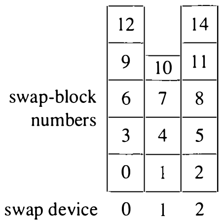

# 5.5 交换空间管理

早期 UNIX 在一块磁盘上保留单一区域作交换区。活跃进程放不进主存时，进程就在这个区域换进换出。总体上交换活动很少：系统都按避免交换来配置，因为一旦需要交换活跃进程，系统性能就无法接受。虚拟内存的引入给交换设备提出了新要求：更大的程序要更大的交换区，持续不断的调页带来更多与交换设备之间的传输。为了让调页从磁盘获得更高性能，4BSD 使用多块磁盘上的交换区：把多个磁盘上可用的交换分区交错（interleave）成单个逻辑交换设备。设备以 `dmmax` 块的边界交错，使最大尺寸的分配绝不跨设备。`dmmax` 的值取决于为系统配置的虚拟内存上限，从 0.5 到 2 MB 不等。要用的交换设备预先配置进内核；各设备的大小在自动配置期间算出。交换区不必等大；交错按可用设备的最大尺寸计算。交错设备上交换块的排序见图 5.9；每个方块代表 `dmmax` 块，虚拟块号按图中次序递增。

**图 5.9 交换块交错**

由于系统必须立即可用至少一个交换设备，第一个交换设备在引导时启用；映射到它的虚拟交换块放入一张交换资源映射表。其余交换设备由系统启动时的 `swapon` 系统调用启用，交错交换设备中属于它们的那一段同时投入使用。

进程各段的交换空间在段增长时分配。由于交错，资源分配器不会返回跨设备的交换块。因此，一段的各个块各自映射到单一磁盘设备。用交错而不是简单拼接交换设备，倾向于把空间分配在交换设备上摊匀，让交换和调页的传输分散到多块磁盘上。
