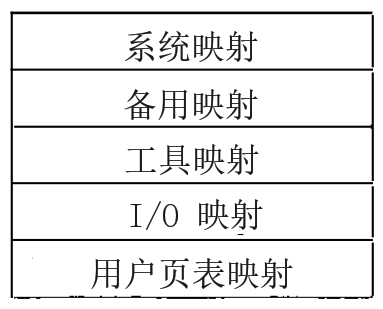
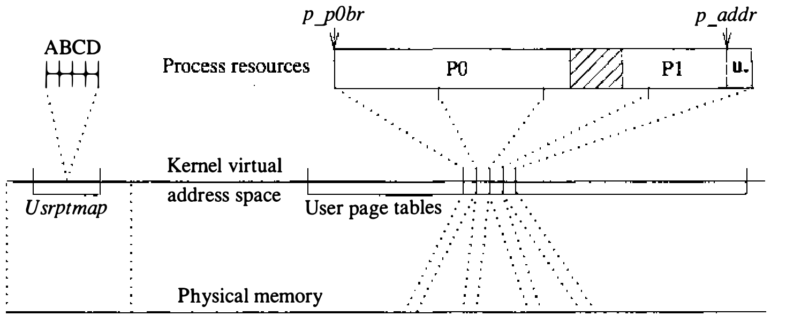
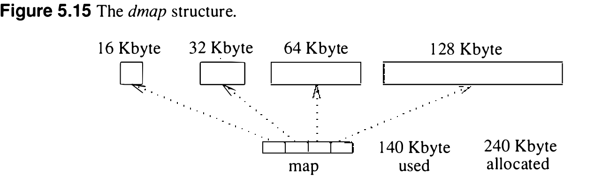

# 5.6 每进程资源

第 4 章讨论了 UNIX 进程的若干组成部分。每个进程由一个 proc 结构（从内核数据段的表项数组中分配）和一个动态分配的 user 结构描述。本节考察 4.3BSD 中 UNIX 进程的内存使用。先看进程的页表如何描述进程的虚拟内存，接着讨论进程生命周期中可能存在的各类 PTE，最后考察与共享正文段关联的共享资源，以及为每个进程在辅存上分配的空间。

## 4.3BSD 进程虚拟地址空间

VAX 上的 4.3BSD 用 P0 区装进程的正文段，正文段之后是数据段。内核栈和 user 结构存在 P1 区顶端，用户栈在它们下方向下生长。每个 VAX 进程 P0 和 P1 区的页表集在进程上下文切换期间保存和恢复。把内核栈和 user 结构放在 P1 区，既让这些对象位于固定地址，也使它们在每次上下文切换时能作为用户地址空间的一部分快速重映射。P1 区顶端装 user 结构和内核运行时栈的各页对用户进程只读。这些页让用户可读的一个好处是，存在 user 结构中的信号蹦床代码随手可用（见 4.7 节）。

## 页表

正如 5.3 节考察 VAX 存储管理体系结构所见，每个进程必须有一组页表描述与其关联的内存。两级的转换过程意味着进程持有两类资源：映射 P0 和 P1 区的用户页表，以及映射这些用户页表的系统页表的一部分。

4.3BSD 中，系统页表静态分配，由若干较小的页表拼接而成（见图 5.10）。映射中的静态项在引导时填好，其余随用随填。第一节（Sysmap）映射内核代码的固定部分、数据和引导时分配的表；这一节还映射文件系统的缓冲区高速缓存（见 7.5 节）。



系统页表的第二块划分为若干节，供内核不同部分用来映射当前未在执行的进程的 user 结构。第三块是内核内存动态分配和主存页临时访问的映射。映射的第四节面向 I/O 空间而不是主存，使设备驱动和自动配置过程能直接访问外设寄存器。系统页表的最后一段，用户页表映射（Usrptmap），用来把用户进程的页表映射进内核地址空间。由于难以再分配物理连续的内存来扩展系统页表，Usrptmap 大小固定。标准大小是 32 页，足够映射 4096 页用户页表，后者又映射 524,288 页内存。于是标准配置可支持驻留进程的虚拟内存总量至多 256 MB 的页表。

进程需要若干连续的系统 PTE 来映射自己的页表。Usrptmap 表项的分配由一张名为 `kernelmap` 的资源映射表管理。资源映射表是描述资源空闲段的有序 <基址， 大小> 对数组（见图 5.11）。`rmalloc()` 用首次适应算法从资源映射表分配给定大小的段，随后由 `rmfree()` 释放。kernelmap 在引导时初始化为包含全部 Usrptmap 表项。分配了空间的 kernelmap 下标既用作 PTE 数组的下标，也用作与这些页对应的虚拟地址数组的下标。P0 和 P1 页表用一组 kernelmap 表项放在相邻区域。

```sh
(base)   0        8        16             29   36   42        48
resource:|        |  in use |              | in use |  in use |        |
(size)      8        8            13          7      6          6     15
resource map: <0,8>, <16,13>, <36,6>, <48,15>
```

图 5.11 一张内核资源映射表

在用户页表映射中保留一块区域，为进程提供了存放页表的虚拟地址范围。但还须给这个虚拟地址范围分配物理内存的页。这些页用 `vmemall()` 或 `memall()` 分配，两者都已在 5.4 节描述。

注意，此过程中进程的全部用户页表都得到分配，尽管相应的系统 PTE 本可以保持无效。4BSD 这样做是因为它不支持页表调页；进程的所有页表总是分配内存。这一政策是从系统先前版本沿用下来的，但随着进程最大规模与日俱增，代价已经相当高。

图 5.12 展示进程页表的布局。图中进程的页表占 4 页内存，由 Usrptmap 中 4 个内核 PTE 映射。进程页表的第一节是 P0 页表，P0BR 指向它的开头。P0BR 的值存在 PCB 里供 VAX 硬件使用，也以 `p_p0br` 存在 proc 结构中。P1 页表放在 P0 页表之后，在页边界上结束。这一区域另维护一个指针：proc 结构的字段 `p_addr` 指向 user 结构的第一个 PTE（在 P1 映射的末端附近）。两节之间的空隙允许少量就地扩展。扩展很复杂，在 5.9 节处理。



## 页表项的类型

进程创建时地址空间是空的，因此它的 PTE 的 valid 位不置位。随着进程执行，对正文段的内存引用引起缺页，把页从磁盘上的目标文件映像调入。这类缺页称为按需填充缺页（fill-on-demand page fault），初始状态下相应的 PTE 就叫按需填充 PTE（fill-on-demand PTE）。

PTE 的 valid 位不置位时，硬件只检查保护字段。表项的其余部分可由软件任意使用。4.3BSD 利用这一点，在 PTE 的未用部分存放处理首次缺页时将要用到的预计算信息。所有用户进程的 PTE 都以这种方式初始化。由于执行期间 valid 位后来被清掉可能有多种原因，另定义一个纯软件位表明页是否仍是按需填充页。若是，PTE 信息的另一种解释仍然有效。

正常 PTE 的结构定义 `struct pte` 见图 5.13，按需填充 PTE 的 `struct fpte` 见图 5.14。两个结构中 valid 位和保护位如硬件要求的一致；按需填充位也相同，用于区分该用哪个结构解释给定的 PTE。

```c
struct pte {
unsigned int  pg_pfnum:21,  /* 页框号 */
              :4,
              pg_fod:1,     /* 按需填充 */
              pg_m:1,       /* 已修改 */
              pg_prot:4,    /* 保护 */
              pg_v:1;       /* 有效 */
};
```

图 5.13 正常页表项（`struct pte`）

```c
struct fpte {
unsigned int  pg_blkno:24,  /* 文件系统块号 */
              pg_fileno:1,  /* 从正文填充还是零填充 */
              pg_fod:1,     /* 按需填充 */
              :1,
              pg_prot:4,    /* 保护 */
              pg_v:1;       /* 有效 */
};
```

图 5.14 按需填充页表项（`struct fpte`）

区分 PTE 的规则总结于表 5.2。下面四段分别描述每种状态的 PTE。

表 5.2 页表项的类型

| 有效（`pg_v`） | 按需填充（`pg_fod`） | 页号（`pg_pfnum`） | 结构类型与用途 |
| ---- | ---- | ---- | ---- |
| 0 | 1 | （无） | `struct fpte`；按需填充页 |
| 1 | 0 | 非零 | `struct pte`；有效、驻留页 |
| 0 | 0 | 非零 | `struct pte`；无效、驻留页 |
| 0 | 0 | 零 | `struct pte`；无效、不驻留页 |
| 1 | 1 | （无） | 未用 |

按需填充页有两种：从文件填充，或以零填充。正文页和已初始化数据页从可执行正文映像文件填充；未初始化数据（bss）、动态扩展的堆和栈区以零填充。两种类型由 `fpte` 结构的 `pg_fileno` 字段区分，取值 PG_TEXT 或 PG_ZERO。页应从正文文件填充时，相应页的预计算磁盘块号在 `pg_blkno` 字段找到，磁盘设备号可从正文表项取得。这些值在为共享正文文件初次建立页表时一次性算好。块号之所以预先计算，是因为计算通常要多次访问辅存，相对缓慢。预计算保证所有必要的文件系统结构首次访问后都会留在缓冲区高速缓存中。

页有效时，它被假定驻留主存。有效 PTE 总含非零的页号，即此地址映射到的物理内存页号。

PTE 无效但记录了非零页号的页，已有一页主存分配给它。这种情况下，下列之一为真：

1. 页正从磁盘填充：页面换入操作进行中。
2. 页正写往磁盘：页面换出操作进行中。
3. 正在该页上仿真引用位。

最后一种情形为 VAX 所特有。页面置换算法本想清除页的引用位（如果有）时，它清除的是 valid 位。valid 位清掉后，进程一用该页就引发缺页。缺页服务例程会注意到页在其他方面有效，这次缺页只是要注明页仍在使用。缺页服务例程只须恢复 valid 位，把页标记为既有效又被引用。5.12 节详细讨论页面置换算法的运作。

PTE 的最后一种状态是 valid 位与按需填充位都清零、页号为零。这表示该 PTE 的页创建并调入过内存，但后来被移到了交换空间。

## 修改过的页

PTE 中用于有效页的最后一个字段是修改位。VAX 上，为写操作转换该页地址时由硬件置位。标记为修改过的页要从内存移走时，必须先存入交换空间才能释放。页首次创建并填充时修改位即置位，迫使页第一次释放时被保存。正文页本可以从文件系统重新填充，但它的文件系统位置已被物理页号覆盖。把它们存到交换空间比重新计算磁盘块位置更快，因为后者可能要读间接块（见 7.2 节）。

## 正文页表

4.3BSD 中进程间共享的内存只有纯正文可执行程序的指令区（`vfork` 除外，见 5.7 节）。在 VAX 上，实现这种共享最高效的办法是给每个共享正文段配一套页表，共享该正文段的每个进程都引用这套页表。但系统没有这样做，因为那会要求正文节起止都在 64 KB 边界上，给二进制站点带来用户可见的不兼容变化。取而代之，共享正文段的进程各自维护引用该正文段物理页的页表副本，系统通过传播装入、失效或换出正文页引起的变化保证这些表保持一致。

## 交换空间

在虚拟内存操作系统中，程序可以在物理内存驻留不足其全部地址空间的情况下运行。但系统必须随时能够取得或创建地址空间任何一节的内容。请求调页下，进程的地址空间起初空无一物：地址空间的一部分映射到文件中的可执行映像，其余部分标记为首次引用时零填充。之后，已经创建并使用过的页可能需要移出内存给别的页腾地方。移出的页若内容无法重建，必须保存在辅存。4BSD 虚拟内存系统从不试图重建已调入内存的页的内容（例如，即使文件和页都未修改，也不再从可执行映像调页）；这样的页一律存入交换空间。交换空间使用磁盘上的保留区域，不含任何文件系统结构，通常每区 16 或 32 MB，在一块或多块磁盘上。为免在不巧的时刻用尽交换空间，系统为每个程序分配足够的交换空间，使程序的所有页在必要时都能写入。预分配交换空间的决定在系统最初设计时是合理的：当年的 VAX 系统主存一般不超过 4 MB，却常有多块总计数百 MB 的磁盘。然而 16 到 128 MB 的内存已渐平常，磁盘容量的增长却慢得多。

进程交换空间的分配与映射由一种称为交换映射（swap map）的数据结构描述。每个进程有两张交换映射：一张描述数据和堆段（P0 空间除去正文）的交换区，一张描述栈段。进程还可以引用一张描述共享正文映像正文段的交换映射。共享正文交换映射与每进程交换映射分开维护，稍后描述。

每进程的区可动态独立增长，大小从几 KB 到许多 MB 不等。若交换映射用固定大小的块，要么大进程需要大映射，要么小进程不得不超额分配，因内部碎片损失不少空间。小进程的问题可以把最后一个交换块削减到实际所需来缓解。但这样的削减会使段的增长变昂贵，因为可能要把一个小交换块从磁盘搬到磁盘、复制到较大的块。

4.3BSD 对这个问题的解法是使用含不同大小块交换地址的定长交换映射。图 5.15 展示一个 140 KB 进程的交换映射。每块的大小由它在映射中的下标决定：第一块大小为 `dmmin`，标准 4.3BSD 配置把 `dmmin` 设为 32 扇区（16 KB）；后继各块逐个翻倍，直到达到 `dmmax`。进程使用的每块都全额分配，长到块尾很简单；长过最后一块的末尾就分配一个新块。于是，小进程全由小块组成，碎片最少；大进程仍能用中等大小的映射描述。实际的进程段交换映射称为 `dmap` 结构，含分配给该段的交换空间量、当前使用量，以及已分配各块交换块地址的定长数组。每个进程的 user 结构为 P0 空间的数据部分保存 `u_dmap`，为 P1 空间的栈部分保存 `u_smap`。



正文段的交换空间另作处理：磁盘上只需存一份，而且大小恒定。正文结构保存一个映射交换映像的块指针数组。除最后一块外每块大小固定为 `dmtext`，通常 512 KB；最后一块只装正文映像剩余部分所需的 1 KB 簇数。
