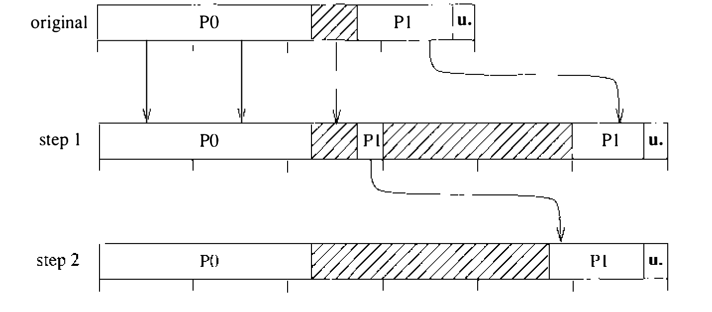

# 5.9 更改进程大小

进程执行期间可以通过 `sbrk` 系统调用显式请求更改数据（堆）区的大小；栈在栈区末端之下生长引发保护故障时，栈段也会自动扩展。两种情况下都必须改变进程地址空间的大小，因此必须更改相应页表和交换映射的大小。若变更是缩小数据段，操作很简单：释放分配给即将退出地址空间的各页的内存，清除多余的 PTE。此后对这些地址的引用将引发保护故障，因为保护字段为零时拒绝访问。

更常见的变更方向是扩大数据、栈两个进程段之一。新页标记为零填充，因为地址空间的新节起初没有内容。第一步检查新尺寸是否违反所涉进程段的尺寸限制。新尺寸在限度内时，按需扩大该段的交换映射。回想一下，这些段的交换映射按映射下标以固定大小的块分配，且同时维护当前大小和当前分配量。当前分配量够得下新尺寸，就只改大小，无须新分配；超出了，就在后继槽位向映射添加整尺寸的新块，直到分配够用。这一过程与 `exec` 创建进程时的完全相同。

取得足够的交换空间后，通过修改 proc 和 user 结构中的区尺寸来调整地址空间，然后计算页表的新大小。页表的大小总是向上取整到下一页簇的末尾，P0 与 P1 页表之间可能夹着未用的表项。剩余空间可能装得下新增表项；装不下就必须扩展进程的页表。页表的扩展总是靠分配完整的一段新系统页表并复制页表 PTE 完成；为简单起见，从不靠分配相邻空闲表项就地增长。如 5.6 节所述，一张进程页表需要若干从 kernel map 分配的连续系统 PTE，以及这些系统 PTE 映射的物理内存。

图 5.17 说明如何在用户页表映射中分配一组新的系统 PTE，为新页映射腾出足够的页。内核不是为用户页表分配新的内核内存再复制表，而是在用户页表映射中复制系统 PTE，把页表页映射到新区。只含栈或 u. 页表的页移到新区末尾，其余页移到新区开头，如步骤 1。两节之间的新页分配后清零，使未用部分的保护字段为零。与 P0 映射同享一页的栈（P1）表项复制到新区末尾的正确位置，如步骤 2。在此期间，用户页表在新旧两个地址双重映射；内核运行在 P1 空间的栈上，这一操作期间栈页表绝不能失效。新用户页表就绪后，更新硬件和软件的页表基址与长度寄存器，旧系统 PTE 即可释放。为被明确请求的那部分地址空间新映射的 PTE 初始化为读写、零填充；其余新表项留着不初始化，直到新的请求需要用到。

**图 5.17 页表扩展**

从 kernel map 分配系统页映射或为新页表页分配内存失败时，内核把进程换出，等待足够的页映射空间。由于新尺寸已设置好（在进程结构里），进程换入时就会有正确的大小；增长过程以新 PTE 的初始化收尾。因此，进程若增长到需要系统页表的一半，就必须靠换出来扩展页表。
