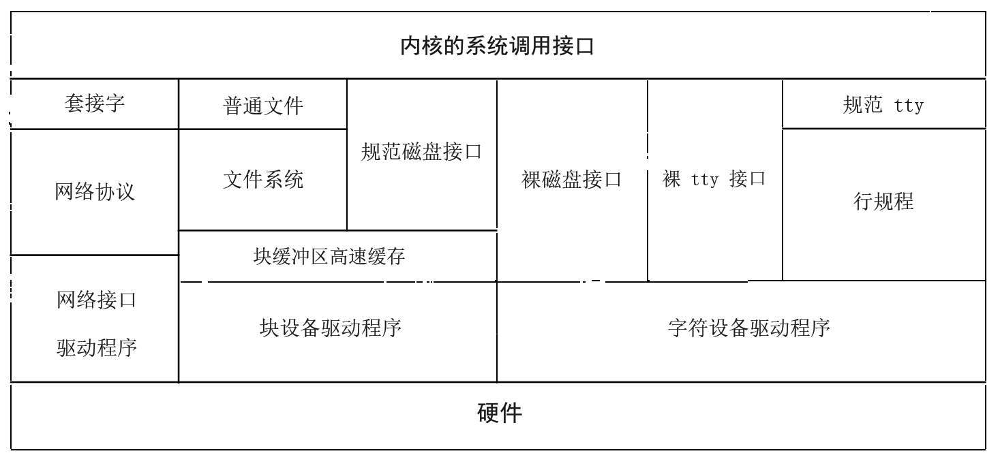

# 6.1 从用户到设备的 I/O 映射

文件系统（第 7 章）和套接字接口（第 10 章）等高层内核设施对用户隐藏了硬件设备的许多特性；I/O 系统则对内核的其余部分隐藏另一些特性。I/O 系统由缓冲区高速缓存系统、通用设备驱动代码以及最终必须应对具体设备特性的特定硬件驱动组成。各种 I/O 系统概括于图 6.1。

**图 6.1 内核 I/O 结构**

4.3BSD 有四大类 I/O：文件系统、字符设备接口、块设备接口，以及套接字接口及其相关的网络设备。字符和块接口出现在文件系统名字空间中。字符接口对底层硬件提供无结构（unstructured）访问，块设备则提供有结构（structured）访问。网络设备不出现在文件系统中，只能经套接字接口访问。

对字符设备和块设备，各有一张供各种驱动使用的入口点数组。设备由类别和设备号（device number）区分。设备号分两部分：主设备号（major device number）索引相应类别的表，找到进入相应设备驱动的入口；次设备号（minor device number）由设备驱动自行解释，例如解释为一个逻辑磁盘分区或一条终端线路。

所有设备驱动只经三样东西与内核的其余部分相连：记录在其类别表中的入口点、对公共缓冲系统的使用，以及对公共低层硬件支持例程和数据结构的使用。这种隔离对可移植性和系统配置都很重要。

**字符设备**

系统中除网络接口外的几乎一切外设都有字符设备接口。字符设备通常把硬件接口映射成字节流，与 UNIX 文件系统的字节流类似。这类字符设备包括终端（如 **/dev/tty00**）、行式打印机（如 **/dev/lp0**）、物理主存的接口（**/dev/mem**），以及一个装不满的数据无底洞和一个取之不尽的文件结束符之源（**/dev/null**）。其中一些（如终端设备）在行边界上可能有特殊行为，但一般仍按字节流对待。

终端类设备使用 C 链表（C-list），一种比磁盘和磁带所用缓冲区更小的缓冲区。这种缓冲系统由保存在链表中的小块（通常 64 字节）字符组成。虽然所有空闲字符缓冲区都放在单一的空闲表上，多数使用它们的设备驱动都限制单个终端端口一次可排队的字符数。

高速图形接口等设备可能有自己的缓冲区，或者总是把 I/O 直接做到用户的地址空间；它们也归入字符设备。这类驱动有些能识别特殊类型的记录，因而离纯粹的字节流模型更远。

磁盘和磁带的字符接口又称裸设备接口（raw-device interface）；它提供对设备的无结构访问。它的首要任务是安排与设备之间的直接 I/O。磁盘驱动把磁道、柱面之类的细节与内核其余部分隔开，还靠维护和排序一个待决传输的活动队列来处理 I/O 的异步性。队列中的每个表项指明是读还是写、传输的主存地址、传输的设备地址（通常是磁盘扇区号）以及传输大小（以字节计）。

底层硬件的其他一切限制都经字符接口透传给客户，使这些字符设备接口离字节流模型最远。因此，用户进程必须遵守底层硬件强加的分扇区限制：对磁盘，文件偏移和传输大小必须是扇区大小的整数倍。字符接口不把用户数据先复制进内核缓冲区再排入 I/O 队列，而是安排 I/O 直接做到或取自进程的地址空间。传输的大小和对齐受物理设备限制，但传输大小不受系统内部缓冲区最大容量的限制——因为根本不用这些缓冲区。软件确实限制单次传输至多 65,535 字节；这一限制是许多设备本身承袭 PDP-11 的历史产物。

字符接口通常只有对磁盘或磁带上的数据结构有透彻了解的系统实用程序才使用。字符接口也支持用户级的原型开发：例如，4.2BSD 的文件系统实现起初就是作为一个使用裸磁盘接口的用户进程编写并大体测通的，之后代码才搬进内核。

**块设备**

块设备包括磁盘和磁带。块设备接口的任务，是把用户“磁盘是字节数组”的抽象转换为底层物理介质强加的结构。用户也许只想往磁盘写一个字节，硬件却只能按扇区的整数倍读写。于是系统必须安排读入包含待改字节的扇区、替换受影响的字节、再把扇区写回磁盘。这种把对字节数组的随机访问转换为磁盘扇区读写的工作称为块 I/O（block I/O）。块设备可以通过相应的设备特殊文件直接访问，但更常见的是经文件系统间接访问（见第 7 章）。内核做交换和调页传输时，磁盘驱动也走块设备接口。

进程可能以小于磁盘块的尺寸读数据。某个磁盘块第一次需要小读时，整块从磁盘传进内核缓冲区；随后对同一块各部分的读通常只须从内核缓冲区复制到用户进程的内存。多次小写同样处理：对磁盘块的首次写分配一个缓存缓冲区，随后对同一块各部分的写多半只须复制进内核缓冲区而无须磁盘 I/O。

块缓冲区高速缓存（block buffer cache）除了提供读写任意对齐的抽象，还减少了访问文件系统所需的磁盘 I/O 传输次数。系统参数文件、命令和目录被反复读取，它们的数据块需要时通常已在缓冲区高速缓存中，内核不必每次都从磁盘读。

系统崩溃时若某块的数据还在缓存中未写盘，磁盘上的文件系统就会不正确，数据就会丢失。[^1] 为缓解这一问题，含脏缓冲区的块被周期性强制写出。强制写（通常每 30 秒）由一个用户进程 `update` 执行 `sync` 系统调用来完成。还有一个系统调用 `fsync`，可用来把单个文件的全部块立即写盘；这种同步对数据库的一致性很有用。

实践中，多数磁带访问经相应的裸磁带设备进行，绕过块缓冲区高速缓存。使用缓存时，磁带块仍必须按序写出，因此磁带驱动对它们强制同步写。

**套接字接口的缓冲**

进程间通信和联网使用内存缓冲系统（memory buffering system），简称 mbuf。mbuf 在第 10 章有完整描述；它保存链表中中等大小（通常 112 字节）的字符块。虽然所有空闲 mbuf 都放在单一空闲表上，多数进程间通信设施都限制单个连接一次可排队的字符数。

对套接字描述符的 `write`（或 `send`）系统调用把字符放上该连接的输出队列。若是网络连接，常常随之在网络上启动一次初始传输。若是同机连接，且已有进程在连接上等数据，就让它可运行或通知它有数据可读。无论哪种情况，与投递相关的后续活动都由内核异步处理，不依赖用户进程。输出队列空间不够放下 `write` 系统调用的全部数据时，调用可能阻塞，直到网络或对方进程从输出队列收走足够字符腾出空间。

输入由来自网络或同机其他进程的数据到达所驱动。这种对到达数据的收集异步进行，用户进程不必先发 `read`（或 `recv`）系统调用。输入到达时接收队列空间不够，发送进程就入睡，直到接收方读走部分数据。

用户进程用 `read` 系统调用从输入队列请求数据时，队列中的任何数据立即返回；若队列空，`read` 可能阻塞到有数据入队。

[^1]: 不过，目录内容等关键系统数据是同步写盘的，以确保文件系统一致性；这在第 7 章描述。
