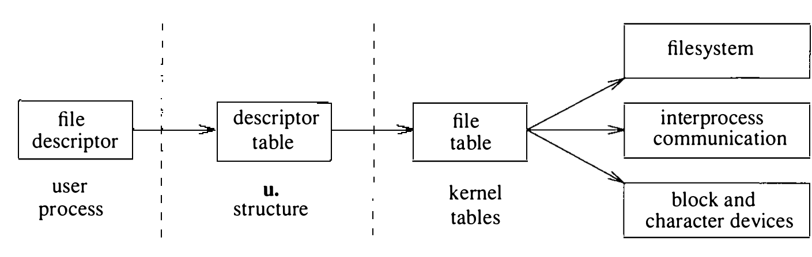

# 6.2 描述符管理与服务

对用户进程来说，一切 I/O 都经描述符进行。描述符的用户接口已在 2.6 节描述。本节描述内核如何管理描述符，以及它如何提供加锁、选择（select）等描述符服务。

引用打开文件的系统调用以文件描述符为参数指定文件。内核用文件描述符索引当前进程的描述符表（保存在进程的 user 结构中），找到一个文件表表项，即 file 结构。这些数据结构的关系见图 6.2。



文件表表项提供文件类型和一个指向下层对象的指针。对数据文件，文件表表项指向一张含文件系统特有信息的表，在第 7 章描述。特殊文件在磁盘上不分配数据块；内核识别出这些文件类型，调用相应的驱动处理它们的 I/O。4.3BSD 的文件表表项还可以引用套接字而非文件。套接字有不同的文件类型，文件表表项指向一个用于进程间通信的系统块。

**打开文件表**

文件表是文件描述符活动的焦点，含有访问下层对象和维护公共信息所需的信息。

文件表是面向对象的数据结构。表中每个表项含一个类型和一个函数指针数组，把对文件表描述符的通用操作转换为与其类型相关的具体动作。4.3BSD 有两种描述符类型：文件和套接字。每种类型必须实现的操作如下：

* 读写描述符的函数
* 在描述符上 select 的函数
* 在描述符上做 `ioctl` 操作的函数
* 关闭、并可能释放描述符所关联对象的函数

注意对象表中没有定义 open 例程。4.3BSD 只在描述符创建之后才以面向对象的方式对待它们。这是因为套接字和文件的特性迥异，在 open 时合并二者会把一个本来简单的接口弄得不堪重负。

每个文件表表项有一个指向包含下层对象实例特有信息的数据结构的指针。该数据结构对操纵文件表的例程不透明。每次调用实现文件表操作的函数时都会传递对该结构的引用。与对象实例相关联的全部状态必须存放在实例自己的数据结构中；下层对象不得自行操纵文件表。

`read` 和 `write` 系统调用不以文件中的偏移为参数；每次读或写都按传输的数据量更新文件中当前的文件偏移量（file offset）。偏移量决定下一次读或写在文件中的位置，可由 `lseek` 系统调用直接设置。由于多个进程可能打开同一文件，而每个这样的进程都需要自己的文件偏移，偏移不能存放在每对象的数据结构中。因此，每次 `open` 系统调用分配一个新的文件表表项，打开文件表保存偏移。

与所有文件描述符相关的语义，在系统调用穿过函数表项之前就在描述符这一级强制实施。这些语义保存在与描述符关联的一组标志中。例如，标志记录描述符是为读、为写还是读写打开。描述符若标记为只读，写它的企图会被描述符代码拦下。于是，为读写定义的函数无须检查请求的合法性——实现它们时可以断定永远不会收到非法请求。

标志中维护的其他信息包括：

* 无延迟（NDELAY）标志。读或写若会使进程阻塞，系统调用改而返回一个错误（EWOULDBLOCK）。
* 异步（ASYNC）标志。内核监视描述符状态的变化，在可以读或写时安排发一个信号（SIGIO）。

普通文件特有的其他信息也保存在标志字段中：

* 描述符对下层文件持有共享锁还是独占锁的信息。尽管锁原语可以扩展为对套接字和文件都通用，套接字的描述符通常都引用同一个文件表表项。
* 追加（append）标志。每次写文件前，偏移指针先设到文件末尾。多个进程写同一日志文件之类的场合，这一特性很有用。

文件表的每个表项有引用计数。单个进程可能因 `dup` 或 `fcntl` 调用而多次引用同一表项；而且 `fork` 之后 file 结构被子进程继承，几个不同的进程也可能引用同一个文件表表项。于是，任一进程对孪生描述符的读写都会推进文件偏移。两个进程由此可以同读一个文件或交替向同一文件穿插输出，而独立打开该文件的另一个进程则通过另一个 file 结构、带着不同的文件偏移引用它。文件结构存在的最初理由正是这种能力：文件结构为文件偏移提供了描述符与下层对象之间的中间存放处。

每创建一个新引用，引用计数加一。描述符关闭时——显式 `close`，或 `exec` 之后因标记了 close-on-exec 而隐式关闭，或进程退出时——引用计数减一。计数最终归零时，文件表表项方可释放。

UNIX 域的进程间通信设施允许在进程之间发送描述符。描述符在进程间传送期间可能没有任何显式引用，却绝不能被释放，因为目的进程收到消息时还要用它。可是消息也可能永远无人接收；于是文件表为每个表项另存一个消息计数（message count）。每有一个描述符在途，消息计数加一；描述符被接收时减一。剩余引用全在消息中时，文件表表项可能需要收回。UNIX 域消息传递的细节见 10.6 节。

close-on-exec 标志放在描述符表而不是文件表中：由于它是文件描述符自身的属性，不在文件表的所有引用之间共享。close-on-exec 标志是唯一放在描述符表而不在文件表中共享的信息。

**描述符管理**

`fcntl` 系统调用操纵 file 结构。它可以对描述符做以下更改：

* 复制描述符，如同 `dup` 系统调用。
* 读取或设置 close-on-exec 标志。进程 `fork` 时，父进程的全部描述符都在子进程中复制；子进程随后 `exec` 新程序。子进程中标记了 close-on-exec 的描述符被关闭，其余的留给新执行的程序。
* 把描述符设为非阻塞模式。读操作有任何数据可用、或写操作有任何空间可用，就立即做一次部分读或写；读无数据、写会阻塞时，系统调用返回一个“操作会阻塞”的错误而不是让进程入睡。这一设施在 4.3BSD 中从未对普通文件实现。
* 强制所有写都把数据追加到文件末尾，而不是写在描述符当前所指的文件位置。
* 可以做 I/O 时向进程发信号。
* 出现异常条件时（如进程间通信信道上到达紧急数据）向进程发信号。
* 设置或读取前述两个 I/O 相关信号应发往的进程标识符或进程组标识符。

`dup` 系统调用的实现很简单。内核从描述符 0 开始扫描当前进程的描述符表，找到第一个未用表项；没有未用表项就返回错误。否则分配该表项，让它指向被复制描述符所指向的同一文件表表项，给文件表表项的引用计数加一，返回所分配表项的下标。`fcntl` 系统调用提供类似功能，只是可以指定从哪个描述符开始扫描。

有时进程想分配一个特定的描述符表表项。这样的请求用 `dup2`：进程指定复制出的引用应放入的描述符表下标。内核的实现与 `dup` 相同，只是找空闲表项的扫描改为：所请求的表项若已打开就关闭，然后照常分配。新旧描述符相同时不做任何事。

读取或设置 close-on-exec 标志经 `fcntl` 系统调用实现：对相应描述符表表项的标志字段做适当动作。`fcntl` 能读写的其他属性操纵的是文件表中的标志。不过这些标志的实现无法由管理文件表的通用代码包办：文件表标志必须穿过对象接口传给类型相关例程，对下层对象做适当操作。例如，套接字非阻塞标志的操纵必须由套接字层完成，因为标志位于套接字结构中，而套接字结构对操作文件表的例程不透明。

`ioctl` 系统调用的实现分为两大部分。上层处理系统调用本身：`ioctl` 调用包括一个描述符、一个命令和一个指向数据区的指针。命令参数编码了参数数据区的大小以及参数是输入、输出还是兼有。上层负责解码命令参数、分配缓冲、复制进输入数据；若要产生返回值而没有输入，缓冲清零。最后经文件表的 `ioctl` 函数，连同 I/O 缓冲，把 `ioctl` 分发给实现所请求操作的底层例程。

底层做所请求的操作：它随命令参数一起收到指向 I/O 缓冲的指针。上层已检查过内存引用的合法性，但底层还须做更精确的参数校验，因为它更了解参数应有的样子。不过它无须把参数从用户进程复制进出。命令成功且有输出时，底层把结果放进上层提供的缓冲；底层返回后，上层把结果复制给进程。

**描述符加锁**

早期 UNIX 系统没有锁文件的措施。需要同步更新文件的进程只好用一个单独的锁文件（lock file）：进程试图创建锁文件，创建成功即可进行更新，失败则等待再试。这一机制有三个缺点：

1. 进程在反复尝试创建锁的循环中空耗 CPU 时间。

2. 系统崩溃遗留的锁必须手工清除（通常在系统启动命令脚本中）。

3. 以特殊系统管理员用户——超级用户——身份运行的进程永远被允许创建文件，只能另想办法。

这些问题虽然都有办法绕开，但都不直截了当，于是 4.2BSD 加入了锁文件机制之外的文件加锁机制。

最通用的加锁方案允许多个进程并发更新文件，其中若干技术在 [Peterson, 1983] 中有讨论。更简单的技术是用锁把对文件的访问串行化。为了达到合理的效率，某些应用需要能锁住文件的一部分。支持字节级粒度的 UNIX 加锁设施早已为人熟知 [Bass, 1981]，System V 中甚至也有。但对标准系统应用而言，文件粒度的锁机制已经够用。

加锁方案可以按其强制程度分类。锁对每个进程都无条件强制的方案称为强制锁（mandatory lock）；只对请求加锁的进程强制的方案称为劝告锁（advisory lock）。显然，劝告锁只有在访问文件的所有程序都使用加锁方案时才有效。强制锁要求内核实现某种越权策略；劝告锁则把策略留给用户程序。UNIX 系统中，超级用户特权的程序被允许无视任何保护方案。由于许多需要用锁的程序必须以超级用户运行，4.2BSD 实现了劝告锁，而没有另造一套与 UNIX 哲学相悖、特权程序又用不上的保护方案。

4.2BSD 的文件加锁设施允许协作的程序对文件加劝告性的共享（shared）锁或独占（exclusive）锁。一个文件上的独占锁只能由一个进程持有；共享锁可以多个并存。共享锁与独占锁不能同时存在于一个文件。别的进程持有独占锁时请求任何锁、或别的进程持有任何锁时请求独占锁，请求都会阻塞到取得为止。由于共享锁和独占锁只是劝告性的，即使一个进程锁住了文件，无视加锁机制的进程照样能访问文件。

锁只在打开的文件上施加或解除。因此进程无须关闭再重开文件就能操纵锁。这一特性很有用：进程想先加共享锁、读些信息、判断是否需要更新，再加独占锁更新文件时尤其如此。

锁请求不能立即满足时会使进程阻塞，某些场合这不令人满意。例如只想检查锁是否存在的进程，需要另一种机制来获取这一信息。因此，进程可以指定其锁请求在不能立即取得时返回错误。能条件性地请求锁，对想照看某个假脱机区的守护进程很有用：守护进程的第一个实例锁住假脱机目录后，后来的守护进程一查便知是否已有活跃实例。锁只在加锁进程存活期间存在，锁文件绝不会在进程退出或系统崩溃后遗留。

**加锁的实现**

劝告锁的实现见图 6.3。请求任一类锁的进程必须先等所有独占锁解除。每当内核要让进程入睡之前，必须先检查这是不是非阻塞请求：是则返回错误而不是入睡。进程想要共享锁，即可继续；想要独占锁，必须等所有共享锁解除。由于多个进程可能同时想要独占锁，它们可能都在图 6.3 的第 20 行等待；只有一个能得到锁，其余继续等。共享锁解除时，等在第 20 行的进程全被唤醒，都必须从图 6.3 的第一行重来：一个进程会走通代码取得锁，其余阻塞在第 9 行。

```c
 1   top:
 2   while (存在独占锁) {
 3       if (当前进程持有独占锁) {
 4           释放其独占锁
 5       }
 6       if (有进程持有独占锁) {
 7           if (非阻塞请求)
 8               return EWOULDBLOCK
 9           等独占锁解除
10       }
11   }
12   if (当前进程想要独占锁) &&
13       (有进程持有共享锁) {
14       if (当前进程持有共享锁) {
15           释放其共享锁
16       }
17       if (有进程持有共享锁) {
18           if (非阻塞请求)
19               return EWOULDBLOCK
20           等共享锁解除
21       }
22       goto top
23   }
24   取得所请求的锁类型
```

图 6.3 获取锁的算法

等在第 9 行和第 20 行的进程在其他进程释放锁时被唤醒。最后一个共享锁释放时，等共享锁解除的进程（第 20 行）全部启动；独占锁释放时，等独占锁解除的进程（第 9 行）全部启动。

任何有两个或更多允许独占使用的资源的分配方案都可能产生分配死锁。检测死锁一般很困难 [Shaw, 1974]。4.3BSD 的加锁代码粗略地尝试了预防死锁：第 3 至 5 行保证想要共享锁的进程不会与自己已持有的独占锁死锁；第 14 至 16 行保证想要独占锁的进程不会与自己已持有的锁死锁。

不把死锁检测放进内核是务实的选择：在所有情形下做死锁检测复杂而耗时 [Kenah & Bate, 1984]。加锁机制的设计目标是快和简单。多数锁（如邮箱锁）一次只用在单一资源上，不存在死锁的可能。更复杂的应用不如自己开发专门的死锁检测策略，这比依赖内核里一个慢吞吞的通用机制更高效。

**在描述符上多路复用 I/O**

进程有时想在多个描述符上处理 I/O。例如，远程登录程序想读键盘数据、经套接字发往远程机器，也想从连着远端的套接字读数据写到屏幕。进程在读请求没有数据可用时通常会在内核中阻塞到数据到来。我们的例子里，阻塞不可接受：进程读键盘阻塞了，就读不了远端发往屏幕的数据；远端数据不来，用户连输入都敲不进去——会话死锁。反过来，屏幕没有数据时进程从远端读会阻塞，读不了终端；远端若在等输出才发数据，同样死锁。写屏幕或写远端的阻塞也有一串类似问题：用户敲了停止字符停住屏幕输出时，写会阻塞到用户敲开始字符；这期间进程没法从键盘读到用户想冲掉输出的意图。

传统 UNIX 用多个进程经管道或共享内存等进程间通信设施协作来解决多路复用问题。但如果处理输入的代价相对上下文切换很小，这一方案因进程间上下文切换而开销显著。何况这类应用用单进程实现往往更直截了当。为此，4.3BSD 提供两种在描述符上多路复用 I/O 的机制：非阻塞 I/O 和信号驱动 I/O。非阻塞描述符上的操作要么立即完成，要么部分完成输入或输出并返回部分计数，要么返回一个表明操作完全无法进行的错误。启用了信号的描述符在其 I/O 状态变化时通知相关进程或进程组。

避免阻塞问题有四种可选方案：

1. 把所有描述符设为非阻塞模式。进程轮流对每个描述符尝试操作，找出谁就绪。问题是进程必须连续运行才能发现有没有 I/O 可做。

2. 让所有关心的描述符在可做 I/O 时发信号。进程等信号即可。缺点是捕获信号的代价高昂，中等以上 I/O 量的应用用信号驱动 I/O 并不实用。

3. 让系统提供询问哪些描述符能做 I/O 的办法。所请求的描述符一个都没就绪时，系统让进程入睡直到有描述符就绪。这一方案避免了死锁——只要可能做 I/O 进程就会被唤醒，并被告知哪个描述符就绪。缺点是每个操作要做两次系统调用：一次轮询就绪的描述符，一次做操作本身。

4. 进程把想读的全部描述符告知系统，然后在这组描述符上做阻塞读。读返回时，进程被告知读是在哪个描述符上完成的。好处是进程用一次系统调用指定描述符集，然后只循环做读 [Accetta et al., 1986]。

4.3BSD 通过 `select` 系统调用采用第三种方案。它虽不如第四种高效，却是更通用的接口：除了从多个描述符读，还处理向多个描述符写、异常条件的通知，以及无 I/O 可能时的超时。

`select` 接口接受三组要轮询的描述符掩码，分别对应读、写和异常条件三方面的兴趣；另有一个超时值，超过指定时间仍无描述符就绪就从 `select` 返回。`select` 调用返回同样的三组描述符掩码，改动为标出能读、能写或有异常条件的描述符。超时期间没有描述符就绪，select 返回表明无描述符可做 I/O。

**Select 的实现**

与许多其他内核功能一样，`select` 的实现分为通用的顶层和许多设备或套接字相关的底层。

顶层解码用户的请求，然后安排调用相应的底层 select 函数。顶层分几步进行：

1. 取来并校验读、写和异常条件的描述符掩码。校验要求检查每个被请求的描述符当前是否已由该进程打开。

2. 为进程设置 selecting 标志。

3. 对每组掩码中的每个描述符，调用其 select 例程轮询设备。描述符不能做所请求的 I/O 操作时，select 例程负责记录该进程想做 I/O。描述符的 I/O 成为可能时——通常是底层设备来了中断——必须向 selecting 的进程发出通知。

4. 进程若已不再标记为 selecting，标记它并重新轮询所有指定设备。由于选择过程可能耗时较长，内核不愿在轮询全部所请求描述符期间屏蔽 I/O，而是安排检测可能影响被轮询描述符状态的 I/O 的发生。这种 I/O 发生时，select 通知例程 `selwakeup()` 清除 selecting 标志。顶层 select 代码发现自己轮询期间标志被清，就知道轮询结果可能失效，必须重做。要求重做轮询的另一条件由冲撞（collision）引起：多个进程同时试图在同一描述符上 select。select 例程只装得下一个进程标识符，无法跟踪多个需要唤醒的进程。这种罕见情形下，所有 selecting 的进程都必须唤醒。若无描述符就绪且 `select` 指定了超时，内核按所请求的时间登记一个超时。超时函数 `unselect()` 接受指向进程表项的指针。进程在内核全局变量 `selwait` 的地址上入睡。正常情况下，会有描述符就绪、进程被 `selwakeup()` 通知；定时器先到则 `unselect()` 被调用并唤醒进程。进程醒来后重复轮询并返回就绪的描述符；因超时醒来的，就绪描述符列表为空。

终端驱动和网络协议中每个底层轮询例程的步骤大同小异。终端驱动的一段 select 例程见图 6.4。轮询设备的步骤如下：

1. 套接字或设备的 select 入口带着 FREAD、FWRITE 或 0（异常条件）的标志被调用。图 6.4 展示 FREAD 情形，其余类似。

2. 所请求的操作可行时轮询返回成功。图 6.4 中，未读字符数大于零即可读；此外载波掉线时可能得到读错误。select 返回不一定意味着有数据可读，只意味着读不会阻塞。

```c
struct tty *tp;

case FREAD:
    if (nread > 0 || (tp->t_state & TS_CARR_ON) == 0)
        return (1);
    if (tp->t_rsel &&
        tp->t_rsel->p_wchan == (caddr_t)&selwait)
        tp->t_state |= TS_RCOLL;
    else
        tp->t_rsel = u.u_procp;
    return (0);
```

图 6.4 终端驱动中的读选择

3. 所请求的操作不可行时，把进程标识符记录在套接字或设备上以备日后通知。图 6.4 中，第二个 **if** 语句为假，进程标识符（指向进程表项的指针）保存在 `t_rsel`。

4. 多个进程在同一套接字或设备上 select 时，为它记录一次冲撞，因为结构只装得下一个进程标识符。图 6.4 中，第二个 **if** 语句为真即发生冲撞。

机器上每条终端线路（或伪终端）各有一个 `tty` 结构。正常情况下一次只有一个进程 select 读终端。图 6.4 的第二个 **if** 语句检测多于一个进程同时 select 的情形。冲撞的判定如下：合取项的第一半查看是否已有进程标识符记录在案；没有就无冲撞。若有，它可能是早先某次 select 的遗留——那个进程因别的描述符就绪已不再 select。若那个进程仍在 select，它应该睡在 `selwait` 上（入睡时睡眠事件的地址存在 `p_wchan`）。它若睡在别的事件上，`p_wchan` 的值会不同于 `selwait`；它在运行，`p_wchan` 为零。通常 `t_rsel` 设为当前进程；当前进程正在运行（在 select 代码里），`p_wchan` 为零，不会记为冲撞。

I/O 成为可能时必须通知 selecting 的进程。检测并唤醒进程的步骤如下：

1. 设备或套接字检测到状态变化。状态变化通常因中断发生（例如键盘来了字符或网络来了分组）。

2. 带着进程标识符和是否发生冲撞的标志调用 `selwakeup()`。

3. 进程若睡在 `selwait` 上，置为可运行（停止态则标记就绪）。进程睡在 `selwait` 以外的事件上则不置可运行。进程从 `select` 返回开始处理一个描述符后，它 select 过的另一个描述符也就绪时，会产生一次多余的 `selwakeup()` 调用。

4. 进程的 selecting 标志若已置位，将其清除，让它知道轮询结果失效、必须重算。

5. 发生过冲撞时，唤醒所有睡在 `selwait` 上的进程重新扫描，看各自有没有描述符就绪。唤醒所有 selecting 的进程实属必要：底层 select 例程记录不下所有需要唤醒的进程，只好唤醒所有可能感兴趣的。经验上冲撞极少发生；若频繁发生，就值得设计一个能容纳多个进程标识符的更复杂数据结构。

**在内核中搬移数据**

内核中，I/O 数据用一组向量描述。每个向量有基址和长度，称为 I/O 向量（I/O vector）或 iovec，与 `readv` 和 `writev` 系统调用所用的 I/O 向量相同。

内核还维护另一个保存 I/O 操作附加信息的结构，称为 `uio` 结构。一个 `uio` 结构的样例见图 6.5；它包含：

* 指向 `iovec` 数组的指针
* `iovec` 数组的大小
* 操作应开始的文件偏移
* I/O 向量长度之和
* 表明操作是读还是写的标志
* 表明源与目的都在内核之内、还是分处用户与内核两侧的标志


内核中的全部 I/O 都用 `iovec` 和 `uio` 结构描述。`read` 和 `write` 等未传 `iovec` 的系统调用会创建一个 `uio` 来描述自己的参数；这个 `uio` 结构传给内核低层，指定 I/O 操作的参数。最终，`uio` 结构到达内核中负责把数据搬到或搬出进程地址空间的部分——文件系统、网络或设备驱动。这些部分一般不直接解释 `uio` 结构，而是安排一个内核缓冲承载数据，再用 `uiomove()` 在缓冲与 `uio` 结构描述的缓冲区之间复制。`uiomove()` 例程接受指向内核数据区的指针、数据计数和一个 `uio` 结构；它边搬数据边按相应数量更新 `iovec` 和 `uio` 结构的计数器和指针。内核缓冲若装不下 `uio` 结构描述的区域，`uio` 结构就指向进程地址空间中紧接最后完成位置之后的部分。于是，服务一个请求期间内核可能多次调用 `uiomove()`，每次给它一个指向新内核缓冲的指针，处理下一块数据。

不从进程复制数据的字符设备驱动一般也不自行解释 `uio` 结构：有一个低层内核例程安排与进程地址空间的直接传输。这里对每个 `iovec` 元素各做一次 I/O 操作，一次一小块地回调驱动。

传统 UNIX 系统用 user 区中的全局变量描述 I/O。这一做法有几个问题：内核低层不可重入——描述一次 I/O 操作的上下文只有一个；系统做不了分散/聚集 I/O——每个进程只有单一的基址和长度变量；最后，内核下半部没有 user 区，做不了 I/O。

4.2BSD 内核中唯一不用 `uio` 结构的部分是块设备驱动。不把这些接口改成用 `uio` 结构的决定主要是务实的：那将不得不改动大量驱动。现有缓冲接口早已与 user 结构解耦，本来就可重入、下半部也能用；唯一的收益是允许分散/聚集 I/O，而内核在块设备上并不需要分散/聚集操作，用户对块设备的操作又都经缓冲缓存进行。

## 习题

6.1 打开文件描述符的读写属性存在哪里？

6.2 close-on-exec 位为什么放在每进程的描述符表而不是系统文件表中？

6.3 文件表表项为什么要做引用计数？

6.4 4.3BSD 的描述符加锁设施解决了锁文件的哪些缺点？

6.5 强制锁会引起什么问题？

6.6 `select` 的实现为什么分在描述符管理代码和底层例程两处？

6.7 描述 `select` 实现中如何使用进程的 selecting 标志。

6.8 `update` 程序通常在系统引导后不久启动，每 30 秒做一次 `sync` 系统调用。若不运行这个程序会出现什么问题？

6.9 特殊设备 **/dev/kmem** 提供对内核虚拟地址空间的访问。你预期它是字符设备还是块设备？解释理由。

6.10 许多磁带机提供块设备接口。这样的磁带机上可能支持文件系统吗？

*6.11 4.3BSD 不支持真正的异步 I/O。在现有 read–write 接口中提供异步 I/O 会出现什么问题？

**6.12** 描述一种替代每进程描述符表的方案，不限制进程可打开文件数的上限。`fork` 要求继承打开文件描述符，这对你的方案提出什么难题？

## 参考文献

Accetta et al., 1986.
M. Accetta, R. Baron, D. Golub, R. Rashid, A. Tevanian, & M. Young, “Mach: A New Kernel Foundation for UNIX Development,” Technical Report, Carnegie Mellon University, Pittsburgh, PA (August 1986).

Bass, 1981.
J. Bass, *Implementation Description for File Locking*, Onyx Systems Inc., 73 E. Trimble Road, San Jose, CA (January 1981).

Kenah & Bate, 1984.
L. J. Kenah & S. F. Bate, *VAX/VMS Internals and Data Structures*, Digital Press, Bedford, MA (1984).

Peterson, 1983.
G. Peterson, “Concurrent Reading while Writing,” *ACM Transactions on Programming Languages and Systems* **5**(1), pp. 46–55 (January 1983).

Shaw, 1974.
A. C. Shaw, *The Logical Design of Operating Systems*, Prentice-Hall, Englewood Cliffs, NJ (1974).
