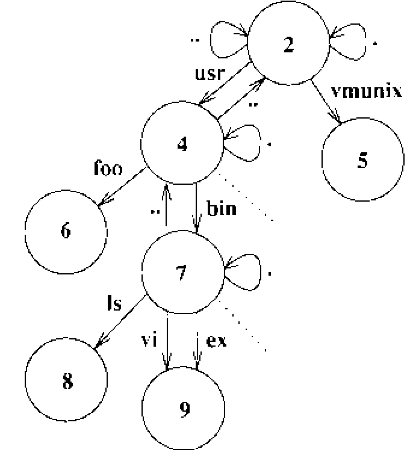
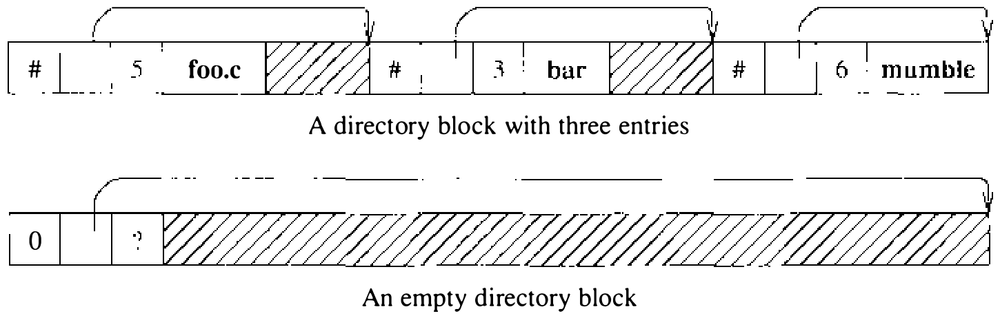
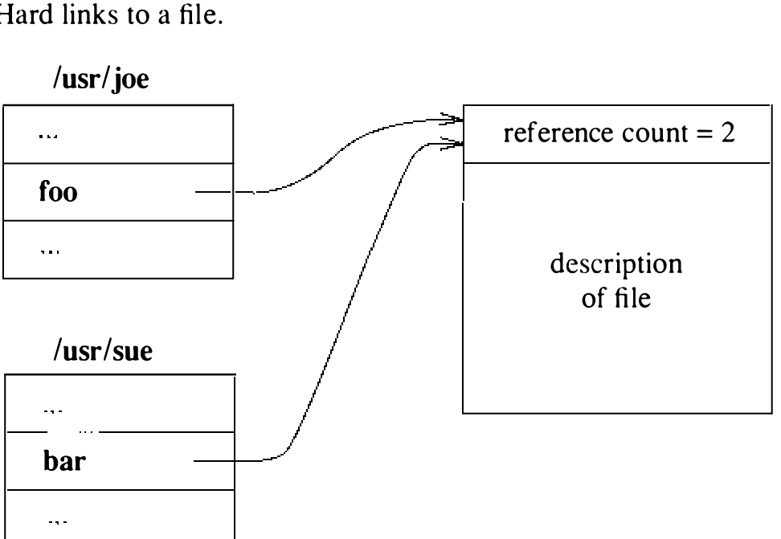
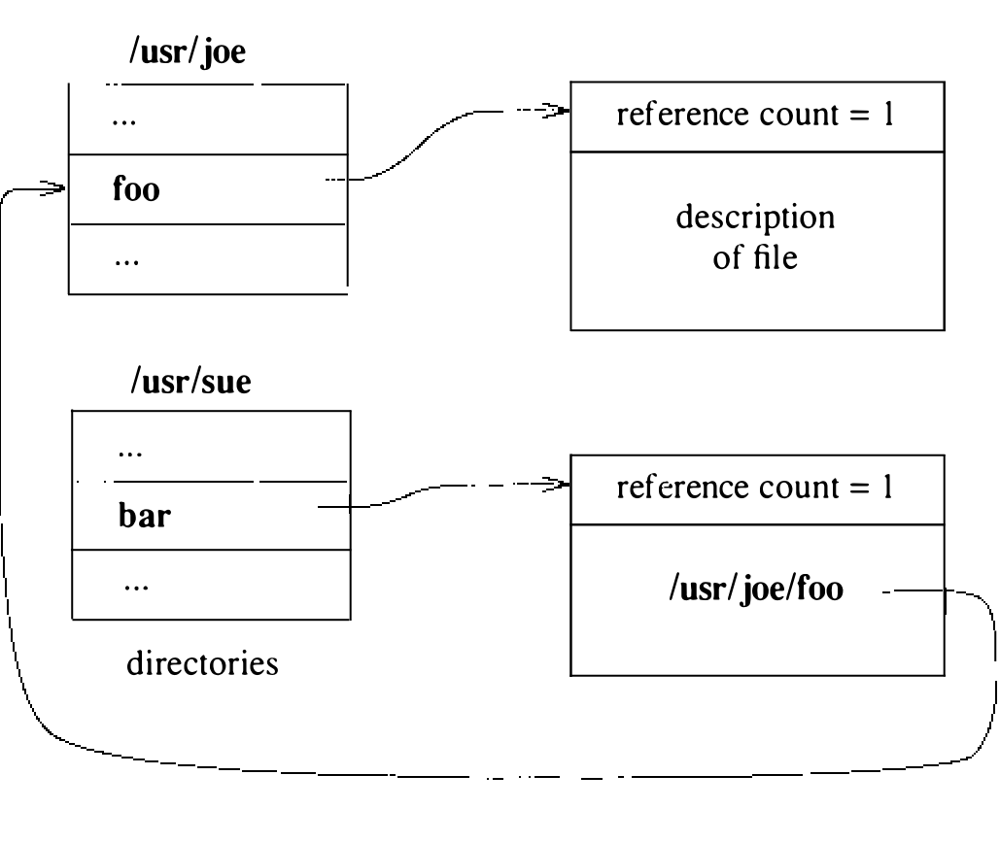

# 7.1 结构与概述

4.3BSD 把数据组织在驻留于磁盘驱动器等大容量存储介质上的文件系统中。每个磁盘驱动器划分为一个或多个细分区域，即分区。每个这样的分区至多包含一个文件系统，文件系统也绝不跨多个分区。

文件系统之内是文件，其中大多数包含普通数据。某些文件被特别区分为目录，包含指向其他文件的指针，而这些文件本身也可是目录。目录和文件的这种层次被组织成树形结构；图 7.1 展示一棵小型文件系统树。

## 目录

目录以称为块（chunk）的单位分配；图 7.2 展示一个典型的目录块。块的大小这样选择：每次分配都能在单次操作中写入磁盘——能在一次操作内修改目录，目录更新才是原子的。块再拆成变长目录项，使文件名几乎可以任意长。任何目录项都不得跨多个块。目录项的头三个字段定长，含：

1. 目录项大小
2. 目录项内文件名的长度
3. 指向描述该文件的磁盘数据结构的指针；这一磁盘数据结构称为索引节点（inode），其内容见 7.2 节

目录项其余部分变长，含以空字符结尾的文件名，填充到 4 字节边界。目录中文件名的最大长度是 255 个字符。

目录中的可用空间这样记录：由一个或多个目录项在自己的 size 字段里累计空闲空间。于是目录项会比容纳名字加定长字段所需的更大。分配给目录的空间应始终由各目录项的大小之和完全核算。从目录中删除某个目录项时，系统把它的空间并入同一目录块中的前一个目录项：把前一项的大小增加被删目录项的大小。目录块的第一个目录项空闲时，指向该目录项 inode 的指针置零，表示未分配。

新的目录结构引入于 4.2BSD。其他 UNIX 系统用 14 字符文件名，目录由 16 字节目录项的数组组成：头两个字节是 inode 号，其余 14 字节是文件名。程序用 `open`、`read`、`lseek` 和 `close` 把目录当普通文件读来扫描。4.2BSD 引入了新的库接口，既能访问新目录结构也能访问旧的。`opendir()` 函数返回一个指向结构的指针，`readdir()` 用它取下一个目录项，`rewinddir()` 用它把读取位置重置到开头，`closedir()` 用它关闭目录；另有 `seekdir()`，返回到先前用 `telldir()` 取得的位置。

使用目录访问例程的另一个好处是它们可以在网络上仿真，甚至对 MS-DOS 这样的非 UNIX 文件系统也能仿真。

## 链接

每个文件都有一个关联的 inode，包含描述访问权限、文件属主、标记文件最后修改和访问时间的时间戳，以及指向文件数据块的索引数组。每个文件只有一个 inode，但在同一文件系统内可以有多个目录项引用它（即多个名字）。每个目录项建立文件名到描述其内容的 inode 的一个硬链接（hard link）。链接的概念至关重要：inode 不驻留在目录里，而是独立存在、由链接引用。指向 inode 的全部链接都移除后，inode 才被释放。删掉文件的一个链接又以新内容重建该文件名，其余链接将继续指向旧的 inode。图 7.3 展示引用同一文件的两个不同目录项 **foo** 和 **bar**；于是文件的 inode 显示引用计数为 2。

系统还支持符号链接（symbolic link），即软链接（soft link）。符号链接实现为一个存有路径名的文件。系统解释路径名的某个成分时遇到符号链接，就把符号链接的内容前置到路径名的其余部分，解释这个名字得到最终路径名。符号链接若含绝对路径名，就用该绝对路径名；否则，符号链接的内容相对于链接在文件层次中的位置（而不是调用进程的当前工作目录）求值。

图 7.4 展示一个符号链接的例子。这里有一个指向该文件的硬链接 **foo**；另一个引用 **bar** 指向另一个 inode，其内容是所引用文件的路径名。进程打开 **bar** 时，系统把符号链接的内容解释为路径名，找到链接引用的文件。系统把符号链接当作数据文件而不是文件系统结构的一部分，因此它们可以指向其他文件系统上的目录或文件。文件名被删除并替换后，指向它的符号链接访问到的是新文件。最后，若文件名未被替换，符号链接就指向空处，任何访问它的尝试都会返回错误。

`open` 作用于符号链接时，返回的是指向的目标文件的描述符，而不是链接本身的。否则就得用某种间接手段访问所指文件——而通常想要的是那个文件而不是链接。出于同样的原因，多数其他接受路径名参数的系统调用也跟随符号链接。`stat` 系统调用是这条规则的例外：遍历文件系统或制作存档磁带时，能察觉符号链接有时很有用。所以另有 `stat` 的变体 `lstat`，取符号链接自身而非其所指对象的状态。

符号链接比硬链接有几点优势：符号链接可以引用目录或别的文件系统上的文件。硬链接不得引用目录，以防文件系统层次中出现环；硬链接的实现也使它们无法引用别的文件系统上的文件。

符号链接有一些有趣的推论。设某进程当前工作目录是 **/usr/sue**，执行 `cd` **src**，而 **src** 是指向目录 **/usr/src** 的符号链接。进程再做 `cd` ..，将落在 **/usr** 而不是 **/usr/sue**——**src** 若是普通目录则落在 **/usr/sue**。内核可以改成跟踪进程走过的符号链接，对经符号链接到达的目录换一种方式解释 ..。这种实现有两个问题：第一，内核得维护可能无界的信息量；第二，没有程序能依赖 .. 可用，因为它无法确定这个名字会被如何解释。

符号链接可能在文件系统中造成环，所以内核在一次路径名翻译中会检查符号链接穿越次数是否过多（八次）；达到上限，内核就产生错误 `ELOOP`。

## 配额

资源共享历来是 UNIX 系统的设计目标之一。在一些实现中，任何单个用户都能把文件系统中的全部可用空间全部分配掉。某些环境不能接受这一点。因此 4.3BSD 引入了配额（quota）机制，限制用户能占用的文件系统资源量。配额机制对用户可分配的文件数和磁盘块数都设限，并可为每个文件系统上的每个用户单独设置。

资源同时设有硬限制和软限制。进程超过软限制时，在用户终端上打印警告；只有超过硬限制才会终止犯规的进程。想法是：登录会话之间用户应保持在软限制之下，工作时可以多用一些。为促成这种行为，用户登录时若超出任何软限制，系统就警告。若用户经过太多次登录会话仍不修正，软限制就开始按硬限制执行。这些配额脱胎于澳大利亚墨尔本大学 Elz 开发的一个更大的资源限制软件包 [Elz, 1984]。
