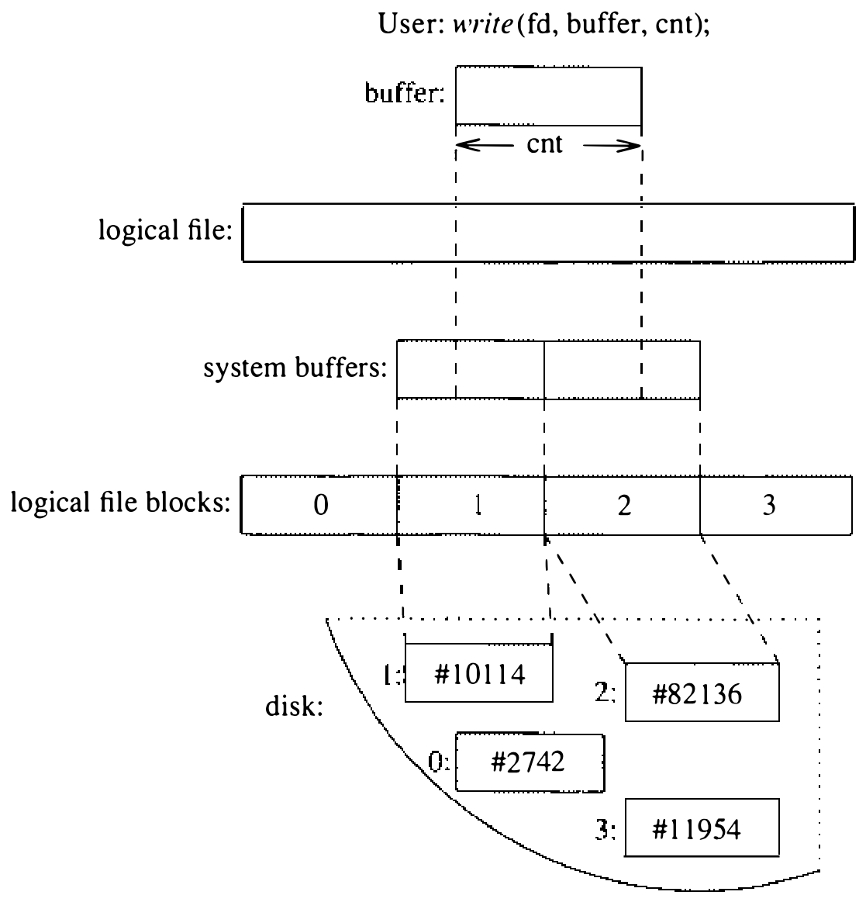
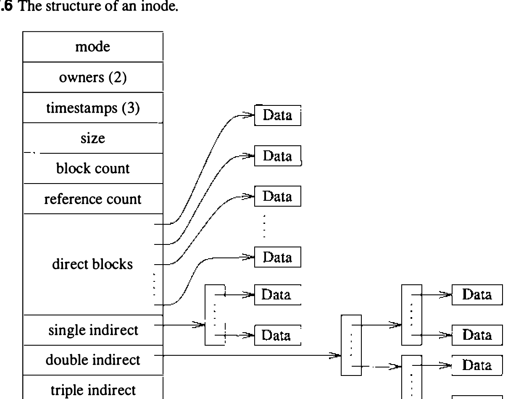

# 7.2 内部文件系统概述

文件系统的实现把用户“文件是字节数组”的抽象转换为底层物理介质决定的结构。考虑按固定扇区划分的典型磁盘介质：用户也许只想向文件写一个字节，磁盘却只能按扇区的整数倍读写。这里系统必须安排读入包含待改字节的扇区、替换受影响的字节、再把扇区写回磁盘。这种把对字节数组的随机访问转换为磁盘扇区读写的操作称为块 I/O。

首先，系统把用户的请求拆解为一组对文件各逻辑块（logical block）的操作。逻辑块描述文件中按块大小划分的片段：系统把字节数组按文件系统块大小分片来计算逻辑块。于是，文件系统块大小为 8192 字节时，逻辑块 0 含字节 0 至 8191，逻辑块 1 含 8192 至 16,383，依此类推。

图 7.5 展示访问磁盘上文件系统所需的信息流与工作。呈现给用户的抽象是字节数组；这些字节由指向数组某处的文件描述符统一描述。用户向系统提交一个缓冲指针和要写的字节数，即可请求写文件。图 7.5 表明所请求的数据无须与磁盘扇区的起止对齐，请求大小也不限于单个扇区。例中用户请求把数据写进逻辑块 1 和 2 的一部分。

每个逻辑块的数据存放在磁盘上的一个物理块（physical block）中。物理块是系统把逻辑块映射到的磁盘位置，由一个或多个连续扇区构成。对于扇区为 512 字节的磁盘，8192 字节的文件系统块由 16 个连续扇区组成。逻辑块的内容在磁盘上虽然连续，文件的各逻辑块却不必连续摆放。下一节描述系统用来把逻辑块转换为物理块的数据结构。

回到图 7.5 的例子：我们已算出要更新哪些逻辑块。磁盘只能按扇区整数倍传输，文件系统必须先安排读入块中不变部分的数据，还得为传输安排一个中转暂存区——暂存通过一个或多个系统缓冲完成。

例中用户想修改逻辑块 1 和 2 中的数据。该操作迭代执行五个步骤：

1. 分配一个缓冲
2. 确定相应物理块在磁盘上的位置
3. 请求磁盘控制器把物理块内容读入系统缓冲，等传输完成
4. 从用户 I/O 缓冲的开头向系统缓冲的相应部分做内存到内存的复制
5. 把块写入磁盘

若用户的请求尚未完成，就对文件的下一个逻辑块重复上述过程。例中系统取回文件的逻辑块 2，完成了用户请求。若写的是整块，系统本可跳过第 3 步，直接把数据写盘而不先读旧内容。写请求的这种增量填充对用户进程是透明的——整个填充期间该进程被阻塞，无法运行。填充对其他进程也是透明的：整个过程期间 inode 被锁住，任何其他进程的访问企图都会被阻塞，直到初始写完成为止。

**在磁盘上分配和查找块**

文件增长时，文件系统还负责为它们分配新块。简单的文件系统实现（如早期微型机系统所用的）把文件一个接一个连续分配，直到文件占满磁盘。文件删除后出现空洞；要重用释放的空间，系统必须整理磁盘，把所有空闲空间移到末尾。文件一次只能建一个；磁盘上除最后一个文件外的任何文件想增大，都必须先复制到末尾再扩展。

为兼顾多文件分配与随机访问，多数 UNIX 系统使用索引节点（index node）即 inode 的概念。图 7.6 显示 inode 含一个指向文件各块的指针数组。系统用逻辑块号索引数组，即可把逻辑块号转换为物理扇区号。数组项为空表示未分配块，读时返回一整块零；写这种数组项时，分配新块、把新块号记入数组项、把数据写盘。

inode 是静态分配的，而多数文件又很小，所以指针数组必须小才省空间。数组的前 12 项分配在 inode 自身之内。对典型文件系统，这使前 48 或 96 KB 的数据可以用简单的索引查找直接定位。

稍大的文件，图 7.6 显示 inode 含一个一级间接指针（single indirect pointer），指向一个存放数据块指针的一级间接块（single indirect block）。要找文件的第 100 个逻辑块，系统先取回间接指针标识的块，再索引到数组的第 88 项（100 − 12 个直接指针），取回那个数据块。

对于超过几 MB 的文件，一级间接块终会用尽，就得改用二级间接块（double indirect block）——指向“指向指针块的指针块”的指针。最后，系统为三级间接块（triple indirect block）留了位置，尽管现有实现并不使用这种块。

一级、二级间接块看似让取一块数据所需的磁盘访问翻倍或翻三倍，实际传输开销通常低得多。7.5 节将讨论文件系统缓存的管理，其中存放最近使用的磁盘块。间接指针块第一次用到时被调进文件系统缓存；此后访问间接指针发现该块已在内存中，取数据只须一次磁盘访问。

除逻辑到物理块的映射外，inode 还含有文件内容的其他信息，包括：

* 文件的类型与访问模式
* 文件的属主
* 组访问标识符
* 文件的引用数
* 文件最后读写的时刻
* inode 最后被系统更新的时刻
* 文件按字节计的大小
* 文件使用的物理块数（含存放间接指针的块）

inode 中明显缺少的是文件名。文件名保存在目录中，而不是 inode 中，因为文件可以有许多名字（链接），而文件名可能很长（至多 255 字节）。

为文件创建新名字时，系统递增引用该 inode 的名字计数，然后把新名字连同 inode 号记入目录。反过来，删除名字时从目录删除表项，然后把 inode 的名字计数减一。计数到零时，系统释放 inode：把该 inode 的所有块放回空闲块表，再把 inode 放回未用 inode 表。
