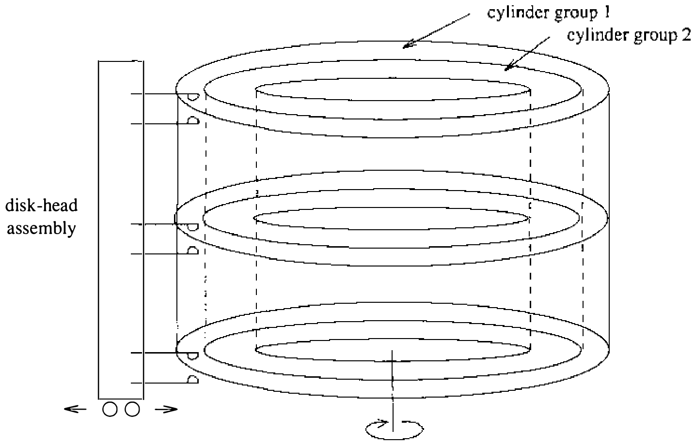

# 7.3 内部结构与重新设计

传统 UNIX 文件系统（如 System V 采用的那种）由其超级块描述，超级块包含文件系统的基本参数：数据块数、文件数上限，以及指向空闲表（free list）——文件系统全部空闲块的表——的指针。

一个 150 MB 的传统 UNIX 文件系统由 4 MB 的 inode 加上 146 MB 的数据组成。这种组织把 inode 信息与数据隔开：访问一个文件通常要在文件的 inode 与数据之间进行一次长寻道。同一目录下的文件在 4 MB inode 区里分到的槽位通常不连续，访问单个目录中许多 inode 时，就要读取许多不连续的磁盘块。

把数据块分配给文件的方式也不理想。传统文件系统实现采用 512 字节的物理块大小，而下一个顺序数据块往往不在同一柱面，因此 512 字节的数据传输之间频繁需要寻道。小块与分散放置相结合，严重限制了文件系统吞吐。

伯克利在 UNIX 文件系统上的第一批工作试图同时改进文件系统的可靠性与吞吐。开发者把对关键文件系统信息的修改按阶段进行，使这些修改要么已经完成，要么能在崩溃后由程序干净修复，以此改进了可靠性 [McKusick & Kowalski, 1986]；又通过把块大小翻倍，使文件系统性能在 3BSD 到 4.0BSD 之间提高了一倍多——每次磁盘传输访问的数据翻倍，还省去了许多文件的间接块。本节其余部分把经过这些改动的文件系统称为 **旧文件系统**。

旧文件系统的性能改进有力地表明：加大块大小是改进吞吐的好办法。吞吐虽已翻倍，旧文件系统也只用到最大磁盘吞吐的约 4%。主要问题是：随着文件创建和删除，空闲表的次序很快被打乱，最终完全随机，文件的块随机撒满磁盘，每次块访问前都得寻道。旧文件系统刚建成时传输率可达每秒 175 KB，中等使用几周后，空闲表的打乱让这一速率降到平均每秒 30 KB。除非重建系统，否则旧文件系统的性能无从恢复。

**新的文件系统组织**

在 4.3BSD 文件系统组织（与旧文件系统组织一样）中，每个磁盘驱动器含一个或多个文件系统。4.3BSD 文件系统由其超级块描述，超级块位于文件系统磁盘分区的开头。因为超级块存有关键数据，系统把它复制多份，以防灾难性丢失。复制在创建文件系统时进行；由于超级块数据不会变化，副本无须使用，除非磁盘故障毁了默认超级块。

为确保只经两级间接就能创建大到 2³² 字节的文件，文件系统块的最小大小是 4096 字节。块大小可以是大于等于 4096 的任意 2 的幂，记录在文件系统的超级块里，因此不同块大小的文件系统可以在同一系统上同时被访问。块大小必须在创建文件系统时选定；不经重建文件系统，事后不可更改。

新文件系统组织把磁盘分区划分为一个或多个区域，各称为柱面组（cylinder group）。图 7.7 展示一组柱面组，每个由磁盘上一个或多个连续柱面构成。每个柱面组包含簿记信息：超级块的冗余副本、inode 的空间、描述柱面组内可用块的位图，以及描述柱面组内数据块使用情况的汇总信息。柱面组的可用块位图取代了传统文件系统的空闲表。文件系统创建时为每个柱面组分配固定数目的 inode。默认策略是柱面组内每 2048 字节空间分配一个 inode，预期这个数目远超所需。

采用柱面组的目的是让 inode 成簇地散布在磁盘各处，而不是全挤在磁盘开头。文件系统尽量把文件块分配在描述它们的 inode 近旁，免得在取 inode 与取数据之间出现长寻道。inode 散布开来之后，单次磁盘故障使它们全部丢失的几率也更小。

簿记信息本可放在每个柱面组的开头。但那样全部冗余信息都会落在同一块盘片上，一次硬件故障就可能毁掉超级块的所有副本。因此簿记信息从柱面组开头起以一个变化的偏移量开始存放；每个后续柱面组的偏移量都比前一个约向外多一个磁道。这样冗余信息沿盘片堆螺旋而下，任何单一磁道、柱面或盘片的损失都不会造成超级块的全部副本一同丢失。除第一个柱面组外，柱面组开头到柱面组信息开头之间的空间用作数据块。

**优化存储利用**

数据的布局让单次磁盘操作就能传输更大的块，大幅提高了文件系统吞吐。新文件系统的一个文件可能由 4096 字节的数据块组成（旧文件系统是 1024 字节块）：每次磁盘事务传输的信息最多可达四倍。大文件的多个块可以分配在同一柱面，因此在需要寻道之前可以进行更大的传输。

大块的主要问题是多数 UNIX 文件系统以小文件为主。一律用大块会浪费空间。表 7.1 显示文件系统块大小对浪费空间量的影响。用于测量的文件位于伯克利的一台分时系统上，该系统约有 1.2 GB 联机存储；测量基于含约 920 MB 格式化空间的活跃用户文件系统。浪费的空间按不含用户数据的磁盘空间百分比计算。块越大浪费涨得越快，4096 字节文件系统块时高达不可容忍的 45.6%。

表 7.1 空间浪费量随块大小的变化

| 使用空间（MB） | 浪费百分比 | 组织方式 |
| ---- | ---- | ---- |
| 775.2 | 0.0 | 仅数据，文件之间不隔开 |
| 807.8 | 4.2 | 仅数据，每个文件从 512 字节边界开始 |
| 828.7 | 6.9 | 数据 + inode，512 字节块 UNIX 文件系统 |
| 866.5 | 11.8 | 数据 + inode，1024 字节块 UNIX 文件系统 |
| 948.5 | 22.4 | 数据 + inode，2048 字节块 UNIX 文件系统 |
| 1128.3 | 45.6 | 数据 + inode，4096 字节块 UNIX 文件系统 |

要让大块不带来显著浪费，小文件必须存得更省。开发者的办法是允许一个文件系统块分成一个或多个片（fragment）。片大小在创建文件系统时指定；每个文件系统块可分成两、四或八片，每片均可寻址。片大小的下限受磁盘扇区大小约束，通常 512 字节。与每个柱面组关联的块图按片记录柱面组内的可用空间；要判断一个块是否可用，系统检查对齐的片。图 7.8 展示一个 4096 字节块、1024 字节片的文件系统（下称 4096/1024 文件系统）的块图片段。图中每一位记录一个片的状态：“-”表示片在使用，“1”表示片可供分配。本例中片 0 至 5、10、11 在使用，片 6 至 9 和 12 至 15 空闲。相邻块的片不能凑成一个整块使用，即使大小足够。本例中片 6 至 9 不能分配为整块；只有片 12 至 15 能合并成整块。

| 图中位 | ---- | --11 | 11-- | 1111 |
| ---- | ---- | ---- | ---- | ---- |
| 片号 | 0-3 | 4-7 | 8-11 | 12-15 |
| 块号 | 0 | 1 | 2 | 3 |

图 7.8 4096/1024 文件系统中块与片布局的示例

在 4096 字节块、1024 字节片的文件系统上，一个文件由零个或多个 4096 字节数据块外加至多一个分片块表示。当一个块必须分片才能容纳少量数据时，块的其余片可供其他文件分配。举例：一个 11,000 字节的文件存放在 4096/1024 文件系统上，将用两个整块外加另一块的三个片。文件创建时若没有三个对齐片的块可用，就拆一个整块，得到所需的各片以及一个未用片；这个剩余片可按需分配给其他文件。

每次进程执行 `write` 系统调用时，系统都检查文件是否变大。进程可能覆盖既有文件中部的数据，此时空间早已分配好。文件需要扩展时，请求向上取整到下一个片大小，只分配这么多。许多小写请求可能一片一片地扩展文件。一片一片扩展的问题在于：分片的块扩展成整块时，数据可能被复制多次。用户进程若每次写一整块（文件尾的部分块除外），片的重新分配可以降到最少。由于同一系统上可能驻有不同块大小的文件系统，文件系统接口向应用程序提供读或写的最优大小。多数应用程序使用的标准 I/O 库，以及归档器、装入器等自行管理 I/O 的系统工具都用这一设施。

据经验观察，4096/1024 新文件系统组织的空间浪费量与旧的 1024 字节组织大致相同；4096 字节块、512 字节片的文件系统与 512 字节块 UNIX 文件系统的浪费量大致相同。新文件系统为大文件的索引信息使用的空间比 512 或 1024 字节文件系统更少，小文件则持平。追踪空闲块所需的更多开销又抵消了这些节省。新文件系统的片大小等于旧文件系统的块大小时，磁盘空间利用率大致相当。

布局策略（本节末描述）要起作用，文件系统就不能保持全满。一个称为空闲空间保留（free-space reserve）的参数给出应保持空闲的文件系统块的最小百分比。空闲块数跌破这一水平后，只允许超级用户分配块。这个参数随时可改。空闲块趋零时文件系统吞吐大约减半，因为文件系统无法把文件的块局部化。文件系统若因过满而吞吐下降，只需删除文件直到空闲空间重回最低可接受水平即可恢复。用户也可以在空间充裕时搬移文件数据，恢复那些在空闲空间稀缺期间创建的文件的访问速率。比较表 7.1 所列的各种组织时，还须把空闲空间保留加进浪费百分比：旧 1024 字节 UNIX 文件系统的浪费率，大致相当于空闲空间保留设为 5% 的新 4096/512 文件系统的浪费率（旧文件系统浪费 11.8%，新文件系统 6.9% 浪费 + 5% 保留）。

**文件系统参数化**

除最初创建空闲表外，旧文件系统无视底层硬件的参数：它既不知道大容量存储设备的物理特性，也不知道与文件系统打交道的硬件。新文件系统的目标之一是把处理器能力和大容量存储特性参数化，让块以依赖配置的最优方式分配。重要参数包括处理器速度、大容量存储传输的硬件支持，以及大容量存储设备的特性。磁盘技术不断进步，某个装机环境可能在单个处理器上运行多种不同的磁盘技术。每个文件系统都经过参数化，以便适配它所在磁盘的特性。

对磁盘这类大容量存储设备，新文件系统尽量把文件的新块分配在同一柱面上，并使其旋转位置良好。旋转最优（rotationally optimal）块之间的距离因系统而异：最优块可以紧邻，也可以相隔一个旋转延迟，取决于系统特性。对于连接专用 I/O 处理器的磁盘，两个连续磁盘块常常可以接连访问而不损失时间，因为中间不必等磁盘多转一圈。对于没有专用 I/O 处理器的机器，主处理器必须处理中断并准备新的磁盘传输；处理这个中断并调度新磁盘传输的期望时间取决于主处理器速度。

每个磁盘的物理特性包括每磁道块数和转速。分配例程用这些信息计算跳过一个块需要多少毫秒。处理器特性包括处理中断并调度新磁盘传输的期望时间。给定分配给文件的一个块，分配例程计算应跳过多少块，使文件的下一块恰好在启动新磁盘传输操作所需的预期时间内转到磁头之下。对大数据量的顺序访问，这一策略使等磁盘就位的时间最少。

定义同一柱面上一次数据传输完成到下一次数据传输启动之间最小毫秒数的参数随时可改。文件系统若按 2 毫秒旋转间隔布局块，而磁盘随后被挪到另一台系统上，该系统的处理器调度一次磁盘操作需 4 毫秒，那么吞吐会因几乎每块都白白空转一圈而骤降。目标机器已知时，即使文件系统最初在别的处理器上创建，也可以按目标机器参数化。即使无法事先预知这次迁移，磁盘挪过去之后也可以重新配置旋转布局延迟，让后续所有分配按新设备的特性进行。

**布局策略**

文件系统的布局策略分为截然不同的两层。顶层是全局策略，用汇总信息决定新 inode 与数据块的摆放，确定新目录和文件的位置，计算旋转最优的块布局，并决定何时因当前柱面组剩余空间不足以做出合理的布局而强制长寻道到新柱面组。全局策略例程之下是局部分配例程，用局部最优的方案摆放数据块。最初的意图是把这些决策提升到用户级，让用户进程可以无视或替换它们。因此它们确实是策略，而非简单的机制。

改进文件系统性能有两个办法：提高引用局部性以最小化寻道延迟 [Trivedi, 1980]，以及改进数据布局以促成更大的传输 [Nevalainen & Vesterinen, 1977]。全局布局策略靠把相关信息聚簇来改进性能。它们不可能把所有数据引用都局部化，而必须设法把无关数据分散到不同柱面组。过度追求局部化时，本柱面组可能被塞满，数据反而散到非局部柱面组；走到极端，完全的局部化会造出一个像旧文件系统那样的单一巨簇。全局策略在“局部化同时访问的数据”与“散开无关数据”两个冲突目标之间求平衡。

一种可分配资源是 inode。同一目录下文件的 inode 常被一起访问——列目录命令 ls 可能访问目录中每个文件的 inode。inode 布局策略尽量把一个目录中全部文件的 inode 放进同一柱面组。为保证文件分布到整个文件系统，目录 inode 用另一种策略分配：新目录放进空闲 inode 数高于平均、且目录数最少的柱面组。这一策略的意图是让 inode 聚簇多数时候能成功。柱面组内 inode 的分配用“下一个空闲”策略；虽然这使 inode 在柱面组内随机分布，但访问一个柱面组的全部 inode 只需 8 到 16 次磁盘传输（至多 16 次，因为一个柱面组至多 2048 个 inode）。这一策略给“访问一个目录中全部文件的 inode”所需的磁盘传输数设了一个小而恒定的上限。相比之下，旧文件系统取目录中每个文件的 inode 通常各要一次磁盘传输。

另一大资源是数据块。一个文件的数据块通常一起访问，策略例程尽量把文件的数据块放进同一柱面组，最好位于同一柱面的旋转最优位置。把全部数据块放在同一柱面组的问题在于：大文件很快用光可用空间，只能溢出到别处；而且一旦空间被占光，柱面组内任何文件随后的分配也都得外溢。理想情况下，任何柱面组都不应被完全填满。选定的启发式解法是每分配 1 MB 就把块分配重定向到别的柱面组。溢出点意在让一个文件用掉柱面组约 25% 的数据块时就重定向。日常使用中，这套启发式在减少完全填满的柱面组方面效果良好。

新选出用于块分配的柱面组，是空闲块数高于平均值的那个柱面组。大文件虽会散布在磁盘各处，但一次长寻道前通常可访问到 1 MB 数据，每 MB 一次长寻道的代价不大。同样重要的是，要在用光柱面组的可用块之前就迫使大文件外溢：最后几块会在柱面组里东一块西一块，访问起来要许多小寻道。

全局策略例程带着对具体块的请求调用局部分配例程。若请求的块空闲，局部分配例程总是分配它；否则分配一个大小符合要求、旋转位置上离所请求块最近的空闲块。全局布局策略若有完整信息，就总能请求未用的块，分配例程退化为简单的簿记。但维护完整信息代价高昂，因此全局布局策略用的是只凭部分信息的启发式。

请求的块不可用时，局部分配器采用四级分配策略：

1. 用同一柱面上与所请求块旋转位置最近的下一个可用块。这里假设磁头切换时间为零。在磁头切换时间不为零的磁盘控制器上，或许可以在构造旋转布局表时计入切换盘片所需的时间，不过尚未尝试。

2. 同柱面无可用块时，用同一柱面组内的一个块。

3. 柱面组满时，对柱面组号做平方散列，另选柱面组寻找空闲块。

4. 最后，散列失败时，穷举搜索全部柱面组。

用平方散列是因为它搜寻将满散列表中空位的速度快 [Knuth, 1975]。参数化为保持至少 10% 空闲空间的文件系统很少用到这一策略。不设置空闲空间保留的文件系统通常空闲块所剩无几，几乎任何分配都是随机的；这种条件下所用策略最重要的特性就是快。
