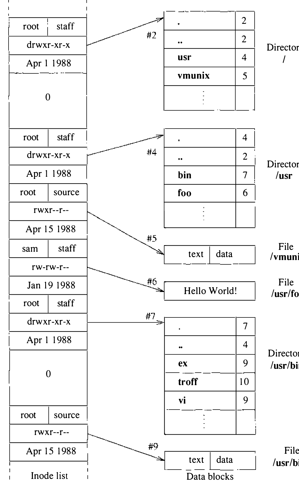
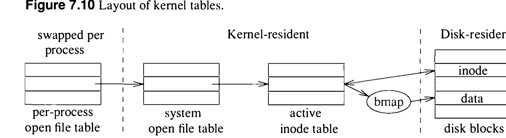
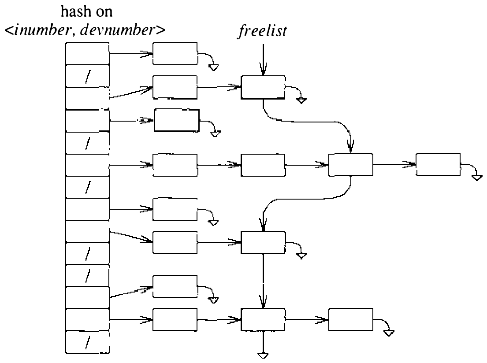
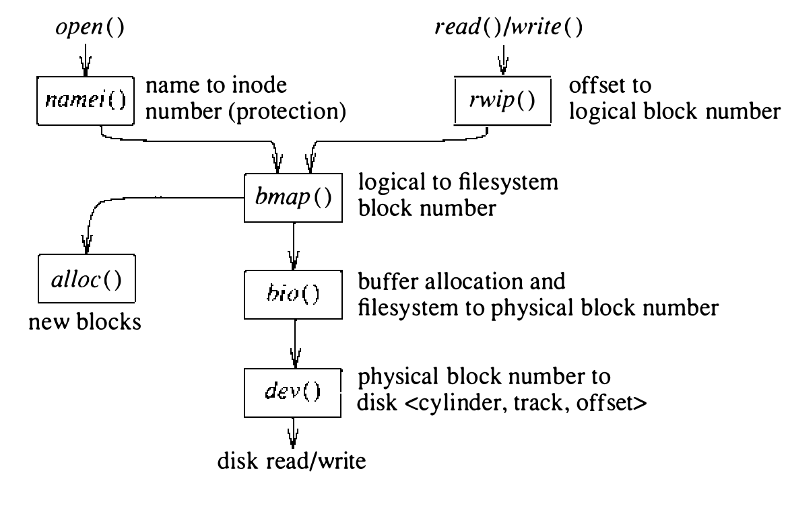

# 7.4 文件系统数据结构

现在可以更细地看文件系统的数据结构了。图 7.1 引入的小文件系统在图 7.9 中展开为内部结构：图 7.1 的每个文件都展开成它的 inode 和数据块。以系统如何找到文件 **/usr/bin/vi** 为例看这些数据结构如何工作。它必须先搜索文件系统的根目录找到目录 **usr**；为此必须先找到描述根目录的 inode。按惯例，inode 2 永远保留给根目录；于是系统找到 inode 2 并调入内存。这个 inode 指明根目录数据块的位置；这些数据块也须调入内存才能搜索表项 **usr**。找到 **usr** 的表项后，系统得知 **usr** 的内容由 inode 4 描述。再回磁盘，系统取 inode 4 找到 **usr** 数据块的位置；搜索这些块，找到 **bin** 的表项。**bin** 表项指向 inode 7。系统接着把 inode 7 及其数据块从磁盘调入，开始搜索 **vi** 的表项。发现 **vi** 由 inode 9 描述后，系统取来这个 inode，找到描述 **vi** 二进制的那组块。

整个过程说明，哪怕执行系统实用程序这样的区区小事也隐含大量磁盘 I/O。要获得合理的性能，系统必须缓存常用信息以减少磁盘请求。本节描述存放最近使用 inode 的 inode 表；7.5 节讨论存放最近使用磁盘块的系统缓冲池；7.8 节讨论为 inode 表中的 inode 保存最近名字翻译的名字翻译缓存。靠这些缓存，系统通常无需从磁盘调入就能找到 85% 以上所需的信息。

**inode 管理**

文件系统的大部分活动围绕 inode 展开。内核维护一张活跃和最近访问的 inode 表。图 7.10 展示 inode 表在系统中的位置。

如 6.2 节所述，每个进程有一张进程打开文件表（process open file table），有若干（如 64 个）文件描述符的槽位，作为进程状态的一部分维护。用户进程打开文件（或套接字）时，在它的打开文件表中找到一个空槽；`open` 成功返回的小整数文件描述符就是索引这张表的值。

每进程的文件表表项指向系统打开文件表（system open file table），其每个表项含描述符所代表文件或套接字的信息。对文件，文件表指向代表该打开文件的 inode。活跃和最近使用的 inode 存放在另一张全系统范围的表——inode 表——中，见图 7.11。

打开文件的第一步是找到文件关联的 inode。内核先搜 inode 表看请求的 inode 是否已在内存。为避免线性扫描全部表项，系统维护一组按 inode 号和文件系统标识符作键的散列链。即使 inode 表有几百个表项，内核判定一个请求的 inode 是否在表中平均也只须检查约五个表项。inode 不在表中（如文件首次打开）时，系统必须分配新的 inode 表槽位并从磁盘读入 inode。新的 inode 表槽位从 inode 表中最久未用的 inode 分配。为了快速找到最老的 inode，系统把未使用的 inode 链成 LRU 链。对文件的最后一个引用关闭时，系统把 inode 放上 LRU 链尾；于是 LRU 链头的 inode 就是最久未用的。常用的 inode 会从 LRU 链中部回收，用完再放回尾部。这一算法降低了 inode 槽位被重用的概率。

下一步是定位包含该 inode 的磁盘块，把它读进系统内存的一个缓冲。磁盘 I/O 完成后，inode 从磁盘缓冲复制到它在 inode 表中的槽位。除 inode 磁盘部分所含信息外，inode 表本身在 inode 驻留内存期间维护补充信息：前述散列链和使用链、表明 inode 状态的标志、使用它的引用计数，以及管理锁的信息；还有指向常被关注的其他内核数据结构的指针，比如包含该 inode 的文件系统的超级块。

**查找文件块**

inode 调入内存后，系统就能定位与文件关联的数据块：解释 inode 中的块指针。解释和分配这些指针的任务由称为 `bmap()` 的块映射例程管理。图 7.12 展示穿过内核的过程访问路径。`open` 调用中指定的路径名交给名字到 inode 的翻译例程 `namei()`，由它做前述路径遍历，最终返回失败码或一个 inode 表表项的指针。

文件打开后，进程可以对它读写。这些请求经 `rwip()` 例程疏导。`rwip()` 负责把读或写转换成对文件逻辑块的一次或多次读写；逻辑块请求再交给 `bmap()`。`bmap()` 负责解释 inode 中的直接和间接块指针，把逻辑块号转换为物理块号。请求读时，`rwip()` 请块 I/O 系统返回装着磁盘块内容的缓冲。从文件读两个或更多逻辑上连续的块时，进程被假定在顺序读文件：`bmap()` 返回两个值——所请求的块和文件中下一块的块号。系统发两个磁盘请求，一个取所请求的块，一个预读下一块，料定进程很快要用。

请求写时，`rwip()` 分配一个缓冲容纳块内容，把用户数据复制进返回的缓冲并标为脏。缓冲被完全填满则排队写盘；没有填满则不立即排队——缓冲被扣着，期待进程很快会再往里加数据。直到缓冲另作他用——即排到空闲表头——或用户进程做了 `sync` 系统调用才释放。通常有一个名为 `update` 的用户进程在运行，每 30 秒做一次 `sync`。

**文件块分配**

管理块和片分配的任务由 `bmap()` 承担。文件正在写且块指针为零、或所指的片太小装不下新增数据时，`bmap()` 调用分配例程取得新块。文件需要扩展时，存在两种情形之一：

1. 文件不含成片的块（且文件最后一块装不下新数据）。已分配的块中若有空间，先用新数据填入。剩余新数据超过一整块时，分配一个整块，把第一整块新数据写进去；重复到剩余不足一整块。剩余新数据小于一整块能装下时，找一个含所需片数的块；否则找一整块。剩余新数据写入找到的空间。不过，为避免缓慢增长的文件过多复制，文件系统只允许文件的直接块引用片。

2. 文件含一个或多个片（且这些片装不下新数据）。新数据的大小加片中已有数据超过一整块时，分配新块：把片的内容复制到块开头，块的其余部分填入新数据，然后按情形 1 继续。否则找一个够装数据的块；当前块的其余部分够空闲就用它，免得复制。既有的片内容接上新数据，写入分配的空间。

`bmap()` 还负责分配存放间接指针的块，也得处理进程跳到文件末尾之外开始写的特例。由于只有文件的最后一块可以是片，`bmap()` 必须先确保先前的任何片已升级为整块。

分配成功（见 7.7 节）后，分配例程返回要用的块号或片号；`bmap()` 随即更新 inode 中相应的块指针。分配了块，系统就可以为块内容分配缓冲，好把块写上磁盘。
