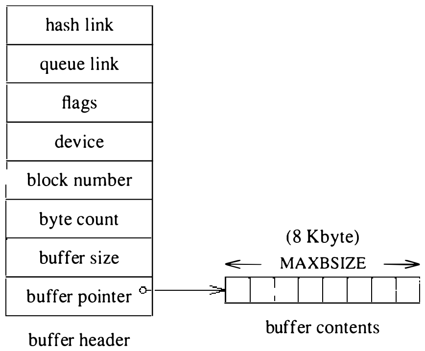
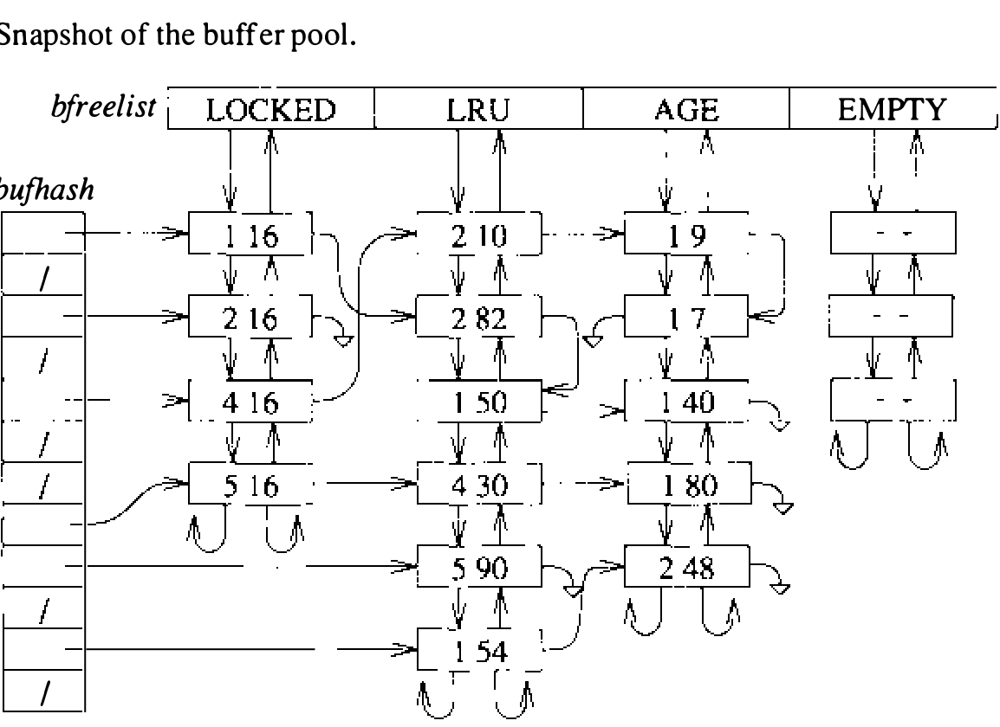
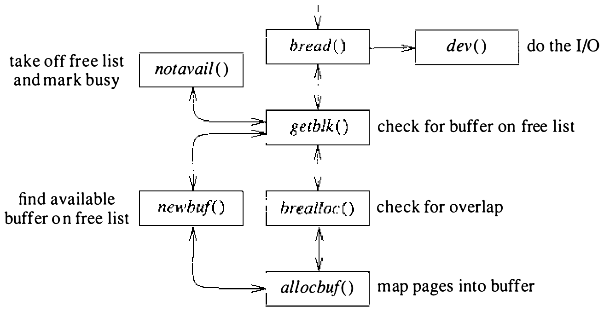
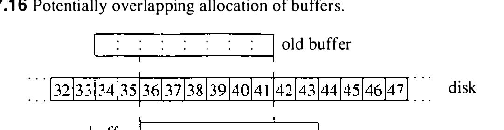
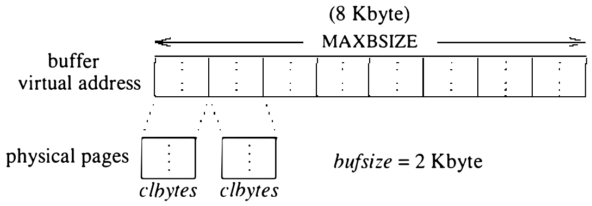

# 7.5 缓冲区管理

UNIX 文件系统的语义隐含大量磁盘 I/O。若每一次隐含的磁盘传输都真要做，CPU 的大部分时间就要花在等 I/O 完成上。缓冲缓存有两重任务：一是管理在缓冲与磁盘之间传递数据的内存；二是充当最近使用磁盘块的缓存，第二重更重要。典型 UNIX 系统上，85% 以上的隐含磁盘传输可以省掉，因为所请求的块已在缓冲缓存中。视内存多寡，系统可配置的缓冲数量从一百到一千不等。缓冲越多，给定磁盘块在内存中留得越久，避免磁盘 I/O 的机会也就越大。

图 7.13 展示缓冲的格式。缓冲由两部分组成。第一部分是缓冲头，包含查找缓冲和描述其内容所需的信息：内容信息包括设备（即磁盘及该磁盘上的分区）、起始物理块号（从分区开头数起）和缓冲包含的字节数；标志项跟踪缓冲的状态，比如缓冲是否含有用数据、是否正在使用、以及是否必须在缓冲复用前把数据写回磁盘。

第二部分是缓冲的实际内容。缓冲头不像 mbuf 那样前置在数据区上（见 10.2 节），数据区单独维护：因此有一个指向数据的指针和一个表明数据缓冲大小的字段。缓冲大小总不小于片大小。数据与头分开维护，以便借助页映射硬件方便地调整缓冲大小。头若前置，要么每个头独占一页，要么内核必须避免重映射含头的缓冲页。

文件系统的缓冲请求从 512 字节的片到 8192 字节的整块不等。访问许多小文件就需要许多小缓冲；访问几个大文件则只需较少的大缓冲。为使系统能高效适应这些变化的需要，每个缓冲分配 8192 字节虚拟内存，但这块地址空间并不全部填入物理内存。起初每个缓冲配 2048 字节物理内存；缓冲分配变小时，把多余的物理内存让给需要超过 2048 字节的缓冲。管理物理内存的算法稍后介绍。

内核到缓冲池的内部接口很简单。文件系统调用 `bread()` 例程分配并填充缓冲：`bread()` 接受设备、块号和大小，返回一个锁定缓冲的指针。其他进程一旦试图访问这个缓冲，就会入睡，直到缓冲被释放。

缓冲可以按四种方式之一释放。缓冲未修改时，直接用 `brelse()` 释放即可。缓冲一旦修改过，就称为脏缓冲，脏缓冲最终必须写回磁盘；按数据写盘的紧迫程度有三个例程可用。典型场合用 `bdwrite()`：它假定缓冲很可能很快又会被修改，因此只标为脏，不立即写盘。其启发式是：缓冲若很快又要修改，这次磁盘 I/O 就白做了；缓冲平均持有 15 秒才写出，所以做许多小写的进程不会反复访问磁盘。缓冲完全填满后，很快再写的可能性就不大，应该用 `bawrite()` 释放：它安排写盘，但让调用者在输出完成期间继续运行。最后一种是 `bwrite()`，它确保磁盘写完成后才继续。这一机制可能给请求者引入较长延迟，只在进程显式请求该行为（如 `fsync` 系统调用）或操作对保证系统崩溃时文件系统的一致性至关重要时使用。

图 7.14 展示缓冲池的一个快照。内容有效的缓冲恰好挂在一条 `bufhash` 散列链上。散列链用于快速判断某磁盘块是否在缓冲池中，若在则据以定位。缓冲只在失效或被改作别的块使用时才从链上摘下。因此，缓冲即使正被一个进程使用，另一个进程也能找到它——不过此时会置位 busy 标志，内容一致之前不会使用它。

除散列链外，每个当前未用的缓冲还恰好挂在一条空闲链上。第一条空闲链是 LOCKED 链：链上的缓冲不会被刷新出缓存；该链目前未使用。LOCKED 队列本打算挂已挂载文件系统的超级块，但这样会与通过块设备访问同一磁盘块的进程发生死锁，只好把超级块复制到私有的系统内存。

第二条链是 LRU 链。找到缓冲（通常在 LRU 链上）就把它摘下使用，用完归还到 LRU 链尾。需要从 LRU 链回收缓冲时，从链头取。反复使用的缓冲会不断移向 LRU 链尾，不太可能被回收给新块。顾名思义，这条链实现了 LRU 算法。

第三条空闲链是 AGE 链，存放尚未证明有用但预计很快会被使用、或已经用过但不太可能重用的块。缓冲可以从这条链的两端压入：不含有用数据的缓冲压到链头（很快被回收），其他缓冲压到链尾（或许能留得够久，再次被用上）。这条链通常用来挂预读块。请求的块若在 AGE 链上找到，说明它已经证明有用，于是把它归还到 LRU 链尾。需要新缓冲时先搜 AGE 队列，队列空了才用 LRU 链。

最后一条是空缓冲的 EMPTY 链。空缓冲的物理内存已全部被其他缓冲拿走，它们挂在这条链上，等别的缓冲改作小块时让出富余的物理内存。

**缓冲管理的实现**

了解管理缓冲池的功能与算法之后，下面看保证缓冲池数据一致性的实现要求。图 7.15 展示了实现缓冲获取接口的支持例程。获取缓冲的主要接口是 `bread()`，调用时带上对某指定磁盘上某指定大小数据块的请求。`bread()` 先调 `getblk()` 查该数据块是否已在内存的缓冲中：若在，`getblk()` 调 `notavail()` 把缓冲从所在空闲链摘下并标为忙，`bread()` 即可把缓冲返回给调用者。

磁盘块若不在内存中，`getblk()` 调 `newbuf()` 分配新缓冲。新缓冲先交给 `brealloc()`，确保不与其他缓冲重叠；再交给 `allocbuf()`，确保物理内存数量合适。`getblk()` 然后把标为忙且未填充的缓冲返回给 `bread()`。`bread()` 发现缓冲未填充，便把它交给磁盘驱动读入数据。磁盘读完成后，缓冲即可返回。

为保持文件系统一致性，`brealloc()` 保证一个磁盘块至多映射进一个缓冲。同一磁盘块若出现在两个缓冲中且都标为脏，系统将无法判断哪个缓冲持有有效信息。图 7.16 展示一个分配示例：图中间是磁盘上的块；磁盘上方是一个含 4096 字节片的旧缓冲（所属文件想必已被删除或缩短）；新缓冲将装一个 3072 字节的片，所属文件想必正在创建，并将重用旧文件先前占用的部分空间。旧缓冲若标为脏，必须先写回磁盘、再标为无效，使其不能在缓冲池中再次找到；标为无效后放进 AGE 队列前端，好让它先于任何可能含有用数据的缓冲被用到。于是系统才能分配新缓冲，此时该缓冲唯一映射相应的磁盘块。

分配缓冲的最后一项任务是确保它分到足够的物理内存，这一项由 `allocbuf()` 处理。图 7.17 展示缓冲数据部分的虚拟内存。每个缓冲的数据区分配 8192 字节虚拟地址空间；缓冲头的 `bufsize` 字段标明有多少虚拟地址空间真正由物理内存支撑。`allocbuf()` 比较目标数据块的大小与该缓冲已分到的物理内存量。若物理内存有富余且 EMPTY 队列上有缓冲，就从 EMPTY 队列取一个缓冲，把富余内存放进这个空缓冲，然后把空缓冲释放到 AGE 队列前端；若 EMPTY 队列上没有缓冲，富余物理内存就留在原缓冲中。

缓冲内存不足时，`allocbuf()` 从其他缓冲取内存：调 `newbuf()` 分配另一个缓冲，再把新缓冲中的物理内存移给正在构建的缓冲。同样，内存有富余就释放到 AGE 队列前端，否则释放到 EMPTY 队列。新缓冲的物理内存仍不足，就重复这一过程。`allocbuf()` 保证每页物理内存任何时刻都恰好映射进一个缓冲。
