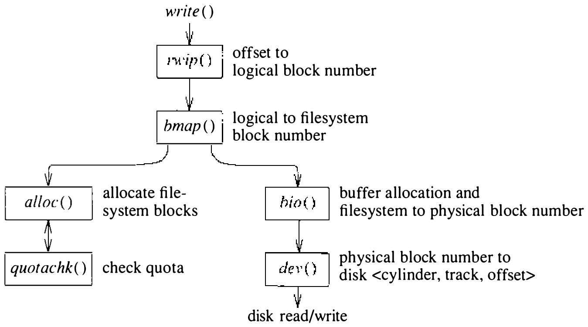
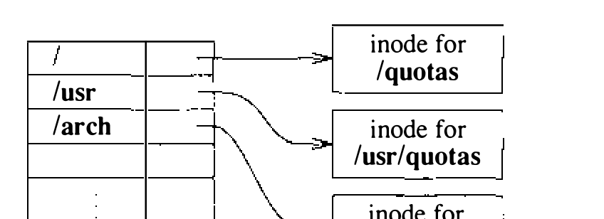
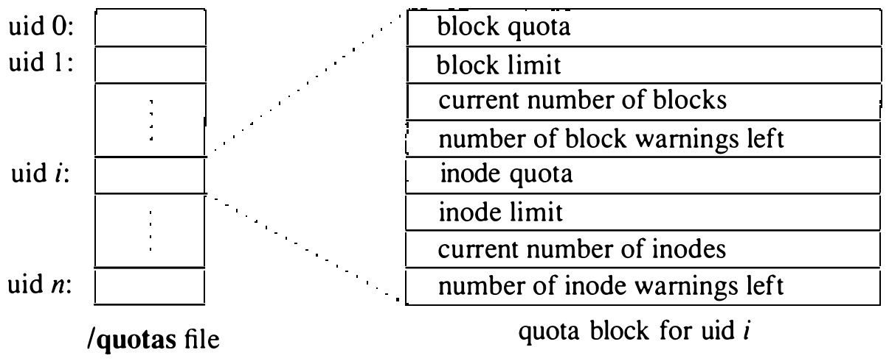
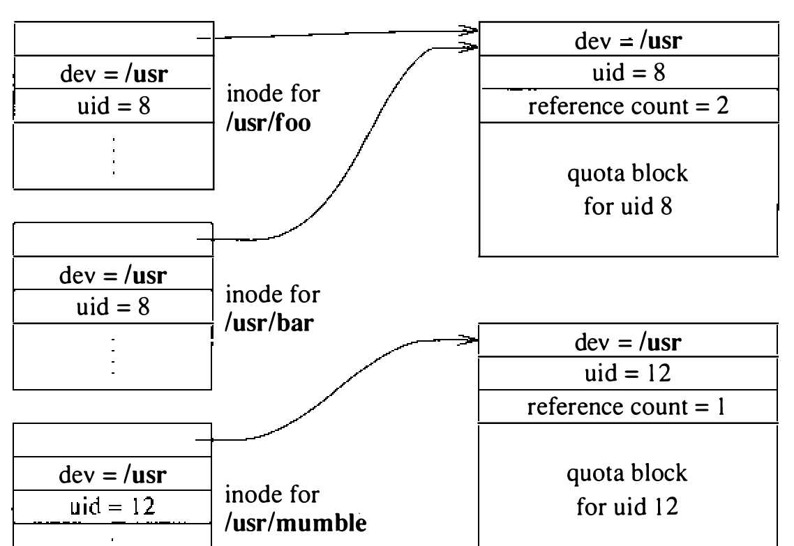
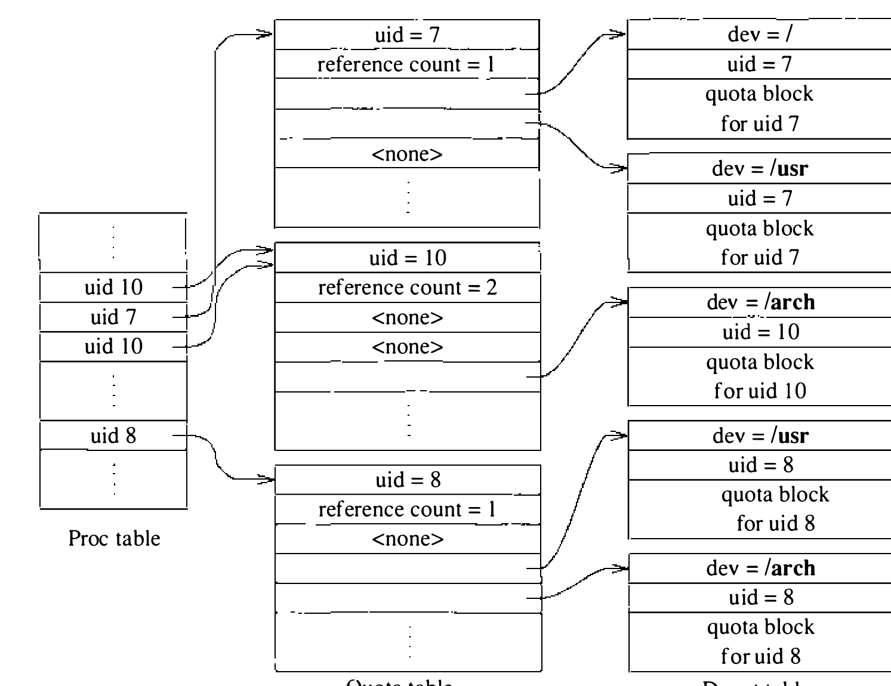

# 7.6 配额

配额系统允许管理员控制各用户在每个文件系统上可分配的 inode 数和数据块数。每个用户的配额按文件系统分别维护。

配额主要作为分配例程的辅助部分接入系统。图 7.18 显示，分配例程收到来自 `bmap()` 的新块请求时，`quotachk()` 先校验该请求，并查阅文件属主的配额。属主用量低于配额，请求获准，并计入其使用统计；属主达到或超出配额，请求遭拒，分配器便向 `bmap()` 返回失败，仿佛文件系统已满。

**图 7.18 配额控制的过程式接口**

文件系统挂载之后才指派配额。一个系统调用把含配额的文件与挂载的文件系统关联起来。按惯例，该文件名为 **quotas**，位于挂载文件系统的根。系统打开 **quotas** 文件，在挂载表与该文件系统相关的表项中持有它的引用；图 7.19 展示挂载表中的引用。需要各用户的配额时，便从 **quotas** 文件取来。

**图 7.19 对 quotas 文件的访问**

系统把 **quotas** 文件维护为按用户标识符索引的配额记录数组；图 7.20 展示一条典型记录。要找用户标识符 *i* 的配额，系统在配额文件中定位到 *i* × `sizeof`（`quota` 结构）处，读取该处的配额结构。每个配额结构包含该用户在此文件系统上的各项限制：可拥有的块数和 inode 数的硬限制与软限制、当前已分配的块数和 inode 数，以及在把软限制当硬限制执行之前用户还能收到的警告次数。

**图 7.20 配额记录的内容**

配额保存在一张称为 dquot 表的系统表中；图 7.21 展示两个典型表项。与 inode 表一样，dquot 表在配额信息驻留期间维护附加信息，以加快访问和识别。由于每次写文件都可能要更新配额，`quotachk()` 必须能快速找到并操作配额。因此，与文件关联的 dquot 结构只需在文件首次打开时查找一次：文件的 inode 首次进入 inode 表时，系统检查是否与之关联了配额。有配额，系统就让 inode 在驻留期间持有对 dquot 结构的引用。`quotachk()` 例程只须检查 dquot 指针非空即可判断文件有配额；非空则所需信息都能直接访问。用户在同一文件系统打开多个文件时，描述这些文件的 inode 都指向同一个 dquot 表项。于是，某用户分得多少块，随时都能轻易而一致地得知。

**图 7.21 dquot 表**

dquot 表中的表项数量可能变得很大。为加快访问，dquot 表采用散列查找，散列以文件系统和用户标识符为键。散列结构和空闲链的建立方式与图 7.11 中的 inode 表相同。dquot 结构的引用计数归零时，该表项便链入空闲链上；dquot 结构不从散列链摘除，因此若很快又要用到它，仍能找到它。只有当系统把某个 dquot 结构回收用作新的 dquot 结构时，才会把它摘下并重新链入散列链。

散列结构便于快速找到最近使用过的 dquot 结构，却解决不了“如何发现用户在某文件系统上没有配额”的问题。用户没有配额时，查找配额会落空；为了发现这一点而去磁盘上读取配额文件，代价高得无法接受。为避免每次访问新文件都做这项工作，系统维护一张配额表，每个活跃用户标识符占一个表项；图 7.22 展示一张典型的配额表。当某用户拥有的 inode 首次被访问，而该用户在配额表中尚无表项时，系统便为其建立表项。此时系统检查每个启用了配额的文件系统，判断该用户在这个文件系统上是否有配额：有配额，就为该文件系统保存指向 dquot 表项的指针；没有配额，就在相应表项中标明无配额。为进一步加快用户打开自己文件这一常见情形，系统在 proc 表的每个表项中维护一个指针，指向该进程所属用户在配额表中的表项。进程打开运行它的用户所拥有的文件时，系统沿指针找到该用户对应的表项；若该用户在该文件系统上有配额，系统就递增相应 dquot 结构的引用计数，并把引用存入 inode。进程打开其他用户的文件时，系统必须在配额表中做散列查找，才能找到其他用户的表项；找到后即可按同样的流程处理。

**图 7.22 配额表**
