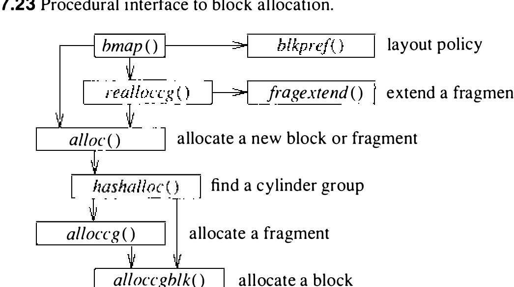

# 7.7 分配机制

现在转入数据块分配的细节。图 7.23 给出分配过程的过程式描述。`bmap()` 例程负责判断何时必须分配新块：先调布局策略例程 `blkpref()`，按 7.3 节所述全局策略例程给出的偏好选出最理想的块。片已分配且需要扩展时，`bmap()` 调 `realloccg()`；尚未分配任何东西时调 `alloc()`。



`realloccg()` 先尝试就地扩展当前片。看表 7.24 中的分配图样例块：第一个片可以从 2 号片扩成 3 号片，因为相邻一段未使用；第二个片占满整块，不能扩展——片不得跨块。`realloccg()` 能就地扩展当前片，就相应更新分配图并返回；不能扩展，就调后文描述的 `alloc()` 取新片，把旧片复制到新片开头，释放旧片。

表 7.24 一个含两个已分配片的样例块

| 表项 | 1 | - | - | 1 | - | - | - | - |
| ---- | ---- | ---- | ---- | ---- | ---- | ---- | ---- | ---- |
| 已分配的片 | 2 号片 | | | 4 号片 | | | | |

分配的簿记工作由 `alloc()` 处理。它先查文件系统汇总信息，确认期望的柱面组有空块；汇总信息显示柱面组已满，就用平方散列遍历汇总信息，找一个有空闲空间的柱面组。找到后，`alloc()` 调片分配例程或块分配例程取一个片或块。

块分配例程接受一个偏好块：可用即返回。不可用时，分配例程尝试找同一柱面上与所请求块旋转位置最接近的另一块。为简化定位旋转最优块，每个柱面组的汇总信息含不同旋转位置上可用块的计数；共区分八个旋转位置，所以对 3600 转/分的驱动器，汇总信息的分辨率是 2 毫秒。超级块含一个称为旋转布局表（rotational-layout table）的向量，按旋转位置索引；向量的每个成员是一张表，列出该旋转位置上每个数据块在块图中的下标。寻找可分配块时，系统先扫描汇总计数，找块数非零的旋转位置，再用旋转位置的下标找到相应的旋转最优块表。这张表使系统扫描空闲块图时，只需检查其中含有空闲块且旋转位置良好的部分。

片分配例程接受一个偏好片：可用即返回。请求的片不可用且文件系统配置为按空间利用优化时，片分配例程采用最佳适应策略：从期望大小的表项开始查柱面组汇总信息，向更大尺寸扫描，直到找到可用片。没有合适或更大的片，就分配一个整块并把它拆开。

片汇总里列有合适大小的片时，分配例程预期在分配图中找到它。为加快扫描可能很大的分配图，采用表驱动算法：分配图中每个字节作为片描述符表（fragment-descriptor table）的下标；描述符表的每个表项描述对应分配图字节中空闲的片。用期望片大小对应的位做逻辑与，分配器即可迅速判断给定的分配图字节中是否含有所需片。举例：看图 7.25 这个 8192/1024 文件系统的分配图字节。该字节表示的块已分成片——开头分出一个 1 号片，中部分出一个 2 号片；未用的是另一个 2 号片和一个 3 号片。于是查片描述符表的 115 号表项，找到图 7.26 所示的表项。找 3 号片就查第三位，发现该尺寸的片可用；找 4 号片就查第四位，发现还需要继续。

```
图 7.25 8192/1024 文件系统的分配图字节
分配图中的位:  -111--11     十进制值: 115

图 7.26 115 号表项的片表项
表项:      0    0    0    0    0    1    1    0
可用片大小: 8    7    6    5    4    3    2    1
```

实现这一算法的 C 代码如下：

```c
    for (i = 0; i < MAPSIZE; i++)
        if (fragtbl[allocmap[i]] & (1 << (size - 1)))
            break;
```

最佳适应策略的好处是磁盘碎片最少；坏处是进程把文件分许多小块写入时，片与片之间的复制次数最多。为避免这种行为，系统可以把文件系统配置为按时间而非按空间优化。进程在按时间优化的文件系统上第一次小块写入时，系统分配一个最佳适应的片；第二次小块写入则分配一个整块，未用部分随之释放。之后的小块写入时，片可以就地扩展，无须额外复制。某些情况下这一策略会让磁盘重度碎片化；系统跟踪这一状况，碎片化距最小空闲空间限制不足 2% 时自动改回按空间优化。
