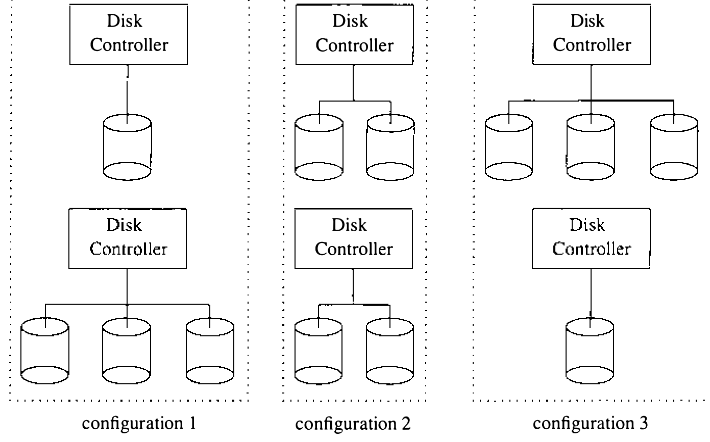

# 8.5 自动配置

有些硬件设备（如控制台终端接口）是系统运行必需的；另一些设备可能用不上，纳入系统只会无谓占用系统资源。可能以不同数量、不同地址、不同组合出现的设备难以预先配置，系统必须在它们在场时予以支持、不在场时优雅失败。为解决这些问题，4.3BSD 既支持创建可引导系统映像时做的静态 **配置过程**（configuration procedure），也支持系统自举时做的动态 **自动配置阶段**（autoconfiguration phase）。

静态配置过程由 **/etc/config** 程序完成。系统管理员创建一个配置文件，定义机器上可能出现的硬件设备集合：不仅给出设备类型，还给出每台设备在机器上的可能位置。例如，系统可以配置两台磁盘控制器和四台磁盘机，按图 8.2 所示的任何一种方式连接。配置过程生成几个定义硬件拓扑的文件，编译进系统供自动配置阶段使用。



自动配置阶段在系统初始化期间进行，识别所配置的设备中哪些真的在机器上。自动配置靠在设备可能连接的每个位置 **探测**（probe）配置过的设备来工作。自动配置阶段识别出的设备被 **附接**（attach）并投入使用；在场但未被识别的设备要等系统重启后才可能可用。

这一方案虽然要求机器上潜在可能出现的硬件设备的全部驱动都配置进系统，却允许设备驱动只为运行系统中实际在场的设备分配系统资源。它允许物理设备拓扑改变而无须重新生成系统装入映像，也防止访问不存在设备导致的崩溃。本节余下部分从设备驱动编写者的角度考察自动配置设施：考察识别机器在场硬件所需的设备驱动支持，以及设备在场被识别后 **附接** 它所需的步骤。配置与自动配置阶段的内部结构留到第 13 章。

**探测设备**

自动配置阶段，对每个响应内存访问的已配置硬件设备控制器，调用设备驱动的 **探测例程**（probe routine）。系统把控制器 I/O 寄存器的地址传给探测例程，期望它既验证设备在场、又尽可能强制设备中断主机。探测例程成功强制出中断，系统就捕获中断并用向量值初始化中断向量表的相应表项，使设备驱动的中断服务例程在此后的中断中被调用。有些硬件设备无法可靠地强制中断；这种场合系统允许探测例程返回一个已知的 interruption 向量来促成设备配置。既没收到中断也没返回中断，系统就认为所给位置上没有该控制器。

除探测设备控制器外，设备驱动还可能被要求探测可能接在控制器上的设备。例如系统先探测磁盘控制器是否在场；每找到一台控制器，再逐一探测可能接着的磁盘机。接在控制器上的设备称为从属设备（slave device）。磁盘机和磁带机是两类从属设备。控制器上可能挂从属设备的设备驱动必须提供 **从属例程**（slave routine）来探测它们。从属例程不必为每台从属设备强制中断，只须返回设备是否在场的指示。

**附接设备**

设备被探测找到后，自动配置代码必须 **附接**（attach）它。把附接与探查分开，是为了让系统初始化总线适配器例程所用的数据结构。多数设备驱动用附接例程初始化硬件设备和软件状态。以磁盘设备为例，附接例程用来识别磁盘机的几何结构、初始化定义文件系统在驱动器上摆放的分区表。

**设备命名**

自动配置设施靠在设备命名中引入一层间接，支持硬件在机器上灵活摆放。应用经文件系统中的块和字符特殊文件引用设备。特殊文件关联的 inode 含相应硬件设备的主、次设备号：主设备号标识设备类型，次设备号标识一个 **逻辑设备部件**（logical device unit）。例如，设文件 **/dev/up1a** 由命令

```sh
/etc/mknod /dev/up1a b 2 8
```

创建。这个文件指主设备号 2、次设备号 8 的块设备。内部，主设备号指明一台由 `up` 设备驱动支持的磁盘机；次设备号交给设备驱动，按公式

*minor* = (8 · *logical unit*) + *logical partition*

解释——本例即逻辑部件（驱动器）1 的分区 0。每个设备的逻辑部件号在自动配置阶段指派，与标识设备的硬件部件号不同：磁带机或磁盘机也许有一个硬件部件插头把它标识为控制器上的物理部件 *x*，对系统而言它却由可能不同的逻辑部件 *y* 标识。每次系统初始化，一个逻辑部件可以指不同的硬件设备；更有意思的是，一台特定硬件设备无论摆在机器哪里都可以映射到同一逻辑部件。设备名字在系统内部的这种逻辑到物理映射，允许例如把磁盘机从一台磁盘控制器挪到另一台而无须重建操作系统。设备命名的灵活性对冗余硬件保可靠性环境下的系统维护很重要；它还允许逻辑编号跨控制器——硬件 0 号部件可以有多台，逻辑 0 号部件只能有一个。
