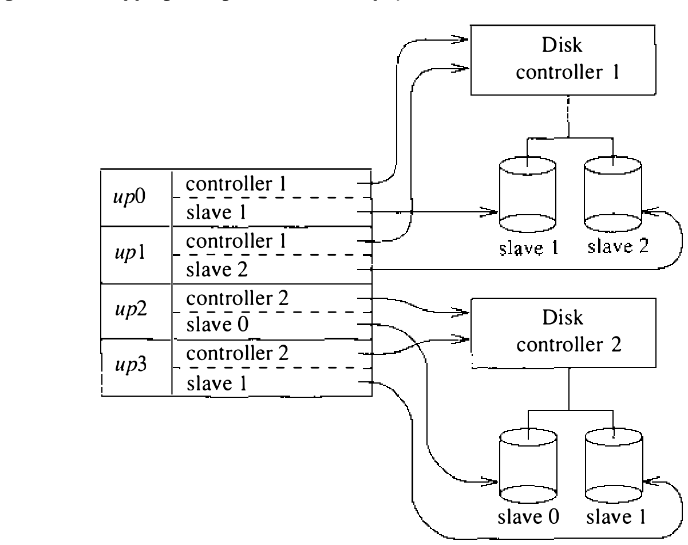

# 8.6 UNIBUS 设备

UNIBUS 是一条支持多种设备和中等数据传输率的异步双向 I/O 总线，即最初的 PDP-11 I/O 总线。VAX 上的每条 UNIBUS 经一个 UNIBUS 适配器连接系统总线。一条 UNIBUS 上可以接许多设备，VAX 的系统总线上也可以接多个 UNIBUS 适配器。每条 UNIBUS 的全部 18 位地址空间都在 VAX 物理地址空间中呈现，并映射进内核的 32 位虚拟地址空间，使内核能直接访问所有 UNIBUS 上的整个地址空间。反向映射问题——让 UNIBUS 设备访问 VAX 内存——由每个 UNIBUS 适配器中的一组映射寄存器解决。这些寄存器允许任一时刻把至多 248 KB 的 VAX 内存映射进一条 UNIBUS 的地址空间（每条 UNIBUS 地址空间的最后 8 KB 即 I/O 页保留给设备控制寄存器访问）。

许多 UNIBUS 设备控制器支持 DMA 操作。DMA 操作中，设备控制器不经 CPU 协助在主存与设备之间搬数据。要做 DMA 操作，必须用映射寄存器把关联的 I/O 缓冲映射进 UNIBUS 的地址空间，还必须为操作分配一条穿过 UNIBUS 适配器的数据通路（data path）。数据通路充当 UNIBUS 与 VAX 系统总线之间传输数据的管道。UNIBUS 适配器支持两类数据通路：缓冲的和非缓冲的。UNIBUS 做 8 位和 16 位数据传输，而 VAX 的系统总线用 32 或 64 位传输。缓冲数据通路把多次 UNIBUS 传输的数据攒成系统总线上的单次操作；非缓冲数据通路则 UNIBUS 上每传一个单位、系统总线上就传一次。使用缓冲数据通路减少 DMA 操作所需的系统总线传输次数，从而减轻系统总线乃至整个系统的负载。每个 UNIBUS 适配器提供若干条（3 到 15 条）须与映射寄存器一起为每次 DMA 传输调度的缓冲数据通路。非缓冲数据通路不维护状态，可以由设备共享。

下面几节考察 UNIBUS 设备驱动的结构与运作，以 `up` 设备驱动（Emulex SC-21V 磁盘控制器的驱动）为例，随后讨论 UNIBUS 适配器支持例程的运作。

**up 设备驱动**

`up` 设备驱动支持在 SC-21V 控制器上对多台磁盘机的裸访问和面向块的访问。控制器可配多种驱动器，驱动在自动配置期间自动判定驱动器的型号与几何结构。除发起和跟踪 I/O 操作这些直截了当的任务外，该驱动还提供几项相当精巧的特性：

* 寻道操作与 I/O 操作重叠
* 对数据传输做 ECC 纠错
* 自动用保留作替换的好扇区更换被标记为不可修复介质缺陷的扇区

`up` 驱动由块、字符两张设备表中的表项描述。`bdevsw` 表项形如：

```c
{ upopen,     /* 设备 open 例程 */
  nulldev,    /* 设备 close 例程 */
  upstrategy, /* i/o strategy 例程 */
  updump,     /* 崩溃转储例程 */
  upsize      /* 分区大小例程 */
},
```

close 入口点用不着，代之以系统默认的空例程 `nulldev()`。`cdevsw` 表项类似：

```c
{ upopen,   /* 设备 open 例程 */
  nulldev,  /* 设备 close 例程 */
  upread,   /* 设备 read 例程 */
        upwrite,  /* 设备 write 例程 */
        nodev,    /* 设备 ioctl 例程 */
        nodev,    /* 设备 stop 例程 */
        upreset,  /* 设备总线复位例程 */
        seltrue,  /* 设备 select 例程 */
        nodev     /* 设备 mmap 例程 */
      },
```

它用到了内核默认例程 `nulldev()`（返回成功指示）和 `nodev()`（返回错误指示）。

对 `up` 驱动的考察按 8.2 节的三方面展开：自动配置支持、服务 I/O 请求的例程和中断服务例程。先集中看设备的面向块接口，再回头看支持裸（字符设备）接口所需的简单补充。

**自动配置支持**

`up` 驱动支持多台磁盘控制器，每台至多接四台磁盘机。自动配置阶段，驱动必须提供：检查磁盘控制器在场的探测例程、检查控制器上磁盘机在场的从属例程，以及在每台驱动器确认在场后附接它的附接例程。要理解这些例程，先得稍微了解设备本身如何工作。

SC-21V 控制器是驻留在 UNIBUS 上的 DMA 设备，经位于 UNIBUS I/O 页中的一组寄存器操纵；经自动配置设施，这组寄存器在内核地址空间中直接可达。就我们的讨论而言，控制器上最重要的两个寄存器是控制状态寄存器和驱动器状态寄存器。控制状态寄存器含 **控制器就绪** 等控制器相关的状态位，也用于驱动向控制器传递 **启动读操作** 等命令时选定具体驱动器。驱动器状态寄存器含 **驱动器在线** 等驱动器相关的状态信息，其内容只在控制器命令完成后才有意义。主机可以用一条立即完成的空操作命令轮询驱动器状态。

探测控制器时，自动配置例程测试寄存器组开头有无寄存器。有，就调用 `upprobe()` 例程并传入控制器寄存器组的地址。探测例程把控制器置为就绪并允许中断，然后停顿片刻给控制器中断 CPU 的时间（见图 8.3）。延迟过后，关掉控制器中断，探测例程返回控制器寄存器组的大小。控制器在场时，这一串动作会使它中断主机：系统捕获中断，用中断向量把 `up` 驱动的中断服务例程 `upintr()` 安装进中断向量表的适当表项。寄存器组开头的地址上若恰好什么都没插，UNIBUS 适配器会记下错误，自动配置代码检测并处理。若那个地址上碰巧是别的设备，强制中断的代码不大可能让那台设备中断。

```c
int upprobe(devaddr)
        device memory location *devaddr;
{
        强制控制器中断；
        延迟 10 毫秒等设备中断；
        关掉控制器中断；
        return (up 寄存器组的大小);
}
```

图 8.3 up 驱动控制器探测的算法

假设控制器被识别，它将被指派一个逻辑部件号，UNIBUS 地址空间中与该设备关联的寄存器组被标记为 in-use（这正是 `upprobe()` 返回寄存器组大小的原因）。自动配置设施跟踪 UNIBUS 地址空间中已分配给设备的部分，避免两台设备的分配区域重叠。

探测磁盘机时调用 `upslave()` 例程（见图 8.4）。待查驱动器由 `ui_slave` 的值指明——一个系统配置时给定的数。这个值交给控制器，向控制器请求驱动器状态；按控制器的响应，`upslave()` 返回指示磁盘机是否在场的值。

```c
boolean upslave(ui, devaddr)
        unibus device *ui;
        device memory location *devaddr;
{
        选中驱动器 ui->ui_slave;
        请求驱动器状态;
        return (驱动器在场 ? true : false);
}
```

图 8.4 up 驱动从属探测的算法

自动配置阶段的最后一个例程是附接例程 `upattach()`（见图 8.5）。附接驱动器涉及一些簿记工作和一项主要工作——判明驱动器型号。`up` 驱动维护一张表，用来把 <控制器,从属部件> 对映射到逻辑设备。这张表必不可少：中断时刻只给控制器号和从属部件号，`up` 驱动必须能凭它找到与特定驱动器关联的数据结构。除建立这一映射外，驱动还统计接到控制器上的驱动器数；一台控制器上发现两台或更多驱动器时，驱动会自动让寻道操作与 I/O 请求重叠。

```c
upattach(ui)
    unibus device *ui;
{
    建立 unibus 设备与
        <控制器,从属部件> 的映射;
    递增本控制器附接的驱动器数;
    调用 upmaptype 判明磁盘机型号;
}
```

图 8.5 up 驱动附接的算法

判别接在控制器上的磁盘机型号：要么由驱动向控制器请求驱动器几何信息，要么（4.3BSD Tahoe 起）由驱动试着从盘上读出含几何信息的标号。标号读出无误，控制器处无须更多信息；读不出，就从控制器上的个性化 PROM 推导几何结构，与已知几何表匹配。控制器给的几何与某已知驱动器相符，即认定相应型号；否则给一个默认型号——多半不对。

附接例程判明的驱动器型号，用来从磁盘标号或（无标号时）驱动内置的表格确定几项重要信息：

* 完整的磁盘几何：每磁道扇区数、每柱面磁道数、每驱动器柱面数。每次 I/O 或定位操作都要用这些信息把逻辑驱动器位置映射为柱面、磁道和扇区（有些驱动器直接提供全部信息，但对这类驱动器未改动一贯的通行做法。）

* 驱动器分区信息。默认驱动器分区按驱动器型号定义，出于性能考虑，起止都在柱面边界上。

* 寻道优化参数。这些参数取决于驱动器的物理特性，稍后描述。

历史上，依赖驱动器的信息编译在设备驱动里；近来许多厂商开始使用磁盘标号。4.3BSD Tahoe 发行版有全面的磁盘标号，涵盖各厂商磁盘标号提供的大部分参数。磁盘标号好处很多，其中重要的一条是可卸盘组和固定磁盘机变得可携：用户把介质从一台机器拿到另一台、或从一种控制器换到另一种，无须依赖软件配置即可正常工作。磁盘标号还允许每台驱动器用自己的分区布局。

**I/O 请求的逻辑到设备映射**

对 `up` 驱动的全部 I/O 请求都经调用 `upstrategy()` 例程进行。块设备访问下，每个读写数据的请求封装在从缓冲池分配的一个缓冲结构中。块 I/O 系统按逻辑设备上的逻辑块表达请求；`up` 驱动负责把这些 **逻辑** 部件映射为目标磁盘机专用的部件。逻辑设备到物理硬件设备的映射用自动配置期间建立的数据结构完成。缓冲中指定的次设备号用来索引一个指针表，各指针指向描述一台磁盘机的结构；该结构又含指向描述所接控制器的结构的指针（见图 8.6）。

要把 I/O 请求中的逻辑磁盘块映射为磁盘机上的物理位置，驱动查询该驱动器关联的分区表。分区表按扇区定义逻辑驱动器分区的基址和范围；次设备编码中含有驱动器分区。要计算 I/O 操作在驱动器上的起始物理位置，驱动只须把所指分区的基址偏移加到缓冲指定的逻辑块上，再用驱动器几何信息算出 I/O 传输起点的柱面、磁道和扇区。



**I/O 策略**

正常系统运行中产生的 I/O 请求交给 `up` 驱动的 strategy 例程。系统不按任何方式排序这些请求，全靠驱动以最优方式把请求分派给设备。磁盘 I/O 流量的最优调度是个难题。对多数动臂磁盘机，把读写磁头定位到 I/O 传输位置附近的时间，通常远长于在物理介质与控制器内存之间传输数据的时间。因此 `up` 驱动 strategy 例程主要关心的，是最小化控制器等待读写磁头定位的时间；定位时间最小化后，一台控制器能最有效地由多台驱动器共享。这里还隐含假设磁盘控制器能让定位操作与数据传输操作重叠。`up` 驱动与 Emulex SC-21V 即典型：它们允许多个定位操作与一次传输操作并行进行。

I/O 请求的分派用一组请求队列实现：每驱动器一条、每控制器一条。请求进入驱动时，由 `disksort()` 例程——一个多数磁盘设备驱动都在用的系统级公用例程——排进各驱动器的请求队列。驱动让定位操作与实际传输分开，尽量不让控制器闲着：各驱动器请求队列上的操作先用来在该驱动器上发起一次定位操作；驱动器就位后，把它移到控制器队列上做 I/O 传输。不过，若所有 I/O 请求都要求给控制器两条命令，这一策略代价可能很高——每条命令的完成都可能要一次对主机的中断，而中断处理相当昂贵。因此驱动并不对所有 I/O 请求做定位操作，只对可能带来更多并发请求的那些发起。

`upstrategy()` 算法见图 8.7。strategy 例程用到两个驱动专有例程 `upustart()` 和 `upstart()`，以及系统的 `disksort()` 例程。`upustart()` 例程负责判断是否为驱动器发起定位命令，并在下一个 I/O 请求准备开始传输时把驱动器加入控制器请求队列。`upstart()` 例程负责发起 I/O 传输：它只是为控制器队列头部的驱动器启动请求规定的传输操作。

```c
upstrategy(bp)
     buffer *bp;
{
     校验逻辑部件;
     检查传输在驱动器分区内;
     计算传输的柱面;
     提升优先级以屏蔽 upintr;
     调用 disksort 把请求排入驱动器队列;
     if (驱动器不活跃) {
          调用 upustart 启动驱动器;
          if (控制器不活跃且驱动器就绪)
               调用 upstart 启动控制器;

     }
     降低优先级;
}
```

图 8.7 up 驱动 I/O 策略的算法

**Disksort**

磁盘驱动调用 `disksort()` 例程，用电梯排序算法把 I/O 请求排进驱动器的请求队列。该算法按循环递增的柱面顺序排序请求，使请求得以用最少的单向扫描服务。这一排序原本为支持文件系统的正常预读、抵消文件系统在驱动器上随机摆放数据而设计。当前文件系统的摆放算法改进之后，`disksort()` 例程的效果不那么显著了；一台驱动器有多个同时用户时效果最大。

`disksort()` 算法见图 8.8。驱动器的请求队列由一至两条按柱面号排序的请求链组成。第一条链头的请求指示驱动器的当前位置；若有第二条链，它由位于当前位置之前的请求组成。每个新请求按其位置排进第一条或第二条链。磁头到达第一条链的末尾时，驱动器转而服务另一条链。

```c
disksort(dq, bp)
     drive queue *dq;
     buffer *bp;
{
     if (驱动器队列为空) {
          把缓冲放在驱动器队列头;
          return;
     }
     if (请求位于第一个活跃请求之前) {
          找到第二条请求链的开头;
          把 bp 排入第二条请求链;
     } else
          把 bp 排入当前请求链;
}
```

图 8.8 disksort 的算法

处理器快而不在设备驱动内排序请求的机器上，disksort 也很重要。这种机器上，若按排队顺序受理一个几 KB 的写，它完成期间会堵住其他进程访问磁盘。排序请求提供了一定的调度，更公平地分配磁盘控制器的访问。

**驱动器定位算法**

`upustart()` 例程所用的算法见图 8.9。基本思路清楚：检查驱动器请求队列的下一个请求；驱动器未定位到请求位置附近，就发起一次定位操作；否则驱动器已就位，把它放上控制器队列等待做 I/O 操作。算法唯一有意思的部分，是判断何时该为驱动器定位的启发式。

`up` 驱动为每种驱动器维护两个参数 `sdist` 和 `rdist`。这两个参数是对“从驱动器当前位置到下一个 I/O 传输位置的旋转距离”施加的阈值。当前位置与下一次传输在同一柱面、且旋转距离介于 `sdist` 与 `sdist + rdist` 之间时，不显式请求定位命令，定位留给控制器在传输时顺带完成；否则发出一条搜索命令，把磁头移到正确柱面，然后等在与目标扇区相距 `sdist` 的扇区处。

`sdist` 和 `rdist` 按磁盘机和控制器的特性选择，目标是确保控制器能在驱动器把数据转出读写磁头之前完成下一个 I/O 操作。控制器若在请求数据的起点转过读写磁头之后才被通知发起 I/O 传输，就只好等数据再转回来。这种情况对性能代价很大——等驱动器转圈的时间本可用于别的传输。`up` 驱动的启发式力求保证这种情况不发生。

```c
upustart(ui)
     unibus device *ui;
{
     if (驱动器队列上没有请求) return;
     if (控制器忙) {
         把设备标记为控制器空闲时需要照应;
         return;
     }
     if (驱动器未定位在柱面上) {
         标记驱动器已定位在柱面;
         if (控制器接有多台驱动器 &&
                  磁头离传输点很远) {
             选中驱动器;
             把驱动器定位到传输位置或其附近;
             return;
         }
     }
     把驱动器放上控制器队列;
}
```

图 8.9 up 驱动部件启动的算法

许多较新的磁盘控制器在内部提供了 `up` 驱动所做的调度优化。由控制器做这些计算，对不直接支持这些设施的操作系统是件好事。但磁盘控制器不可能掌握操作系统的全部信息，会有行为异常的场合——例如控制器无法给同步请求高于异步请求的优先级。

**发起 I/O 操作**

驱动决定启动 I/O 操作时调用 `upstart()` 例程（见图 8.10）。`upstart()` 的任务直截了当：检查控制器队列的下一个请求，让控制器启动 I/O 操作。设备控制器直接接在主系统总线上的机器，这样做也许就够了。但 VAX 上，设备驱动必须调用 UNIBUS 适配器资源例程请求传输所需资源。系统动态分配这些资源而不是引导时静态分配，因为单条总线适配器上的许多设备合起来需要的资源可能超过一个适配器的容量；而且某些 I/O 设备做数据传输时要求独占总线，因其控制器数据缓冲不足。出于这些原因，发起 DMA I/O 操作时，设备驱动先填好一次传输的全部设备参数，再调用 `ubago()` 例程在 UNIBUS 适配器中分配资源。资源可得时，`ubago()` 例程回调设备驱动开始 I/O 传输。传输启动后，驱动 strategy 例程的工作即告完成，剩下的由控制器完成传输、并在完成时向主机交付中断。注意适配器例程强加的排队延迟可能损害系统性能；因此调优 VAX 系统的性能，必须仔细考虑 I/O 设备给 UNIBUS 带来的负载。

```c
upstart(ui)
	unibus device *ui;
{
	检查控制器队列的第一个请求;
	if (没有要处理的请求)
		return;
	标记控制器忙并确定请求的目的地;
	选中驱动器并检查其就绪在线;
	设置 I/O 传输;
	调用 ubago 为传输调度适配器资源;
}
```

图 8.10 up 驱动控制器启动的算法

**中断处理**

`up` 驱动有一个中断服务例程 `upintr()`。每个 I/O 或定位操作完成时由控制器投递中断，中断处理算法见图 8.11。

中断可能为 I/O 或定位操作而来，但传输操作期间发生的定位中断推迟到传输完成后处理。因此 `upintr()` 必须检查有无未决的 I/O 操作；有则检查操作完成状态。然后扫描完成搜索操作的驱动器，对每台完成当前请求的驱动器调用 `upustart()` 例程调度下一个操作。

I/O 请求完成时，`upintr()` 调用 `biodone()` 例程通知请求 I/O 操作的进程。该例程唤醒阻塞的进程，为异步写释放缓冲，或（对调页守护进程的请求）调用缓冲结构中指定的过程。

```c
upintr(cntrl)
     controller *cntrl;
{
     if (控制器正在做传输) {
         取得与传输关联的缓冲;
         选中驱动器并检查驱动器和控制器状态;
         处理驱动器或控制器上的错误;
         if (操作完成) {
             从控制器队列摘下请求;
             记录传输状态;
             调用 biodone 通知 I/O 完成;
             if (本驱动器还有未决操作)
                 调用 upustart 启动驱动器的
                      下一个操作;
         }
         释放传输使用的 unibus 资源;
     }
     for (每台完成寻道的驱动器)
         调用 upustart 启动驱动器的下一个操作;
     if (设备就绪可传)
         调用 upstart 启动控制器的下一个操作;
}
```

图 8.11 up 驱动中断处理的算法

成功 I/O 操作的处理之外，中断服务例程还负责处理可能发生的多种错误。有些错误不可恢复，另一些可由设备驱动处理。驱动会尝试纠正的两类错误是：传输数据中出现短暂错误串的请求，以及数据被放在驱动器上替代位置的请求。第一类错误的恢复靠控制器提供的纠错码（ECC）纠正控制器传来的数据。第二类错误的恢复要求设备驱动在坏扇区表（bad-sector table）中查找 **坏扇区** 以定位替代扇区：坏扇区表中有该扇区，驱动就从替代位置发起传输，把数据当作原本就在所请求位置那样返回。

上述两种错误恢复机制通称 ECC 纠错和坏扇区转发。多数现代磁盘控制器把两种恢复方案内建在控制器中。坏扇区转发可以多种方式实现。一种方案在磁盘上保留单一区域映射无法纠正缺陷的扇区，通常由驱动器末端几个柱面组成；问题在于坏扇区被识别时，替代扇区可能离当前位置很远，访问替代扇区是一次耗时的定位操作。为解决这一问题常用第二种方案，即滑移扇区转发（slip-sector forwarding）：不再保留单一连续区域，而是在每条磁道上保留一个扇区。这样，替代 **滑移扇区** 至多延迟一圈磁盘旋转即可到达。但一条磁道上坏掉不止一个扇区时，第二个坏扇区就无法重映射。制造商通常研究磁盘介质失效的统计特性，决定每条磁道分配多少滑移扇区、每个驱动器保留多少柱面。两种做法兼收的混合方案也有使用，往往最有效，但完全在控制器内实现代价不小。总体而言，坏扇区处理对性能的影响可以察觉，却好过报废设备——何况如今的磁盘机少有无瑕介质。

给 `up` 驱动添加裸访问很简单：只须 `upread()` 和 `upwrite()` 两个例程，加一组做裸 I/O 的缓冲。读写例程按 8.4 节所述调用 `physio()` 即可。

**UNIBUS 适配器支持例程**

UNIBUS 适配器例程为 UNIBUS 设备的驱动提供两大功能：

1. 管理每个适配器的资源，把资源动态分配给驱动做 DMA 传输。
2. 监视适配器故障，在适配器报告严重或反复的错误时重置其状态。

（第二项功能源于早期 UNIBUS 适配器的不稳定；如今已很少用到。）

每个 UNIBUS 适配器有一组把内存页映射进 UNIBUS 地址空间的寄存器，共 496 个，每个映射一个 512 字节的页，足以映射 248 KB 内存；UNIBUS 地址空间的其余 8 KB 保留给 UNIBUS 设备寄存器。要在主存与 UNIBUS 外设之间做 DMA 传输，必须用一组连续的映射寄存器把 I/O 缓冲映射进 UNIBUS 地址空间，并为传输分配一条缓冲或非缓冲数据通路。缓冲数据通路不能由多个做 DMA 的设备共享，因此必须逐传输调度。

经 UNIBUS 适配器的 I/O 操作分三步：

1. 为操作分配资源
2. 发起操作
3. 收到操作完成的通知后，释放第 1 步分配的资源

第 1、3 步的工作分别藏在 `ubago()` 和 `ubadone()` 例程里；第 2 步的工作是设备专有的，由设备驱动的 go 例程（go routine）承担——资源分配到位时它被自动调用。

```c
boolean ubago(ui)
        unibus device *ui;
{
        为设备找到 unibus 适配器;
        提升优先级到 spluba;
        if (设备需要独占适配器且另有
                使用者存在 || 适配器正被独占使用)
                goto resource_wait;
        调用 ubasetup 为传输分配 unibus 适配器
                资源 (指明本例程中不做等待);
        if (并非全部资源都可得)
                goto resource_wait;
        递增适配器的使用者数;
        if (设备需要独占适配器)
                标记适配器正被独占使用;
        降低优先级;
        if (本设备先前在适配器的等待队列上)
                从适配器队列摘除设备表项;
        调用设备的 go 例程启动操作;
        return (true);

resource_wait:
        把设备放上等待适配器资源的设备队列;
        降低优先级;
        return (false);
}
```

图 8.12 调度 UNIBUS I/O 操作的算法

`ubago()` 所用的算法见图 8.12。设备驱动经调用 `ubasetup()` 例程隐式分配资源（`ubasetup()` 的算法见图 8.13）。设备若要求独占适配器，或适配器正被要求独占访问的设备使用，设备就被放上每个适配器维护的等待设备队列。同样，资源当前不可得时，设备也上适配器的队列。

```c
boolean ubasetup(number, bp, flags)
        unibus adapter number;
        buffer *bp;
        int flags;
{
        计算传输所需的适配器映射寄存器数;
        提升优先级到 spluba;
        while (映射寄存器不可用) {
                if (标志指明调用者不能等待) {
                        降低优先级;
                        return (false);
                }
                递增映射寄存器的等待者计数;
                阻塞等待映射寄存器;
        }
        分配所需的映射寄存器;
        if (需要缓冲数据通路) {
                while (无缓冲数据通路可用) {
                        if (标志指明调用者不能等待) {
                                释放已分配的
                                        映射寄存器;
                                降低优先级;
                                return (false);
                        }
                        递增缓冲数据通路的
                                等待者计数;
                        阻塞等待缓冲数据通路;
                }
                分配一条缓冲数据通路;
        }
        降低优先级;
        记录已分配的适配器资源;
        计算数据缓冲的物理位置;
        设置适配器映射寄存器指向数据缓冲;
        return (true);
}
```

图 8.13 分配 UNIBUS 适配器资源的算法

驱动收到中断并经 `ubadone()` 调用释放资源时（见图 8.14），就扫描适配器的队列：队列上的每台设备再获一次分配资源、发起 I/O 操作的机会；阻塞在 `ubasetup()` 里等资源的进程也被唤醒重试。

```c
ubadone (um)
        unibus controller *um;
{
        为控制器找到 unibus 适配器;
        if (设备要求独占适配器)
                标记适配器不再被独占使用;
        递减适配器的使用者数;
        调用 ubarelse 释放传输使用的资源;
}
```

图 8.14 完成 UNIBUS I/O 操作的算法

这些算法的实现有些微妙之处。适配器例程必须防范不可恢复的适配器错误或 I/O 操作超时引起的总线复位。复位发生时，当时为 I/O 操作分配的所有资源直接由 UNIBUS 适配器复位例程收回。因此 `ubarelse()`（见图 8.15）释放资源时必须小心，别把资源释放两次。为避免这个问题，`ubarelse()` 在释放资源期间把处理器优先级提升到 `spluba`，挡住因 UNIBUS 适配器中断而运行的总线适配器复位例程。优先级提高期间，`ubarelse()` 可以先对要释放的资源做一致性检查，赶在总线复位例程再次释放之前把它们释放。

```c
ubarelse(number, mapptr)
        unibus adapter number;
        mapping register pointer *mapptr;
{
        提升优先级到 spluba;
        if (用过缓冲数据通路) {
                释放数据通路;
                if (有人在等缓冲数据通路) {
                        把等待者计数清零;
                        唤醒所有等缓冲数据通路的
                                进程;
                }
        }
                释放使用的映射寄存器;
        降低优先级;
        if (有人在等映射寄存器) {
                把等待者计数清零;
                唤醒所有等映射寄存器的进程;
        }
        while (适配器还有排队的请求) {
                if (调用 ubago 表明操作做不成)
                        break;
        }
}
```

图 8.15 释放 UNIBUS 适配器资源的算法
