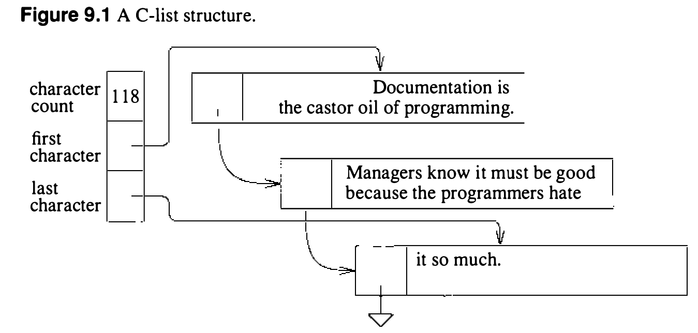

# 9.6 C-list

终端 I/O 系统处理的数据块大小悬殊。多数输入输出操作处理单个字符（键入的输入字符及其回显）。输入字符通常与先前的输入聚成大小不一的行。有些输出操作涉及大量数据，如屏幕刷新或其他命令输出。为终端驱动最初设计的数据结构——字符块（C-block）和字符链表（C-list）——在 4.3BSD 中仍在使用。每个 C-block 是一个定长、对齐的缓冲，含一个链接指针和存放缓冲字符的空间。它的大小总是 2 的幂，使系统靠掩去指针低位就能算出块间边界。4.3BSD 用 64 字节的 C-block 装 60 个字符；早期系统用 32 字节缓冲。输入或输出字符的队列由一个 C-list 描述：它含指向第一个字符和最后一个字符的指针，以及队列中字符数的计数（见图 9.1）。两个指针都指向存放在 C-block 中的字符。从 C-list 队列摘除一个字符时，计数减一、指向第一个字符的指针加一。指针若越过队列第一个 C-block 的末尾，就从当前 C-block 开头的前向指针取得指向下一个 C-block 的指针；前向指针更新后，空 C-block 放上空闲链。向队列添加字符的过程类似：当前缓冲没有空间时，从空闲表分配另一个缓冲，把最后一个缓冲的链接指针指向新缓冲，尾指针设到新缓冲的第一个存储位置。字符存入尾指针所指处，尾指针加一，字符计数加一。一组公用例程操纵 C-list：`getc()` 从 C-list 摘下下一个字符并返回；`putc()` 向 C-list 末尾添加字符。成组字符可分别用 `b_to_q()` 和 `q_to_b()` 加入或移出 C-list。终端驱动还需要：用 `unputc()` 从队列末尾摘字符、用 `nextc()` 检查队列中的字符、用 `catq()` 拼接队列。

UNIX 在地址空间狭小的计算机上开发的年代，为终端驱动设计缓冲是个难题。C-list 和 C-block 优雅地解决了在为小内存机器设计的终端输入输出队列中存放任意长度数据队列的问题。在 VAX 这样地址空间较大的机器上，改用每字符 CPU 时间更少、空间效率更差的数据结构本来更好。VAX 之所以沿用原来的 C-list，是因为改换新数据结构的人工成本高：改队列结构就得修改所有行规程和所有终端设备驱动，工作量可观。只改接口例程的实现也行，但接口不变的话例程仍要逐字符调用；改接口又得改驱动。
