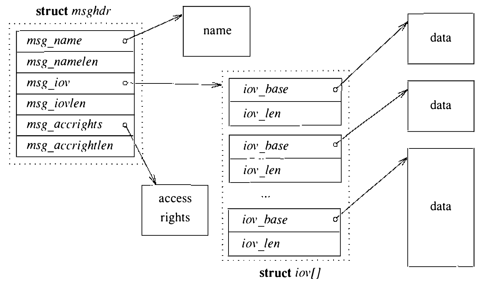

# 10.1 进程间通信模型

历史上，UNIX 在进程间通信（interprocess communication）领域偏弱。4.2BSD 发布之前，UNIX 中唯一的标准进程间通信设施是管道（pipe）——一种可靠、有流控的字节流，只能在同一台机器上两个相关的进程之间建立。管道的局限激发了许多实验性设施：兰德公司 UNIX 系统的端口（ports）[Sunshine, 1977]、第七版 UNIX 实验部分的多路复用文件（multiplexed files）[UPMV7, 1983]，以及卡内基-梅隆大学开发的 Accent IPC 设施 [Rashid, 1980]。还有些通信设施为 UNIX 的应用专用版本而开发，例如 Columbus UNIX 系统中的共享内存、信号量和消息队列。DARPA 研究共同体——4.2BSD 设计开发的主要推动者——的需求，促成了对 UNIX 缺少成套进程间通信设施这一问题的集中攻坚。4.2BSD 设计实现的设施在该版本发布后又经打磨。于是，4.3BSD 提供了丰富的进程间通信设施，意在支撑构建以通信原语为基础的分布式程序（distributed program）。

本章描述进程间通信设施。实现这些设施的软件层与网络子系统紧密交织：网络系统的体系结构在第 11 章描述，网络协议本身在第 12 章考察。先读第 10 章、再读第 11、12 章，读者会觉得这三章的材料最容易理解。第 12 章末尾有一节把三者串成一体。

对 UNIX 进程间通信增补的设计有几项目标。最迫切的需要是访问 DARPA Internet [Cerf, 1978] 等通信网络。此前提供网络访问的工作集中在网络协议的实现上，经专用而常常笨拙的字符设备接口向 UNIX 应用导出传输设施 [Cohen, 1977; Gurwitz, 1981]。结果每次新的网络实现都带来一个不同的应用接口，多数既有程序要大改或彻底重写。4.2BSD 的进程间通信设施意在提供足够通用的接口，让基于网络的应用独立于底层通信设施来构建。

第二项目标是允许实现多进程程序，例如分布式数据库。UNIX 管道要求所有通信进程派生自一个共同的父进程。管道的使用迫使 Ingres 数据库系统之类的系统设计得结构相当别扭 [Kalash et al., 1986]。需要新的通信设施支持同一台主机上本地的、以及多台主机上远程的无关进程之间的通信。

最后，新兴的联网与工作站技术要求新的通信设施能构建文件服务器等局域网服务。意图是提供易于支持分布式环境中资源共享的设施；而不是要构造一个分布式 UNIX 系统。

进程间通信设施的设计支持以下三点：

* **透明性**：进程之间的通信不应取决于进程是否在同一台机器上。

* **效率**：任何进程间通信设施的适用范围都受其性能限制。4.2BSD 出于性能原因把进程间通信分层叠加在网络通信之上。另一种做法是把网络通信作为一种经进程间通信设施访问的服务来提供：那样虽更模块化，却要求网络通信设施经一个或多个服务进程访问。4.2BSD 设计之时，系统所运行的主流硬件进程上下文切换很慢，分布式环境中通信设施的性能会因此严重受限。因此，进程间通信设施叠在网络通信设施之上是最有效的实现。

* **兼容性**：既有的朴素 UNIX 进程应能不加修改地用于分布式环境。**朴素进程**（naive process）的特征是：从标准输入文件读、向标准输出文件写来完成工作。**老练进程**（sophisticated process）则是指管理其他进程、或利用终端等特定设备相关知识的进程。UNIX 成功的一大原因，就是靠充当字节流过滤器的朴素进程支持模块化。shell 和屏幕编辑器等老练应用虽然存在，数量却远少于朴素应用程序一族。

设计进程间通信设施的过程中，开发者确定了支持这些目标的下列需求，并为每一条发展出统一概念：

* 系统必须支持使用不同协议集、不同命名约定、不同硬件等的通信网络。为此定义了通信域（communication domain）的概念。通信域体现通信与命名的标准语义。不同的网络为指明通信端点的名字所用的标准几乎总是不同，名字的性质也各有出入：一个网络中名字可能是通信端点的固定地址，另一个网络中却可能用来定位一个可在位置间移动的进程。通信的语义可以包括可靠传输数据的代价、对多播传输的支持、传递访问权或权能的能力等。区分开通信性质，应用就能按需选择合适的域。

* 需要一个可以用 UNIX 文件描述符操纵的、通信端点的统一抽象。套接字（socket）就是收发消息所自的抽象对象。套接字在通信域中创建，很像文件在文件系统中创建；与文件不同的是，套接字只在被引用期间存在。

* 通信的语义方面必须以受控而统一的方式提供给应用。也就是说，应用必须能请求虚电路或数据报等通信风格，而这些风格在所有通信域中必须以一致的方式提供。为此，所有套接字按其通信语义分 **类型**（typed）。类型由套接字支持的性质子集定义：

  1. 数据按序交付
  2. 数据交付不重复
  3. 数据可靠交付
  4. 保留消息边界
  5. 支持带外消息
  6. 面向连接的通信

  管道具备前三条性质，不具备第四条。带外（out-of-band）消息是在正常入局带内数据流之外投递给接收方的消息，通常与紧急或异常条件相关。连接是一种机制，用来避免随每个数据分组传输发送套接字的身份：各通信端点的身份在传输任何数据之前交换，并在两端维护，以便随时呈报。数据报套接字（datagram socket）建模可能不可靠、无连接的分组通信；流套接字（stream socket）建模可靠、基于连接、可能支持带外数据传输的字节流；顺序分组套接字（sequenced packet socket）建模有序、可靠、不重复、基于连接且保留消息边界的通信。其他类型的套接字也合乎需要，可以添加。

* 进程必须能定位通信端点，才能在彼此无关的情况下会合；为此套接字可以 **命名**（named）。套接字的名字只在创建它的通信域的语境中才有意义地解释。

多数应用使用的名字是人类可读的字符串。而通信域内部使用的套接字名字通常是一个低层 **地址**。4.3BSD 没有把名字到地址的翻译函数放进内核，而是为应用程序提供做这种翻译的函数。本章余下部分，我们把套接字的名字称为地址（address）。

**使用套接字**

使用套接字相当直截了当。首先必须用 `socket` 系统调用创建一个套接字：

```c
    s = socket(domain, type, protocol);
    int s, domain, type, protocol;
```

套接字的类型按应用所需的特性性质选择：例如需要可靠通信，可选用流套接字。`type` 参数是系统头文件中定义的套接字类型之一。`domain` 参数指明套接字应在其内创建的通信域（或 **协议族**，见 10.4 节），视应用的工作环境而定。机器间通信最常见的域是 Internet 通信域，因为支持 Internet 通信协议的主机数量庞大。最后一个参数 `protocol` 可用来指明支持套接字运作所用的具体通信协议。协议以每个通信域专有的著名常量指明；协议指定为零时，系统自选一个合适的。`socket` 系统调用返回一个文件描述符（一个小整数，见 6.2 节），供此后的套接字操作使用。`socket` 调用与 `open` 相似，不同在于它创建指定类型对象的一个新实例，而 `open` 创建对既有对象（如文件或设备）的新引用。

套接字创建后，下一步取决于所用套接字的类型。最常用的套接字类型使用前需要 **连接**。两个套接字之间建立连接，通常要求每个套接字都绑定了一个地址。应用可以显式指定套接字的地址，也可以听由系统指派。套接字的地址不可改变。通信域允许时套接字地址可以重用；不过各域通常保证套接字地址在每台主机上唯一，使两个套接字的关联在通信域内唯一。绑定到套接字的地址必须构造成一个套接字地址结构（socket address structure）。应用在数据库里查名字来找到著名服务的地址。地址的格式因域而异；为容纳千姿百态的格式，系统把地址当作变长字节数组对待，前缀一个标识其格式的标签。把地址绑定到套接字的调用是

```c
error = bind(s, addr, addrlen);
int error, s;
struct sockaddr *addr;
int addrlen;
```

其中 `s` 是先前 `socket` 系统调用返回的描述符。

把名字绑定到套接字与创建套接字分开，有几方面的原因。第一，套接字不命名也可能有用；若所有套接字都必须命名，用户将被迫凭空编造无意义的名字。第二，某些通信域中，绑定名字之前可能要向系统提供额外的非标准信息——例如使用套接字所需的“服务类型”。若套接字的名字必须在创建时指定，提供这些信息就无从做起，除非把接口搞得更复杂。

基于连接的通信中，发起连接的进程通常称为客户进程（client process），接收或响应连接的进程称为服务器进程（server process）。**客户进程** 用 `connect` 系统调用发起连接：

```c
error = connect(s, serveraddr, serveraddrlen);
int error, s;
struct sockaddr *serveraddr;
int serveraddrlen;
```

**服务器进程** 则先把套接字标记为将在此接受入局连接：

```c
error = listen(s, backlog);
int error, s, backlog;
```

然后一次一个地接收连接：

```c
snew = accept(s, clientaddr, clientaddrlen);
int snew, s;
struct sockaddr *clientaddr;
int *clientaddrlen;
```

`listen` 调用中的 `backlog` 参数指定排队等待接受（acceptance）的未决连接数的上限。进程在 `accept` 调用中指定 `clientaddr` 和 `clientaddrlen` 参数，即可随新连接的套接字取得客户地址。注意，`accept` 返回的是与一个 **新** 套接字关联的文件描述符；客户与服务器的通信就经这个新套接字进行。原来的套接字 `s` 只用于管理服务器中的连接请求队列。

非基于连接的套接字也可以用 `connect` 系统调用固定对端的地址，尽管这并非必需。收发数据的系统调用（后述）允许无连接套接字不固定对端地址，随每条发送的消息指定目的地。同样，无连接套接字传输数据前也无须绑定地址；不过某些通信域中，未绑定特定地址的套接字在首次使用时会被指派地址。

收发数据有多种调用。常规的 `read`（`readv`）和 `write`（`writev`）系统调用，以及较新的 `send` 和 `recv` 系统调用，都可用于处于连接状态的套接字。`send` 和 `recv` 与更常见的接口的不同在于都支持一个额外的 `flags` 参数：标志可用于接收时 **窥视** 入局数据（MSG_PEEK）、发送或接收带外数据（MSG_OOB）、以及不经网络路由发送数据（MSG_DONTROUTE）。`sendto` 和 `recvfrom` 系统调用具备 `send` 和 `recv` 的全部能力，还允许调用者指定或接收通信对端的地址；对每次收发对端都可能不同的无连接套接字最有用。最后，`sendmsg` 和 `recvmsg` 系统调用支持进程间通信设施的完整接口：除可做分散/聚集操作外，还可指定或接收地址、使用前述可选标志，并收发称为访问权的特别解释数据（见图 10.1）。



除这些系统调用外，另有若干调用访问杂项服务。`socketpair` 调用提供一种无须绑定地址就创建两个相连套接字的机制——除数据可能双向流动外，这一设施与管道几乎一样；事实上管道内部就实现为一对套接字。`getsockname` 调用返回套接字本地绑定的地址；`getpeername` 返回连接远端套接字的地址。`shutdown` 调用终止套接字上的数据发送或接收；两个 `ioctl` 式的调用 `setsockopt` 和 `getsockopt` 用来设置和读取控制套接字或底层网络协议运作的各种参数。这些选项包括发送广播消息的能力、设置套接字收发数据缓冲的大小，以及套接字销毁时等待排队数据发完。套接字用正常的 `close` 系统调用丢弃。

进程间通信设施刻意设计得与标准 UNIX 系统接口——即 `open`、`read` 和 `write` 系统调用——正交。这一决定是为了避免给熟悉的接口强加不应有的复杂性。开发者还认为，使用完全独立于 UNIX 文件系统的接口能改善软件的可移植性——例如不必牵扯 UNIX 路径名。为朴素进程着想的向后兼容仍受重视；因此，凡是有意义之处（例如使用连接的流套接字时），熟悉的 read–write 接口都做了扩充以访问新的通信设施。
