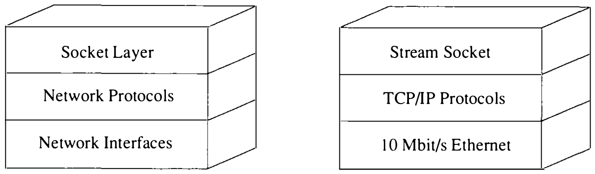

# 10.2 实现结构与概述

如图 10.2 所示，进程间通信设施分层叠加在网络设施之上。数据从应用经套接字层流向网络支持，反之亦然。套接字层所需的状态完全封装在套接字层内，而协议相关的状态维护在支撑协议专有的辅助数据结构中。传输数据所用存储的责任由套接字层移交网络层；始终如一地遵守这条规则有助于简化存储管理的细节。套接字层内，套接字数据结构是一切活动的焦点。系统调用接口例程管理 UNIX 系统调用相关的动作，包括收集系统调用参数（见 3.2 节）与把用户数据转换成第二级例程期望的格式。套接字抽象的大部分在第二级例程中实现。所有第二级例程的名字都带 `so` 前缀；它们直接操纵套接字数据结构，并管理异步活动之间的同步。这些例程列于表 10.1。

**图 10.2 进程间通信实现的分层**

**表 10.1 套接字层支持例程**

| 例程 | 功能 |
| ---- | ---- |
| `socreate()` | 创建新套接字 |
| `sobind()` | 把名字绑定到套接字 |
| `solisten()` | 把套接字标记为监听连接请求 |
| `soaccept()` | 接受套接字上的未决连接 |
| `soconnect()` | 发起到另一套接字的连接 |
| `soconnect2()` | 在两个套接字之间创建连接 |
| `sosend()` | 发送数据 |
| `soreceive()` | 接收数据 |
| `soshutdown()` | 关闭数据发送或接收 |
| `sosetopt()` | 设置套接字选项的值 |
| `sogetopt()` | 读取套接字选项的值 |

本章余下部分主要讲套接字层的实现。10.3 节讨论套接字层及以下网络子系统的内存管理；10.4 节讲套接字及相关数据结构；10.5 节给出连接建立的算法；10.6 节讨论数据传输；10.7 节描述连接关闭。本章中提到网络通信协议提供的支撑设施时一带而过，不作展开；网络协议与套接字层交互的完整描述见第 11 章，第 12 章给出网络协议的内部实现。
