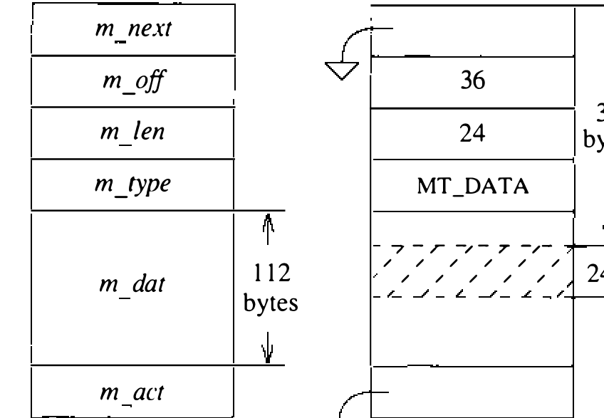

# 10.3 存储管理

进程间通信与网络协议对内存管理方案的要求，与操作系统其他部分大不相同。虽然都要求高效分配与回收内存，通信协议尤其需要大小悬殊的内存：既需要套接字、协议状态块等定长数据结构的内存，也需要通信协议分组等可变结构的内存。为此，为进程间通信和联网系统创建了一套专用的内存管理设施。

## Mbuf

内存管理设施围绕一个称为 mbuf 的数据结构展开（见图 10.3）。mbuf（memory buffer，内存缓冲区）长 128 字节，其中 112 字节留作数据存储。对大消息，靠引用私有页池中的一页，一个 mbuf 可关联至多 1 KB 数据。数据要么存在内部数据区、要么存在外部页，绝不在两处同时存在。与 mbuf 关联的数据，靠 mbuf 结构中的偏移字段与 mbuf 基址相加访问：数据在 mbuf 内时偏移介于 12 到 124；数据在映射页中时（无符号）偏移大于 124。

**图 10.3 内存缓冲区（mbuf）数据结构**

除引用数据的偏移字段外，还维护一个长度字段，指明该偏移处有效数据的字节数。偏移和长度字段让例程能高效地在 mbuf 的开头或末尾修剪数据：删除 mbuf 开头的数据，偏移递增、长度递减；删除末尾的数据，只需递减长度。mbuf 内有空间时，数据可以在任一端添加。这种无须复制即可增删空间的灵活性，在实现通信协议时特别有用：协议常在把消息内容交给更高层的处理模块之前剥掉消息前部或后部的协议信息，或在消息传向低层时添加协议信息。

把页映射进 mbuf 的安排使数据移动时无须做内存到内存的复制：改变与物理内存页关联的页表项，就能把内存从一个 mbuf 重映射到另一个。此外，需要某个数据块的多个副本时，同一页可以映射进多个 mbuf，避免物理复制；为支持这种共享，为映射页池维护一个引用计数数组。

多个 mbuf 可以链接起来装任意数量的数据，链接靠 mbuf 的 `m_next` 字段完成。按惯例，这样链起来的一串 mbuf 被当作单一对象对待——例如通信协议就用 mbuf 链构造分组。第二个字段 `m_act` 用来把由 mbuf 链构成的对象链接成对象列表。在本书的讨论中，用 `m_next` 字段链起来的一组 mbuf 称为一条链（chain）；用 `m_act` 字段链起来的 mbuf 链称为一个列表（list）。

mbuf 结构的最后一个成分是类型字段。每个 mbuf 按其用途标记类型，未用的 mbuf 标记 MT_FREE。mbuf 类型有两个用途：操作上的唯一用途，是区分排在套接字数据队列上等待接收的 mbuf 链中消息的可选成分；除此之外，类型信息用于维护存储使用的统计，出问题时也用来辅助追踪 mbuf。

mbuf 的数据区是定长而非变长，有几方面原因。第一，定长使内存碎片最少——这在联网软件最初设计之时是重要考量，因为目标机器之一是 BBN C70，一台 20 位物理地址空间的机器。第二，通信协议经常要在既有数据区的前部或后部附加头部、拆分数据区，或从数据区开头或末尾修剪数据；mbuf 设施的设计使其尽可能无须重新分配或复制就能处理这些改动。最后，后文所述的 `dtom()` 函数在 mbuf 不定长时会昂贵得多。

mbuf 内存管理方案好用又高效，结果 mbuf 被拿去装许多设计初衷之外的数据结构——从变长的协议分组到僵尸进程的状态，无所不装。某些系统例程甚至给 mbuf 的数据存储区强加子结构，以尽量减少浪费的空间。mbuf 设施的这种超载，与其说归功于 mbuf 存储机制的强，不如说归咎于系统内存分配设施的弱。许多厂商补上了系统内通用堆存储的缺位，从而免除了 mbuf 的诸多不当使用；4.3BSD 之后的系统也有类似改动。

**存储管理算法**

mbuf 存储库由三种中心资源组成：从系统内存分配器分配的页池、把页映射进内核地址空间的私有页映射、以及为映射页维护引用计数的计数器数组。分配给 mbuf 存储库的页，要么划分成 mbuf 结构，要么用来存放超出 mbuf 结构数据数组容量的数据。维护两条空闲链：一条给 mbuf 结构，一条给映射页。系统引导时，mbuf 分配例程用 4 KB 物理内存创建 32 个 mbuf 结构、再分配四页初始化可映射页池，从而初始化存储库。系统运行中可以进一步分配，上限 256 KB。分配给 mbuf 存储库的每页记录在私有页映射 Mbmap 中。mbuf 分配请求要表明自己是必须立即满足，还是可以等待资源可用：请求标记为“可等”而资源不可得时，进程入睡等资源。非阻塞的分配请求对中断级执行的代码必不可少。若 mbuf 存储库耗尽而系统资源不可得，或存储库已扩到上限，mbuf 分配例程会请网络协议模块交还能交出的资源。分配给 mbuf 存储库的内存从不归还系统。

mbuf 分配请求经调用 `m_get()`、`m_getclr()` 或为效率而设的等价宏发出。空闲链上有 mbuf 就径直取用；否则尝试把资源池扩一页。系统有资源且 mbuf 存储库未到上限时，新分配的页划分成 mbuf 放上空闲链，调用者再从空闲链分配所需 mbuf。

释放 mbuf 资源直截了当：`m_free()` 释放单个 mbuf，`m_freem()` 释放一条 mbuf 链。mbuf 释放时检查 mbuf 结构的偏移字段，系统就能轻易察觉与 mbuf 关联的页；页的引用计数归零时放上空闲页链。

**Mbuf 公用例程**

用于操纵 mbuf 的实用例程很多。第 11 章将用到的那些在这里简述。

`m_copy()` 例程从数据起点的逻辑偏移（以字节计）开始复制一条 mbuf 链，可复制整条链或其一部分。mbuf 由映射页构成时，副本靠递增页的引用计数引用同样的页；否则数据部分一并复制。

`m_adj()` 例程按指定字节数调整 mbuf 链中的数据，从前部或后部削掉。数据从不复制：`m_adj()` 纯靠操纵 mbuf 结构中的偏移和长度字段运作。

`mtod()` 例程接受指向 mbuf 头的指针和一个数据类型，返回 mbuf 中数据的指针并转型为给定类型。`dtom()` 函数是它的逆运算：接受指向 mbuf 数据中任一地址的指针，返回指向 mbuf 头（不是 mbuf 链头）的指针。4.3BSD 中这一操作靠把数据地址直接截断到 mbuf 大小的边界完成。

`m_pullup()` 例程用来重排 mbuf 链，使指定数量的数据驻留在 mbuf 内（而非页中）的连续数据区。这一操作使协议头部等对象连续、可以当作正常数据结构对待，也使对象释放时 `dtom()` 能工作。有空间的话，`m_pullup()` 还会向连续区多加至多 MPULL_EXTRA 字节，尽量避免日后再次被调用。
