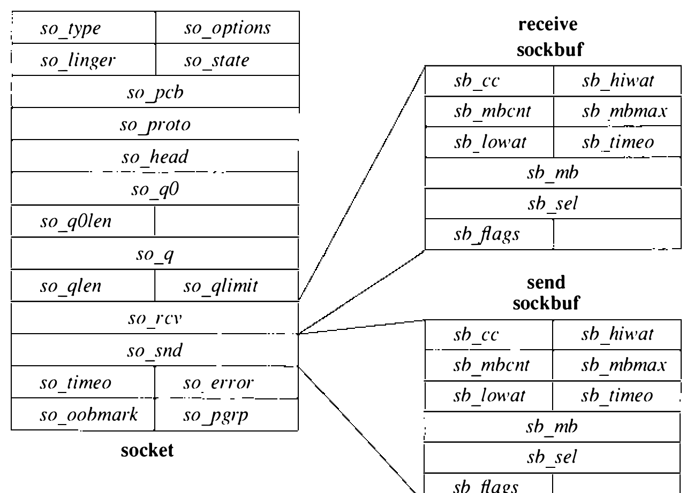
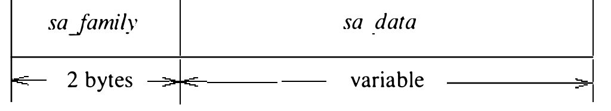
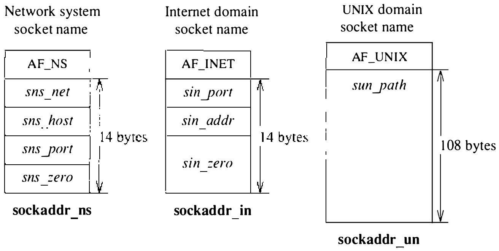

# 10.4 数据结构

套接字是通信进程使用的基本对象。套接字的类型定义通信语义，而通信域定义与套接字使用相关的辅助性质。表 10.2 列出系统当前支持的四种套接字类型。应用要创建新套接字，必须指明套接字类型和在其内创建的通信域；请求还可指明套接字使用的具体网络协议。未指明协议时，系统从通信域支持的协议集中选一个合适的。通信域无法支持所请求的套接字类型（即没有合适的协议）时，请求失败。

表 10.2 系统支持的套接字类型

| 名称 | 类型 | 性质 |
| ---- | ---- | ---- |
| SOCK_STREAM | 流 | 可靠、有序的数据传输；可支持带外数据 |
| SOCK_DGRAM | 数据报 | 不可靠、无序、保留消息边界的数据传输 |
| SOCK_SEQPACKET | 顺序分组 | 可靠、有序、保留消息边界的数据传输 |
| SOCK_RAW | 原始 | 直接访问底层通信协议 |

套接字由在 `socket` 系统调用时动态创建的 `socket` 数据结构描述。通信域由系统按配置（见 13.5 节）静态定义的 `domain` 数据结构描述。域内的通信协议由同样按配置静态定义的 `protosw` 结构（每个配置的协议实现一个）描述。请求创建套接字时，系统用通信域的名字线性搜索配置域的列表。域找到后，查域的支持协议表，为所创建套接字的类型（或所请求的具体协议）找合适的协议（原始域可以有通配表项）。多个协议表项都满足请求时取第一个。我们从 `domain` 结构开始讨论数据结构；`protosw` 结构在 11.1 节讨论。

**通信域**

`domain` 结构见图 10.4。`dom_name` 字段是通信域的 ASCII 名字。[^1]`dom_family` 字段标识域使用的协议族（protocol family），可能取值见表 10.3。协议族指一个域中用来支撑套接字通信语义的整套通信协议。`dom_protosw` 字段指向通信域支持协议的表，其余字段是指向管理与传递访问权（后述）所用域专有例程的指针。

| 字段 | 取值 |
| ---- | ---- |
| `dom_family` | `PF_UNIX` |
| `dom_name` | `"unix"` |
| `dom_init` | `...` |
| `dom_externalize` | `unp_externalize()` |
| `dom_dispose` | `unp_dispose()` |
| `dom_protosw` | `unixsw` |
| `dom_protoswNPROTOSW` | `&unixsw[5]` |
| `dom_next` | |

图 10.4 通信域数据结构

[^1]: 最初的设计中，通信域用 ASCII 字符串指定；现在用宏常量指定。

表 10.3 协议族

| 名称 | 描述 |
| ---- | ---- |
| PF_UNIX | 本地通信，如管道 |
| PF_INET | DARPA Internet（TCP/IP） |
| PF_IMPLINK | 1822 接口报文处理机链路层 |
| PF_PUP | 旧施乐网络 |
| PF_CHAOS | MIT Chaos 网络 |
| PF_NS | 施乐网络系统（XNS）体系结构 |
| PF_NBS | 美国国家标准局（NBS）网络 |
| PF_ECMA | 欧洲计算机制造商网络 |
| PF_DATAKIT | AT&T Datakit 网络 |
| PF_CCITT | CCITT 协议，如 X.25 |
| PF_SNA | IBM 系统网络体系结构（SNA） |
| PF_DECnet | DEC 网络 |
| PF_DLI | 直接链路接口 |
| PF_LAT | 局域网终端接口 |
| PF_HYLINK | Network Systems Corporation Hyperchannel（原始） |
| PF_APPLETALK | AppleTalk 网络 |

**套接字**

`socket` 数据结构见图 10.5。`socket` 数据结构驻留在 mbuf 的数据区。用 mbuf 使 `socket` 结构可以动态创建，但 mbuf 的大小也限制了结构的大小。套接字含有其类型、使用的支撑协议和状态的信息（表 10.4）。收发中的数据以 mbuf 链列表的形式在套接字排队。此外还有一些字段，用于管理连接建立期间创建的套接字队列。每个套接字结构还保存一个进程组标识符，用于投递 SIGURG 和 SIGIO 信号：套接字存在紧急条件时发 SIGURG，异步 I/O 设施使用 SIGIO（见 6.2 节）。套接字含一个与 `user` 结构中错误号（4.2 节）类似的错误字段，用于向套接字的属主报告异步错误。

表 10.4 套接字状态

| 状态 | 描述 |
| ---- | ---- |
| SS_NOFDREF | 无文件表引用 |
| SS_ISCONNECTED | 套接字已连接对端 |
| SS_ISCONNECTING | 正在连接对端 |
| SS_ISDISCONNECTING | 正在与对端断开 |
| SS_CANTSENDMORE | 不能再向对端发送数据 |
| SS_CANTRCVMORE | 不能再从对端接收数据 |

套接字通过进程的文件描述符、经文件表定位。套接字创建时，`file` 结构的 `f_data` 字段设为指向套接字结构，`f_ops` 字段指向定义套接字专有文件操作的一组例程。就此而言，套接字结构与文件系统使用的 `inode` 结构直接对应。

套接字结构充当收发数据的排队点。当数据由于 `write` 或 `send` 等系统调用进入系统时，套接字层把数据作为 mbuf 链交给网络子系统立即传输。如果支撑协议模块决定推迟数据传输，或要保留数据副本直到收到确认，数据就在套接字的发送缓冲中排队。网络用掉数据后，把它们从发出队列中丢弃。接收时，网络同样以 mbuf 链把数据上传套接字层，在那里排队等应用做系统调用来请求。为避免资源耗尽，套接字对数据缓冲中可排队的数据量设上限。这一高水位线最初由协议设置，应用最多可调到 56 KB。网络协议可以查看高水位线并在流控策略中使用该值，但一经设置从不更改。每个套接字数据缓冲还有一个低水位线，不过当前未用。低水位线的用途是让应用控制数据流：在接收请求得到满足之前，它指定数据缓冲中必须存在的最小数据量；对输出，它设置尝试传输之前必须可用的最小空间。

用于接受入局连接请求的套接字另维护两条队列。以 `so_q0` 字段为首的套接字列表表示通信协议层尚不完整的连接队列；而 `so_q` 字段为首的套接字列表对应协议层已完成的连接。与数据队列一样，已完成连接的队列也有应用可控的上限。要认识到：连接虽可由网络协议建立，应用却可以选择不接受已建立的连接，或在查明客户身份后立即关掉它。与某些别的系统不同，本系统没有让应用在网络层控制连接接受与否的设施。这一点可以视为缺陷，不过实践中的主要影响是要求客户与服务器进程在服务器提供服务之前先做一次更高层的握手。网络协议也可以把连接的完成推迟到应用经 `accept` 系统调用取得控制之后。

**套接字地址**

套接字可以标注名字，以便进程连接到它们。套接字层把地址当作不透明对象对待。应用以带标签的变长字节串的形式提供和接收地址。地址进入套接字层时总是驻留在 mbuf 中。一个称为 `sockaddr` 的结构（见图 10.6）可用作引用每个地址标识标签的模板。每个地址族实现都包含对地址做地址族专有操作的例程。需要操纵地址时——例如比较是否相等——用指向地址（`sockaddr` 结构）的指针取出地址族标签，再用标签确定调用哪个例程做所需操作。

应用传入的地址通常只在 mbuf 中停留很短的时间，仅够套接字层把它交给支撑协议并转入定长地址结构。例如协议把地址记录在协议状态块中时就是这样。`sockaddr` 结构是套接字层与网络支持设施交换地址的通用手段。通用数据数组的大小选得足以直接装下多数地址；支持更大地址的通信域可以忽略数组大小。只有路由数据结构（11.5 节讨论）含有定长的通用 sockaddr 结构。例如 UNIX 通信域把文件系统路径名存在 mbuf 中，允许套接字名字大至 108 字节（见图 10.7）；Internet 通信域则使用一个结合 DARPA Internet 地址与端口号的结构。Internet 协议在 Internet 控制块数据结构中为地址保留空间，复制内容后释放装地址的 mbuf。

