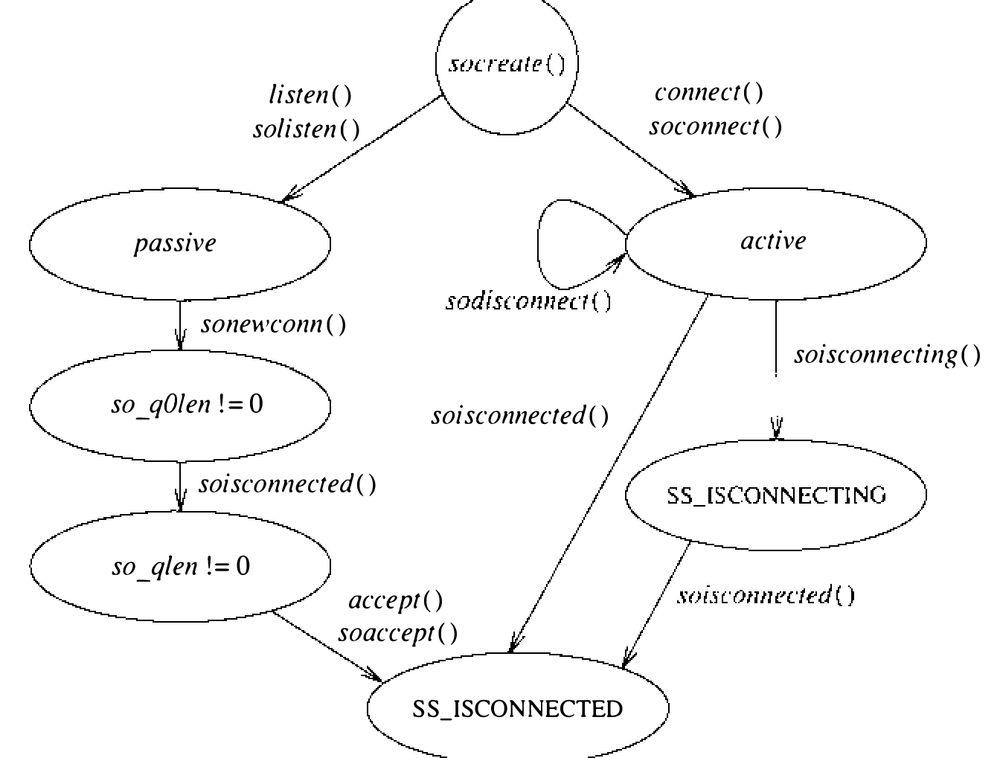
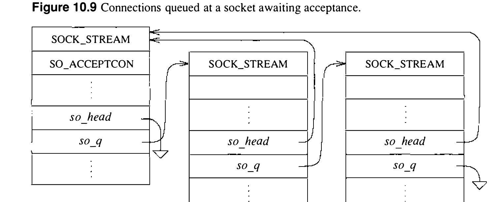

# 10.5 连接建立

两个进程要传递信息，必须先建立一个关联（association）。创建关联的步骤（`socket`、`connect`、`listen`、`accept` 等）已在 10.1 节描述。本节研究套接字层在建立关联时的运作。由于无连接数据传输所需的状态完全封装在每条发送的消息中，我们的讨论集中于用 `connect`、`listen` 和 `accept` 系统调用建立的基于连接的关联。

客户-服务器模型中的连接建立是不对称的：客户进程主动发起连接以获得服务，服务器进程被动接受连接以提供服务。图 10.8 展示用于发起或接受连接的套接字的状态转换图。状态转换由用户动作（系统调用）或协议动作——收到网络消息或定时器到期——发起。

套接字通常用来收发数据；用于建立连接时，对待方式略有不同。套接字若要用来接受连接，必须用 `listen` 系统调用。`listen` 调用 `solisten()`：通知支撑协议该套接字将接收连接，在套接字处（经 `so_q` 字段）建立空的未决连接列表，然后把套接字标记为接受连接（SO_ACCEPTCON）。执行 `listen` 时，应用指定一个 backlog 参数，用于限制系统排队等待应用接受的入局连接数（系统对此上限强制一个最大值）。套接字一旦设置好接收连接，创建连接的其余工作都交给协议层管理。服务器端每建立一条连接，就用 `sonewconn()` 例程创建一个新套接字。这些新套接字在连接完成期间可放在套接字的部分建立连接队列上，一旦就绪即移到已完成、等待应用接受的连接队列（见图 10.9）。`accept` 系统调用来获取连接时，系统核实套接字的入局连接队列上确有连接；没有未决连接时（除非套接字用非阻塞 I/O，那样返回错误），系统让进程入睡，直到有连接到来。有连接可用时，关联的套接字从队列摘下，分配一个新文件描述符引用它，把结果返回调用者。若 `accept` 调用要求返回对端身份，对端地址就复制到所提供的缓冲中。

在客户端，应用用 `connect` 系统调用请求连接，提供要连接的对端套接字地址。系统核实该套接字上没有正在进行的连接尝试，然后调用 `soconnect()` 发起连接。`soconnect()` 例程先检查套接字是否已连接：已连接（只对数据报套接字如此做）则先终止既有连接。套接字处于未连接状态后，`soconnect()` 把状态标记为连接中，向协议层发起建立新连接的请求。连接请求交给协议层后，若请求未完成，系统让进程入睡，等协议层通知连接已完成。非阻塞的 `connect` 此刻即可返回，但等待完成连接的进程只在连接请求完成——成功或出错——时才被唤醒。

连接建立期间套接字的状态由套接字层和支撑协议层共同管理。协议从不直接改动套接字的状态值：为促进模块化，一切修改都由 `soisconnected()` 等套接字层的代理例程完成。异步检测到的错误经套接字的 `so_error` 字段传达给它。例如连接请求因协议层发现所请求的服务不可用而失败时，唤醒请求进程之前通常先把 `so_error` 设为 ECONNREFUSED。套接字层从 `sleep()` 调用返回后总是检查 `so_error` 的值——这是识别协议层异步检测到的错误的标准方法。
