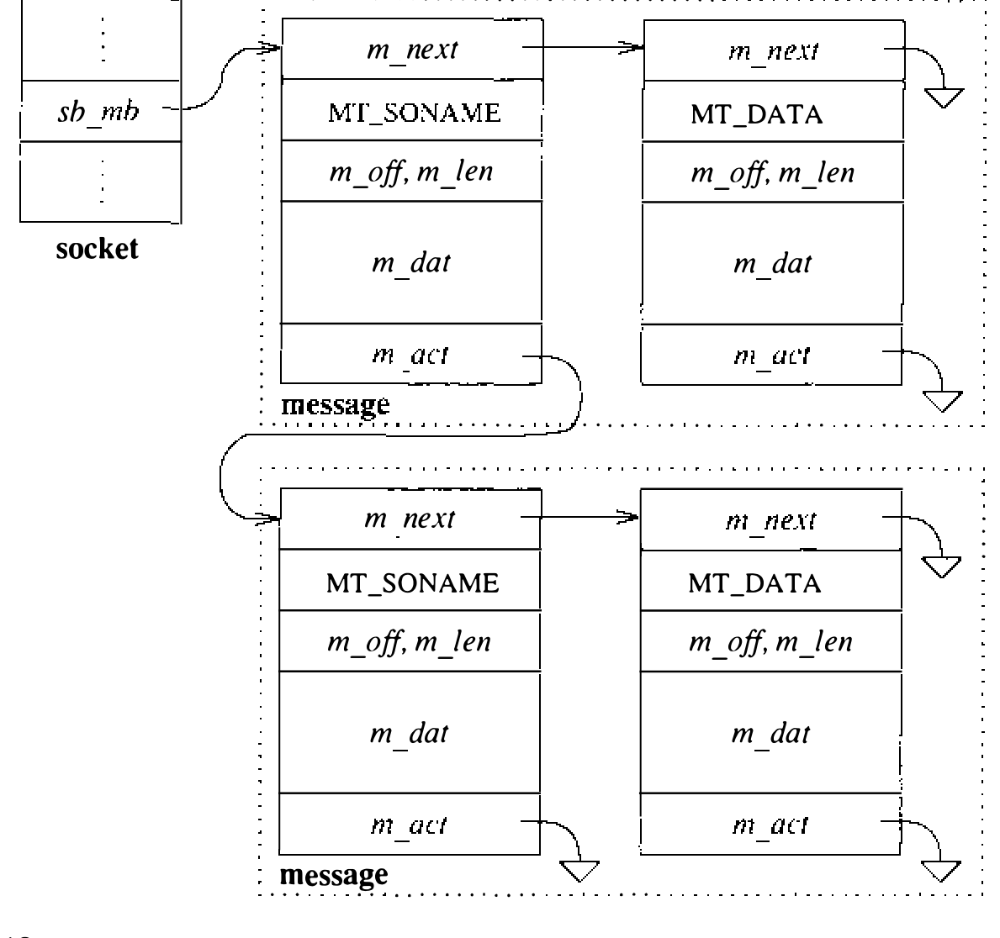

# 10.6 数据传送

套接字层做的工作大半在收发数据。应当指出，套接字层本身刻意不对经套接字收发的数据强加任何结构。这与当今 UNIX 可用的一些进程间通信设施 [Fitzgerald & Rashid, 1986] 形成对照。在整体的进程间通信模型内，任何数据解释或结构化在逻辑上都隔离在通信域的实现里。这种逻辑隔离的一个例子，是能用 UNIX 域套接字在进程间传递文件描述符。

收发数据可用多个系统调用之一，差别在于要传输和接收的信息量，以及执行操作的套接字的状态。例如 `write` 系统调用可用于处于连接状态的套接字——数据的目的地已由连接隐式指定；而 `sendto` 或 `sendmsg` 系统调用允许进程显式指定消息的目的地。同样，接收数据时 `read` 系统调用让进程在已连接的套接字上收数据而不取发送者地址；`recvfrom` 和 `recvmsg` 允许进程取回入局消息和发送者地址。提供多个不同的系统调用而不是只提供一个通用接口，这一决定见仁见智。只实现一个系统调用接口、经用户级库例程向应用提供简化接口，本来也是可以的。内部，所有发送和接收请求都转换成统一的格式，分别交给套接字层的 `sendit()` 和 `recvit()` 例程。

**发送数据**

`sendit()` 例程负责把应用指定的全部系统调用参数（实际数据除外）收集进内核地址空间，然后调用 `sosend()` 例程执行传输。`sosend()` 处理大半的套接字级数据传输选项，包括带外数据的发送请求和不做网络路由的数据发送；还负责在数据传输超出套接字发送缓冲可用空间时让进程入睡。数据的具体传输由支撑通信协议完成；`sosend()` 把数据从用户地址空间搬进内核地址空间的 mbuf，再调用协议传输数据。

`sosend()` 的大半工作在于把应用的传输请求拆成一个或多个协议传输请求。只有在用户请求的数据量加上套接字发送数据缓冲中已排队的量超过套接字的高水位线时才有必要拆分。用户数据流要保留消息边界时不允许拆分请求，因为套接字层对协议模块的每次请求都隐式指明数据流中的一处边界。遵守每个套接字的高水位线，确保协议在套接字的发送缓冲中总有空间排队未确认的数据，也确保任何进程或进程组无法垄断系统资源。

对保证可靠交付的套接字，协议通常在套接字的发送队列保留全部已传数据的副本，直到接收方确认收到。不保证交付的协议通常从 `sosend()` 接过数据直接传给目的地，不留副本。`sosend()` 自己并不区分可靠与不可靠交付。

`sosend()` 总是确保套接字的发送缓冲有足够空间存放下一段要传的数据。发送缓冲装不下全部待传数据时，`sosend()` 采用如下策略：发送队列中的数据超过一页、待传数据超过一页、且进程未用非阻塞 I/O，就让进程入睡等发送缓冲腾出更多空间；否则按发送缓冲的可用空间组织一次协议传输请求。这一策略倾向于保持应用指定的消息大小，有助于避免网络层的分片。后者很重要：传输单位是机器页大小的整数倍时系统性能显著更佳，因为对带映射页的 mbuf 有优化的支持。（数据能装满至少半页时，`sosend()` 会把数据从用户地址空间复制进从 mbuf 页池分配的页。）

`sosend()` 例程操纵套接字的发送数据缓冲时，着力确保多个发送进程之间对缓冲的访问同步：用 `sblock()` 和 `sbunlock()` 调用夹住对数据结构的访问。与异步网络活动的互锁在这里也是问题：网络中断级运行的网络协议模块无法等待对套接字数据缓冲之类数据结构的访问，因而不遵守进程间的加锁协议。要阻塞网络协议模块，`sosend()` 必须把处理器优先级提升到 `splnet`，确保不发生可能改变所操纵套接字状态的协议处理。

**接收数据**

`soreceive()` 例程用来接收套接字处排队的数据。作为 `sosend()` 的对偶，`soreceive()` 在内部软件结构中处于同一层，做相似的工作。套接字处排队等待接收的数据通常有两种：带内数据和访问权。带外数据通常不放进套接字的接收缓冲，而是在协议层管理、经一个特殊接口在用户请求时提取。（这种特殊处理允许多种紧急数据传输风格。）

`soreceive()` 检查套接字的状态（含接收数据缓冲），看有无入局数据、错误或状态转换，然后按数据的类型和调用者指定的动作处理排队数据。系统调用请求可以声明只取带外数据（MSG_OOB），或声明数据只返回而不从数据缓冲移除（指定 MSG_PEEK 标志）。

接收数据缓冲中的数据按是否保留消息边界组织成两种形式之一。套接字保留入局消息边界时，缓冲组织成消息列表：列表上每条 mbuf 链代表一条消息，边界隐含在列表结构中（见图 10.10）。随每条消息提供发送者地址的协议，在消息前面放一个装地址的 mbuf；地址之后紧随一个可选的装访问权的 mbuf；常规数据 mbuf 跟在访问权之后。名字和访问权靠 mbuf 中的类型字段区分：地址标 MT_SONAME，访问权标 MT_RIGHTS。不保留消息边界时，接收数据缓冲就是单条 mbuf 链；同样用 mbuf 类型区分可选信息。注意套接字所用的存储方案允许它们把同类型数据压缩进容纳这些数据所需的最少的 mbuf。

进入 `soreceive()` 时先检查是否在请求带外数据。是则询问协议层有无此类数据；有的话就返回给调用者。常规数据不能与带外数据同时提取，`soreceive()` 随即返回。否则请求的是常规数据，`soreceive()` 检查接收数据缓冲的字符计数看有无数据。没有数据时，查套接字状态看数据是否还会到来。数据可能再也收不到了——套接字已断开（而收数据需要连接），或对端已用 `shutdown` 终止了数据的接收。此外，若前一操作遗留的错误被异步检测到，需要把它返回给用户；`soreceive()` 在查完数据后检查 `so_error` 字段。没有数据也没有错误时，数据仍可能到来；套接字未标记非阻塞 I/O 时，`soreceive()` 让进程入睡等新数据到来。

数据到达套接字时，支撑协议调用 `sorwakeup()` 通知套接字层。随后即可按前述数据结构规则处理接收缓冲的内容：`soreceive()` 先摘下必须在场的地址，再摘可选的访问权，最后是正常数据。数据的摘除因带内与带外数据的互动而略显复杂。下一个带外数据的位置在带内数据流中标记，带内数据处理期间用作记录边界：协议收到带外数据指示时，在带内数据流的对应点做标记；此后请求接收带内数据时，只返回到标记为止的数据。这个标记让应用能同步带内与带外数据流——例如把接收数据冲掉到收到带外数据的那一点。每个套接字有一个字段 `so_oobmark`，含从接收数据缓冲前端到最近一次收到带外消息的数据流位置处的字符偏移。带内数据从接收缓冲摘除时，偏移相应更新，标记之后的数据不会与标记之前的数据混在一起。`so_oobmark` 归零时，套接字状态字段的 SS_RCVATMARK 位置位，表示带内与带外数据流已同步。应用可用 SIOCATMARK `ioctl` 调用测试该位，查明带内数据是否已读到标记处。

数据从套接字接收缓冲摘除后，`soreceive()` 更新套接字状态，并通知协议层用户已收到数据。协议层可利用这一信息释放内部资源、触发端到端的接收确认、更新流控信息或发起新的数据传输。最后，若收到过访问权，`soreceive()` 把它们交给一个通信域专有的例程，从内部表示转换成外部表示。

**传递访问权**

除收发不作解释的数据外，系统还支持传递有特殊含义的数据。这些数据通常代表对关联对象执行操作的权利。表示访问权或权能的数据通常只在创建或取得权利的进程的语境中有意义，因此其传输需要系统支持才能在接收进程的语境中有意义。例如在 UNIX 中，文件系统或套接字的访问权以文件描述符的形式封装；文件描述符是一个小整数，只在打开或创建关联文件的进程的语境中有意义。要把文件描述符从一个进程传给另一个，系统必须在接收进程的 user 结构中创建对关联文件表结构的引用。

访问权或权能分为内部化（internalized）与外部化（externalized）两类。内部化的权能需要受信代理的支持才有用：与之关联的钥匙由受信代理创建，出示以访问受保护对象时，按出示者语境中的解释认定有效。外部化的权能则使用无须特定受信代理的钥匙：对访问对象权利的认定，完全基于对必需钥匙的持有和出示。使用外部化权能的系统常用公钥加密算法。外部化权能的钥匙通常寿命长，可以存放在文件系统等位置而不会失去作用。

支持外部化权能不需要专门的系统支持。但要支持内部化权能时，操作系统作为受信代理必须在把钥匙作为消息在进程间传输时验证并翻译它们。进程间通信系统按通信域提供设施，处理消息中收发的全部访问权，并处置未被接收的访问权。

要发送和接收访问权，就得把它们内部化与外部化。内部化把发送进程持有的钥匙转换成可以作为消息中的数据传递的内部形式；外部化逆转这一过程，把内部形式转换成在接收进程语境中有意义的外部形式。当 `sosend()` 例程请求发送含访问权的数据时，协议层执行访问权的内部化；待传的访问权作为与常规数据分开的 mbuf 链传递。`soreceive()` 在接收数据队列上遇到访问权时，调用通信域的 `dom_externalize` 例程把访问权外部化。套接字层隐含假定：存放在套接字数据队列中的访问权在系统持续运行期间始终有效。也就是说，既没有加速访问权投递的机制，也没有让存放在套接字数据队列上的访问权超时或失效的机制。

**UNIX 域中的访问权**

UNIX 域中，文件描述符的内部化使它们转换成系统文件表指针，外部化则要求为接收进程分配新的文件描述符。消息中传递的文件描述符实际是发送进程所持描述符的副本（如同经 `dup` 创建）。发送进程送出描述符之后必须显式关闭它，才算真正让出。

系统提供垃圾收集（garbage-collection）设施，回收与未妥善投递的访问权关联的资源。访问权可能无法投递，原因有两个：接收套接字空间不足，或用户从套接字收数据时没有用正确的系统调用请求它们。需要垃圾收集是因为正常的消息处理不允许协议在把消息传递出去投递之后再访问它。消息传递之后无法再访问，意味着消息中的访问权若未投递，这些访问权将被丢弃而无法回收。[^1] UNIX 域中，访问权的回收确保与之关联的文件被关闭，文件表项等系统资源才不致枯竭。

要实现垃圾收集，每个文件表表项必须含一个套接字接收队列中的文件描述符所持引用的计数 `f_msgcount`；另一个变量 `unp_rights` 跟踪所有使用中的 UNIX 域套接字里持有的文件描述符数。文件描述符为传输而内部化为文件表指针时，该文件的 `f_msgcount` 递增；接收时描述符外部化，`f_msgcount` 递减。UNIX 域套接字被回收且 `unp_rights` 非零时，调用垃圾收集例程 `unp_gc()` 扫描文件表和全部 UNIX 域套接字，回收无主的文件表引用。

`unp_gc()` 履行职责时使用标记-清扫算法 [Cohen, 1981]。基本策略是找出 UNIX 域套接字中或进程 user 结构中存在的对文件的全部引用：在 user 结构或套接字接收数据缓冲中存在引用的文件被 **标记**；被认为活跃却找不到现存引用的文件则不被 **标记**。随后，垃圾收集器可以搜索文件表中未标记、且全部引用都表明在套接字接收队列中的表项，以回收丢失的引用。

注意，垃圾收集器只在 UNIX 域套接字关闭且确知有文件描述符排队待收时才被调用，因此其开销有限。而且垃圾收集器只回收在消息传递中丢失的那些文件表表项；系统其他地方可能丢失的引用不在回收之列。

[^1]: 事后来看，若在释放 MT_RIGHTS 类型的 mbuf 时使用每域的处置例程，这个问题本可以处理得更好。
