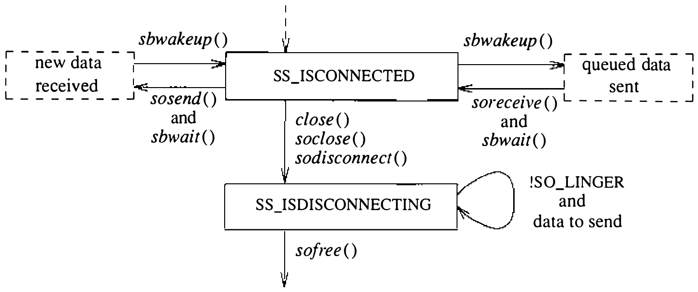

# 10.7 套接字关闭

关闭套接字、回收其资源，乍看是直截了当的操作，实际上可能相当复杂。复杂性源自 UNIX 附加在 `close` 系统调用上的隐含语义。某些情形（如进程退出）下，`close` 调用绝不应失败。然而，承诺可靠交付数据的套接字在关闭时若仍有数据排队待传或等待接收确认，为了让 `close` 维持套接字宣称的语义，套接字必须——或许无限期地——尝试传输这些数据。套接字若为让 `close` 顺利完成而丢弃排队数据，就违背了可靠交付数据的承诺。丢弃数据会让依赖 `close` 隐含语义的朴素 UNIX 进程在网络环境中不可靠地工作。可是套接字若阻塞到所有数据成功传完，在有些通信域中 `close` 也许永远完不成！

套接字层在这一问题上折中，同时尽量维持 UNIX `close` 系统调用的语义。图 10.11 展示套接字从连接到关闭状态的可能转换。正常操作中，关闭套接字会丢弃一切排队未接受的连接。套接字处于连接状态则发起断开。套接字被标记为不再有文件描述符引用它，关闭操作成功返回。断开请求完成时，网络支持通知套接字层，套接字资源随即回收。网络层可以尝试传输套接字发送缓冲中排队的数据，不过并无保证。



另一种做法：套接字可以被显式标记，强制应用进程在关闭时 **逗留**（linger），直到未决数据排空、连接关闭。这一选项用 `setsockopt` 系统调用的 SO_LINGER 选项标记在 `socket` 数据结构中。应用声明套接字要逗留时，还要指定逗留期的时长。逗留期在断开完成之前到期的话，套接字层强制关闭套接字，丢弃仍未决的数据。[^1]

[^1]: 实际上逗留只实现了一部分：逗留期是无限的，用户无法更改。

## 习题

10.1 管道使用中的什么局限促使开发者设计替代的进程间通信设施？

10.2 4.3BSD 的进程间通信设施为什么设计成独立于 UNIX 文件系统来为套接字命名？

10.3 4.3BSD 中进程间通信为什么叠在网络之上，而不是反过来？

10.4 按本章给出的定义，屏幕编辑器算朴素的还是老练的 UNIX 程序？解释理由。

10.5 什么是带外数据？哪种类型的套接字支持带外数据通信？描述带外数据的一种用途。

10.6 进程间通信对内存管理设施提出哪两条要求？

10.7 装一条 3024 字节的消息需要多少个 mbuf？画出所需 mbuf 链及关联内存页的示意图。

10.8 mbuf 为什么有两个链接指针？各用于什么？

10.9 4.3BSD 的套接字数据结构为什么至多限于 112 字节？

10.10 每个套接字的发送和接收数据缓冲都有高、低水位线。这些水位线有什么用？

10.11 考虑一个经网络连接、在套接字处排队等待 `accept` 系统调用的套接字。它在套接字结构中 `so_q` 还是 `so_q0` 字段领衔的队列上？它 **不在** 的那条队列有什么用？

10.12 协议层如何把异步错误告知套接字层？

10.13 套接字明确不去解释它们收发的数据。你认为这是正确的做法吗？解释理由。

10.14 `sosend()` 例程为什么在调用协议层传输数据之前，确保套接字发送缓冲有足够空间？

10.15 mbuf 中的类型信息在数据报套接字的数据排队中怎么用？在流套接字的数据排队中又怎么用？

10.16 `soreceive()` 例程为什么在数据从套接字接收缓冲摘除时可以选择通知协议层？

10.17 描述一个传递文件描述符的能力很有用的应用。在 4.3BSD 中还有别的办法模拟这一设施吗？

10.18 内部化权能与外部化权能有什么区别？按本章给出的定义，UNIX 描述符算外部化的还是内部化的权能？

10.19 关闭时什么情况可能导致连接永远逗留？

*10.20 存储压缩对网络通信协议的性能可能有影响？

**10.21 把 mbuf 存储释放回系统为什么复杂？这样做可取吗？

**10.22 进程间通信设施的最初设计中，对通信域的引用经一个 `domain` 系统调用获得：

```c
    int d;  d = domain("inet");
```

（其中 *d* 是一个很像文件描述符的描述符），套接字随后这样创建：

```c
    s = socket(type, d, protocol);
    int s, type, protocol;
```

这一方案比 4.3BSD 所用的有什么优点？引入域描述符类型对内核中描述符的管理和使用有什么影响？

## 参考文献

Cerf, 1978.
V. Cerf, “The Catenet Model for Internetworking,” Technical Report IEN 48, SRI Network Information Center, Menlo Park, CA (July 1978).

Cohen, 1977.
D. Cohen, “Network Control Protocol (NCP) Software,” University of Illinois Software Distribution, University of Illinois, Champaign-Urbana, IL (1977).

Cohen, 1981.
J. Cohen, “Garbage Collection of Linked Data Structures,” *Computing Surveys* **13**(3), pp. 341–367 (September 1981).

Fitzgerald & Rashid, 1986.
R. Fitzgerald & R. F. Rashid, “The Integration of Virtual Memory Management and Interprocess Communication in Accent,” *ACM Transactions on Computer Systems* **4**(2), pp. 147–177 (May 1986).

Gurwitz, 1981.
R. F. Gurwitz, “VAX-UNIX Networking Support Project—Implementation Description,” Technical Report IEN 168, SRI Network Information Center, Menlo Park, CA (January 1981).

Kalash et al., 1986.
J. Kalash, L. Rodgin, Z. Fong, & J. Anton, “Ingres Version 8 Reference Manual,” pp. 10:1–88 in *UNIX Programmer's Supplementary Documents*, Volume 2, 4.3 Berkeley Software Distribution, Virtual VAX-11 Version, USENIX Association, Berkeley, CA (1986).

Rashid, 1980.
R. F. Rashid, “An Inter-Process Communication Facility for UNIX,” Technical Report, Carnegie-Mellon University, Pittsburgh, PA (August 14, 1980).

Sunshine, 1977.
C. Sunshine, “Interprocess Communication Extensions for the UNIX Operating System: Design Considerations,” Technical Report R-2064/1-AF, Rand Corporation, Santa Monica, CA (June 1977).

UPMV7, 1983.
UPMV7, UNIX Programmer's Manual, 7th ed, Volume 1 and 2, Holt, Rinehart & Winston, New York, NY (1983).
