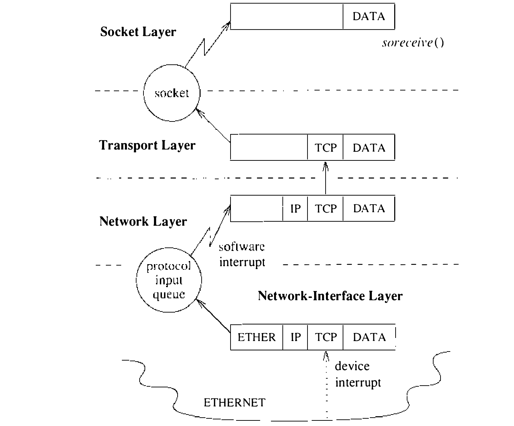
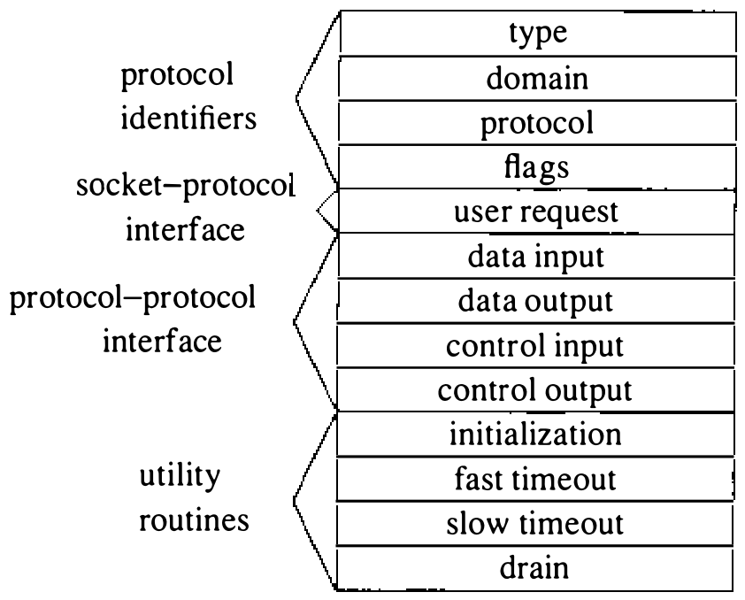
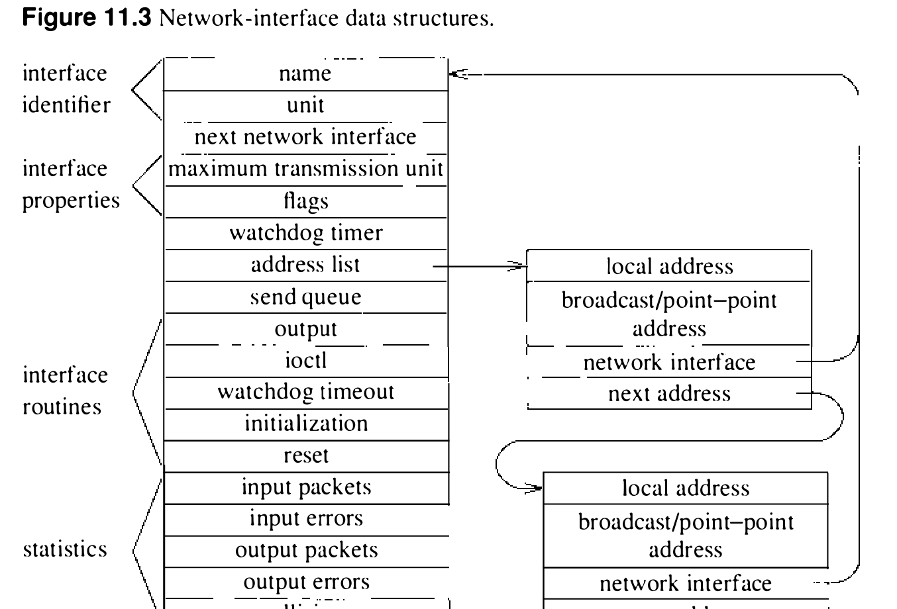

# 11.1 内部结构

本章研究 4.3BSD 网络子系统的内部结构。联网设施提供一个可以让多种网络体系结构（network architecture）并存的框架。一个网络体系结构由一组网络通信协议（协议族 protocol family）、命名通信端点的约定（地址族 address family 或地址格式 address format），以及连接管理与数据传输之外可能有的附加设施组成。联网设施经第 10 章描述的套接字抽象访问。网络子系统提供一个实现网络服务的通用框架，设施包括：

* 到套接字层的结构化接口，允许开发独立于网络的应用软件
* 与收发数据所用硬件设备的一致接口
* 独立于网络的消息路由支持
* 存储管理

11.1 节描述网络子系统的内部结构，随后讨论套接字层与网络设施之间的接口，并考察组成网络子系统的各软件层之间的接口。11.5 节讨论网络协议使用的路由数据库；11.6 节描述管理缓冲和控制拥塞的机制；11.7 节给出提供对低层网络协议直接访问的裸套接字接口；最后在 11.8 节讨论一组杂项议题与设施，包括带外数据、子网编址、地址解析协议、尾部协议，以及对驻留在 VAX UNIBUS 上的网络接口的支持。讨论完网络协议各得其所的框架之后，第 12 章考察既有网络协议的实现。

网络子系统在逻辑上分为三层，分别管理：

* 进程间数据传输
* 网际编址与消息路由
* 传输介质支持

前两层由实现通信协议的模块组成；第三层的软件在结构上很像设备驱动（见第 8 章）。

网络子系统最上面的层称为传输层（transport layer）。传输层必须提供一个允许套接字之间通信的编址结构，以及套接字语义所需的任何协议机制，比如数据的可靠交付。第二层即网络层（network layer），负责交付目的地为远程传输层或网络层协议的数据。提供网际交付时，网络层必须管理一个私用的路由数据库，或利用全系统设施把消息路由到目的主机。底层即网络接口层（network-interface layer），负责在连接到公共传输介质的主机之间传送消息，主要关心驱动所涉传输介质并做必要的链路级协议封装（encapsulation）与解封装（decapsulation）。

网络子系统的传输层、网络层、网络接口层最接近施乐网络系统（NS）体系结构的底部三级（2 到 0），分别对应 ISO 开放系统互连参考模型 [ISO, 1984] 的传输层、网络层和链路层。联网软件的内部结构对用户不直接可见：所有联网设施都经第 10 章描述的套接字层访问。每个允许访问其设施的通信协议向套接字层导出一个用户请求例程；套接字层用它来提供对网络服务的访问。

这里描述的分层是 **逻辑分层**。实现网络服务的软件按所支撑网络体系结构的设计，可以用或多或少的通信协议。

**数据流**

数据从套接字层向下流入网络子系统，靠调用支撑套接字抽象的传输层模块进行。网络接口收到的数据向上经各通信协议流入，直到放进目的地套接字的接收队列。数据的下行通常由系统调用发起。上行的数据异步接收，从网络接口层经每协议输入消息队列传给适当的通信协议（见图 11.1）。系统靠在网络中断状态字中标记该协议的位、并投递一个为触发网络活动保留的软件中断，来调度来自网络接口层的网络协议处理。用软件中断调度异步网络活动而不是让协议作为独立 UNIX 进程运行，是为了避免上下文切换的开销。通信协议收到的消息若目的地是更高层的协议，该协议直接在软件中断级被调来处理消息；若消息发往另一台主机且系统准备转发，消息则交回网络接口层重新传输。

**通信协议**

每个通信协议模块由一组过程和私用数据结构组成。协议由一个协议开关（protocol switch）结构描述，其中含对外可见的入口点集合和某些属性（见图 11.2）。套接字层只经协议的协议开关结构与通信协议交互，把结构地址记录在套接字的 `so_proto` 字段中。套接字层与网络子系统的这种隔离，对保证套接字层向用户提供对系统所支持全部协议的一致接口很重要。

协议首次使用前调用其初始化例程。此后，有 `pr_fasttimo()` 入口的协议每 200 毫秒被调用一次做基于定时器的动作，有 `pr_slowtimo()` 入口的每 500 毫秒一次。提供 `pr_drain()` 入口是为了让系统能在空间告急时通知协议、希望丢弃非关键数据。[^1]

协议之间可以经 `pr_input()` 和 `pr_output()` 例程用 mbuf 链传递数据（见 10.3 节）：`pr_input()` 把数据向 **上** 传向用户，`pr_output()` 把数据向 **下** 传向网络。类似地，控制信息经 `pr_ctlinput()` 和 `pr_ctloutput()` 例程上下传递。用户请求例程 `pr_usrreq()` 是协议与套接字层之间的接口，11.2 节详述。

一般而言，协议对经这些过程向下传递的任何参数所占的存储空间负责，必须传下去或处置之。输出时，到达的最低层必须释放作为参数传递的空间；输入时，最高层负责释放传上来的空间。协议需要的辅助存储从 mbuf 存储库分配，用来临时组织消息或保存状态控制块等数据结构。协议为私用分配的 mbuf 不再使用时必须由该协议释放。

协议开关结构的 `pr_flags` 字段描述协议的能力及与套接字层运作相关的某些运作方面（见表 11.1）。基于连接的协议指定 PR_CONNREQUIRED 标志，套接字例程便不会在连接建立前尝试发送数据。PR_WANTRCVD 标志置位时，用户从套接字接收队列取走数据后套接字例程会通知协议。这一通知让协议能实现用户接收确认，也能按接收队列的可用空间量更新流控信息。PR_ADDR 字段表明协议放进套接字接收队列的任何数据前面都带发送者地址。PR_ATOMIC 标志规定每次 **用户** 发送数据的请求必须在一次 **协议** 发送请求中完成，由协议负责保持待发数据的记录边界。PR_RIGHTS 标志表明协议支持访问权的传递，目前只有 UNIX 通信域的协议使用（见 10.6 节）。

表 11.1 协议标志

| 标志 | 描述 |
| ---- | ---- |
| PR_ATOMIC | 消息各自分开发送，每条装单个分组 |
| PR_ADDR | 协议随每条消息呈送地址 |
| PR_CONNREQUIRED | 数据传输需要连接 |
| PR_WANTRCVD | 用户收到数据时通知协议 |
| PR_RIGHTS | 协议支持传递访问权 |

[^1]: 4.3BSD 最初发行版从未调用过协议的 `pr_drain` 例程。

**网络接口**

系统中配置的每个网络接口定义一条可以收发消息的通路。通常有硬件设备与此接口关联，尽管并无此要求（例如所有系统都有一个供调试和性能分析使用的软件环回接口）。除操纵硬件设备外，网络接口模块还负责为把消息投递到目的地所需的任何链路级协议头部做封装和解封装。选择用哪个接口投递分组，是网络协议层做的路由决定。一个接口可以有一个或多个地址族中的地址。每个地址在引导时用相应域中套接字上的 `ioctl` 系统调用设置；这一操作由协议族在网络接口提供的 `ioctl` 入口点验证后实现。网络接口抽象为协议提供对机器上可能出现的所有硬件设备的一致接口。

接口及其地址由图 11.3 所示的结构定义。网络接口模块通常把接口数据结构维护在一个更大结构中，该结构还含驱动底层硬件设备所用的信息。

每个网络接口有待发消息队列和用于初始化（`if_init()`）与输出（`if_output()`）的例程。接口驻留在系统总线上时，总线复位后会调用一个复位例程让它重新初始化自己。接口还可以指定定时器例程和定时值（非零时系统每秒递减一次，到期调用定时器例程）。接口通常用这一超时机制为不可靠硬件实现看门狗方案、收集硬件设备上的统计。

接口的状态和某些外部可见的特性存在 `if_flags` 字段（见表 11.2）。接口配置好、可以传输消息时置 IFF_UP 标志。接口连接到支持 **广播** 消息传输的网络时置 IFF_BROADCAST 标志，接口的地址列表含收发此类消息所用的广播地址。接口关联到点对点硬件链路（例如 DEC DMR-11）时置 IFF_POINTOPOINT 标志，地址列表含连接对端主机的地址。（注意广播与点对点属性互斥，两个地址共享接口地址结构中的存储。）这些地址和接口的本地地址供网络层协议过滤入局分组使用。接口分配了系统资源、并对它管理的设备登记了初始读之后，置 IFF_RUNNING 标志。这一状态位用来避免接口地址变化时重复的分配请求。IFF_NOTRAILERS 标志表示接口对外出分组应避免使用尾部封装，或（可以逐主机协商尾部时）不应请求尾部封装；尾部协议见 11.8 节。IFF_NOARP 标志表示接口把网际地址映射为链路级地址时不应使用地址解析协议，也在 11.8 节描述。

表 11.2 网络接口标志

| 标志 | 描述 |
| ---- | ---- |
| IFF_UP | 接口可用 |
| IFF_BROADCAST | 支持广播 |
| IFF_DEBUG | 在接口软件中启用调试 |
| IFF_LOOPBACK | 这是软件环回接口 |
| IFF_POINTOPOINT | 接口用于点对点链路 |
| IFF_NOTRAILERS | 接口不应使用尾部封装 |
| IFF_RUNNING | 接口资源已分配 |
| IFF_NOARP | 接口不应使用地址解析协议 |

接口地址和标志用 `ioctl` 请求设置：SIOCSIFADDR 请求最初用来定义每个接口的地址；SIOCSIFFLAGS 请求可用来更改接口状态、做站点专有的配置；点对点链路的目的地址用 SIOCSIFDSTADDR 请求设置；读取每个值都有对应的操作。协议族还可以支持设置和读取广播地址的操作。最后，SIOCGIFCONF 请求可用来取得运行系统中所有已配置接口和协议的接口名字与协议地址列表——这一请求让路由守护进程等网络进程无须了解系统内部数据结构的细节即可构建。
