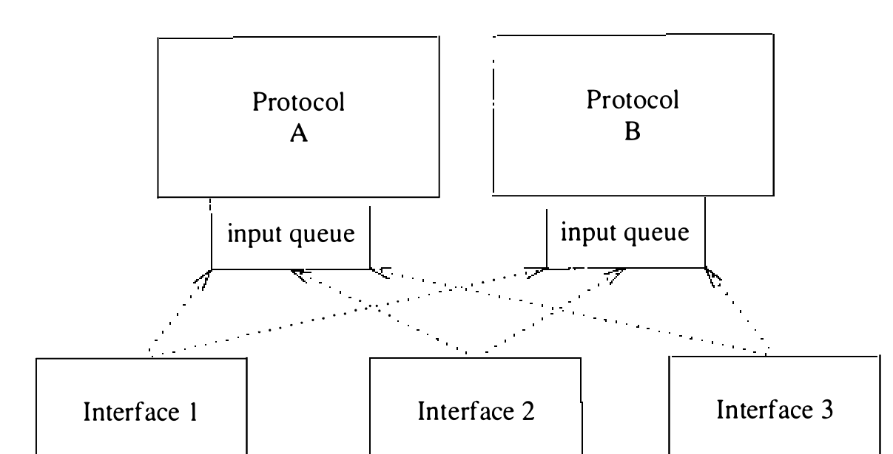

# 11.4 协议-网络接口接口

构成协议族的协议集中最低的一层必须与一个或多个网络接口交互来收发分组。假设分组发给网络接口之前路由决定都已做出；实际上，除非使用单一 **硬连线** 接口，定位任何接口都需要先做路由决定。协议与网络接口的交互有两个要关心的情形：分组的传输和分组的接收。分别考虑。

**分组传输**

设协议已选定由 `ifp`（指向网络接口结构的指针）标识的接口，协议用下面的调用传输一个格式完整的网络层分组：

```c
error = (*ifp->if_output)(ifp, m, dst);
    struct ifnet *ifp;
    struct mbuf *m;
    struct sockaddr *dst;
```

网络接口的输出例程把分组 `m` 传输到 `dst` 中指定的协议地址，或返回错误指示（UNIX 错误号）。实际上传输未必能立即进行，也未必会成功：输出例程通常校验目的地址、把分组排上发送队列、启动中断驱动的例程去传输。以太网等不可靠介质上，**成功** 传输只意味着分组无冲突地上了电缆。相比之下，ARPANET IMP 接口为每条传输的消息保证正确交付或错误指示。联网系统采用的模型对呈交给网络接口的分组不作任何交付承诺，因而最接近以太网。输出例程返回的错误只是能立即检测到的那些，性质上通常无关紧要（无缓冲区空间、地址格式不受支持等）。调用返回后才发现的错误不会使协议得到通知。

传输消息时，每个网络接口通常必须为每个外出分组构造链路级地址。[^1]接口层必须理解它支持的每种协议地址格式，才能构造相应的链路级地址。每个协议族的网络层为每条消息选好目的地址，再用该地址选出要用的网络接口。这个目的地址以 `sockaddr` 结构的形式传给接口的输出例程。假定接口支持该地址格式，接口必须把目的协议地址映射为它所支持的传输介质对应的链路级协议地址。映射可以是简单算法，可以查表，也可能需要更复杂的手段，如 11.8 节描述的地址解析协议。

**分组接收**

网络接口收到分组，按链路级协议头部中编码的信息分发给适当的网络层协议。每个协议族必须有构成 11.1 节所述网络层的一个或多个协议。本系统中，每个网络层协议各有一个输入分组队列。网络接口收到的入局分组排进协议的输入分组队列，并投递软件中断发起网络层处理（见图 11.4）。类似的队列也用来存放等待网络接口模块传输的分组。



**图 11.4 入局分组被分发到协议输入队列**

操纵分组队列有四个宏：

* **IF_ENQUEUE(ifq, m)** 把分组 `m` 放到队列 `ifq` 尾部。
* **IF_DEQUEUE(ifq, m)** 把队列 `ifq` 头部分组的指针放进 `m` 并把分组从队列摘除；队列空则 `m` 为零。
* **IF_DEQUEUEIF(ifq, m, ifp)** 从队列头摘除下一个分组，分组放进 `m`，收到分组的接口的指针放进 `ifp`。
* **IF_PREPEND(ifq, m)** 把分组 `m` 放到队列 `ifq` 头部。

分组队列有最大长度，作为简单形式的拥塞控制。宏 IF_QFULL() 可判断队列是否已满，满了就用宏 IF_DROP() 在队列的统计中记录这一事件。例如，网络接口的输入例程中常见这样的代码片段：

```c
        if (IF_QFULL(inq)) {
            IF_DROP(inq);
            m_freem(m);     /* 丢弃分组 */
        } else
            IF_ENQUEUE(inq, m);
```

网络接口收到分组后解码分组类型、剥掉链路级协议头、附加接收接口的身份，然后把分组分发给适当的协议。例如，Internet 域的分组这样入队：

```c
schednetisr(NETISR_IP);   /* 调度 IP 输入例程 */
IF_ENQUEUE(&ipintrq, m);  /* 把消息放上 IP 的队列 */
```

`schednetisr()` 宏在全局状态字中标记一个位并投递软件中断。软件中断发生时，中断处理程序扫描状态字，每个预先指派的位如已置位就调用关联的协议输入例程。状态字的位按协议族标识符的值指派（见表 11.5）。

**表 11.5 网络中断状态字的位指派**

| 状态位 | 值 | 输入队列 | 用途 |
| ---- | ---- | ---- | ---- |
| NETISR_RAW | PF_UNSPEC | `rawintrq` | 未指派/原始输入 |
| NETISR_IP | PF_INET | `ipintrq` | Internet IP 协议输入 |
| NETISR_IMP | PF_IMPLINK | `impintrq` | IMP/1822 错误输入 |
| NETISR_NS | PF_NS | `nsintrq` | 施乐 NS 协议输入 |

协议输入队列的表项既含分组，也含收到分组的网络接口的指针。接口指针用处很多，比如决定何时生成路由重定向报文。软件中断级运行的输入处理例程典型形如：

```c
for (;;) {
	s = splimp();		/* 屏蔽网络对队列的访问 */
	IF_DEQUEUEIF(&xxintrq, m, ifp);
	splx(s);
	if (m == 0) break;	/* 全部分组处理完毕 */
	/* 处理分组并确定接收协议 */
	(*pr_input)(m, ifp); /* 调用协议 */
}
```

从输入队列摘除表项期间，必须靠 `splimp()` 提升处理器优先级挡住全部网络接口输入处理，确保队列数据结构中的指针不被改动。消息摘队后即被处理；分组中若有给更高层协议的信息，消息向上传递。

[^1]: 点对点链路可能不需要链路级地址。
