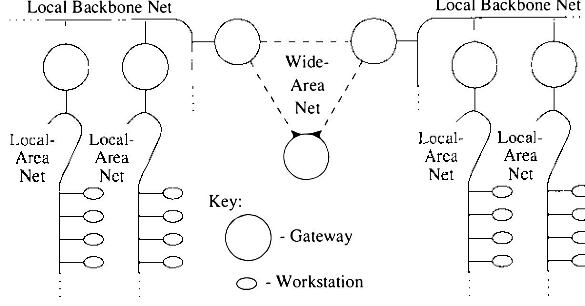
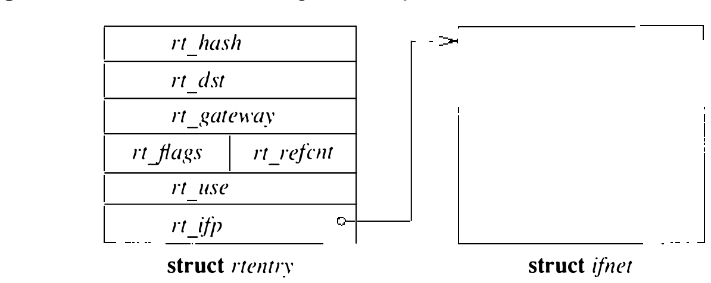
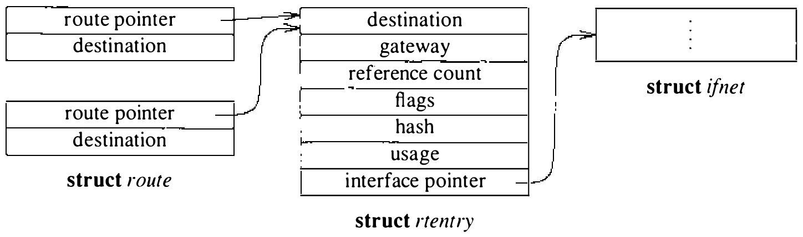

# 11.5 路由

联网系统为网际环境而设计：一组局域网经拥有多个网络接口的主机在一个或多个点互连（见图 11.5）。拥有多个网络接口——每个局域网或远程网络上一个——的主机被期望充当网关。这样的环境中，与网关和分组路由相关的问题很重要。其中一些问题（如拥塞控制）处理得简单（见 11.6 节）；另一些，网络系统提供了可以构建更复杂策略的简单机制。这些机制保证：随着对这些问题的认识加深，相应解决方案可以并入系统。

本节描述为消息路由提供的设施。系统并不阻止协议自管路由信息，但这里描述的设施为多数需要而设计。注意：操作系统内置的路由设施不强加路由 **策略**，而是支持一种可以落实外部定义策略的路由 **机制**。

**路由表**

网络系统维护一组路由表，供协议在把分组投递到目的地时选择要用的网络接口。这些表由图 11.6 所示形式的表项组成。

路由信息组织在两张独立的表中：一张到主机的路由，一张到网络的路由。区分主机与网络，是为了让单一机制既适用于广播和多分支网络，也适用于由点对点链路构建的网络（如 DECnet [DEC, 1980]）。

每张表组织成链表的散列集合。每个地址族定义的例程算出两个散列值：一个为目的主机、一个为目的主机所在网络。每个散列值用来定位要搜索的散列链（值对散列表大小取模），完整值用作扫描路由列表的键。查找先在主机路由表做，再在网络路由表做；两者都失败，最后查一次通配路由（按惯例为 **网络** 0）。找到的第一条合适路由即被采用。这一算法既允许存在到具体主机的特定路由，也允许到一般网络的路由；还可以定义一条到 **智能网关** 的兜底网络路由，由网关做更有依据的路由决定。

每个路由表项含目的地（期望的最终目的地）、发送分组所至的网关，以及表明路由状态和类型（主机或网络）的标志。还保存使用该路由发送的分组计数，和动态分配结构的引用计数——只在路由不再被引用时才回收内存。最后保存网络接口的指针：用该路由发送的分组交给此接口的输出例程。

路由按两种方式分类：主机或网络，直接或间接。主机-网络之分决定查找时如何比较目的地址：路由到网络时只比较分组的目的 **网络** 与表项所存网络；否则路由到主机，地址必须 **完全** 匹配。

直接与间接之分表示目的地是否与源直接相连。做链路级封装时需要这一区分：分组的目的地对端所在的主机或网络若不与源直接相连，网际分组头含最终目的地的地址，链路级协议头则寻址中间的网关；目的地直接相连时两个地址多半相同，或两者间存在映射。路由表项的 RTF_GATEWAY 标志表示路由通往 **间接** 的网关代理，链路级头应从 `rt_gateway` 字段而不是最终的网际目的地址填写。

假定同一目的地不会有多条路由。若存在多条，只用最近安装的那条。

**路由重定向**

路由重定向（routing redirect）是协议对路由系统的一个控制请求：修改既有路由表项或创建新的。协议通常在收到网关发来的路由重定向报文后产生这类请求。网关发现自己被请求转发的分组存在更好的路由时，产生路由重定向报文。例如，主机 A 和 B 在同一网络上，A 经网关 C 向 B 发分组，C 会向 A 发路由重定向报文，指出 A 应直接向 B 发分组。

在详尽路由信息维护代价过高（如工作站）的主机上，通配路由表项加路由重定向报文的组合可以提供简单的路由管理方案，无须更高级的策略进程。经协议的 `pr_ctlinput()` 入口通知协议后，现行连接可被改道。路由表例程保存路由重定向报文的使用及其对路由表影响的统计。

**路由表接口**

协议经三个例程访问路由表：分配路由、释放路由、处理路由重定向控制报文。`rtalloc()` 例程分配路由，调用时带一个指向 `route` 结构的指针，其中含期望的目的地（见图 11.7）。返回的路由视为被调用者 **持有**，直到 `rtfree()` 释放。实现虚电路的协议（如传输控制协议 TCP）在电路存活期间持有路由；无连接协议（如用户数据报协议 UDP）在路由目的地址变化时分配并释放路由。

`rtredirect()` 例程处理路由重定向控制报文，调用时带目的地址、到该目的地的新网关和重定向的来源。只接受来自目的地当前路由器的重定向。到目的地存在非通配路由时，路由中的网关表项改为指向新网关；否则插入一个反映所供信息的新路由表项。到接口的路由，以及到主机无法直接到达的网关的路由，都被忽略。

**用户级路由策略**

内核路由设施刻意不做策略决定。路由策略由用户进程确定，进程再经两个 `ioctl` 系统调用在内核路由表中增删表项。把策略决定放进用户进程意味着路由表更新可能略滞后于新路由的发现或既有路由的失效；只要路由进程实现得当，这段不稳定期通常很短。Internet 专有的提示信息，如 ICMP 错误报文和 IMP 诊断报文，也可以从原始套接字读取（见 11.7 节）。

系统实现了多个路由策略进程。系统标准的路由守护进程使用施乐 NS 路由信息协议的一个变体 [Xerox, 1981]，在本地环境中维护最新的路由表。与其他既有路由协议（如 Internet 外部网关协议 EGP）的交互也用类似方案完成。
