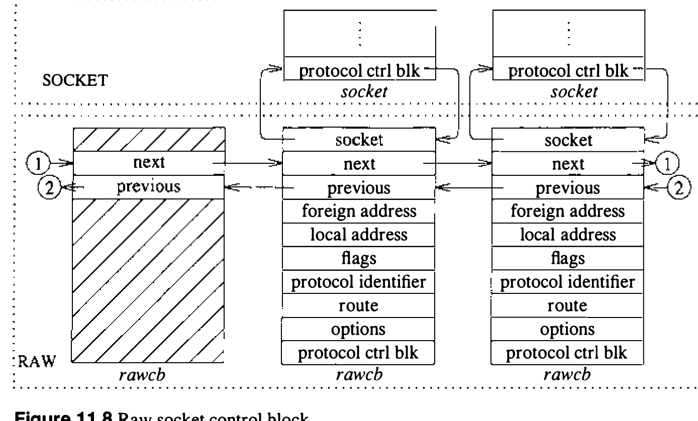

# 11.7 原始套接字

裸套接字允许特权用户直接访问协议。裸套接字面向两种行家：想利用正常接口无法直接访问的协议特性的进程，以及在既有协议之上开发协议的人。例如，Internet EGP [Mills, 1984] 就实现为一个利用裸 IP 套接字投递分组的用户级进程。裸 IP 套接字接口力图提供与协议驻留内核时完全相同的接口。

裸套接字的支持围绕一个通用裸套接字接口构建，可加协议专有的处理例程。以下各小节只描述裸套接字接口的核心；特定协议的细节不讨论。

## 控制块

每个裸套接字有一个图 11.8 所示形式的协议控制块。全部控制块挂在一条双向链表上，供分组分发时查找。关联可记录在控制块中，输出例程准备待传分组时使用。`rcb_proto` 字段含裸套接字关联的协议族和协议号。协议、族和地址用来按下述方式过滤输入分组。需要协议专有信息时，可经 `rcb_pcb` 字段附加到控制块；外出分组应含的协议专有选项可保存在 `rcb_options` 字段。



裸套接字接口面向数据报：套接字上每次发送或接收都要目的地地址。目的地地址可由用户提供，或存在控制块中由输出例程自动装入外出分组。控制块中有无地址靠观察无法判断，因此用两个标志分别指示本地和外地地址是否存在。需要路由时，必须由底层协议完成。

## 输入处理

输入分组按简单的模式匹配方案分给裸套接字。每个网络接口或协议把未指派的分组交给裸输入例程：[^1]

```c
    raw_input(m, proto, src, dst)
        struct mbuf *m;
        struct sockproto *proto;
        struct sockaddr *src, *dst;
```

数据分组随后被前置一个图 11.9 所示形式的通用头部，放进裸输入协议模块的分组队列。从该队列取出的分组被复制进所有按下列规则与头部匹配的裸套接字：

1. 套接字与头部的协议族一致。
2. 套接字的协议号非零时，与分组头中的一致。
3. 套接字定义了本地地址时，套接字本地地址的地址格式与分组目的地址相同，且两个地址完全一致。
4. 规则 3 应用于套接字的外地地址和分组的源地址。

```sh
图 11.9 裸输入分组头部
struct raw_header:  源 | 目的地 | 协议标识
```

模式匹配方案的一个基本假设是：控制块和分组头（由网络接口和任何裸输入协议模块构造）中的地址是可以在逐位基础上比较的规范形式。

[^1]: 4.3BSD 中，网络接口不把未指派的分组交给裸输入例程。

## 输出处理

输出时，每次发送请求导致一次对裸套接字用户请求例程的调用；该例程为所有裸套接字共用。用户请求例程把分组和裸控制块的指针传给协议专有的输出例程，做完全部必要处理后把分组交给适当的网络接口。实现一个裸套接字接口通常只需要这个输出例程。
