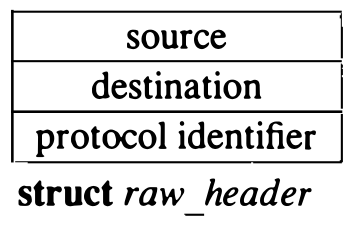

# 11.7 原始套接字

原始套接字允许特权用户直接访问协议。原始套接字是为有经验的进程而设，让它们能利用正常接口无法直接访问的协议特性，也可用于开发建立在既有协议之上的协议。例如，Internet EGP [Mills, 1984] 就实现为一个利用原始 IP 套接字投递分组的用户级进程。原始 IP 套接字接口力图提供与协议驻留内核时完全相同的接口。

原始套接字的支持围绕一个通用原始套接字接口构建，并可辅以协议专有的处理例程。以下各小节只描述原始套接字接口的核心；特定协议的细节不讨论。

## 控制块

每个原始套接字有一个图 11.8 所示形式的协议控制块。全部控制块挂在一条双向链表上，供分组分发时查找。关联可记录在控制块中，输出例程准备待传分组时使用。`rcb_proto` 字段含原始套接字关联的协议族和协议号。协议、族和地址用来按下述方式过滤输入分组。需要协议专有信息时，可经 `rcb_pcb` 字段附加到控制块；外出分组应含的协议专有选项可保存在 `rcb_options` 字段。


**图 11.8 原始套接字控制块**

原始套接字接口面向数据报：套接字上每次发送或接收都要目的地地址。目的地地址可由用户提供，或存在控制块中由输出例程自动装入外出分组。控制块中有无地址靠观察无法判断，因此用两个标志分别指示本地和外地地址是否存在。需要路由时，必须由底层协议完成。

## 输入处理

输入分组按简单的模式匹配方案分给原始套接字。每个网络接口或协议把未分配的分组交给原始输入例程：[^1]

```c
    raw_input(m, proto, src, dst)
        struct mbuf *m;
        struct sockproto *proto;
        struct sockaddr *src, *dst;
```

随后给数据分组加上一个图 11.9 所示形式的通用头部，再把它放进原始输入协议模块的分组队列。从该队列取出的分组被复制进所有按下列规则与头部匹配的原始套接字：

1. 套接字与头部的协议族一致。
2. 套接字的协议号非零时，与分组头中的一致。
3. 套接字定义了本地地址时，套接字本地地址的地址格式与分组目的地址相同，且两个地址完全一致。
4. 规则 3 应用于套接字的外地地址和分组的源地址。



**图 11.9 原始输入分组头部**

模式匹配方案的基本假设是：控制块和分组头（由网络接口和任何原始输入协议模块构造）中的地址都呈规范形式，可以在逐位的基础上相互比较。

[^1]: 4.3BSD 中，网络接口不把未分配的分组交给原始输入例程。

## 输出处理

输出时，每次发送请求导致一次对原始套接字用户请求例程的调用；该例程为所有原始套接字共用。用户请求例程把分组和原始控制块的指针传给协议专有的输出例程，做完任何必要处理后把分组交给适当的网络接口。实现一个原始套接字接口通常只需要这个输出例程。
