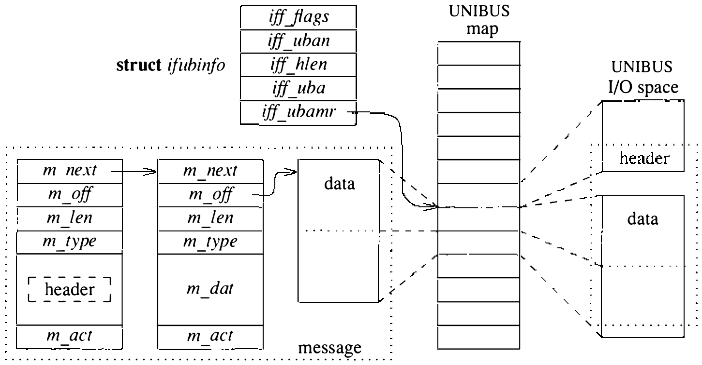

# 11.8 其他网络子系统话题

以下几小节讨论网络子系统中几个不易归类的方面。

**带外数据**

处理带外数据的能力是流套接字抽象专有的设施。带外数据的语义应该是什么，看来共识甚少。TCP 定义了称为紧急数据（urgent data）的概念，把带内数据标记为 **紧急交付**；NBS 协议 [Burruss, 1980] 和许多其他协议提供完全独立的逻辑传输信道发送带外数据。此外，一条带外消息可发送的数据量因协议而异，从 1 位到 16 字节或更多。

流套接字的带外数据概念定义为最低限度的公约数。带外数据应脱离数据流的正常顺序和流控约束传输。支持流套接字的协议至少应提供 1 字节带外数据和一条未决带外消息。支持更长的消息或同时多条未决带外消息，是协议的权利。

带外数据由协议维护，通常不存放在套接字的接收队列。套接字级的 SO_OOBINLINE 选项用来强制把带外数据在紧急数据到达时放进正常接收队列。把带外数据放进正常数据流，可以让协议同时保有多条带外消息。这一机制可以避免用户响应缓慢导致的带外消息丢失。

**地址解析协议**

地址解析协议（ARP）是链路级协议，为支持广播或多播通信的网络提供动态的地址翻译机制 [Plummer, 1982]。4.3BSD 用 ARP 把 32 位 Internet 地址映射为 48 位以太网地址。ARP 并非专用于 Internet 协议地址或以太网，但 4.3BSD 网络子系统只支持这一组合。ARP 并入网络接口层，尽管它逻辑上位于网络层与网络接口层 **之间**。

ARP 的基本想法简单：维护一张网络地址到链路级地址的翻译表。网络接口向 ARP 服务发出地址翻译请求而所请求的地址不在已知翻译表中时，ARP 创建一条报文，指明所请求的网络地址和一个未知的链路级地址。接口广播这条报文，期待网络上某台主机知道这个翻译——通常因为那台主机正是原消息的目的地。及时收到响应的话，ARP 服务用响应更新翻译表、解决未决的请求，然后回调请求的网络接口传输原消息。

实践中，这一算法的简单性被几个必要性搞复杂：最小化名字翻译表和网络接口占用的资源、避免陈旧的翻译数据、处理失败的翻译请求。ARP 翻译表实现为翻译的缓存：每个表项把一个 Internet 网络地址映射到相应的以太网地址，并关联一个定时器。表项组织成散列结构以加快查找。为外出消息把 Internet 地址解析为以太网地址的请求由这一调用发出：

```c
result = arpresolve(ac, m, destip, desten, usetrailers);
    struct arpcom *ac;
    struct mbuf *m;
    struct in_addr *destip;
    u_char *desten;
    int *usetrailers;
```

ARP 先查表看 Internet 地址 `destip` 是否已在。地址已知且表项 **完整**（不在等响应）时，以太网地址在 `desten` 返回。地址没找到，ARP 必须在表中分配新表项、把外出消息排队待发、广播请求 Internet 地址翻译的报文；同时初始化表项的定时器，确保翻译无响应时装消息的 mbuf 链被回收。收到应答之前又有翻译请求到来，排队的那条消息被丢弃，只留较新的一条。

稍后——最好在排队消息的定时器到期之前——ARP 收到翻译请求的响应。收到的报文先由 `arpinput()` 例程处理（每个支持 ARP 的网络接口设备都调用它），处理 ARP 分组找到翻译表项。报文完成了一次未决翻译时，表项更新，原消息交回网络接口传输；这一次对 `arpresolve()` 的调用将毫无延迟地成功。

ARP 的输入处理既要应对对本机地址的请求，也要应对本机发出的翻译请求的响应。输入模块还监视其他主机宣告自己 Internet 地址翻译的响应。这种监视是为了确保同一网络上没有两台主机以为自己是同一个 Internet 地址（这一错误虽可检测，ARP 的对策也只是记一条诊断消息）。

ARP 通常在 20 分钟后让缓存中完成的翻译表项超时，3 分钟后让未完成的表项超时。表项可以标记为 **永久**（permanent），则永不从缓存删除；也可以标记为 **公布**（published），让一台主机充当不支持 ARP 的其他主机的代理。

ARP 对使用 Internet 协议的以太网络的顺畅运转很重要。但当不支持 ARP 的主机也在场时，它会带来兼容问题。公布表项可以用于不支持 ARP 的主机，但这些主机若不支持 Internet 与以太网地址间完整的 32 位到 48 位映射，就不解决问题。所幸多数 Internet 主机如今都支持 ARP。

**VAX UNIBUS 接口**

4.3BSD 支持的 VAX 硬件接口都驻留在 UNIBUS 上。UNIBUS 接口按主机与设备的通信走 DMA 还是走共享 UNIBUS 内存分为两类。支持 DMA 的设备使用一组处理 UNIBUS 的公共例程，其运作在此描述。

每个网络设备至少有收发消息各用的两个分组缓冲。所有 DMA 传输都经 UNIBUS 适配器通往硬件设备所在的 UNIBUS。必须设置 UNIBUS I/O 映射寄存器，把 I/O 缓冲的内存页映射进 UNIBUS 的地址空间（见图 11.10）。



每个 UNIBUS 接口利用一个 `if_ubinfo` 结构，装着设备在一个 UNIBUS 上 I/O 缓冲的一般信息。此外每个缓冲有一个描述结构，含接口为把缓冲映射进 UNIBUS I/O 空间所持有的 UNIBUS 资源。系统初始化时，为每个缓冲分配足够的内存页和 UNIBUS 映射寄存器，把整个满尺寸分组加头部映射进 UNIBUS 地址空间。缓冲的 VAX 虚拟地址存在 `ifrw_addr`，映射寄存器从 `ifrw_mr` 开始。UNIBUS 映射寄存器 `ifrw_mr[-1]` 映射在页边界上结尾的链路级协议头（为后述尾部封装着想）。每个接收和发送缓冲各关联附加结构——通常每接口各一。

发送消息时，接口软件必须把 mbuf 链的内容搬到一段在 UNIBUS 地址空间连续映射的内存。搬运用复制数据完成，或者可能时设置 UNIBUS 适配器的映射寄存器，把 mbuf 持有的数据页映射进 UNIBUS 地址空间的适当区域。后一种情况，通常映射发送缓冲各页的映射寄存器被暂时改为指向 mbuf 数据页；下次使用时恢复为引用发送缓冲的保留页。内容被映射待传的 mbuf 排队等传输后释放；内容被复制的 mbuf 立即回收。

收到已传入 VAX 内存的消息时，必须做类似的过程。传输含至少半页数据时，从 mbuf 页池分配页框，与已含数据的页交换。新页映射进接收缓冲替换刚放进 mbuf 的页，使设备为下一次 UNIBUS 传输就绪。

页的重映射改善了复制内存的 CPU 开销高于重映射内存页的机器上的网络性能。这种重映射只有在消息大到允许此类操作时才可能（最常见的是传输使用以太网等局域网时）。尾部封装的使用也与这一方案配合良好，有可能让数据从设备输入到用户地址空间无须复制。

**尾部协议**

内存到内存的复制可以占网络数据传输服务开销的相当部分 [Watson & Mamrak, 1987]。因此设计者在联网软件的设计上花大力气把这类操作减到最少。许多体系结构提供按页组织的虚拟内存硬件，允许 I/O 传输按页映射。减少复制操作的一个诱人方案是把数据保持在页对齐边界上的页大小单元中，系统靠改页表项而不是物理复制来搬移数据。套接字软件尽量把用户数据放进带关联页的 mbuf（见 10.6 节）。支持 DMA 的 VAX UNIBUS 设备利用例程在可能时把页重映射进 UNIBUS 地址空间以备 DMA。这有可能让数据传输只经一次复制完成。在现行内存管理方案下数据必须复制进内核地址空间；联网软件移植到的其他一些系统则不需要。

遗憾的是，从网络接收数据时做类似操作很困难。考虑入局分组的格式：分组典型地含一个链路级协议头，后跟更高层协议使用的一个或多个头，最后才是数据（若有）。头部信息长度可变，没有协议头格式的先验知识就无法保证送往用户接收缓冲的数据在内存中正确对齐（例如系统只支持单一协议头格式时，头长就是已知的）。

为了既允许变长协议头在场、又保证数据页对齐，可以使用一种特殊的本地网络封装。这一封装称为尾部协议（trailer protocol）[Leffler & Karels, 1984]，把变长头部信息放到数据之后（见图 11.11）。链路级头含一个新的尾部专有协议类型值，编码数据部分的大小；变长头部信息之前插入一个新的尾部协议头。尾部协议含原始分组类型和其后协议信息的大小。链路级协议头若定长（通常如此），输入 DMA 可以按该头的大小偏移，确保数据落在页对齐的内存区域。

```sh
典型分组
| ETHER |  IP  |   TCP    |     Data     |
|  14   | 变长 | n × 512 字节 |

尾部协议头
| type | length |

尾部分组
| ETHER |     Data     | T,L |  IP  |   TCP    |
|  14   | n × 512 字节  |  4  | 变长  |
  第 1 页   第 2 至 n+1 页     第 n+2 页（尾部）
```

图 11.11 尾部协议的分组格式

尾部协议的处理简单。输出时，链路级头中的分组类型设为指示使用尾部封装。类型从为尾部保留的一组类型中按尾部协议头之前消息中数据页的数目选取。尾部协议头初始化为含实际分组标识和变长头部的大小，随变长头部信息一起附在数据之后。

输入时，接口例程凭链路级头中的分组类型识别尾部封装，计算数据页数以找到尾部的开头。尾部协议头信息复制进单独的 mbuf，链到所得分组的前端。数据部分留在接收缓冲的页中，为接收缓冲分配新页。

尾部协议需要源主机与目的主机合作。为了可以逐主机协商尾部，ARP 服务加入了尾部协议使用的协商。一对主机之间正常的 ARP 请求与响应报文交换期间，每台主机可以额外为尾部协议类型发一条 ARP 响应，表示愿意接收尾部封装的分组。

对驻留在以太网并使用 ARP 的网络接口，每次解析 Internet 地址的调用都返回接收主机是否愿意接收尾部协议的指示。只有主机表明愿意接收，系统才发送尾部封装。不用 ARP 协商尾部使用的网络上，尾部封装的分组总是被接受；网络上的主机若无力接收尾部，可在接口结构中设置 IFF_NOTRAILERS 标志停用尾部。

## 习题

11.1 说出网络子系统中两个对保持套接字层软件独立于网络实现很重要的关键数据结构。

11.2 收到数据时为什么用软件中断触发网络协议处理，而不是把协议处理封装在独立进程中？

11.3 协议开关中的哪些例程由套接字层调用？解释每个例程为何被调用。

11.4 设 **可靠投递消息套接字**（SOCK_RDM）是保证数据可靠交付、保留消息边界的无连接套接字。支持这种套接字类型的协议，其协议开关表项的 `pr_flags` 字段应置哪些标志？

11.5 举一个没有底层硬件设备也有用的网络接口的例子。

11.6 网络接口的地址 **不在** 网络接口数据结构中，给出两条理由。

11.7 套接字的名字或地址为什么放在网络层而不是套接字层？

11.8 4.3BSD 为什么不试图强加死板的协议-协议接口结构？

11.9 描述网络接口输出例程做的两项工作。

11.10 每条消息收到时所在的网络接口的身份为什么随消息向上传递？

11.11 内核实现了哪些路由 **策略**？

11.12 路由设施为什么用主机、网络两张独立的表？

11.13 什么路由设施主要为支持工作站而设计？

11.14 什么是路由重定向？它有什么用？

11.15 每个网络接口的输出分组队列为什么对可排队分组数设限？

11.16 SO_OOBINLINE 套接字选项做什么？它为什么存在？

*11.17 解释为什么不可能用裸套接字接口支持并行的协议实现——一部分在内核、一部分在用户态。要支持这一设施，系统需要哪些修改？

*11.18 访问权为什么与任何关联数据同时提供给用户请求例程，而不是单独一次调用发送？

*11.19 什么是尾部协议？尾部协议的使用应该改善受 I/O 限制的系统（如硬件控制器慢的系统）的性能吗？协议处理受 CPU 限制的系统又如何？

## 参考文献

BBN, 1978.
BBN, “Specification for the Interconnection of Host and IMP,” Technical Report 1822, Bolt, Beranek, and Newman, Cambridge, MA (May 1978).

Burruss, 1980.
J. Burruss, “Features of the Transport and Session Protocols,” Report No. ICST/HLNP-80-1, National Bureau of Standards, Washington, D.C. (March 1980).

DEC, 1980.
DEC, “DECnet DIGITAL Network Architecture—General Description,” Report No. AA-K179A-TK, Digital Equipment Corporation, Maynard, MA (October 1980).

ISO, 1984.
ISO, “Open Systems Interconnection—Basic Reference Model,” ISO 7498, International Organization for Standardization (1984). Available from: American National Standards Institute, 1430 Broadway, New York, NY 10018.

Leffler & Karels, 1984.
S. J. Leffler & M. J. Karels, “Trailer Encapsulations,” RFC 893, SRI Network Information Center, Menlo Park, CA (April 1984).

Mills, 1984.
D. L. Mills, “Exterior Gateway Protocol Formal Specification,” RFC 904, SRI Network Information Center, Menlo Park, CA (April 1984).

Plummer, 1982.
D. Plummer, “An Ethernet Address Resolution Protocol,” RFC 826, SRI Network Information Center, Menlo Park, CA (September 1982).

Postel, 1981.
J. Postel, “Internet Control Message Protocol,” RFC 792, SRI Network Information Center, Menlo Park, CA (September 1981).

Watson & Mamrak, 1987.
R. W. Watson & S. A. Mamrak, “Gaining Efficiency in Transport Services by Appropriate Design and Implementation Choices,” *ACM Transactions on Computer Systems* **5**(2), pp. 97–120 (May 1987).

Xerox, 1981.
Xerox, “Internet Transport Protocols,” Xerox System Integration Standard 028112, Xerox Corporation, Stamford, CT (December 1981).
