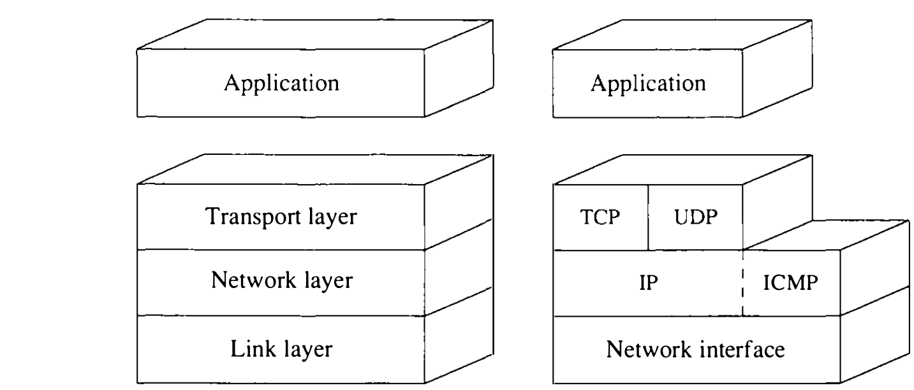
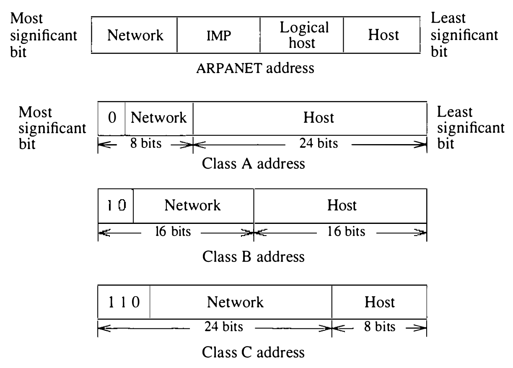
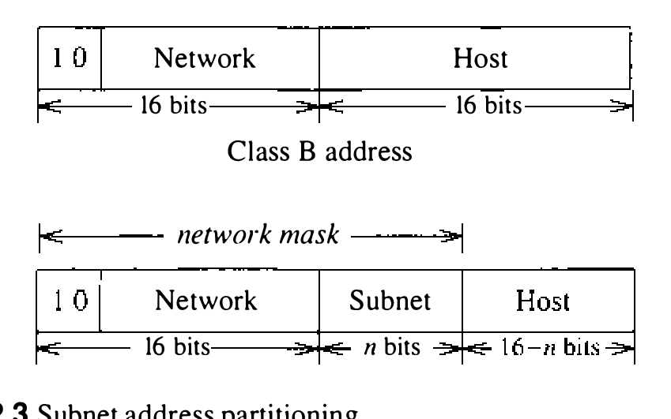
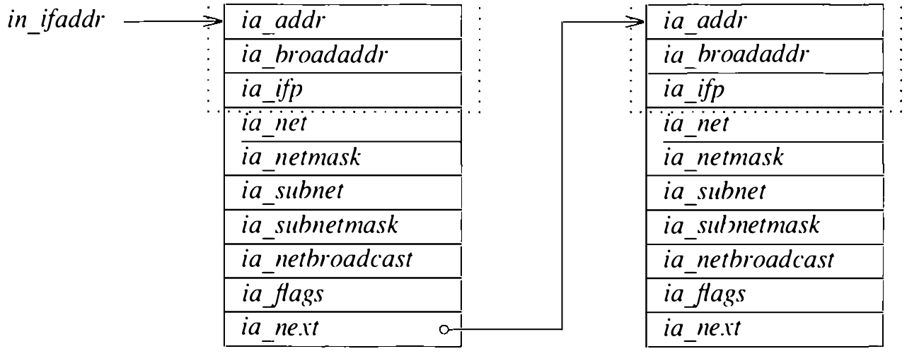
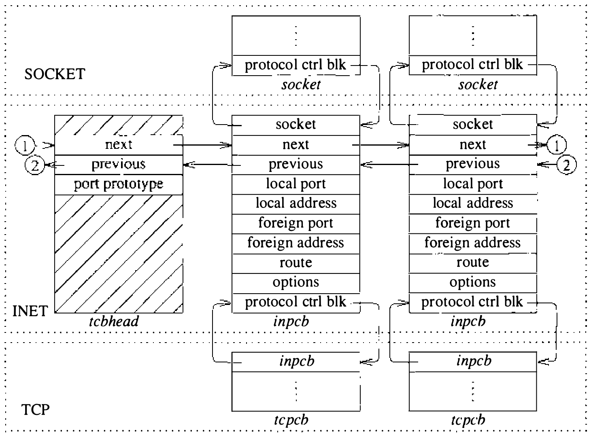

# 12.1 DARPA Internet 网络协议

第 11 章给出了 4.3BSD 的网络通信体系结构。本章考察在这一框架内实现的网络协议。4.3BSD 系统支持三个通信域：DARPA Internet、施乐网络系统（NS）和 UNIX。UNIX 域不含网络协议，因为它完全在单一系统内运作。DARPA Internet 协议套件是 4.2BSD 网络体系结构中实现的第一组协议。4.2BSD 发布后，若干厂商在该体系结构内实现了专有协议族；但直到 4.3BSD 加入施乐 NS 协议，系统才清楚地表现出支持多个网络协议族的能力。协议接口的某些部分此前未用因而未实现，但加入第二个网络协议族所需的改动并没有实质性地修改网络体系结构。

本章集中于 DARPA Internet 协议的组织与实现。这一协议实现应用广泛——既在 4BSD 系统中，也在许多其他系统中——因为当许多厂商寻找经过调优、可靠的通信协议时，它已经公开可得。开发者遵循 Internet 协议例程确立的同一通用框架，实现了包括施乐 NS 在内的其他协议。描述完 Internet 协议的总体体系结构后，我们按第 11 章定义的结构考察其运作，描述 Internet 协议使用的重要算法，最后概述施乐 NS 协议及其实现。

DARPA Internet 网络协议在 DARPA 资助下开发，供 ARPANET 使用 [McQuillan & Walden, 1977; DARPA, 1983]。它们通称 TCP/IP，尽管 TCP 和 IP 只是族中众多协议里的两个。与 ARPANET 早先使用的协议（ARPANET 主机-主机协议，有时称 NCP，网络控制程序 [Carr et al., 1970]）不同，这些协议不假设存在保证数据交付的可靠子网。Internet 协议为这样一个模型而设计：主机接到特性各异的网络上，网络之间由网关互连。这样的模型称为 catenet（网际网络）[Cerf, 1978]。Internet 协议为分组交换网络而设计，从提供可靠消息交付或失败通知的 ARPANET，到对数据报交付不作任何指示的以太网这样的纯数据报网络，都在其列。

这一模型导致至少两个协议层。一层在参与会话的两台主机之间端到端地运作，基于一个逐跳运作的低层协议——把每条消息经中间网关转发到目的主机。一般在这两层之上还有一层，即应用层。这种三级分层被称为 ARPANET 参考模型 [Padlipsky, 1985]，三层大致对应 ISO 开放系统互连参考模型 [ISO, 1984] 的第 3 级（网络）、第 4 级（传输）和第 7 级（应用）。

支持这一模型的 Internet 通信协议的分层见图 12.1。网际协议（IP）是 ARPANET 参考模型中最低层的协议，对应 ISO 的网络层。数据报从始发主机经任何中间网关发往目的地时，IP 逐跳运作，提供主机编址、路由等网络级服务，必要时还提供分组的分片与重组——当中间网络无法整个传输一个分组时。其他所有协议都使用 IP 的服务。传输控制协议（TCP）和用户数据报协议（UDP）是传输级协议，在 IP 之上提供附加设施。每个协议在 IP 的主机地址之外增加一个端口标识符，以便识别本地和远程套接字。TCP 提供可靠、不重复、带流控的数据传输，支持 Internet 域中的流套接字类型。UDP 除端口标识符外还提供用于完整性检查的可选数据校验和，但除此之外几乎不增加 IP 已提供的任何服务；UDP 是 Internet 域中数据报套接字使用的协议。网际控制报文协议（ICMP）用于错误报告和其他网络管理任务，逻辑上是 IP 的一部分，但与传输协议一样分层在 IP 之上，通常不供用户访问。经 **原始套接字** 可以直接访问 IP 和 ICMP 协议；见 11.7 节。

**图 12.1 Internet 协议分层（TCP 为传输控制协议；UDP 为用户数据报协议；IP 为网际协议；ICMP 为网际控制报文协议）**

Internet 协议为异构的主机系统与体系结构而设计。这些系统的内部数据表示五花八门，连数据的基本单位 **字节** 都不统一——一种常见的主机类型支持大小可变的字节。网络协议却需要标准表示。这一表示以八位组（octet，8 位的字节）表达。我们将按协议规格中的用法用该词描述网络数据，尽管指系统内的数据或存储时继续用“字节”。Internet 协议中大于一个八位组的字段都以 **网络字节序** 表示，最高有效八位组在前。VAX 等本机字节序不同的主机上，4.3BSD 网络实现用一组例程或宏在主机与网络字节序之间转换短整数和长整数字段。

## Internet 地址

Internet 主机地址（Internet host address）是一个 32 位数，既标识主机所在的网络，又标识网络上的主机。网络标识符由中央机构指派，主机标识符由各网络的管理员指派。于是，其网络接口接在多个网络上的主机拥有多个地址。图 12.2 展示与 ARPANET 所用子网编址绑定的最初编址方案：每台主机由它所接 ARPANET IMP 的编号和它在该 IMP 上的主机端口号标识（IMP 即接口报文处理机，见 12.9 节）。IMP 号和主机号各占地址的一个八位组；其余两个八位组一个用于指明网络，另一个可用于多路复用主机连接之类——故名逻辑主机。这一地址编码把网络数限制为 255 个，很快证明太少。图 12.2 展示地址的网络部分如何编码成大小可变：地址网络部分的最高几位决定地址的类别。定义 A、B、C 三类，最高位分别为 0、10、110，[^1]分别用 8、16、24 位作地址的网络部分。类别越低，地址主机部分的位数越少、可支持的主机越少。这种频率编码形式支持数量更多、大小不一的网络，又与 ARPANET 地址的旧编码兼容。

**图 12.2 Internet 地址（IMP 为接口报文处理机）**

## 子网

基本的 Internet 编址方案用既含网络标识符又含主机标识符的 32 位地址。要全连通，所有互连网络都必须为中央路由代理群体所知。这一方案对付大量互连网络并不好：保证全连通所需的路由信息量太大，网络铺设迅速时管理开销也很可观。不过，许多网络安装在大学、公司和研究机构，它们有大量互连的局域网，却只有少数几个接入外部网络的点。为解决这些问题，加入了子网（subnet）编址方案 [Mogul & Postel, 1985]，允许一组网络共用一个网络号。

子网为 Internet 地址空间增加了一层层次。它们把指派给一个机构的网络划分成多个地址空间（见图 12.3）。这一划分的每一部分称为一个子网（subnet），只对子网化网络上的主机和网关可见；对不在子网化网络上的主机，子网结构不可见——特定网络各子网上的全部主机在外部看来都在单一网络上。这一方案允许 Internet 路由按站点进行：站点各子网上的全部主机在站外主机和网关看来都在单一 Internet 网络上。划分方案也让站点对本地网络拓扑有更大的自主权。

**图 12.3 子网地址划分**

站点建立子网编址方案时，必须选择该站点所指派 Internet 地址空间的划分。看图 12.3：站点分到一个 B 类网络地址，就有 16 位可以用来编码子网号和子网上的主机标识符。16 位的任意细分都允许，但站点须在所需子网数与每个子网可编址的主机数之间权衡。为把所选划分方案告知系统，站点管理员为每个网络接口指定一个网络掩码（network mask）。掩码指明从本地地址提取网络标识符时应包含 Internet 地址中的哪些位。掩码包括正常的网络部分加子网字段；提取地址的主机部分时也用这个掩码。解释非本地地址时，系统用地址类别对应的掩码。

子网的实现大体限于操作 Internet 地址的例程。指派给网络接口的每个 Internet 地址维护在一个 `in_ifaddr` 结构中，它含一个接口地址结构和 Internet 域使用的附加信息（见图 12.4）。指定接口的网络掩码时，它记入地址结构的 `ia_subnetmask` 字段；网络掩码 `ia_netmask` 在指派接口地址时按网络号的类型（A、B 或 C 类）计算。非子网化网络的两掩码相同。系统随后用这些值解释本地 Internet 地址：地址在网络掩码下的字段与某接口地址的网络字段匹配，该地址即视为本地。因此，假定子网掩码在整个子网化网络上一致。

**图 12.4 Internet 接口地址结构**

## 广播地址

在支持广播数据报的网络上，4.2BSD 用主机部分为零的地址做广播。4.2BSD 发布之后，Internet 广播地址定义为主机部分全一的地址 [Mogul, 1984]。这一变化加上子网的引入，都使广播地址的识别复杂化：主机可能用主机部分全零或全一表示广播，有些可能理解子网的存在，有些可能不理解。出于这些原因，4.3BSD 把每个接口的广播地址设为主机值全一，但允许为向后兼容设置备用地址。网络被子网化时，广播地址的子网字段含正常的子网号。设置地址时还计算网络的 **逻辑** 广播地址——即不使用子网时的标准广播地址。IP 输入例程过滤输入分组时需要这一地址。输入时，4.3BSD 识别并接受主机部分全零或全一的子网和网络广播地址，以及 32 位全一的地址（“本物理网络上的广播”）。

## Internet 端口与关联

IP 层上，分组寻址到主机而非进程或通信端口。但每个分组含一个 8 位的协议号，标识下一个应接收该分组的协议。Internet 传输协议用另一个标识符指明主机上的连接或通信端口。多数协议（含 TCP 和 UDP）为此用 16 位的端口号。每个协议维护自己的端口号到进程或描述符的映射。于是，一个 **关联**（如连接）由五元组 <源地址、目的地址、协议号、源端口、目的端口> 完全规定。TCP 等面向连接的协议必须强制关联的唯一性；其他协议一般也这么做。本地部分先于远程部分设置时，必须选一个唯一的端口号，防止指定远程部分时发生冲突。

## 协议控制块

每个基于 TCP 或 UDP 的套接字创建一个 Internet 协议控制块（`inpcb` 结构），装着 Internet 网络地址、端口号、路由信息和指向辅助数据结构的指针。TCP 另外创建一个 TCP 控制块（`tcpcb` 结构），装着实现所需的大量协议状态信息。供 TCP 使用的 Internet 控制块维护在 TCP 协议模块私有的双向链表上；供 UDP 使用的维护在 UDP 协议模块类似的私有链表上。需要两条独立的链，因为 Internet 域中每个协议都有各自独立的端口标识符空间。各协议用公共例程向链表添加新控制块、固定关联的本地和远程部分、按关联定位控制块、删除控制块。IP 按协议头中指定的协议标识符对消息流量做多路分解，每个更高层的协议随后负责检查自己的 Internet 控制块链表，把消息交给适当的套接字。图 12.5 展示套接字数据结构与这些协议专有数据结构之间的链接。

Internet 协议的实现耦合相当紧，与各协议的紧密交织相称。例如，传输协议收发的分组不仅含自己的头部，还含一个 IP 伪头部——装着源和目的地址、协议标识符和分组长度。传输级分组的校验和包含这个伪头部。

现在可以考察 Internet 协议的运作了。先从 UDP 开始，它远比 TCP 简单。

**图 12.5 Internet 协议数据结构**

[^1]: 另外定义了第四类 D，其最高位为 1110，用于实验性的多播设施。
