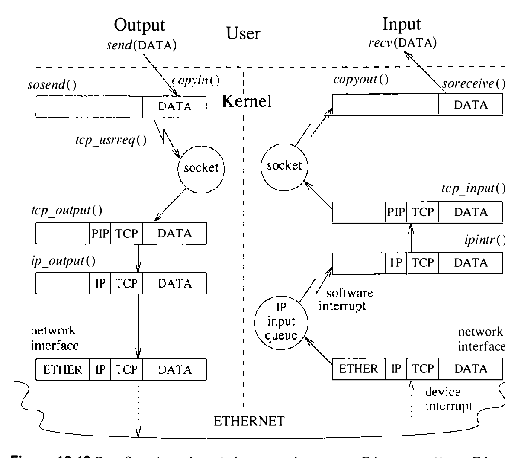

# 12.11 小结

本节把前面三章的许多材料串成一体，做法是描述套接字层和网络层在正常使用中的运作。

套接字的一生有三个阶段：初建——创建套接字并与某个通信域关联；存活——数据经它流往一个或多个其他套接字；终结——套接字不再需要时，经有序的关闭过程释放其资源。

**创建通信信道**

套接字由用户用 `socket` 系统调用创建，内部则由 `socreate()` 例程完成。创建套接字时，用户须给出通信域和套接字类型，还可以请求域内的具体通信协议。套接字例程先从引导时为每个配置域初始化的全局列表中定位通信域的 `domain` 结构；构成该域协议族的协议表就在这个域结构中，它是一张协议开关表项的表。找到这张表后，套接字例程扫描它，为正在创建的套接字类型（或用户指定的具体协议）找合适的协议。搜索靠检查 `pr_type` 字段（含可能的套接字类型，如 SOCK_STREAM）和 `pr_protocol` 字段（含该协议的协议号，通常是知名值）完成。找到合适的协议后，对该协议开关表项的引用就记入套接字的 `so_proto` 字段；此后一切网络服务请求都通过结构中标识的相应过程处理。

定位到协议之后，`socreate()` 分配一个 mbuf，按套接字的初始状态创建套接字数据结构。为完成创建过程，`socreate()` 向协议的用户请求例程发出 PRU_ATTACH 请求，使协议把自己 **附接** 到新套接字上。

接着可以把地址绑定到套接字。地址的绑定由 `sobind()` 在内部完成，它向套接字的支撑协议发出 PRU_BIND 请求。Internet 和 XNS 域各提供一个管理自己地址空间的例程。UNIX 域中的地址是文件系统名字空间中的名字，因此名字请求要经过文件系统的名字查找例程 `namei()`。

要让套接字准备好接受连接，套接字层必须以 PRU_LISTEN 请求通知协议。这一请求对 UDP 和 IDP 等无连接协议显然无意义；对 TCP 和 SPP 等面向连接的协议，listen 请求则引起协议状态转换。在进行状态转换之前，协议会核实套接字是否已绑定地址；若没有绑定，协议模块就替它选一个。

UNIX 域中的 listen 请求不引起状态变化，只检查套接字是否已有名字；不过与其他协议不同，UNIX 域不会替套接字选名字。

`soconnect()` 被调用来建立连接，向协议发出 PRU_CONNECT 请求。对无连接协议，该地址被记录为默认地址，供此后在该套接字上发送数据时使用（即进程做 `write` 或 `send`，而不是 `sendto`）；设置地址不需要任何对端通信，协议模块立即返回。

基于连接的协议则验证对端地址，并为未绑定的套接字指派本地地址。套接字不立即进入 **已连接** 状态，而是经 `soisconnecting()` 标记为 **连接中**；协议随即发送连接请求消息，与对端握手。这类连接请求完成时——通常在协议输入例程收到消息之际——套接字的状态便通过调用 `soisconnected()` 改变。

在用户看来所有连接请求都是同步的：`connect` 系统调用先调用 `soconnect()` 发起连接，然后在套接字层把调用进程置入睡眠（若连接请求尚未完成）。或者，若套接字已被 `fcntl` 设为非阻塞，连接一经成功发起，`connect` 就返回 EINPROGRESS 错误；调用者可以发出 `select` 调用测试能否向套接字写入，以检验连接是否完成。

基于连接的通信中，进程必须在监听套接字上调用 `accept` 接受入局连接请求，`accept` 转而调用 `soaccept()`；后者从套接字接收队列返回下一个已完成的连接。

**收发数据**

套接字一经创建，数据就可以开始流经它。一条典型的 TCP/IP 连接见图 12.10。`sosend()` 例程负责把数据从发送进程的地址空间复制进 mbuf，然后通过一次或多次对协议 PRU_SEND 请求的调用把数据交给网络层。网络可以选择立即发送数据，或等更好的时机；协议若推迟发送，或必须保留数据副本以备重传，可以把数据存放在套接字的发送缓冲区中。最终，数据被当作一个或多个分组，经 TCP 和 IP 逐层向下传给适当的接口驱动程序；每经过一层都加上相应的头部。每个分组经网络发往目的机器。

**图 12.10 TCP/IP 连接经以太网的数据流（ETHER 为以太网头；PIP 为伪 IP 头；IP 为 IP 头；TCP 为 TCP 头）**

目的机器收到分组后，接口驱动的接收中断处理程序校验并剥掉自己的头部，把分组放到适当的网络协议输入队列上。稍后，软件中断唤起网络级输入处理模块（如 IP 或 IDP）；它的中断优先级低于硬件网络接口中断的优先级。本例中，输入队列上的分组先由 IP 处理，再由 TCP 处理，各自校验并剥掉自己的头部。如果按序收到，数据随即放到相应套接字的输入队列上，等 `read` 请求到来时由 `soreceive()` 复制出去。

**终止数据传输和/或接收**

`soshutdown()` 例程停止套接字上的数据流。关闭套接字的读很简单：冲掉接收队列并把套接字标记为不能再收数据——由调用 `sorflush()` 完成，它转而调用 `socantrcvmore()` 改变套接字状态，然后释放接收队列关联的资源。关闭套接字的写则需要通过 PRU_SHUTDOWN 请求通知协议。对可靠连接，发送队列中剩余的数据必须排空后，连接才能完成关闭。协议若支持 **半打开** 连接（即允许单向数据流的连接），套接字还可以继续使用；否则协议可以开始断开过程。套接字两个方向都关闭后，协议开始断开过程；断开完成时，先释放网络关联的资源，再释放套接字关联的资源。

## 习题

12.1 TCP 是传输层、网络层还是链路层协议？

12.2 IP 如何识别应处理入局消息的下一个更高层协议？这一分派在施乐 NS 体系结构中有何不同？

12.3 C 类 Internet 网络上能有多少台主机？C 类网络能用子网编址吗？

12.4 什么是广播消息？DARPA Internet 中如何识别广播消息？

12.5 TCP 和 UDP 的协议控制块为什么放在不同的链表上？

12.6 为什么检查外出分组的目的地址是否为广播地址的是 IP 输出例程，而不是套接字层的发送例程（`sosend()`）？

12.7 4.3BSD 为什么不转发广播消息？

12.8 TCP 头总是封装在含 TCP 消息长度的 IP 分组中，为什么还要有头部长度字段？

12.9 TCP 限制数据发送速率的流控机制是什么？

12.10 TCP 如何识别发自主机、指向先前存在但已关闭的连接（比如机器重启之后）的消息？

12.11 什么时候连接的 TCP 接收窗口大小不等于关联套接字接收缓冲区中可用的空间量？此时两值为何不等？

12.12 什么是保活报文？TCP 用它做什么？保活报文为什么在内核中实现，而不是在每个需要这一设施的应用里实现？

12.13 为什么计算平滑往返时间很重要，而比如简单地取算出的往返时间的平均值却不重要？

12.14 TCP 为什么对收到的数据延迟确认？TCP 延迟确认的最长时间是多少？

12.15 解释糊涂窗口综合症是什么，举一个避免它对良好协议性能很重要的例子。4.3BSD TCP 如何避免这一问题？

12.16 **小分组避免** 指什么？为什么小分组避免对表现为单向数据流、且需要低延迟才有良好交互性能的客户（如 X Window System）不利？

*12.17 **定向广播** 是要在距发送方一跳或多跳远的网络上广播的消息。描述在 Internet 域中支持定向广播消息的方案。

*12.18 TCP 连接的初始序号为什么随机选择，而不是比如恒设为零？

*12.19 TCP 协议中 SYN 和 FIN 标志为什么占据序号空间？

*12.20 描述连接建立期间典型的 TCP 分组交换过程。假设主动客户向被动服务器发起连接。被动服务器若同时试图向客户发起连接，这一场景会有何变化？

*12.21 勾画服务器进程接受连接后未收任何数据即立即关闭时的 TCP 状态转换。4.3BSD 若支持服务器在系统完成连接前拒绝连接请求的机制，这一场景会有何不同？

*12.22 4BSD TCP 一度在传输时采用严格的指数退避策略。解释这一非自适应算法如何损害 **丢包严重** 但带宽很高的网络（如某些使用卫星连接的网络）上的性能。

*12.23 UDP 为什么把入局消息完全指定的目的地址与本地和远程目的地址不完整的套接字相匹配？

*12.24 发送方为什么可能在 IP 分组头设置 **不可分片** 标志？

*12.25 **最长报文段生存期**（MSL）是消息在网络中存在的最长时间，即消息在某种硬件介质上传输或排队在网关中的最长时间。TCP 如何保证 TCP 消息具有有限的 MSL？IP 又如何保证 MSL 有限 [Fletcher & Watson, 1978]？

**12.26** 描述一种能够计算网际环境中消息的最长报文段生存期上界的协议。TCP 如何借助消息 MSL 的上界（见习题 12.25）把关闭 TCP 连接的开销降到最低？

## 参考文献

BBN, 1978.
BBN, “Specification for the Interconnection of Host and IMP,” Technical Report 1822, Bolt, Beranek, and Newman, Cambridge, MA (May 1978).

CCITT, 1980.
CCITT, “Recommendation X.25: Interface between Data Terminal Equipment (DTE) and Data Circuit-Terminating Equipment (DCE) for Terminals Operating in the Packet Mode on Public Data Networks,” in *Public Data Networks, Orange Book, vol. VIII.2* (1980).

Carr et al., 1970.
S. Carr, S. Crocker, & V. Cerf, “HOST–HOST Communication Protocol in the ARPA Network,” *Proceedings of the AFIPS Spring Joint Computer Conference*, pp. 589–597 (1970).

Cerf, 1978.
V. Cerf, “The Catenet Model for Internetworking,” Technical Report IEN 48, SRI Network Information Center, Menlo Park, CA (July 1978).

Cerf & Kahn, 1974.
V. G. Cerf & R. E. Kahn, “A Protocol for Packet Network Intercommunication,” *IEEE Transactions on Communications* **22**(5), pp. 637–648 (May 1974).

Clark, 1982.
D. D. Clark, “Window and Acknowledgment Strategy in TCP,” RFC 813, SRI Network Information Center, Menlo Park, CA (July 1982).

DARPA, 1983.
DARPA, “A History of the ARPANET: The First Decade,” Technical Report, Bolt, Beranek, and Newman, Cambridge, MA (April, 1983).

Fletcher & Watson, 1978.
J. Fletcher & R. Watson, “Mechanisms for a Reliable Timer-Based Protocol,” pp. 271–290 in *Computer Networks* 2, North-Holland, Amsterdam, The Netherlands (1978).

Heart et al., 1970.
F. E. Heart, R. E. Kahn, S. Ornstein, W. Crowther, & D. Walden, “The Interface Message Processor for the ARPA Computer Network,” *Proceedings of the AFIPS Spring Joint Computer Conference*, pp. 551–567 (1970).

ISO, 1984.
ISO, “Open Systems Interconnection—Basic Reference Model,” ISO 7498, International Organization for Standardization (1984). Available from: American National Standards Institute, 1430 Broadway, New York, NY 10018.

Jacobson, 1988.
V. Jacobson, “Congestion Avoidance and Control,” *Proceedings of the ACM SIGCOMM Conference*, pp. 314–329 (August 1988).

McQuillan & Walden, 1977.
J. M. McQuillan & D. C. Walden, “The ARPA Network Design Decisions,” *Computer Networks* **1**(5), pp. 243–289 (1977).

McQuillan et al., 1980.
J. M. McQuillan, I. Richer, & E. Rosen, “The New Routing Algorithm for the ARPANET,” *IEEE Transactions on Communications* **28**(5), pp. 711–719 (May 1980).

Mogul, 1984.
J. Mogul, “Broadcasting Internet Datagrams,” RFC 919, SRI Network Information Center, Menlo Park, CA (October 1984).

Mogul & Postel, 1985.
J. Mogul & J. Postel, “Internet Standard Subnetting Procedure,” RFC 919, SRI Network Information Center, Menlo Park, CA (August 1985).

Nagle, 1984.
J. Nagle, “Congestion Control in IP/TCP Internetworks,” RFC 896, SRI Network Information Center, Menlo Park, CA (January 1984).

Padlipsky, 1985.
M. A. Padlipsky, *The Elements of Networking Style*, Prentice-Hall, Englewood Cliffs, NJ (1985).

Postel, 1980.
J. Postel, “User Datagram Protocol,” RFC 768, SRI Network Information Center, Menlo Park, CA (August 1980).

Postel, 1981a.
J. Postel, “Internet Protocol,” RFC 791, SRI Network Information Center, Menlo Park, CA (September 1981).

Postel, 1981b.
J. Postel, “Transmission Control Protocol,” RFC 793, SRI Network Information Center, Menlo Park, CA (September 1981).

Postel, 1981c.
J. Postel, “Internet Control Message Protocol,” RFC 792, SRI Network Information Center, Menlo Park, CA (September 1981).

Postel et al., 1981.
J. B. Postel, C. A. Sunshine, & D. Cohen, “The ARPA Internet Protocol,” *Computer Networks* **5**(4), pp. 261–271 (July 1981).

Scheifler & Gettys, 1986.
R. W. Scheifler & J. Gettys, “The X Window System,” *ACM Transactions on Graphics* **5**(2), pp. 79–109 (April 1986).
