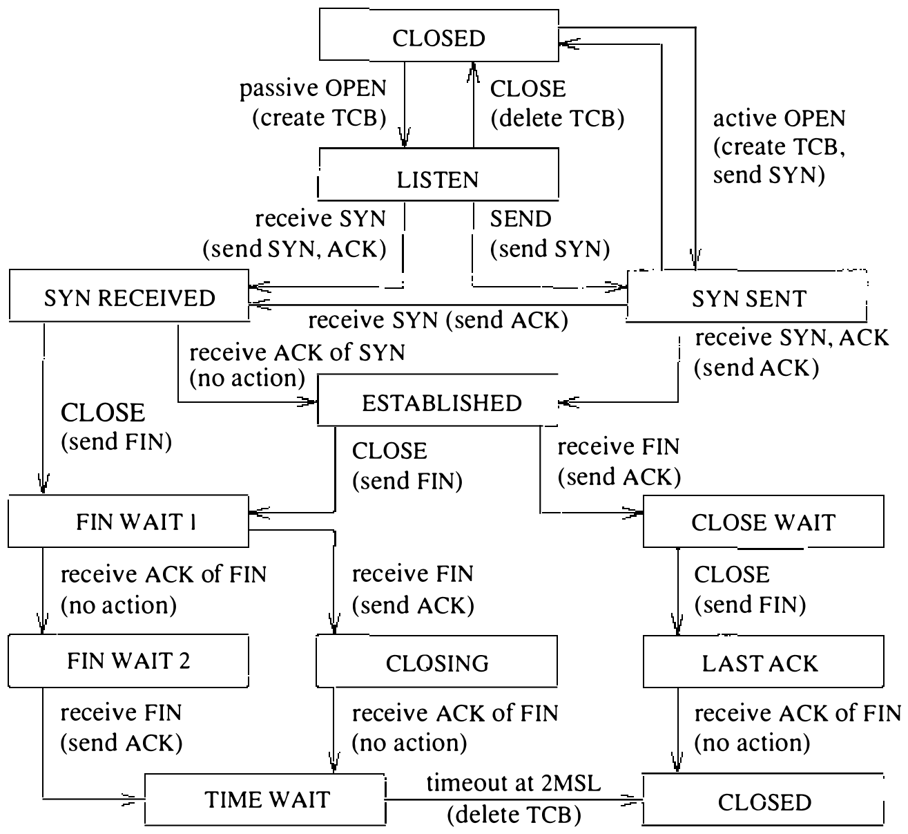
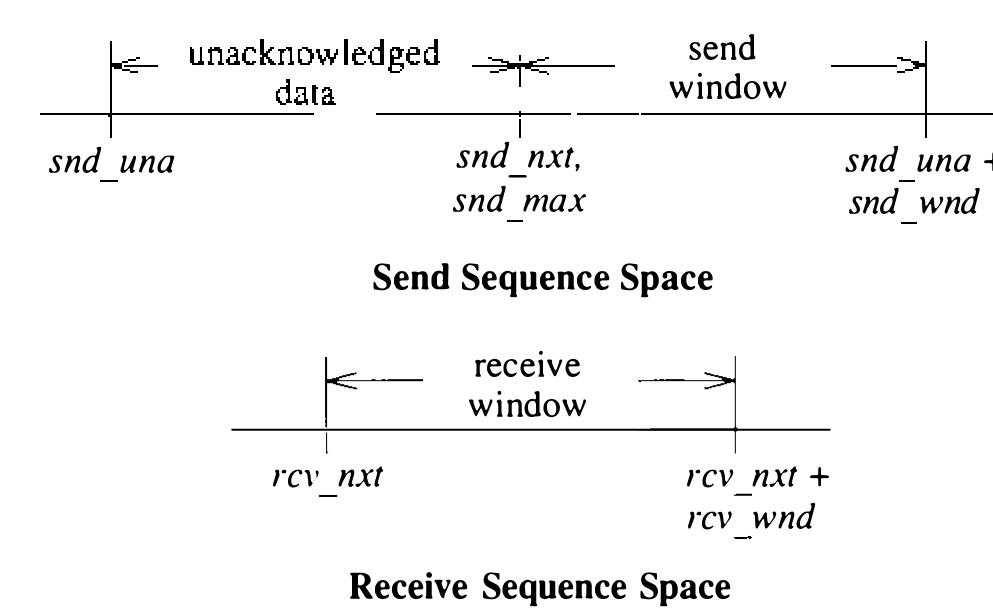

# 12.4 传输控制协议（TCP）

Internet 协议套件的主力协议是传输控制协议（TCP）[Postel, 1981b; Cerf & Kahn, 1974]。TCP 是可靠、面向连接的流传输协议，多数应用协议以它为基础。它有几样此前描述的传输和网络协议都没有的特性：

* 显式且有确认的连接发起与终止
* 可靠、有序、不重复的数据交付
* 流量控制
* 紧急数据的带外指示

因为这些特性，TCP 的实现远比 UDP 或 IP 复杂。这些复杂性加上 TCP 的广泛使用，使 TCP 实现的细节比简单协议的实现更关键也更有趣。我们先考察 TCP 本身，再继续描述它在 4.3BSD 中的实现。

一条 TCP 连接可以看作两个对端之间传输的双向、有序的数据八位组流。数据可以用大小不一的分组、在间隔不一的时间发送——例如用来支撑网络上的登录会话时。流的发起和终止是流开始与结束处的显式事件，在流的序号空间（sequence space）中占有一席，使它们能像数据一样被确认。序号是循环空间中的 32 位数：比较按模 2³² 进行，零是 2³²−1 之后的下一个序号。每个方向的序号从一个任意值开始，称为初始序号（initial sequence number）。TCP 连接的每个分组（报文段，segment）携带其第一个数据的序号和（连接建立期间的消息除外）对已收全部连续数据的确认。确认用尚未收到的下一个数据的序号表示。确认是累积的，因此可以确认多个（或其一部分）分组里收到的数据。分组可以含数据也可以不含，但总含下一个待发数据的序号。

```sh
图 12.7 TCP 分组头
 0               15 16            31
|   Source port   |  Destination port |
|         Sequence number            |
|      Acknowledgment number         |
| Data offset | Reserved |U|R|G|A|C|K|P|S|H|R|S|T|S|Y|N|F|I|N| Window |
|          Checksum      | Urgent pointer |
|          Options       |    Padding    |
|              Data                     |
```

TCP 的流控用滑动窗口机制完成。每个带确认的分组含一个窗口：从确认中的序号起，接收方准备接受的数据八位组数。紧急数据的处理类似：指明紧急数据的标志置位时，紧急数据指针用作相对分组序号的正偏移，指明紧急数据的范围。这样，即使流控窗口不允许发送中间数据，TCP 也能不发全部中间数据就发出紧急数据通知。

TCP 分组的完整头部见图 12.7。标志有 SYN 和 FIN，分别表示连接的发起（同步）和完成。这两个标志各占一个序号空间。一条完整的连接由每个对端发出并被对方确认的一个 SYN、零个或多个八位组的数据和一个 FIN 构成。其余标志指明确认字段（ACK）和紧急字段（URG）是否有效，还包括连接中止信号（RST）。头部含头部长度字段，使头部可以用可选字段扩展。选项的编码方式与 IP 选项相同： **空操作** 和 **选项结束** 是单个八位组，其余选项含类型和长度。当前定义的唯一选项指明通信方愿意接受的最大报文段（分组）大小，只在初始建立连接时使用。

## TCP 连接状态

TCP 的连接建立与连接完成机制为健壮性而设计。它们为连接期间传输的数据加框，使不仅数据本身、连同其范围都可靠传达。此外，该过程为发现因一端崩溃或网络连通丢失而未正确终止的旧连接而设计；发现这种半打开连接即予中止。主机为每条连接另选新的初始序号，降低旧分组与现行连接混淆的机会。

正常的连接建立过程称为 “三次握手”。每个对端向对方发一个 SYN，各自再以 ACK 确认对方的 SYN。实践中，连接通常由一方（客户）发起，试图连接另一方（在著名端口上监听的服务器）。客户选一个端口号和初始序号，用在带 SYN 的初始分组中。服务器为未决连接创建新连接块，发一个带自己初始序号、一个 SYN 和对客户 SYN 的 ACK 的分组。客户以对服务器 SYN 的 ACK 响应，连接建立完成。由于第一个 SYN 的确认搭在第二个 SYN 上，这一过程只需三个分组，故名 “三次握手”。（两个对端同时发起连接时协议仍正确运作，只是需要四个分组。）

连接建立后，每个对端在每个分组中都带确认和窗口信息。各方都可以按从对端收到的窗口发送数据。一端发出数据，窗口逐渐填满；对端收到数据后可发确认，让发送方从发送队列丢弃数据。接收方若准备接受更多数据——比如接收进程已消费掉先前数据——还会推进流控窗口。数据、确认和窗口更新可以合并进单个消息。

发送方在合理时间内未收到确认，就重传它认为丢失的数据。重复数据被接收方丢弃，但再次确认——以防重传由确认丢失引起。数据乱序到达时，接收方一般保留乱序数据，等缺失的报文段到来时用；乱序数据可以不确认。

任一方随时可以发带 FIN 位的分组终止数据传输。FIN 表示数据的结束（类似文件结束指示），被确认后序号前进一。连接另一方向可以继续传数据，直到那个方向也发出 FIN；对那个 FIN 的确认终止连接。为保证连接结束时同步，发最后一个 FIN 之 ACK 的一方必须保留状态足够久，让任何重传的 FIN 分组要么到达它、要么已被丢弃；否则 ACK 丢失而重传的 FIN 又到达时，接收方将无法重复确认。这一间隔任意取为最大预期报文段生存期的两倍（2MSL）。

TCP 输入处理模块和定时器模块必须在连接的整个存活期维护连接状态。因此，除处理连接上收到的数据外，输入模块还必须处理 SYN 和 FIN 标志及其他状态转换。TCP 连接一端的状态列表见表 12.1。图 12.8 展示这些状态、引起转换的事件和转换期间的动作构成的有限状态机。早期版本的 TCP 实现实际实现为一个显式的状态机。

一端因崩溃或超时而丢失连接、另一端仍视为已建立时，连接上发送的任何数据到达另一端都会使半打开连接被发现。检测到半打开连接时，接收方发一个带 RST 标志、序号从入局分组推导的分组，表示连接已不存在。

表 12.1 TCP 连接状态

| 状态 | 描述 |
| ---- | ---- |
| *建立连接所涉状态* | |
| CLOSED | 已关闭 |
| LISTEN | 监听连接 |
| SYN SENT | 主动，已发 SYN |
| SYN RECEIVED | 已发送并收到 SYN |
| *已建立连接的状态* | |
| ESTABLISHED | 已建立 |
| *对端发起连接关闭所涉状态* | |
| CLOSE WAIT | 已收到 FIN，等待关闭 |
| LAST ACK | 已收到 FIN 并关闭；等 FIN 的 ACK |
| CLOSED | 已关闭 |
| *本地发起连接关闭所涉状态* | |
| FIN WAIT 1 | 已关闭，发出 FIN |
| CLOSING | 已关闭，FIN 已交换；等 FIN 的 ACK |
| FIN WAIT 2 | 已关闭，FIN 已确认；等 FIN |
| TIME WAIT | 关闭后在 2MSL† 静候 |
| CLOSED | 已关闭 |

† 报文段最长生存期的两倍。



## 序号变量

每条 TCP 连接在 TCP 控制块中维护一大组状态变量，包括连接状态、定时器、选项与状态标志、一个装乱序收到数据的队列，以及若干序号变量。序号变量用来定义发送和接收序号空间，包括各自的当前窗口（window）。窗口是当前允许发送的数据序号范围，从尚未确认的第一个数据八位组到头部窗口字段已提供的范围末尾。4.3BSD 中定义窗口的变量是协议规格 [Postel, 1981b] 所用变量的超集。发送和接收窗口见图 12.9。序号变量的含义列于表 12.2。



`snd_nxt` 与 `snd_una` + `snd_wnd` 之间的区域称为发送窗口（send window）。范围 `snd_una` 到 `snd_max` 的数据已发出未确认，连同尚未发送的数据一起保存在套接字发送缓冲。`snd_nxt` 和 `snd_max` 通常一起维护，重传时除外。`rcv_nxt` 与 `rcv_nxt` + `rcv_wnd` 之间的区域称为接收窗口（receive window）。这些变量供输出模块判断能否发送数据、供输入模块判断收到的数据能否接受。接收方发现分组因数据全在窗口之外而不可接受时，丢弃分组但回送上一条确认的副本。分组若含旧数据，第一条确认可能已丢失，必须重复。确认还含窗口更新，使发送方状态与接收方状态同步。

表 12.2 TCP 序号变量

| 变量 | 描述 |
| ---- | ---- |
| `snd_una` | 尚未确认的最低发送序号 |
| `snd_nxt` | 下一个待发送的数据序号 |
| `snd_wnd` | 对端将从 `snd_una` 起接收的数据八位组数 |
| `snd_max` | 已发送的最高序号 |
| `rcv_nxt` | 期望的下一个接收序号 |
| `rcv_wnd` | 过 `rcv_nxt` 可接受的八位组数 |
| `rcv_adv` | 向对端宣告的接收窗口最后一个八位组 |
