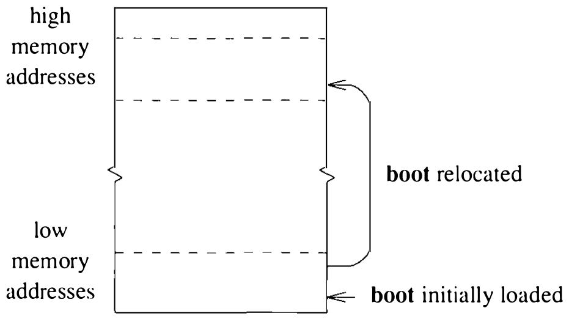

# 13.2 自举

自举一个程序是依赖机器的操作。多数机器上，这一操作由称为控制台处理器（console processor）的辅助处理器或控制台监视器（console monitor）支持。控制台监视器程序驻留在非易失存储器中，CPU 复位时自动被调起。控制台设施应支持独立程序的自举。多数控制台处理器和监视器在机器复位时还执行诊断操作，确保硬件正常。

**boot 程序**

控制台处理器或控制台监视器往往不懂 4.3BSD 文件系统的格式；取而代之的是，支持自举操作的软件所解读的是厂商专有的文件系统格式或其他文件系统格式。因此，UNIX 内核历来经 **boot** 程序自举。这个程序是一个通用的 **独立** 程序，可用来装入和执行其他独立程序。独立程序（standalone program）是无须 UNIX 内核协助即可运作的程序，通常与独立 I/O 库（standalone I/O library）链接——该库在多种硬件设备上支持类 UNIX 的 I/O 接口。独立 I/O 库通过一组独立设备驱动和一组例程提供这些设施；这组例程支持从驻留在设备上的 UNIX 文件系统读取文件。

**boot** 程序装入并启动后，必须装入含待自举程序可执行映像的文件，然后启动装入的程序。要装入正确的文件，**boot** 必须知道待装入文件的路径名和文件所在的硬件设备。这一信息以两种方式之一传达给 **boot**：VAX 上，初始化两个硬件寄存器，其值指定 **boot** 应如何运作、装入程序映像时用哪个设备；其他机器则通过初始化运行时栈并把参数放到栈上来传达自举信息，做法与 UNIX 内核向程序传参的方式相同。

VAX 上用的寄存器称为引导方式寄存器（boothowto）和引导设备寄存器（bootdevice）。**boot** 启动运行时解释引导方式寄存器：视其值，**boot** 或从引导设备寄存器指定的设备装入文件 **vmunix**，或在控制台终端提示输入要装入的文件名和获取该文件的设备。放进引导方式寄存器的值由表 13.1 的标志定义；放进引导设备寄存器、标识自举所用硬件设备的值取决于与 **boot** 链接的独立 I/O 库的配置——该库的构成取决于机器上可用的硬件设备，引导设备寄存器的内容因机器类型而异。就本文的讨论而言，只要知道寄存器内容指定了读取程序所用的默认设备和文件系统分区即可。

表 13.1 传给 boot 程序和 reboot 系统调用的标志

| 标志 | 描述 |
| ---- | ---- |
| RB_ASKNAME | 提示输入要自举的文件名 |
| RB_SINGLE | 自举系统到单用户运行 |
| RB_NOSYNC† | 重启前不做 sync |
| RB_HALT† | 不重启，只停机 |
| RB_INITNAME | 用给定的名字代替 **/etc/init** |
| RB_DFLTROOT | 用编译进内核的根设备 |
| RB_KDB | 把控制交给内核调试器 |
| RB_RDONLY | 只读挂载根文件系统 |
| RB_DUMP† | 重启前转储内核内存 |

† 仅对 `reboot` 系统调用有意义。

**boot** 总是把程序装到内存位置 0。**boot** 自己起初就装在位置 0，因此必须把自己的映像复制到高地址内存的别处，以免把它自举的程序映像装到自己头上（见图 13.1）。这一 **重定位** 意味着创建 **boot** 程序时必须把起始地址设为它将被复制到的内存位置；否则 **boot** 被复制后，对其中数据结构的引用会访问错误的内存位置（记住 **boot** 在虚拟地址转换禁止下运作）。

**VAX 控制台介质**

多数 VAX 计算机配有控制台处理器，以及某种可供控制台处理器访问的辅存。VAX-11/780 的控制台子系统配有软盘驱动器，VAX-11/750 和 VAX-11/730 的控制台子系统则配有小型盒式磁带驱动器。

VAX 自举的确切步骤因机器而异。正常运行时，VAX 控制台处理器在自己的控制台介质上搜索名为 **DEFBOO.CMD** 的文件。这个文件包含控制台处理器为自举 CPU 而应解释的命令。这些命令通常复位 CPU 和 I/O 子系统，把寄存器初始化为已知值，然后从控制台存储设备装入一个文件并启动它。在部分 VAX 机器上，用户可以通过设置前面板开关或在控制台终端输入特殊命令来请求其他动作。

自举过程用到控制台存储设备时，**boot** 程序必须驻留在该存储设备上。4.3BSD 提供两个工具程序——**arff** 和 **flcopy**，用于处理控制台处理器所用的文件系统格式；这两个程序把 **boot** 等程序放到 VAX 控制台存储介质上。
