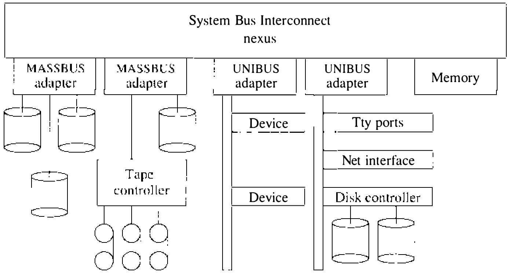

# 13.3 内核初始化

**boot** 程序启动 UNIX 内核后，内核为执行应用程序做初始化。初始化过程大致分三阶段：第一阶段全部用汇编语言写成，做让非汇编代码得以运作的必要工作；第二阶段做与机器相关的操作，包括机器上 I/O 设备的配置与初始化；第三阶段做与机器无关的操作，以启动构成正常 UNIX 运行环境基础的系统驻留进程收尾。

**汇编语言启动**

系统初始化的头几步由汇编语言代码完成。这项工作与机器高度相关，包括：

* 建立运行时栈
* 识别系统正在其上执行的 CPU 类型
* 计算机器的物理内存量
* 启用虚拟地址转换硬件
* 初始化存储管理硬件
* 为 0 号进程构造硬件上下文
* 调用系统最初的基于 C 的入口点

对这些步骤的讨论集中于支持 VAX 所需的工作；4.3BSD 运行的任何机器都需要类似的动作。

**boot** 程序启动 UNIX 内核运行时，只设置机器状态的两个方面：

1. 中断优先级设在最高级，屏蔽全部硬件中断。
2. 禁用硬件地址转换设施，使所有内存引用都指向物理内存位置。

UNIX 内核对它所运行机器的状态不作任何其他假设。

内核被装入物理内存的 0 号位置。正常运行时，VAX 地址转换硬件启用，内核映像映射进从十六进制位置 80000000 开始的虚拟内存。为启用地址转换做准备，内核使用的物理内存被映射到完全相同的虚拟位置。这一 **双重映射** 之所以必要，是因为 VAX 要在地址转换启用 **且** 执行了一条转移指令之后才进入映射模式。内核物理内存的双重映射保证转移到下一条指令（以虚拟地址指定）会落到正确的物理位置。

启动代码的第二项任务是识别系统正在其上执行的 VAX 类型。所有 VAX 计算机虽支持共同的指令集，I/O 体系结构却因机器而异；此外，VAX 体系结构的某些微处理器实现仅直接支持完整指令集的一个子集，这些机器上内核必须在软件中 **仿真** 缺失的硬件指令。

内核靠询问系统标识寄存器（SID）的内容识别自己正在其上执行的 VAX 类型。寄存器内容含一个唯一标识 VAX 类型的著名常量。4.3BSD 用系统类型：

* 区分不同类型的控制台存储介质和控制台处理器接口
* 决定机器上可能配置哪些硬件设备和 I/O 接口
* 处理异常机器状况（机器检查）
* 计算用自旋循环实现的实时延迟
* 决定如何建立中断处理程序

4.3BSD 可以配置成单一内核装入映像支持多种不同 VAX。

**与机器相关的初始化**

汇编语言代码完成工作后，调用内核第一个用 C 写的例程——`main()` 例程。传给这个例程一个参数：第一个可用内存页的页号。系统计算这个值时计入内核装入映像的大小和分配给运行时栈及其他数据结构的页。`main()` 例程立即调用 `startup()` 例程做与机器相关的初始化；`startup()` 得到与 `main()` 从汇编语言代码收到的相同的值。

与机器相关的启动代码的任务包括：

* 初始化消息缓冲区
* 为系统数据结构分配内存
* 初始化内核的内存分配器
* I/O 设备的自动配置与初始化

调用 `startup()` 返回后，机器还有一些硬件特有的部分要初始化；这些操作在后文与机器无关的启动代码的讨论中描述。

**消息缓冲区**

消息缓冲区是位于物理内存顶端的一个 4 KB 环形缓冲区。用 `printf()` 例程（或其变体）显示在控制台上的诊断消息保存在这个缓冲区里，帮助追踪问题。4.3BSD 之前，消息缓冲区只能经 **/dev/kmem** 特殊设备访问；**dmesg** 等读消息缓冲区并把内容复制到管理日志文件的实用程序也无法与新的诊断消息的生成妥善同步。出于这些原因，4.3BSD 增加了特殊设备 **/dev/log**，提供支持 `select` 系统调用的消息缓冲区只读接口。此外，多数系统诊断现在按 **syslogd** 程序可解释的格式生成。这些改动保证系统诊断可靠地保存在日志文件中。

消息缓冲区的初始化直截了当：先从汇编语言代码算出的物理内存量中扣除消息缓冲区的大小，为缓冲区分配内存；再初始化私有页映射 `msgbufmap`，让它引用刚分配的物理页。

**系统数据结构**

启动过程进行到这一步，系统数据结构的内存分配很容易。`startup()` 例程得到驻留内核之后第一个可用物理内存页的页号 `firstaddr`；另外，已知内核驻留在从十六进制位置 80000000 开始的虚拟内存。于是，为连续数据结构分配空间，系统只须把下一个可用物理内存块的虚拟地址指派给每个数据结构：

```sh
    base = 0x80000000 | (firstaddr * NBPG)
```

然后把 `firstaddr` 按数据结构的大小递增。这样分配给数据结构的内存不一定清零；从 `main()` 调用的初始化例程保证每个数据结构的内容得到正确设置。

上述技术用来为每个连续系统数据结构分配内存。这些数据结构多数在系统配置时定大小，尺寸基于预期的用户峰值数（另见 13.5 节）。缓冲区高速缓存和核心映射表则按机器可用物理内存量定大小：缓冲区高速缓存的大小按物理内存前 2 MB 的 10% 加其余内存的 5% 计算；系统保证至少有 16 个缓冲区；除非系统配置了很大的文件系统块大小，这一下限应该永远不成问题。除专用于缓冲区高速缓存的缓冲区外，系统还须为交换操作分配缓冲区头：交换和调页操作用的缓冲区头按文件 I/O 缓冲区头数的一半分配。核心映射表的大小必须在分配缓冲区高速缓存和静态数据结构之后计算，因为该值用来映射系统中未分配给其他用途的全部物理内存。核心映射表和系统内存分配器一旦初始化（见下一小节），就必须使用正常的系统内存分配机制。

**内存分配器**

与机器相关的启动过程在自动配置前的最后一步是初始化系统的内存分配器。内核已分配了容纳系统数据结构所需的全部物理内存；其余内存供一般使用。内存分配器经调用 `meminit()` 例程初始化，参数是可用内存的第一页和最后一页。核心映射表结构初始化为引用这段内存，存储管理系统使用的 `firstfree`、`maxfree`、`freemem`、`avefree` 变量（见 5.12 节）按可用内存设置。

**自动配置**

自动配置是系统识别并启用机器上在场的硬件设备的过程。8.5 节介绍过它对设备驱动的要求；本节集中于自动配置过程的核心运作，特别是描述系统硬件拓扑的数据结构和系统访问设备的方式。

要理解自动配置过程，先得熟悉 VAX 计算机的结构。VAX 体系结构是一个主要关于 CPU 运作的规格：每台 VAX 计算机支持共同的指令集、存储管理设施、陷阱与中断处理机制等。指令集的共同子集由硬件实现，其余指令由软件仿真。VAX 的 I/O 设备驻留在 I/O 总线上，总线有明确的规格，但 **不** 属于基本体系结构规格的一部分。每台 VAX 系统把一个 VAX CPU 的 **实现** 与一条系统总线组合在一起。I/O 设备可以直接接在计算机的系统总线上，更常见的是接在既有的 I/O 总线上，总线经硬件总线适配器连到系统总线（见图 13.2）。到 VAX 系统总线的每个物理连接（含总线适配器）都通过一个 nexus 建立。nexus 为需要访问系统总线的设备做系统总线仲裁，每个 nexus 还在系统总线上提供一组 8 KB 的寄存器，CPU 经它访问和控制所关联的设备。与 nexus 关联的寄存器位于系统区的 I/O 部分。nexus 是自描述的：每个 nexus 寄存器组中有一个寄存器的值唯一标识接在该 nexus 上的设备类型。



**图 13.2 基本 VAX 计算机体系结构**

自动配置的做法是系统化地探测 VAX 上可能的 nexus，寻找系统总线的活跃连接。对每个使用中的 nexus，解释接在其上的设备类型，并视类型采取初始化和配置设备的必要动作：接在 nexus 上的内存控制器，系统必须初始化控制器并启用内存错误报告；总线适配器，配置例程必须探测相关 I/O 总线上可能有的 I/O 设备。

要配置一个 I/O 设备，系统要求该设备在 **配置时** 被指定为可能在场（见 13.5 节）。可能的设备集合组织成两张初始化表：一张给可能驻留在 MASSBUS 上的设备，一张给可能出现在 UNIBUS 上的设备。自动配置时遇到 I/O 适配器，系统搜索初始化表中可能配置在该适配器上的设备。对每个匹配的设备，由设备驱动（UNIBUS 设备）或自动配置代码（MASSBUS 设备）做一次探测；探测成功，设备即作为已配置设备记入系统数据结构（见 8.5 节）。

除探测设备的工作外，配置过程还必须确定 I/O 设备将在何处中断，然后安装适当的中断服务例程，使设备将来的中断由支撑它的设备驱动处理。I/O 设备和中断处理程序的动态配置使单一内核可配置为支持多种不同的硬件组合；这一灵活性对把系统维护降到最少很重要。

要动态配置中断处理程序，系统把 I/O 适配器的全部可能中断向量初始化为指向一个专用例程。该例程只是把中断向量和发生中断的中断优先级记入著名寄存器，然后返回。设备驱动的探测例程在写法上为这些寄存器规定了一种用法，但从不真正向寄存器装入值。自举时，系统修改探测例程，使它们进入时不保存受影响的寄存器。这样，探测例程被调用前放进寄存器的值就可以被这一专用中断处理程序的调用所改变。要探测设备并配置它的中断向量，系统只须把寄存器初始化为已知值、调用设备驱动探测设备并生成中断、然后检查寄存器中的值，看设备是否产生过中断。例如 `up` 设备驱动的探测例程是：

```c
upprobe(reg)
     caddr_t reg;
{
    register int br, cvec;      /* 必须是 r11、r10 */

                /* 探测设备并生成中断 */
    ((struct updevice *)reg)->upcsl = UP_IE|UP_RDY;
    DELAY(10);
                /* 禁止中断 */
    ((struct updevice *)reg)->upcsl = 0;
    return (sizeof (struct updevice));
}
```

VAX 上，声明变量 `br` 和 `cvec` 使 C 编译器为该例程保留寄存器 R11 和 R10。正常情况下这些寄存器会在进入例程时保存，但改动 `upprobe()` 例程的 VAX 寄存器保存掩码可以绕过这一动作。`upprobe()` 被调用、设备中断时，寄存器将被设为含设备的中断优先级和中断向量。因为保存掩码已被改为不把 R10 和 R11 恢复原值，调用 `upprobe()` 的例程中这些寄存器将仍含设备的中断优先级和中断向量。

配置中断向量所用的技术依赖 4.3BSD C 编译器对 `register` 声明的实现。如果 `register` 声明被解释为 **建议性的**，或分配给变量的寄存器以不确定方式指派，这一方案就不能工作。使用 ANSI C 编译器时，无法强制某个变量进入寄存器；但可以用 `volatile` 关键字强制变量分配到内存。使用这一特性时，调用方得安排传递一个 `volatile` 变量的地址来放置结果。

启动时未分配给已配置设备的中断向量仍指向最初的中断处理程序。全局变量 `cold` 由系统置为 1，直到启动过程的自动配置阶段完成为止。中断处理程序检查这个变量：值非零则采取前述动作；否则，处理程序在控制台上生成一条诊断。

VMS 可以在系统完全自举之后再装入设备驱动，4.3BSD 不能，因为：

* 4.3BSD 设备驱动使用一些共享的全局数据结构
* UNIBUS 等一些总线不可全局寻址
* 新设备可能在与既有设备相同的位置中断，引起混乱

MASSBUS 设备没有这些问题，本可以晚些装入；开发者认为这不会有用，4.3BSD 未实现对这一能力的专门支持。

**与机器无关的初始化**

静态系统数据结构分配完毕、I/O 设备配置并初始化之后，系统可以完成初始化过程、启动头几个进程了。`main()` 例程从 `startup()` 返回后的第一个动作为 0 号进程建立上下文——这个进程最终将实现虚拟内存系统的交换策略。进程表的第一项分配给 0 号进程，进程标记为可运行并安装为当前运行的进程（见第 4 章）。这个进程的 user 结构、运行时栈和进程控制块已在汇编语言启动代码中初始化，完成初始化只需少量工作。运行时栈的最后一页标为只读充当红区（red zone），确保进程一旦把栈扩张超出分配给它的固定空间，就会引发系统陷阱。user 结构中的各种指针也要初始化，跨 `fork` 系统调用继承的 user 结构默认参数也要确立——后者包括资源限制、文件创建掩码和组标识符数组。

0 号进程建立完毕后，系统逐个调用例程初始化各系统数据结构：

* `vminit()` 例程建立调页系统使用的参数。这些参数取决于可用物理内存量和用于调页与交换的 I/O 设备数。进程栈和数据段的资源限制及驻留集大小装入 0 号进程的 user 结构，随后被所有其他进程自动继承——它们都是 0 号进程的后代。

* 磁盘配额资源控制系统初始化，包括驻留进程的配额缓存和每用户数据结构缓存。

* 经调用 `startrtclock()` 启动实时时钟。该例程预先启动向系统供应定期中断的必要硬件；时钟频率可编程时，按系统配置时定义的 `hz` 变量设置。默认情况下 4.3BSD 以 100 赫兹实时时钟运行。这个值可以改，但低于 50 赫兹会劣化系统对轮询 I/O 设备的响应时间；对某些硬件终端多路复用器，降低时钟频率可能使高数据流量淹没输入缓冲区。时钟频率选择不当还会在某些计算中引起舍入误差——例如 60 赫兹时，涉及时钟频率的整数计算会偏斜。系统通常以时钟节拍为单位维护超时值，从而避免这一问题。选择时钟频率的最后一个考虑：频率定义系统可观察的最小时间间隔。这对统计分析（如程序剖析和记账）很重要——实时时钟中断被服务时，**整个** 时钟节拍都算到当时进程或程序计数器的值上。总的说，时钟频率应在系统开销不过大的前提下尽量选高。

时钟初始化之后，经调用 `mbinit()` 初始化网络的内存管理系统（见第 10 章）；终端 I/O 设施使用的字符链表数据结构经调用 `cinit()` 建立；随后逐个调用初始化：

* 网络接口
* 通信域和网络通信协议
* 进程管理数据结构
* 正文表
* 散列的 inode 缓存和 inode 表
* 交换空间管理数据结构
* 全系统文件系统名字缓存

系统到达单用户运行之前，还必须挂载根文件系统，创建 1 号进程（执行 **/etc/init** 的进程）和 2 号进程（为支持虚拟内存系统把内存页复制到辅存的进程）。根文件系统的身份由 `rootdev` 变量的值定义。这个值最初在配置时定义，用户也可以在启动时从非配置设备自举系统来改变它（见前面对自动配置的讨论）。

已挂载根文件系统的根 inode 用来初始化 0 号进程的当前工作目录和根目录。此外，根文件系统超级块中的最后修改日期用来初始化系统的当日时刻：超级块的时间戳与硬件可得的当日时刻现值比较，当前当日时刻被约束在文件系统时间的 6 个月之内（除非文件系统时间完全不可信）。这一一致性检查保证系统自举时带有相当准确的当日时刻。用户级设施——如 timed 守护进程与 **timed** 程序——支持网络环境中的时间同步与重新校准。

最后，系统可以执行用户态程序了。1 号进程经调用 `newproc()` 创建，然后把一段编译进内核的小汇编语言程序复制进该进程的用户地址空间，让进程开始执行。这个程序的内容基本如下：

```c
main() {
    char *argv[2];

    argv[0] = "init";
    argv[1] = 0;
    exit(execv("/etc/init", argv));
}
```

也就是说，这个程序启动 **/etc/init** 程序，`execv` 调用失败则退出。这使 **/etc/init** 对运行至关重要：它运行不正确、不存在、或通往它的文件系统必要部分损坏，系统就无法从那个文件系统自举。这一错误比 **/vmunix** 不正确更严重——自举允许为内核另起对象文件名，却没有直接的办法指定别的 init 程序。磁盘空间够用时，惯常的后备是另备一个文件系统应付这类病态情况。

第二个启动的进程是调页守护进程，进程标识符 2。这个进程完全在内核态执行：调用永不返回的 `pageout()` 例程。与 0 号进程一样，调页守护进程标记自己的进程结构，确保该结构不会被移出内存；它还扩展自己的数据段，为映射将写到辅存的内存页腾出空间（见 5.12 节）。

`main()` 的最后一个动作是在 0 号进程内调用 `sched()` 例程。与调页守护进程一样，这个进程完全在内核态执行，对 `sched()` 的调用永不返回。`sched()` 例程实现虚拟内存系统的交换策略，见 5.13 节。
