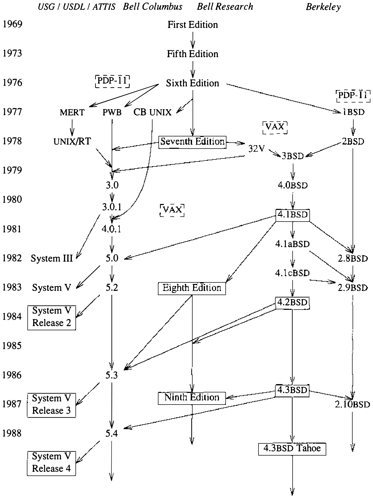

# 1.1 UNIX 系统的历史

UNIX 系统在现今广泛使用的操作系统中算得上古老，历史几乎长达 20 年，但它许多最独特、最有用的设施反而是相对晚近的产物。

**起源**

UNIX 系统的第一版由贝尔实验室的 Ken Thompson 于 1969 年开发，原本是一项利用一台闲置 PDP-7 的个人研究项目。Thompson 还设计了 B 语言，早期系统的大部分不久便用这种语言重写。随后 Dennis Ritchie 也加入进来，他不仅参与了系统的设计与实现，还发明了此后各版本所用的 C 语言。系统最初优雅的设计 [Ritchie, 1978] 和过去 15 年间的发展 [Ritchie, 1984a] [Compton, 1985]，使 UNIX 成为重要而强大的操作系统 [Ritchie, 1987]。

Ritchie、Thompson 与其他早期 Research UNIX 开发者此前都参加过 Multics 项目 [Peirce, 1985; Organick, 1975]，该项目对这个新操作系统影响深远。连“UNIX”这个名字也不过是对 Multics 的一个文字游戏：在 Multics 试图面面俱到的地方，UNIX 只求把一件事做好。UNIX 文件系统的基本组织、命令解释器（shell）作为用户进程的思想、文件系统接口的总体结构，以及许多别的系统特征，都直接来自 Multics。

来自其他各种操作系统的思想也被吸收，例如麻省理工学院（MIT）的 CTSS。创建新进程的 `fork` 操作来自伯克利的 GENIE（SDS-940，后称 XDS-940）操作系统。允许用户廉价地创建进程，带来了每条命令占用一个进程的做法，而不再像 Multics 那样把命令当作过程调用来运行。

UNIX 系统的发展至少有三大支流。图 1.1 勾画了它们的演进，尤其是通向 4.3BSD 和 System V 的分支 [Chambers & Quarterman, 1983; Uniejewski, 1985]。图中给出的年份是近似的，也未试图画出全部影响。图中有几个系统正文并未提到，列出它们只是为了更清楚地显示我们将要考察的那些系统之间的关系。

**图 1.1 UNIX 系统家族谱系图**

**Research UNIX**

最早的几个主要版本是贝尔实验室的 Research 系统。除系统最早的版本外，还包括 **UNIX Time-Sharing System, Sixth Edition**（通称 **V6**）；1976 年，它是第一个在贝尔实验室之外广泛使用的版本。各个系统按发行时当期 UNIX Programmer's Manual 的版次标识。

这个系统与其他操作系统有三点重要区别：

1. 系统用高级语言编写
2. 系统以源码形式发行
3. 系统提供强大的原语，这类原语通常只出现在运行于昂贵得多的硬件上的操作系统中

系统源码的大部分用 C 而非汇编语言写成。当时流行的看法是：操作系统必须用汇编语言编写，才能获得合理的效率并访问硬件。C 语言的层次刚好足够高，易于编译到各种各样的计算机硬件上，又不至于复杂或受限到让系统程序员为了效率或功能而退回汇编语言。对硬件的访问由汇编语言桩提供，只用于操作系统功能中需要它们的那约 3%——例如上下文切换。UNIX 的成功固然并非仅因为它用高级语言写成，但使用 C 是关键的第一步 [Ritchie et al., 1978; Kernighan & Ritchie, 1978; Kernighan & Ritchie, 1988]。Ritchie 的 C 语言源自 [Rosler, 1984] Thompson 的 B 语言，后者又源自 BCPL [Richards & Whitby-Strevens, 1982]。C 至今仍在演进 [Tuthill, 1985; X3J11, 1988]，还有一个更便于做数据抽象的变体 C++ [Stroustrup, 1984; USENIX, 1987]。

UNIX 的第二个重要区别，在于它很早就从贝尔实验室以源码形式发布给其他研究机构。系统缔造者们以源码示人，确保其他组织不仅能使用系统，还能摆弄它的内部机制。新想法能被轻松吸收进系统，这一点始终是对系统做种种变革的关键。每当有想压 UNIX 一头的新系统出现，总会有人解剖这个新来者，把它的核心思想克隆进 UNIX。置身于一个新想法层出不穷的环境，使用一个以高级语言写成、小巧而可理解的系统，造就了 UNIX 的演进远超其寒微的起点。

UNIX 的第三个重要区别是，它让单个用户得以并发运行多个进程，并把这些进程连成命令的管道线。在当时，只有运行在大型昂贵机器上的操作系统才能运行多个进程，而且并发进程的数量通常由系统管理员严格控制。

多数早期 UNIX 系统运行在 PDP-11 上；以当时的标准看，这台机器便宜而强大。尽管如此，早年至少有一次把第六版 UNIX 移植到体系结构截然不同的机器上 [Miller, 1978]。PDP-11 还有一个不便之处：地址空间太小。32 位地址空间机器的出现——尤其是 VAX-11/780——让 UNIX 有机会把服务扩展到虚拟存储和联网。Research 组早先在不同硬件上提供类 UNIX 设施的实验得出了这样的结论：把整个操作系统移植过去，和在别的操作系统之下复制它的服务一样容易。第一个把可移植性当作明确目标的 UNIX 系统是 **UNIX Time-Sharing System, Seventh Edition**（V7），它运行在 PDP-11 和 Interdata 8/32 上，还有一个称为 **UNIX/32V Time-Sharing, System Version 1.0**（32V）的 VAX 变种。贝尔实验室的 Research 组后来又研制了 **UNIX Time-Sharing System, Eighth Edition**（V8）。他们当前的系统是 **UNIX Time-Sharing System, Ninth Edition**（V9）。

**AT&T UNIX System III 与 System V**

1978 年第七版发行之后，Research 组把对外发行工作移交给了 UNIX 支持组（USG）。USG 此前对内发行过 **UNIX Programmer's Work Bench**（PWB）等系统，偶尔也对外发行 [Mohr, 1985]。

他们在第七版之后的第一个对外发行版是 1982 年的 **UNIX System III**（System III），它综合了第七版、32V 以及 Research 组之外若干团体开发的 UNIX 系统的特性，纳入了 UNIX/RT（一个实时 UNIX 系统）的特性以及 PWB 的许多特性。USG 于 1983 年发布了 **UNIX System V**（System V），该系统大体脱胎于 System III。法院裁定贝尔运营公司从 AT&T 剥离，使 AT&T 得以积极行销 System V [Wilson, 1985; Bach, 1986]。

USG 后来变身为 UNIX 系统开发实验室（USDL），后者于 1984 年发布了 **UNIX System V, Release 2**。System V Release 2 Version 4 为 System V 引入了调页 [Miller, 1984; Jung, 1985]，包括写时复制和共享内存。System V 的实现并不以 Berkeley 的调页系统为基础。接替 USDL 的是 AT&T 信息系统（ATTIS），它于 1987 年发行了 **UNIX System V, Release 3**。该系统包含 STREAMS——一种取自 V8 的进程间通信机制 [Presotto & Ritchie, 1985]。

**其他组织**

UNIX 系统易于修改，这催生了众多机构的开发工作，其中包括：兰德公司，负责第 10 章将提到的 Rand 移植版；Bolt Beranek and Newman（BBN），第 12 章讨论的 4.2BSD 网络实现的直系前身就出自它手；伊利诺伊大学，做过早期的联网工作；还有哈佛大学、普渡大学以及数字设备公司（DEC）。

若按运行机器的数量计，流传最广的 UNIX 操作系统版本恐怕是 Microsoft 公司的 XENIX。XENIX 最初以第七版为基础，后来转到 System V。最近，Microsoft 与 AT&T 已同意将两者合而为一。

**伯克利软件发行版**

在贝尔实验室和 AT&T 之外，最有影响的 UNIX 开发团体当属加州大学伯克利分校 [McKusick, 1985]。伯克利的 UNIX 软件以 **伯克利软件发行版**（Berkeley Software Distributions，BSD）的形式发布，例如 4.3BSD。伯克利在 VAX UNIX 上的第一项工作，是 William Joy 和 Özalp Babaoğlu 于 1979 年为 32V 添加虚拟存储、请求调页和页面置换，成果即 **3BSD** [Babaoğlu & Joy, 1981]。3BSD 的大虚拟内存空间，动因是伯克利自己的 Franz LISP 等超大程序的开发。这项存储管理工作使美国国防高级研究计划局（DARPA）确信应当资助伯克利团队，去开发一个供 DARPA 承包商使用的标准 UNIX 系统（4BSD）。

这个项目的目标之一，是支持 DARPA Internet 的网络协议 TCP/IP [Cerf & Cain, 1983]。网络实现足够通用，能在多种网络设施之间通信：从本地网络（如以太网和令牌环）到远程网络（如 DARPA 的 ARPANET）。

我们把 3BSD 之后的伯克利 VAX UNIX 系统统称为 4BSD，尽管实际上有过多个发行版——4.0BSD、4.1BSD、4.2BSD、4.3BSD 和 4.3BSD Tahoe。从 VAX 于 1977 年问世直到 System III 发布（1979 至 1982 年），4BSD 都是 VAX 上的首选操作系统，对许多研究机构和联网站点而言至今仍是。多数机构会购买 32V 许可证，却向伯克利订购 4BSD。贝尔系统内部的许多站点运行 4.1BSD（如今许多改用 4.3BSD）。

为 DARPA 所做的 4BSD 工作由一个指导委员会把关，委员会成员来自产业界和学术界，不乏知名之士。伯克利 DARPA UNIX 项目的巅峰之作是 1983 年 **4.2BSD** 的发布；伯克利的后续研究已经产出 **4.3BSD**——而且工作仍在继续。

**世界范围内的 UNIX**

数十家计算机制造商[^1]（几乎包括所有通常按市场份额被视为“主要厂商”的公司）都已宣布或推出了运行 UNIX 系统或其近似衍生产品的计算机，另有众多公司销售相关的外设、软件包、支持、培训、文档或其中几项的组合。涉及的硬件从微型机、小型机、中型机、大型机一直到巨型机。这些机器大多数使用 System V、4.2BSD、4.3BSD 的移植版或它们的混合，不过仍有多种机器运行基于 System III、4.1BSD 和第七版的软件。还有运行 2BSD 及其他 UNIX 变种的 PDP-11，甚至还有一些第六版系统仍在日常运转。

UNIX 系统也是学术工作的沃土。Thompson 和 Ritchie 因该系统的设计获得（美国）计算机协会（ACM）的图灵奖 [Ritchie, 1984b]。UNIX 与专门设计的教学系统——如 Tunis [Ewens et al., 1985; Holt, 1983]、XINU [Comer, 1984] 和 MINIX [Tanenbaum, 1987]——一道被广泛用于操作系统课程。UNIX 系统遍及世界各地的大学和研究机构，在工业和商业中的应用也日益广泛。

[^1]: 这些制造商包括 Altos、Alliant、Amdahl、Apollo、Apple、Ardent Computer、AT&T、Bull、Callan、Celerity、Codata、Convergent Technologies、Convex、COSI、Cray、Cromemco、Data General、DEC、Dual Systems、ELXSI、Encore、Ericsson、Fairchild、Flexible、Gould、Heurikon、Hewlett-Packard、Honeywell、IBM、ICON、ICL、Integrated Business Computers、Integrated Solutions、Intel、Interactive Systems、Locus、Logical MicroComputer、Medical Informatics、Microsoft、MIPS、NBI、NCR、National Semiconductor、NeXT、Nixdorf、Olivetti、Onyx、Pacific Computer、Parallel、Perkin-Elmer、Philips、Plexus、Prime、Pyramid、R Systems、Ridge、Sequent、Siemens、Silicon Graphics、Sony、Stellar、Sun Microsystems、Symmetric、Tandy、Tektronix、Unisys、Visual Technology 和 WICAT。
