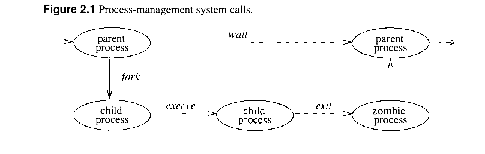

# 2.4 进程管理

UNIX 支持多任务环境。每个任务或执行线程称为一个进程（process）。UNIX 进程的上下文（context）由用户级状态和内核级状态组成：前者包括进程地址空间的内容和运行时环境，后者包括调度参数、资源控制和标识信息。上下文涵盖了内核为进程提供服务时用到的一切。用户可以创建进程、控制进程的执行，并在进程执行状态变化时收到通知。每个进程都有一个唯一的值，称为进程标识符（PID）。内核向用户报告状态变化时用它标识进程，用户在系统调用中引用进程时也用它。

内核通过复制另一个进程的上下文来创建进程。新进程称为子进程（child process），原进程则称为父进程（parent process）。进程创建时复制的上下文，既包括进程的用户级执行状态，也包括由内核管理的进程系统状态。内核状态的重要组成部分在第 4 章描述。

进程的生命周期见图 2.1。进程可以用 `fork` 系统调用创建一个与自身一模一样的新进程。`fork` 调用返回两次：一次在父进程中，返回值是子进程的进程标识符；一次在子进程中，返回值为 0。父子关系使系统中的进程集合形成层次结构。新进程共享父进程的全部资源，如文件描述符、信号处理状态和内存布局。

通常，创建新进程是为了执行一个与父进程正在执行的程序不同的程序。进程可以用 `execve` 系统调用把自己覆盖为另一个进程的内存映像，同时向新建的进程传递一组参数。其中一个参数是文件名，文件内容的格式系统能够识别——或者是二进制可执行文件，或者是一个会使系统执行指定解释程序来处理其内容的文件。

进程可以通过执行 `exit` 系统调用终止，向父进程返回 8 位退出状态。如果进程要与父进程交换的信息多于一个字节，就必须用管道或套接字建立进程间通信通道，或者借助中间文件。进程间通信在第 10 章有更充分的讨论。

进程可以用 `wait` 系统调用挂起自己的执行，直到任一子进程终止；该调用返回子进程的 PID 和退出状态。父进程可以安排在子进程退出或异常终止时由信号通知自己。用 `wait3` 系统调用，父进程还能取回导致子进程终止的事件信息，以及子进程生存期内消耗的资源信息。如果一个进程因为父进程先于它退出而成为孤儿，内核会安排把它的退出状态传回一个特殊的系统进程（`init`，见 3.1 节和 13.4 节）。

内核创建和撤销进程的细节在第 5 章描述。

进程按进程优先级（process priority）参数调度执行。这一优先级由内核中的调度算法管理。用户可以通过指定一个参数（`nice`）来影响进程的调度，它会给总体调度优先级加权；但一般而言，用户有义务按内核的调度策略共享底层的 CPU 资源。

**信号**

系统定义了一组可以投递给进程的信号（signal）。4.3BSD 中的信号以硬件中断为模型。进程可以指定一个用户级子例程作为信号送达的处理例程（handler）。信号产生后，在处理例程捕获它期间会被屏蔽，不再继续出现。捕获一个信号涉及保存当前进程上下文，并构造一个运行处理例程的新上下文。随后信号送达处理例程，后者可以中止进程，也可以（也许在设置一个全局变量之后）返回正在执行的进程。处理例程返回后，信号解除屏蔽，可以再次产生（和捕获）。

进程也可以指定忽略某个信号，或者采取由内核决定的默认动作。有些信号的默认动作是终止进程。终止时可能伴随创建一个 core 文件，其中含有进程当前的内存映像，供事后调试使用。

有些信号既不能捕获也不能忽略，包括用于杀死失控进程的 SIGKILL 和作业控制信号 SIGSTOP。

进程可以选择让信号投递到一个专用栈上，以便进行复杂的软件栈操作。例如，支持协程的语言需要为每个协程提供一个栈。语言的运行时系统可以把 UNIX 提供的单一栈划分开来，分配这些栈。如果内核不支持独立的信号栈，给每个协程分配的空间就必须多出捕获一个信号所需的大小。

所有信号优先级相同。若多个信号同时待决，信号投递给进程的顺序依实现而定。信号处理例程在引发它的那个信号被屏蔽的状态下执行，但其他信号仍可能出现。系统提供了相应的机制，进程可以用它们来保护代码的临界区免受指定信号的打扰。

信号的详细设计与实现见 4.7 节。

**进程组**

进程组织成进程组（process group）。进程组用来控制对终端的访问，也提供了一种向一组相关进程分发信号的手段。进程从父进程继承自己的进程组。内核提供机制，允许进程改变自己的进程组或其任何后代的进程组。创建新进程组很容易：新进程组的值通常就是创建进程的进程标识符。

进程组里的那组进程有时称为一个作业（job），由 shell 之类的高层系统软件操纵。shell 创建的一种常见作业是由管道连接的若干进程组成的管道线：第一个进程的输出是第二个进程的输入，第二个进程的输出是第三个进程的输入，依此类推。shell 通过 fork 创建这样的作业：把子进程的进程组标识符设为子进程的 PID，然后创建作业中的其余进程并把它们的进程组标识符设为同一个 PID，从而建立管道线的其余部分。

用户进程既可以向单个进程发信号，也可以向进程组中的每个进程发信号。特定进程组中的进程可能收到影响全组的软件中断，使全组挂起、恢复执行、被中断或被终止。

终端有一个指派给它的进程组标识符。这个标识符通常设为与该终端相关联的某个进程组的标识符。一个作业控制 shell 可以创建多个与同一终端相关联的进程组；对各组中的每个进程而言，这个终端都是控制终端（controlling terminal）。只有当终端的进程组标识符与进程的一致时，进程才能从其控制终端的描述符读取。标识符不一致时，进程若试图从终端读取就会被阻塞。通过改变终端的进程组标识符，shell 可以在几个不同的作业之间仲裁一个终端。这称为作业控制（job control），与进程组一起在 4.7 节描述。
