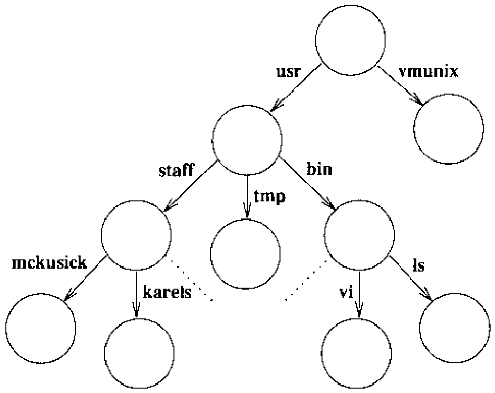

# 2.7 文件系统

普通文件是一个字节线性数组，可以从文件中任何字节开始读写。内核不区分普通文件中的记录边界，虽然许多程序把行进给字符认作行的结尾，另一些程序可能强加别的结构。文件本身不保存任何与系统相关的信息，但文件系统随每个文件存放少量所有权、保护和使用信息。

文件名（filename）成分最长可达 255 个字符。文件名存放在一类称为目录（directory）的文件中。目录中关于一个文件的信息称为一个目录项（directory entry），除文件名外，它还包含指向文件本身的指针。目录项既可以指普通文件，也可以指其他目录。由此形成目录和文件的层次结构，称为文件系统（filesystem）；一个小型文件系统见图 2.2。目录可以包含子目录，目录嵌套的深度没有固有的限制。为保护文件系统的一致性，内核不允许进程直接写入目录。文件系统不仅可以包含普通文件和目录，还可以包含对其他对象（如设备和套接字）的引用。

文件系统形成一棵树，树的起点是根目录（root directory），有时也按其名字称为 slash（斜杠），拼写为单个斜线字符（/）。根目录包含文件——在图 2.2 的例子中，**vmunix** 是内核可执行目标文件的一个副本；也包含目录——本例中是 **usr** 目录。**usr** 目录里面是 **bin** 目录，其中主要存放程序的可执行目标代码，如文件 **ls** 和 **vi**。

进程用路径名（pathname）指定文件：一个由零个或多个以斜线（/）分隔的文件名（filename）成分构成的字符串。内核为每个进程关联两个目录用于解释路径名。进程的根目录是它在文件系统中能访问的最高点，通常设为整个文件系统的根目录。以斜线开头的路径名称为绝对路径名（absolute pathname），内核从进程的根目录开始解释。

不以斜线开头的路径名称为相对路径名（relative pathname），相对进程的当前工作目录（current working directory）解释。（这个目录也叫 current directory 或 working directory，即当前目录、工作目录。）

当前目录本身可以直接用名字 dot（点，即 `.`）指代；文件名 dot-dot（点点，`..`）指目录的父目录。根目录是它自己的父目录。

进程可以用 `chroot` 系统调用设置自己的根目录，用 `chdir` 设置当前目录。任何进程随时都可以执行 `chdir`，但 `chroot` 只允许超级用户使用，通常用于建立对系统的受限访问。

以图 2.2 的文件系统为例：若一个进程以文件系统的根为根目录、以 **/usr** 为当前目录，它引用文件 **vi** 时，既可以从根出发用绝对路径名 **/usr/bin/vi**，也可以从当前目录出发用相对路径名 **bin/vi**。

系统实用程序和数据库存放在一些众所周知的目录里。这个定义良好的层次结构中，有一部分是包含每个用户主目录（home directory）的目录，例如图 2.2 中的 **/usr/staff/mckusick** 和 **/usr/staff/karels**。用户登录时，其 shell 的当前工作目录就设为主目录。在自己的主目录里，用户可以像创建普通文件一样轻松地创建目录，从而可以构建任意复杂的子层次。

用户通常只知道一个文件系统，但系统可能知道这个虚拟文件系统其实由几个物理文件系统组成，各在一个不同的设备上。一个物理文件系统不能跨多个硬件设备。由于多数物理磁盘设备被划分为几个逻辑设备，一个物理设备上可能有多个文件系统，但一个逻辑设备上至多一个。其中一个文件系统——锚定所有绝对路径名的那个——称为根文件系统（root filesystem），它总是可用的。其他文件系统可以挂载（mount），即并入根文件系统的目录层次。对挂载了文件系统的目录的引用，由内核透明地转换为对被挂载文件系统根目录的引用。

新创建的文件获得创建它的进程的用户标识符和创建所在目录的组标识符。为保护文件，系统提供三级访问控制机制。这三级分别规定文件对下列对象的可访问性：

* 文件的属主用户
* 文件的属主组
* 其他所有人

每级访问都各自有读、写、执行三种权限的指示位。

文件创建时长度为零，写入时可以增长。文件打开期间，系统在文件中维护一个指针，指明与描述符相关联的当前位置。这个指针可以在文件中按随机访问方式移动。文件中可以有空洞（hole）。空洞是文件线性范围中从未写入数据的空区。进程把指针定位到当前文件末尾之后再写入，就造出空洞。读取时，空洞被系统当作零值字节。

早期 UNIX 系统的文件名成分限 14 个字符，这个限制常常造成麻烦。例如，除了用户想给文件起长而有描述性的名字这一自然愿望之外，一种常见的命名方式是 **基名.扩展名**：扩展名（表示文件种类，如 C 源码用 **.c**、中间二进制目标文件用 **.o**）占一到三个字符，给基名剩下 10 到 12 个字符。源码控制系统和编辑器通常还要占去另外两个字符作前缀或后缀，基名就只剩 8 到 10 个字符。一个英文单词作基名，10 个或 12 个字符很容易就用完了（如 “multiplexer”）。

守在这些限度之内是可能的，但并不方便，甚至危险，因为别的 UNIX 系统创建文件时接受超长字符串，然后截断到限度。名为 **multiplexer.c** 的 C 语言源文件（已有 13 个字符）可能被源码控制系统加上 **s.** 前缀，得到 **s.multiplexer**——它与 **multiplexer.ms**（存放该 C 程序文档的 troff 源文件）的源码控制文件无从区分。两个原文件的内容很容易被弄混，源码控制系统却不给任何警告。细致的编码可以察觉这个问题，但 4.2BSD 率先引入的长文件名几乎根除了它。
