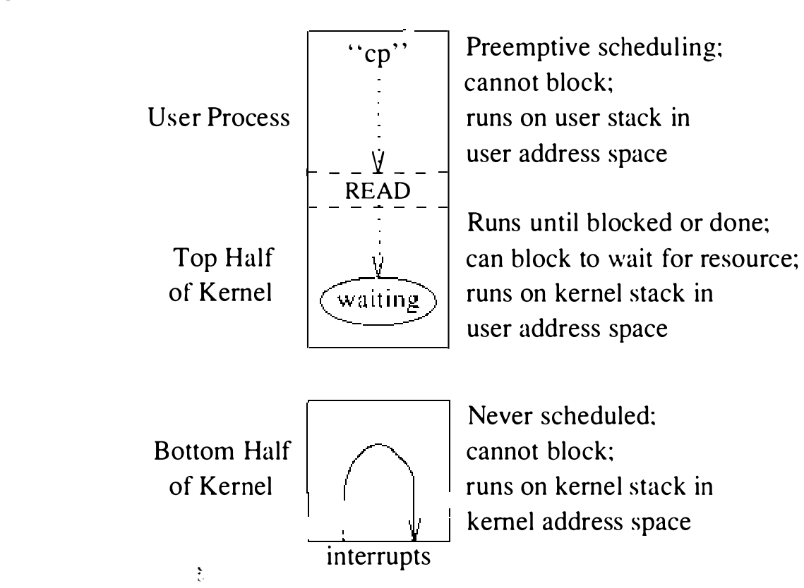

# 3.1 内核结构

UNIX 内核向用户进程提供服务。进程大多通过系统调用直接访问这些服务。其他服务，如进程调度和存储管理，则实现为在内核态执行的 UNIX 进程，或实现为在内核中周期执行的例程。本章描述内核如何向用户进程提供服务，并解释内核正常运行中所做的辅助处理。在此之后，我们将介绍一些基本的内核服务及其实现。

**系统活动**

每次进入内核都称为一次系统活动（system activity）。这些活动可以按引发它们的事件或动作归类：

* 系统调用
* 硬件中断
* 硬件陷阱
* 软件引发的陷阱或中断

系统调用通常是最后一类的特例——发起系统调用的机器指令通常引起一个硬件陷阱，由内核特殊处理。硬件中断来自外部事件，例如需要照应的 I/O 设备。内核依赖实时时钟或间隔计时器的存在来维护当前时刻、驱动进程调度，并启动系统超时函数的执行。硬件中断异步发生，与当前执行进程的上下文很少有关联。硬件陷阱则通常出乎意料，但与当前执行的进程相关。硬件陷阱的例子有算术计算出错（如除以零）引发的那些。最后，软件引发的陷阱或中断被系统用来在合适的时机强制调度一次系统活动。这类事件的一个例子是异步系统陷阱（AST）：系统在内核态执行期间投递它，但要等到重新进入用户态才送达。（AST 用来强制进程重新调度。）

**运行时组织**

内核的运行时结构分为上半部（top half）和下半部（bottom half），如图 3.1 所示。内核上半部响应系统调用或陷阱向应用程序提供服务。这部分软件可以看作一个例程序列，供所有 UNIX 进程共享。内核上半部在特权执行模式下运行，既可访问内核数据结构，也可访问它所支持的用户级进程的上下文。每个进程都有一块预留的内存区域，存放进程访问系统服务时内核要用的每进程信息。这些信息包括一个供内核为该进程执行系统调用时使用的小栈。栈的下方是用户区（user area），存放有关进程状态的长期信息，包括与进程关联的唯一标识符，还记录资源使用的最大值和当前值，以及与进程关联的权利和特权。待决和将来的外部事件也记录在用户区中，连同事件就绪后投递给进程时要采取的动作。最后，用户区记录进程持有的全部描述符。

内核下半部是一组例程，为处理与当前进程无关的硬件中断和陷阱而被调用。中断可以由 I/O 设备或实时时钟等其他硬件设备投递。内核假设中断至少在硬件提供屏蔽手段的程度上是有优先级的。VAX 假定不同种类的中断有各自不同的硬件优先级；4BSD 也能运行在 Perkin Elmer 这样所有中断同优先级的体系结构上，或 ELXSI 这种没有传统意义中断的机器上。

内核下半部的活动异步发生，软件不能指望中断发生时正有某个特定进程在运行。特别是，某些每进程状态可能不可用，而且内核上半部使用的运行时栈不应被下半部的例程改动。内核下半部通常运行在系统范围的中断栈上。

内核执行系统调用的代码期间，绝不会为了运行另一个进程而被抢占。不过它的执行可能被内核下半部的活动中断。它必须显式放弃处理器以等待资源，或者运行到完成。上半部可以通过把处理机优先级设为屏蔽相应中断的值，来阻塞进入内核下半部例程。这一机制用来保证上半部与下半部共享的数据结构的一致性，例如。

进程在共享 CPU 等系统资源方面相互协作。内核上半部在必须等待事件或共享资源的访问权时，可以自愿交出处理器的控制权。内核的上、下两半还协同实现某些系统操作，例如 I/O：典型地，上半部启动一个 I/O 操作，交出处理器，然后等待下半部在 I/O 请求完成时发来通知。

**系统进程**

所有 UNIX 进程都源自内核在启动时手工打造的单一进程。有三个进程预期总是存在。其中两个称为内核进程（kernel process），完全在内核内部运作。内核进程执行编译进内核装入映像的代码，以内核的特权执行模式运行。第三个进程是第一个在用户态执行程序的进程，它充当所有后续进程的父进程。

两个内核进程分别称为交换进程（swapper）和调页守护进程（pagedaemon）。交换进程历史上是 0 号进程，负责在系统资源不足时调度整个进程在主存与辅存之间转移。调页守护进程是 2 号进程，为 Berkeley 版 UNIX 特有，负责把进程地址空间的部分内容写到辅存，以支持虚拟存储系统的调页设施。系统创建的第三个进程是 `init` 进程（1 号进程），它执行管理任务，例如为机器上的每个终端派生登录进程，以及处理系统从多用户到单用户运行的有序停机。`init` 进程的行为由一个独立于内核的程序承载（见 13.4 节）。

**进入内核**

进程通过系统调用、陷阱或中断进入内核时，内核必须先把全部机器状态保存妥当，再去服务该事件。对 VAX 而言，必须保存的机器状态包括 16 个通用寄存器和处理机状态长字。机器状态若不完整保存，内核就会以意想不到的不当方式改变当前执行程序中的值。中断可能发生在任意两条用户级指令之间，而且可能与当前执行的进程毫无关系；状态保存不完整，会让本来正确的程序在神秘的、无法复现的方式下出错——哪怕它根本没做系统调用。

保存进程状态所需的确切事件序列高度依赖机器，不过 VAX 给出了通用过程的一个好例子。陷阱或系统调用发生时，依次发生：

* 硬件切换到内核态，使内存访问检查以内核特权进行，栈指针引用使用内核的栈指针，并且可以执行特权指令。

* 程序计数器和处理机状态长字被压入每进程内核栈。

* 一个指明陷阱类型（或系统调用号）的代码被压栈。

* 一个汇编语言例程保存通用寄存器。

经过这些初步的状态保存，内核便可以调用一个 C 例程，后者可以像任何其他 C 例程一样随意使用机器寄存器，不必担心毁掉不知情进程的状态。主要的处理程序有几类，对应特定种类的内核进入：

* 系统调用对应 `syscall()`
* 陷阱对应 `trap()`
* 设备中断对应相应的设备驱动中断处理程序

处理程序的参数包括用户栈指针、程序计数器和指明陷阱类型的代码。

**从内核返回**

处理程序完成任务后返回。随后一个汇编语言例程恢复寄存器状态，并执行中断返回指令。中断返回指令逆转进入内核的过程：

* 恢复先前压栈的程序计数器和程序状态长字
* 切换到用户态，使此后栈指针的引用使用用户的栈指针，特权指令不得执行，内存访问检查以用户级特权进行

执行在用户进程的下一条指令处恢复。
