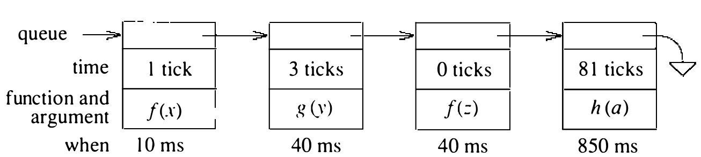

# 3.4 时钟中断

系统由一个按固定间隔中断的时钟驱动。每次中断称为一个时钟节拍（tick）。VAX 上时钟每秒节拍 100 次。这些节拍用来强制上下文切换，使所有进程都能分到 CPU。每个节拍，系统采集此刻正在发生之事的统计信息，可用于记账、监视系统行为，以及确定将来的调度优先级。这些中断还用来驱动系统内部和用户进程中用户进程的计时器。

时钟节拍的中断以高硬件中断优先级投递。保存进程状态后，调用 `hardclock()` 例程。`hardclock()` 必须快点儿干完活，原因有三：

* `hardclock()` 若运行超过 0.01 秒，就会错过下一次中断。

* `hardclock()` 为系统维护时刻，丢失节拍意味着系统会慢慢失准。

* 由于中断优先级高，`hardclock()` 运行期间，系统上几乎所有其他活动都被阻塞。这种阻塞可能让网络控制器丢分组，或让磁盘控制器错过磁盘头下经过扇区的传输。

为了把花在 `hardclock()` 里的时间减到最少，耗时但时间性不那么强的处理交给一个较低优先级的软件中断处理程序 `softclock()`。

`hardclock()` 做的工作如下：

* 给当前运行的进程记一个节拍；进程若累计满四个节拍，就重算它的优先级。若进程设有实时计时器或剖析计时器（见 3.5 节），则递减计时器，到期则投递信号。若当前进程超过了它的 CPU 时间限制，向它投递 SIGXCPU 信号。

* 递增当日时刻时钟。

* 采集节拍时刻系统状态（空闲、用户态执行或系统态执行）的统计信息。

其余与时间相关的处理，涉及处理超时请求和周期性地重排就绪进程的优先级。这些功能由 `softclock()` 例程承担。`hardclock()` 结束时检查有没有 `softclock()` 的函数要做；若有，就安排一个 softclock 中断。作为一种优化，`hardclock()` 会检查处理机状态是否满足“hardclock 中断一返回 softclock 中断就会立即发生”；若满足，`hardclock()` 便显式降低处理机优先级并直接调用 `softclock()`，省去从一个中断返回又立即进入另一个中断的开销。中断的代价高昂，而这些中断每秒发生 100 次，日积月累节省可观。

**超时**

`softclock()` 例程的首要任务是安排周期性事件的执行，例如：

* 网络重传计时器
* 需要持续监视的外设上的看门狗计时器
* 系统调度事件

描述这组事件的数据结构称为 callout 队列。图 3.2 是 callout 队列的一个快照。进程想请求一个将来的事件时，它指定一个要调用的函数、事件发生时要传给该函数的参数，以及事件应发生在未来多少个时钟节拍之后。

队列按事件发生的先后排序：最快发生的事件在最前，最远的在最后。每个事件的时间保存为与前一个队列事件的时间之差。这样，`hardclock()` 例程只需递减队列第一个元素的超时时间，就等于为所有事件递减了时间。`softclock()` 例程从队首摘除时间已递减到零的事件，直到遇见一个时间仍属未来（为正）的事件。事件的登记频率通常远低于每秒 100 次的节拍处理和队列检查。因此，在事件登记时就找准它的插入位置，比每次扫描整个队列判断哪些事件该发生更有效率。

除了要调用的函数还提供参数，是为了让一个函数能被多个进程共用。例如，实时计时器函数可能被几个不同进程使用。有一个单一的函数负责确认计时器到期并向进程发信号。每个开着实时计时器的进程都会为这个函数登记一个超时请求。传给函数的参数是指向请求超时的进程的进程表项的指针，使超时函数能正确投递信号。否则，每个想登记实时超时的进程都得有一个独一的名字。

超时以节拍数规定时，超时处理效率更高。时间更新只需整数递减，到期检查只需与零比较。若计时器存的是时刻值，比较和递减都会更复杂，至少递减不能再按一进行。当必须管理的事件数量变大时，为插入新事件做线性查找的开销会压倒 4.3BSD 所用的简单线性队列。其他可行办法包括：维护一个堆，把最近发生的事件放在堆顶；或为短期、中期、长期事件分别维护队列 [Barkley & Lee, 1988; Varghese & Lauck, 1987]。

**进程调度**

时钟例程负责为进程累计 CPU 时间。此外，它还负责周期性运行调度程序——根据各进程最近的 CPU 使用情况升降它们的 CPU 优先级（见 4.4 节）。重调度计算每秒做一次。调度程序在引导时启动，每次运行时把自己登记到 1 秒之后的超时队列上。

在进程众多的重负载系统上，调度程序可能要很久才能完成工作。它的超时登记在调度任务完成 1 秒之后。这样的系统上，调度的发生频率会低于每秒一次。调度程序不承担任何时间关键的功能（如维护时刻），所以这不成问题。
