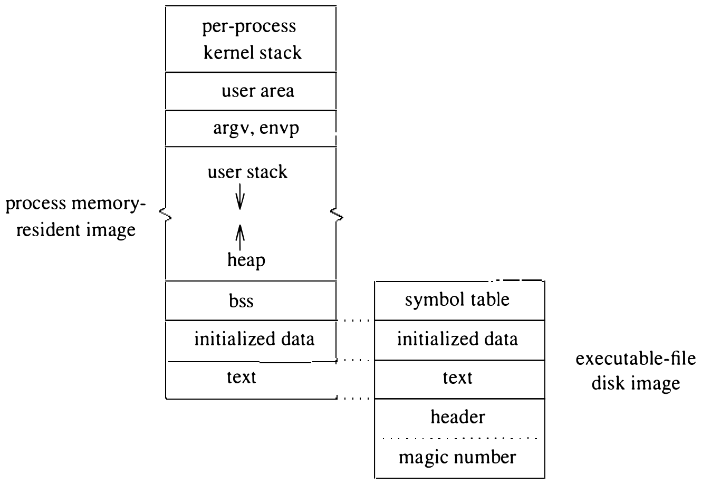

# 3.6 进程管理

UNIX 进程的存储组织与布局见图 3.3。每个进程以三个内存段开始执行，分别称为正文段、数据段和栈段。数据段又分为已初始化数据和未初始化数据（bss）。正文只读且可共享，数据区和栈区则为进程私有。

进程的正文和已初始化数据取自进程执行时指定的文件。可执行文件的特征是：它是普通文件（不是目录、特殊文件或符号链接），而且一个或多个执行位已置位。文件的头几个字节（VAX 上是前四个字节）含有一个魔数（magic number），指明这是哪一类可执行文件。可执行文件分两大类：

1. 直接可执行的文件
2. 必须由解释程序执行的文件

解释执行的文件，魔数是两字符序列 **#!** 后跟一个字符串，指明要使用的解释程序的路径名。例如 **#!/bin/sh** 可以指 Bourne shell。内核执行指定的程序，并把待解释的文件名作为参数传给它。为防止循环，只允许一层解释：文件的解释程序本身不得再被解释。

其余文件直接执行。这类文件的魔数指明它能否调页、其正文部分能否在多个进程间共享。魔数之后是 exec 头部，给出正文、已初始化数据、未初始化数据的大小，以及一些供调试用的附加信息。头部之后是正文映像，再后是已初始化数据的映像。可执行文件不含未初始化数据，因为它们可以用零填充内存创建。调试信息不被内核和执行中的程序使用。

开始执行时，内核把文件的正文部分映射到进程地址空间的低端，文件的已初始化数据部分映射到正文之后。已初始化数据区之后，用零填充内存划出一块与未初始化数据区等大的区域。栈也从零填充内存创建。虽然栈本不必零填充，早期 UNIX 系统却是这么做的。为了省一点启动时间，内核曾改成跳过栈的零填充，留下页里原先的随机内容。结果大量程序罢工——它们依赖 `main` 过程的局部变量被初始化为零。于是栈的零填充又改了回来。

把一个大程序的正文和已初始化数据整体复制进内存会造成很长的启动延迟。我们不预装入，而是把程序请求调页进内存，以此避免启动耗时。请求调页下，程序按需分小块（页）装入，而不是在开始执行前一次装入。系统把地址空间划分为等大的页来实施请求调页。对每一页，内核记录相应数据在可执行文件中的偏移。首次访问到某页上的地址会引起一次缺页陷阱进入内核，缺页处理程序把可执行文件中正确的页读进进程内存。这样，内核只装入可执行文件中真正用到的部分。调页的细节在第 5 章解释。

未初始化数据区可以通过系统调用 `sbrk` 用零填充页扩展，尽管多数用户进程为此使用库例程 `malloc()`（`malloc()` 调用 `sbrk`）。这块从原数据段顶端开始新分配的内存称为堆（heap）。VAX 上栈从内存顶端向下生长，堆从内存底端向上生长。

用户栈之上有一块系统在进程启动时创建的内存。紧贴用户栈之上是程序执行时设置好的进程环境向量（`envp`）和参数向量（`argv`）。用户内存顶端是用户区（**u.**）和每进程内核栈。4.3BSD 中，用户地址空间还含有进程的用户态执行状态：每次进入内核时保存，每次退出时恢复。用户区出现在用户地址空间顶端，是因为它用于 VAX 上信号处理的实现；4BSD 移植到其他硬件上未必如此。

除了用户区中维护的信息，进程还需要一些全局系统资源。内核维护一张进程表（process table），系统中创建的每个进程各占一项。进程表除其他内容外，记录调度信息和虚拟内存分配信息。由于进程的整个地址空间（包括用户区）都可能被换出主存，进程表必须记录足够的信息，以便找到用户区并把它调回内存。调度信息放在进程表而不是用户区，是为了免得把进程换进来才发现它的优先级不够高不能运行。类似地，进程想忽略的事件的信息也存在进程表里。

与进程相关的其他全局资源包括：记录描述符信息的表项、记录物理内存使用情况的页表，以及协调共享正文的正文表中的空间。

**图 3.3 UNIX 进程在内存和磁盘上的布局**
